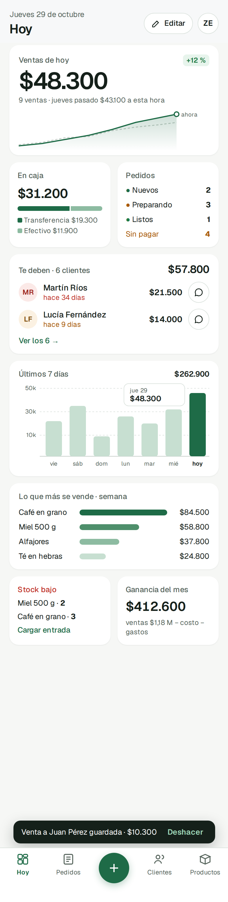
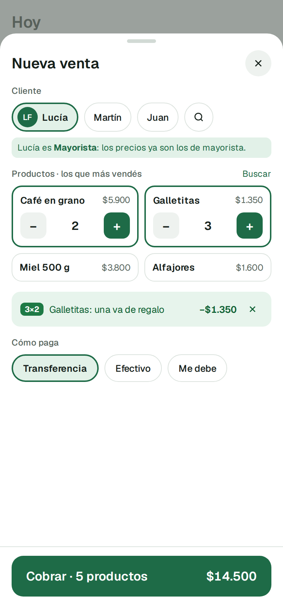
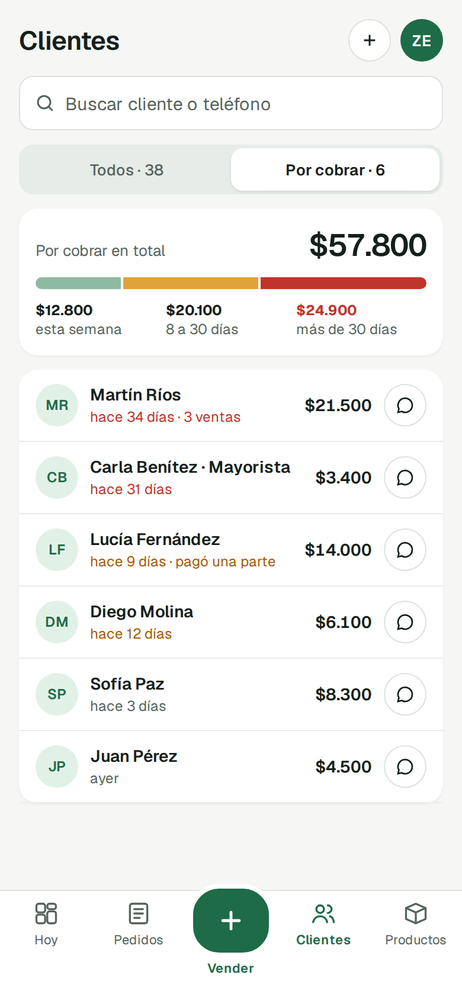
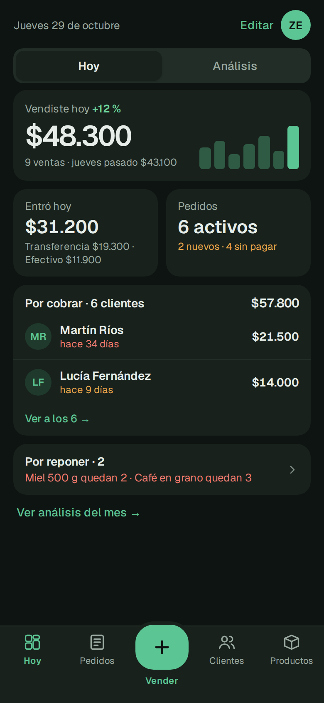
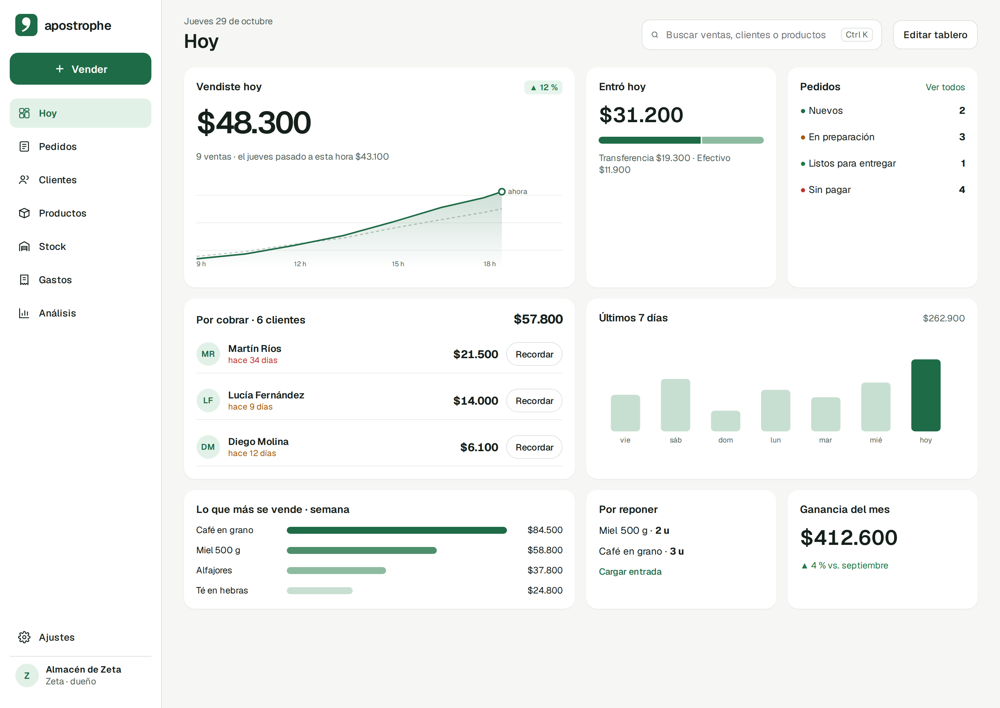
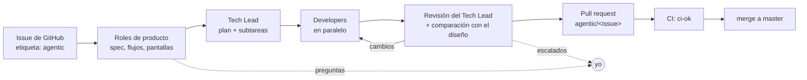
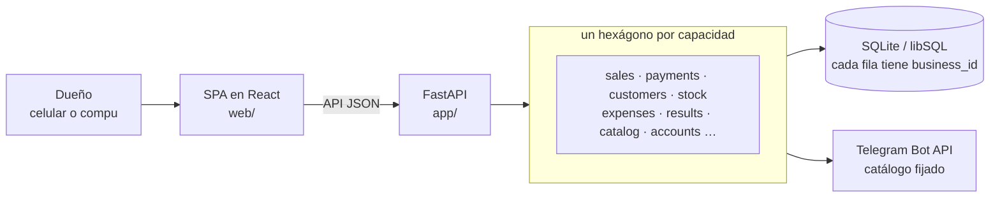

# apostrophe

[English](README.md) · **Español**

[](https://github.com/GonzaloZevallos/apostrophe/actions/workflows/ci.yml)
[](LICENSE)


[](https://github.com/GonzaloZevallos/agentic-system)

Un back office para negocios chicos, pensado primero para el celular: ventas, stock, quién
te debe qué, gastos y resultados. La mayor parte del código no la escribo yo. La escribe mi
sistema multi-agente, [agentic-system](https://github.com/GonzaloZevallos/agentic-system):
toma un issue de GitHub y lo convierte en un pull request revisado y con tests.

<table>
  <tr>
    <td></td>
    <td></td>
    <td></td>
    <td></td>
  </tr>
  <tr>
    <td colspan="4"></td>
  </tr>
</table>

<sub>Son las pantallas del rediseño aprobado (celular a 390 px, compu a 1440 px, claro y
oscuro), con datos de ejemplo. El sistema las está construyendo ahora, en la épica
[#494](https://github.com/GonzaloZevallos/apostrophe/issues/494). Ojo: la app de hoy está
en inglés y todavía no se ve así. El español como segundo idioma es el
[#317](https://github.com/GonzaloZevallos/apostrophe/issues/317).</sub>

## Por qué existe

Arrancó con el negocio chico de un amigo. Vende productos por unidad y por peso a unas
decenas de clientes fijos, que le piden por Telegram o WhatsApp. Llevaba todo en una
planilla, y se rompía justo donde se pierde plata:

- Saldar una deuda la pisaba. No quedaba fecha de pago ni había pagos parciales.
- El cliente era texto libre, así que una persona terminaba siendo dos deudores.
- Un pedido con dos productos eran dos filas.
- La ganancia se caía a cero la semana que reponía mercadería.

apostrophe reemplaza esa planilla. Con una sola instalación andan varios negocios, y sus datos
nunca se mezclan. Lo armo para el dueño del negocio, con el celular en la mano, entre pedido y
pedido. En la compu también anda, pero cuando hay que elegir, gana el celular.

## Qué hace

Lo que ya está:

- **Ventas.** Cargás un pedido en pocos toques: productos, cantidades, cliente y cómo
  pagó. Cada línea toma el precio del día y se lo guarda, así un cambio de precio después
  nunca reescribe lo que cobraste.
- **Deudas y pagos.** Pagos parciales o totales, en el momento o semanas después, con los
  medios de pago que tu negocio acepta de verdad. Cada cliente tiene su saldo y desde
  cuándo debe.
- **Clientes.** Se identifican por teléfono dentro de cada negocio, y los encontrás por
  nombre o por número.
- **Stock.** Compras, producción propia y conteos por producto, con su costo, y un aviso antes de
  que algo se termine.
- **Gastos y resultados.** Ventas, costo, gastos, ganancia y la plata que realmente se
  movió, del día, la semana o el mes, uno al lado del otro. Una pantalla de análisis te
  muestra qué te deja plata a lo largo del tiempo.
- **Precios.** Historial de precios por producto, y reglas opcionales como precio por
  cantidad o precio VIP.
- **Catálogo.** La lista de precios armada con los precios y el stock de hoy, lista para
  compartir. Cada negocio puede tener su propio bot de Telegram que deja el catálogo fijado
  en su chat y lo mantiene al día, después de mandarte una copia de prueba.
- **Negocios aislados.** Se entra solo por invitación. Ningún usuario, link ni error deja
  ver datos de otro negocio, ni siquiera que existe. Los tests lo controlan en cada ruta.
- **No asume nada del negocio.** Unidades, símbolo de moneda, decimales y medios de pago
  son configuración con valores neutros. No hay un rubro metido a mano en el código.
- **Primeros pasos e importación.** Una configuración inicial guiada y corta, y una
  importación única desde la planilla vieja.
- **Claro y oscuro**, según lo que tengas en el celular.

Lo que viene (issues abiertos): el rediseño de arriba ([#494](https://github.com/GonzaloZevallos/apostrophe/issues/494)),
estados de pedido ([#326](https://github.com/GonzaloZevallos/apostrophe/issues/326)),
promociones ([#411](https://github.com/GonzaloZevallos/apostrophe/issues/411)),
un análisis armable sobre un módulo de reportes ([#321](https://github.com/GonzaloZevallos/apostrophe/issues/321)),
clientes que piden desde una Mini App de Telegram ([#325](https://github.com/GonzaloZevallos/apostrophe/issues/325)),
el español ([#317](https://github.com/GonzaloZevallos/apostrophe/issues/317)) y subirla a
internet ([#12](https://github.com/GonzaloZevallos/apostrophe/issues/12)).

Queda afuera a propósito: roles dentro de un negocio, pagos con tarjeta, facturas e impuestos.

## Lo construyen agentes

Este repo es el segundo producto de [agentic-system](https://github.com/GonzaloZevallos/agentic-system),
un sistema de desarrollo que estoy armando sobre LangGraph y el Claude Agent SDK. Así entra un cambio:

1. Cada capacidad arranca como un issue de GitHub con la etiqueta `agentic`. Lo escribo
   yo, o lo propone el rol de PM del sistema.
2. El sistema lo toma. Los roles de producto escriben la spec (jobs, casos borde,
   pantallas), un Tech Lead la parte en subtareas, los Developers las implementan en
   paralelo y el Tech Lead revisa cada una contra la spec y los estándares del repo. Si toca
   UI, las pantallas construidas se capturan al lado del diseño y se comparan.
3. Abre un pull request desde una rama `agentic/<issue>`. Antes del merge, el CI tiene que
   estar en verde sobre el head revisado.
4. Yo entro para las decisiones de producto y los escalados. Las reglas que voy fijando
   quedan escritas como decisiones del dueño, y el sistema las aplica la próxima vez.



Los números, al **19 de noviembre de 2026** (el primer commit es del 2 de octubre):

| | |
|---|---|
| Pull requests mergeados | **344**, de los cuales **329** (96 %) salieron de ramas `agentic/*` |
| Issues cerrados como completados | **361**, de los cuales **358** tienen la etiqueta `agentic` |
| Commits en `master` | **4.137**, de los cuales **3.674** (89 %) son de `agentic-system` |
| Decisiones de arquitectura (ADR) | **94** en [`docs/adr/`](docs/adr/) |
| Tests | **7.354** de pytest, **3.914** de Vitest, **52** archivos de specs de Playwright |

<sub>Cómo los conté: los PRs mergeados con `gh api repos/GonzaloZevallos/apostrophe/pulls?state=closed`
(filtrando por `merged_at` y por la rama); los issues con `gh api …/issues?state=closed`
(sin los PRs, con `state_reason == completed`); los commits con `git log origin/master --format=%an`;
los tests con `pytest --collect-only`, `vitest list` y los archivos de `web/e2e/`.</sub>

Lo difícil, y donde puse la mayor parte del trabajo en el sistema: que los agentes no se
salgan de la spec, que la revisión encuentre problemas reales y con evidencia, que los
tests corran rápido para no ser el cuello de botella, y que la UI no se aleje del diseño
aprobado.

## Stack y arquitectura

- **Backend:** Python 3.13, FastAPI, SQLAlchemy 2, Alembic, Pydantic. SQLite en local.
  Para el hosting, el plan es libSQL (Turso).
- **Frontend:** React 19, Vite, TanStack Query, React Router, i18next. Primero el celular.
- **Forma:** un hexágono por capacidad en `app/` (`domain`, `application`, `adapters`), con
  las reglas de imports controladas por los tests de `tests/architecture/`.



Más en [docs/architecture/](docs/architecture/README.md).

## La vara de calidad

Todo esto corre en el CI en cada pull request, y un solo job, `ci-ok`, habilita el merge:

- `ruff` y `mypy` estricto en el backend; typecheck y lint en el frontend. No se silencia
  nada: el sistema rechaza cualquier edición que agregue `# type: ignore`, `noqa` o
  `@ts-ignore`.
- pytest, Vitest y tests end-to-end con Playwright contra el backend real, con coverage.
- Antes de sumar una ruta o una tabla, conocé estos:
  - `tests/test_gated_routes.py`: toda ruta responde 401 sin sesión.
  - `tests/test_business_isolation.py`: ninguna ruta llega a los registros de otro negocio.
  - `tests/migrations/test_business_ownership.py`: toda tabla tiene `business_id`.
  - `tests/architecture/`: las reglas de imports del hexágono.
  - `tests/migrations/test_schema.py`: las migraciones arman exactamente las tablas declaradas.
- Controles de documentación: los docs de arquitectura y la referencia de la API se
  generan, se chequean los links, y cada página queda a dos clics de
  [docs/README.md](docs/README.md).
- Fidelidad al diseño: el [design capture](docs/product/design-capture.md) saca el archivo de
  diseño y la app construida lado a lado, pantalla por pantalla.

## Correrlo en local

Necesitás [uv](https://docs.astral.sh/uv/) 0.12 y Node 24.

```sh
cp .env.example .env          # después poné APOSTROPHE_SECRET_KEY
uv venv --python 3.13
uv sync --locked --extra dev
npm --prefix web ci
npm --prefix web run build    # el front, que sirve el backend desde web/dist
scripts/serve.sh              # http://localhost:8000
scripts/invite-business.sh    # imprime un link de un solo uso para abrir el primer negocio
```

La guía completa (entrar desde el celular, correr todos los controles, cambiar el esquema)
está en [docs/development.md](docs/development.md), en inglés.

Todavía no está en internet ([#12](https://github.com/GonzaloZevallos/apostrophe/issues/12)).
El hosting que tengo planeado (Render, Turso, UptimeRobot y una copia diaria cifrada) está
en [deploy/README.md](deploy/README.md).

## Documentación

- [BRIEF.md](BRIEF.md): qué es y para quién.
- [CONTEXT.md](CONTEXT.md): el lenguaje del dominio, obligatorio en el código y en los issues.
- [CODING_STANDARDS.md](CODING_STANDARDS.md), [DESIGN_STANDARDS.md](DESIGN_STANDARDS.md),
  [WRITING_STANDARDS.md](WRITING_STANDARDS.md).
- [docs/README.md](docs/README.md): cómo se comporta cada capacidad (`docs/product/`), la
  arquitectura y los ADR.

## Sobre mí

Soy Gonzalo Zevallos ([@GonzaloZevallos](https://github.com/GonzaloZevallos)). Diseño y
construyo sistemas de desarrollo agénticos y los uso para sacar productos reales, como
este. Estoy abierto a roles de IA / ingeniería agéntica.

## Licencia

[MIT](LICENSE)
