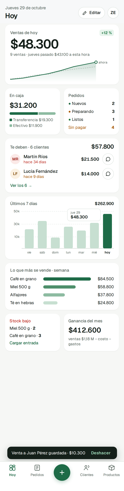
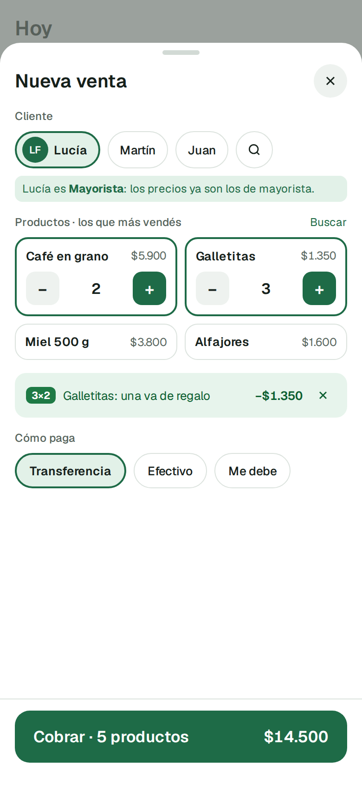
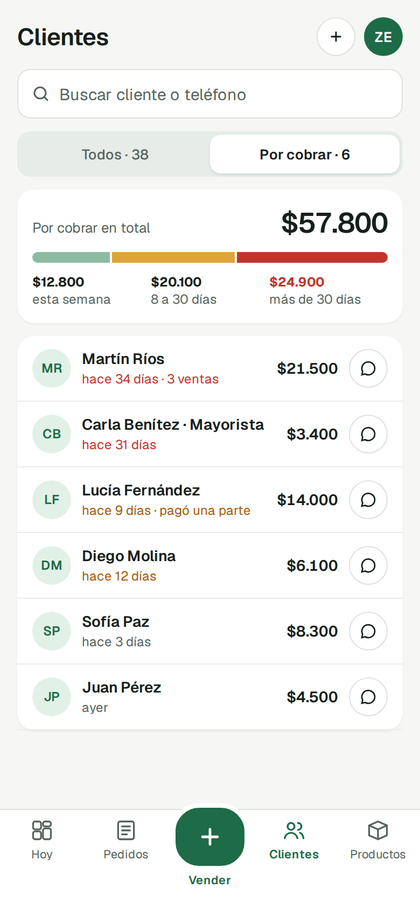
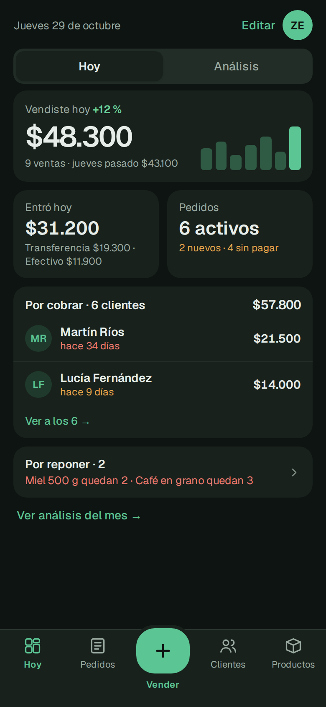
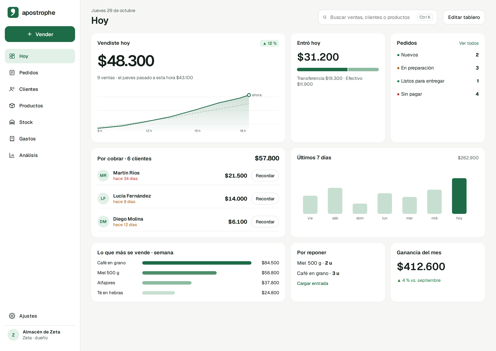
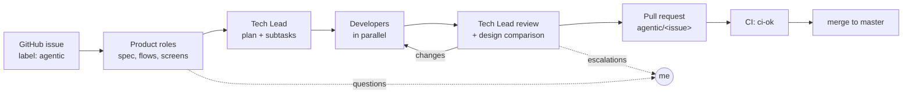
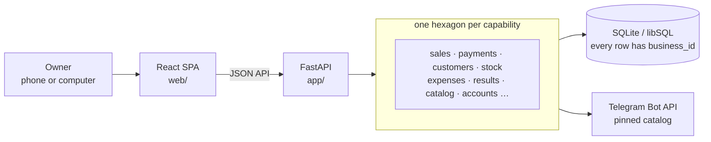

# apostrophe

**English** · [Español](README.es.md)

[](https://github.com/GonzaloZevallos/apostrophe/actions/workflows/ci.yml)
[](LICENSE)


[](https://github.com/GonzaloZevallos/agentic-system)

A phone-first back office for small businesses: sales, stock, who owes you what, expenses
and results. I don't write most of its code. My multi-agent system,
[agentic-system](https://github.com/GonzaloZevallos/agentic-system), does: it takes a GitHub
issue and turns it into a reviewed, tested pull request.

<table>
  <tr>
    <td></td>
    <td></td>
    <td></td>
    <td></td>
  </tr>
  <tr>
    <td colspan="4"></td>
  </tr>
</table>

<sub>These are the approved redesign screens (phone at 390 px, computer at 1440 px, light
and dark), drawn in Spanish with example data. The system is building them now, in epic
[#494](https://github.com/GonzaloZevallos/apostrophe/issues/494). Heads up: the app today
is in English and doesn't look like this yet. Spanish as a second language is
[#317](https://github.com/GonzaloZevallos/apostrophe/issues/317).</sub>

## Why it exists

It started with a friend's small shop. It sells products by unit and by weight to a few
dozen regular customers, who order over Telegram or WhatsApp. Everything lived in a
spreadsheet, and it broke right where it costs money:

- Settling a debt overwrote it. No payment date, no partial payments.
- A customer was free text, so one person turned into two debtors.
- An order with two products was two rows.
- Profit dropped to zero the week new stock came in.

apostrophe replaces that spreadsheet. One install runs several businesses and their data
never mixes. I build it for the owner, on the phone, between orders. It works on a computer
too, but when there's a trade-off, the phone wins.

## What it does

Shipped:

- **Sales.** Record an order in a few taps: products, quantities, customer, how they paid.
  Each line is priced from that day's prices and keeps that price, so a later change never
  rewrites what you charged.
- **Money owed and payments.** Partial or full payments, on the day or weeks later, with
  the payment methods the business actually takes. Each customer has a balance and an
  "owing since" date.
- **Customers.** Identified by phone number within the business, found by name or number.
- **Stock.** Purchases, own production and counts per product, with cost, and a warning before
  something runs out.
- **Expenses and results.** Sales, cost, expenses, profit and actual cash for a day, a
  week or a month, side by side. An analysis screen shows what makes money over time.
- **Pricing.** Price history per product, plus optional rules like bulk and VIP prices.
- **Catalog.** A price list built from today's prices and stock, ready to share. Each
  business can have its own Telegram bot that keeps the catalog pinned in its chat, after
  a test send to the owner.
- **Multi-business isolation.** Sign-in by invitation only. No user, link or error reveals
  another business's data, or even that it exists. Tests check this on every route.
- **No assumptions about the business.** Units, currency symbol, decimals and payment
  methods are settings with neutral defaults. No hard-coded business type.
- **Onboarding and import.** A short guided setup, and a one-time import from the old
  spreadsheet.
- **Light and dark**, following the phone's setting.

Planned (open issues): the full redesign above ([#494](https://github.com/GonzaloZevallos/apostrophe/issues/494)),
order states ([#326](https://github.com/GonzaloZevallos/apostrophe/issues/326)),
promotions ([#411](https://github.com/GonzaloZevallos/apostrophe/issues/411)),
a customizable analysis on a reports module ([#321](https://github.com/GonzaloZevallos/apostrophe/issues/321)),
customers ordering from a Telegram Mini App ([#325](https://github.com/GonzaloZevallos/apostrophe/issues/325)),
Spanish ([#317](https://github.com/GonzaloZevallos/apostrophe/issues/317)) and putting it
online ([#12](https://github.com/GonzaloZevallos/apostrophe/issues/12)).

Left out on purpose: roles inside a business, card payments, invoices and taxes.


## Built by agents

This repo is the second product of [agentic-system](https://github.com/GonzaloZevallos/agentic-system),
a development system I'm building on LangGraph and the Claude Agent SDK. How a change gets in:

1. A capability starts as a GitHub issue labelled `agentic`. I write it, or the system's
   PM role proposes it.
2. The system picks it up. Product roles write the spec (jobs, edge cases, screens), a
   Tech Lead splits it into subtasks, Developers implement them in parallel, and the Tech
   Lead reviews each one against the spec and the repo's standards. When it touches UI, the
   built screens are captured next to the design and compared.
3. It opens a pull request from an `agentic/<issue>` branch. CI has to be green on the
   reviewed head before it merges.
4. I step in for product decisions and escalations. The rules I set along the way are
   written down as owner's decisions, so the system applies them next time.



The numbers, as of **2026-11-19** (first commit 2026-10-02):

| | |
|---|---|
| Pull requests merged | **344**, of which **329** (96%) came from `agentic/*` branches |
| Issues closed as completed | **361**, of which **358** carry the `agentic` label |
| Commits on `master` | **4,137**, of which **3,674** (89%) are authored by `agentic-system` |
| Architecture decision records | **94** in [`docs/adr/`](docs/adr/) |
| Tests | **7,354** pytest, **3,914** Vitest, **52** Playwright spec files |

<sub>How they were counted: merged PRs from `gh api repos/GonzaloZevallos/apostrophe/pulls?state=closed`
(filtered by `merged_at` and head branch); issues from `gh api …/issues?state=closed`
(excluding PRs, `state_reason == completed`); commits with `git log origin/master --format=%an`;
tests with `pytest --collect-only`, `vitest list` and the files in `web/e2e/`.</sub>

The hard part, and where most of my work on the system went: keeping the agents on the
spec, getting review to find real problems with evidence, keeping the tests fast enough that
they aren't the bottleneck, and keeping the UI on the approved design.

## Stack and architecture

- **Backend:** Python 3.13, FastAPI, SQLAlchemy 2, Alembic, Pydantic. SQLite locally.
  libSQL (Turso) is the plan for hosting.
- **Frontend:** React 19, Vite, TanStack Query, React Router, i18next. Phone first.
- **Shape:** one hexagon per capability under `app/` (`domain`, `application`, `adapters`),
  with the import rules enforced by tests in `tests/architecture/`.



More in [docs/architecture/](docs/architecture/README.md) (Spanish).

## Quality bar

CI runs all of this on every pull request, and one job, `ci-ok`, gates the merge:

- `ruff` and strict `mypy` on the backend, typecheck and lint on the frontend. Nothing is
  silenced: the system refuses edits that add `# type: ignore`, `noqa` or `@ts-ignore`.
- pytest, Vitest and Playwright end-to-end tests against the real backend, with coverage.
- Know these before adding a route or a table:
  - `tests/test_gated_routes.py`: every route answers 401 without a session.
  - `tests/test_business_isolation.py`: no route reaches another business's records.
  - `tests/migrations/test_business_ownership.py`: every table carries `business_id`.
  - `tests/architecture/`: the hexagon import rules.
  - `tests/migrations/test_schema.py`: the migrations build exactly the declared tables.
- Docs checks: generated architecture docs and API reference, link checks, and every doc
  page within two clicks of [docs/README.md](docs/README.md).
- Design fidelity: [design capture](docs/product/design-capture.md) shoots the design file
  and the built app side by side for each registered screen.

## Run it locally

Needs [uv](https://docs.astral.sh/uv/) 0.12 and Node 24.

```sh
cp .env.example .env          # then set APOSTROPHE_SECRET_KEY
uv venv --python 3.13
uv sync --locked --extra dev
npm --prefix web ci
npm --prefix web run build    # the front, served by the backend from web/dist
scripts/serve.sh              # http://localhost:8000
scripts/invite-business.sh    # prints a one-time link to open the first business
```

The full guide (reaching it from a phone, running every check, changing the schema) is in
[docs/development.md](docs/development.md).

It isn't online yet ([#12](https://github.com/GonzaloZevallos/apostrophe/issues/12)). The
planned hosting (Render, Turso, UptimeRobot and an encrypted daily backup) is written up in
[deploy/README.md](deploy/README.md).

## Docs

- [BRIEF.md](BRIEF.md): what it is and who it's for.
- [CONTEXT.md](CONTEXT.md): the domain language, mandatory in code and issues.
- [CODING_STANDARDS.md](CODING_STANDARDS.md), [DESIGN_STANDARDS.md](DESIGN_STANDARDS.md),
  [WRITING_STANDARDS.md](WRITING_STANDARDS.md).
- [docs/README.md](docs/README.md): how each capability behaves (`docs/product/`), the
  architecture and the ADRs. Most of it is in Spanish.

## About me

I'm Gonzalo Zevallos ([@GonzaloZevallos](https://github.com/GonzaloZevallos)). I design and
build agentic development systems and use them to ship real products, like this one. I'm
open to AI / agentic engineering roles.

## License

[MIT](LICENSE)
