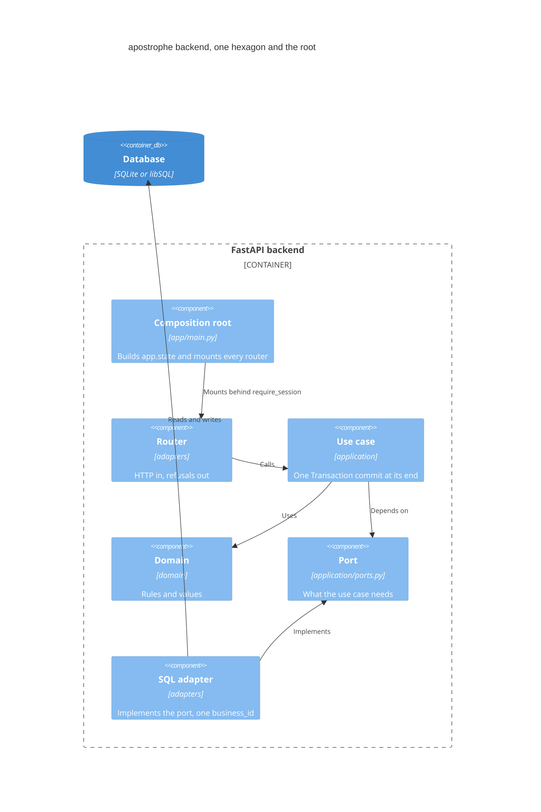

# Componentes

Dentro del backend, cada capacidad es un hexágono bajo `app/<capacidad>/` con tres capas: `domain/` (reglas, sin infraestructura), `application/` (casos de uso y los puertos que necesitan) y `adapters/` (rutas HTTP y SQL). Contenedor que los aloja: [contenedores.md](contenedores.md).

## Vista de componentes

## Las reglas

- Un caso de uso que escribe confirma una sola vez, al final, a través del puerto [app/shared/transaction.py](../../app/shared/transaction.py) `Transaction`; los repositorios escriben pero nunca confirman.
- El `domain/` y el `application/` de una capacidad nunca importan otra capacidad: cada una declara en su propio `application/ports.py` lo que necesita de las demás, y [tests/architecture/hexagon.py](../../tests/architecture/hexagon.py) lo define y [tests/architecture/test_architecture.py](../../tests/architecture/test_architecture.py) lo hace cumplir. Los adaptadores sí importan, por ejemplo, las tablas de otras capacidades. [app/main.py](../../app/main.py) `create_app` une los puertos dejando en `app.state` una fábrica por cada uno (la mayoría recibe la sesión y el id del Business; algunas también el día de hoy) o, en algunos casos, una instancia. El motivo está en [docs/adr/0006-capabilities-meet-through-ports.md](../adr/0006-capabilities-meet-through-ports.md).
- Las respuestas de rechazo llevan un código que el front traduce: [app/http_errors.py](../../app/http_errors.py) `Refused` y `TranslateErrors` ([docs/adr/0008-refusals-carry-a-code-the-front-maps.md](../adr/0008-refusals-carry-a-code-the-front-maps.md)).

## Hexágonos y sus puertos

El diagrama de clases de cada capacidad lo genera [scripts/docs/generate.py](../../scripts/docs/generate.py) en [generated/](generated/README.md); cada uno dibuja solo su propio paquete. El de la raíz de la app está en [app-root.md](generated/app-root.md).

| Capacidad | Puertos (clases de `application/ports.py`) | Diagrama de clases |
| --- | --- | --- |
| accounts | [accounts](../../app/accounts/application/ports.py) `Accounts` `BusinessOpening` | [accounts](generated/classes/accounts.md) |
| business_removal | sin `ports.py`: sus contratos están en [schema_rows](../../app/business_removal/application/schema_rows.py) | [business_removal](generated/classes/business_removal.md) |
| catalog | [catalog](../../app/catalog/application/ports.py) `CatalogVarieties` `CatalogStock` | [catalog](generated/classes/catalog.md) |
| customers | [customers](../../app/customers/application/ports.py) `Customers` `Balances` | [customers](generated/classes/customers.md) |
| expenses | [expenses](../../app/expenses/application/ports.py) `Expenses` `ExpenseCategories` | [expenses](generated/classes/expenses.md) |
| onboarding | [onboarding](../../app/onboarding/application/ports.py) `Onboardings` `VarietyFacts` `StockFacts` | [onboarding](generated/classes/onboarding.md) |
| payments | [payments](../../app/payments/application/ports.py) `Payments` `Ledgers` | [payments](generated/classes/payments.md) |
| pinned_catalog | [pinned_catalog](../../app/pinned_catalog/application/ports.py) `TelegramApi` `PinSnapshots` `PinRecorder` | [pinned_catalog](generated/classes/pinned_catalog.md) |
| pricing_settings | [pricing_settings](../../app/pricing_settings/application/ports.py) `PricingSettingsStore` | [pricing_settings](generated/classes/pricing_settings.md) |
| products | [products](../../app/products/application/ports.py) `Products` `ProductLeaving` | [products](generated/classes/products.md) |
| results | [results](../../app/results/application/ports.py) `StockFigures` `SalesLedger` `DebtSummary` | [results](generated/classes/results.md) |
| sales | [sales](../../app/sales/application/ports.py) `Sales` `PriceBook` `CustomerFacts` | [sales](generated/classes/sales.md) |
| spreadsheet_import | [spreadsheet_import](../../app/spreadsheet_import/application/ports.py) `VarietiesImport` `SalesImport` | [spreadsheet_import](generated/classes/spreadsheet_import.md) |
| stock | [stock](../../app/stock/application/ports.py) `StockEntries` `Withdrawals` `VarietyCatalog` | [stock](generated/classes/stock.md) |
| shared | sin puertos de negocio: [transaction.py](../../app/shared/transaction.py) `Transaction` | [shared](generated/classes/shared.md) |

Un ejemplo de punta a punta, con las llamadas en orden, está en [flujos-clave.md](flujos-clave.md).
