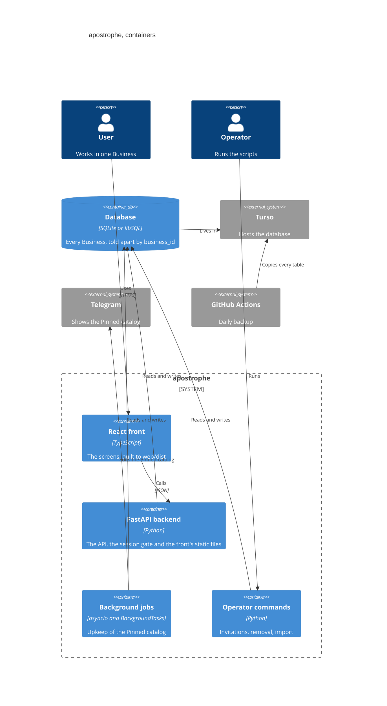

# Contenedores

De qué procesos y almacenes se compone apostrophe. Contexto general: [contexto.md](contexto.md); lo que hay dentro del backend: [componentes.md](componentes.md).

## Vista de contenedores

## Cada contenedor

- **Backend FastAPI**: [app/main.py](../../app/main.py) `create_app` arma la app, hace colgar de `app.state` el motor, el reloj y las fábricas de puertos, y monta cada router detrás de la compuerta de sesión [app/accounts/adapters/deps.py](../../app/accounts/adapters/deps.py) `require_session`. Al arrancar, [app/main.py](../../app/main.py) `lifespan` migra el esquema con [app/migrations/runner.py](../../app/migrations/runner.py) `upgrade_to_head`. Se arranca con [scripts/serve.sh](../../scripts/serve.sh), el único lugar donde se inicia uvicorn.
- **Front React**: el código está en [web/](../../web/); `npm run build` lo deja en `web/dist` (lo hace el comando de build de [render.yaml](../../render.yaml)). El mismo backend lo sirve: [app/static_spa.py](../../app/static_spa.py) `SpaStatic` responde los archivos y [app/static_spa.py](../../app/static_spa.py) `FrontNavigation` deja que una navegación del navegador llegue al front antes que al router de la API ([docs/adr/0024-a-front-path-may-share-its-first-segment-with-the-api-only-through-an-exact-allowlist-served-to-browser-navigations.md](../adr/0024-a-front-path-may-share-its-first-segment-with-the-api-only-through-an-exact-allowlist-served-to-browser-navigations.md) lo explica). Los módulos del front y sus dependencias están en el [diagrama generado](generated/front-modules/overview.md); su cliente HTTP es [web/src/api/client.ts](../../web/src/api/client.ts).
- **Base de datos**: [app/db.py](../../app/db.py) `make_engine` crea el motor y `get_session` entrega una sesión por pedido; las tablas se declaran sobre [app/db.py](../../app/db.py) `Base`. En producción es Turso por libSQL; en desarrollo y en los tests, un archivo SQLite o uno en memoria. El esquema se ve en el [diagrama ER generado](generated/data-model.md).
- **Trabajos en segundo plano**, dos, ambos dentro del proceso del backend y ambos sobre el Pinned catalog:
  - el **ticker de cambio de día**: [app/pinned_catalog/adapters/ticker.py](../../app/pinned_catalog/adapters/ticker.py) `run_ticker`, que arranca [app/main.py](../../app/main.py) `lifespan` como tarea de asyncio solo si `upkeep_ticker` es verdadero;
  - el **upkeep posterior al commit**: [app/pinned_catalog/adapters/upkeep_trigger.py](../../app/pinned_catalog/adapters/upkeep_trigger.py) `schedule_upkeep` agrega una tarea de fondo en las escrituras de productos, ventas, stock y catálogo; la tarea es [app/pinned_catalog/adapters/safe_upkeep.py](../../app/pinned_catalog/adapters/safe_upkeep.py) `run_upkeep_safely`.

  [scripts/serve.sh](../../scripts/serve.sh) arranca sin `--workers` justamente porque el candado por Business de ese trabajo vive en la memoria de un solo proceso.
- **Comandos del Operator**: [app/accounts/adapters/cli.py](../../app/accounts/adapters/cli.py) `main` (invitaciones y links de restablecimiento), [app/business_removal/adapters/cli.py](../../app/business_removal/adapters/cli.py) `main` (baja de un Business) y los envoltorios [scripts/invite-business.sh](../../scripts/invite-business.sh), [scripts/reset-password.sh](../../scripts/reset-password.sh), [scripts/remove-business.sh](../../scripts/remove-business.sh) e [scripts/import-spreadsheet.sh](../../scripts/import-spreadsheet.sh).
- **Backup**: no es parte del proceso de la app sino un workflow: [.github/workflows/backup.yml](../../.github/workflows/backup.yml), con [scripts/backup_copy.py](../../scripts/backup_copy.py) `copy_tables` y el ensayo de restauración [scripts/drill.py](../../scripts/drill.py) `restore_and_check`.
