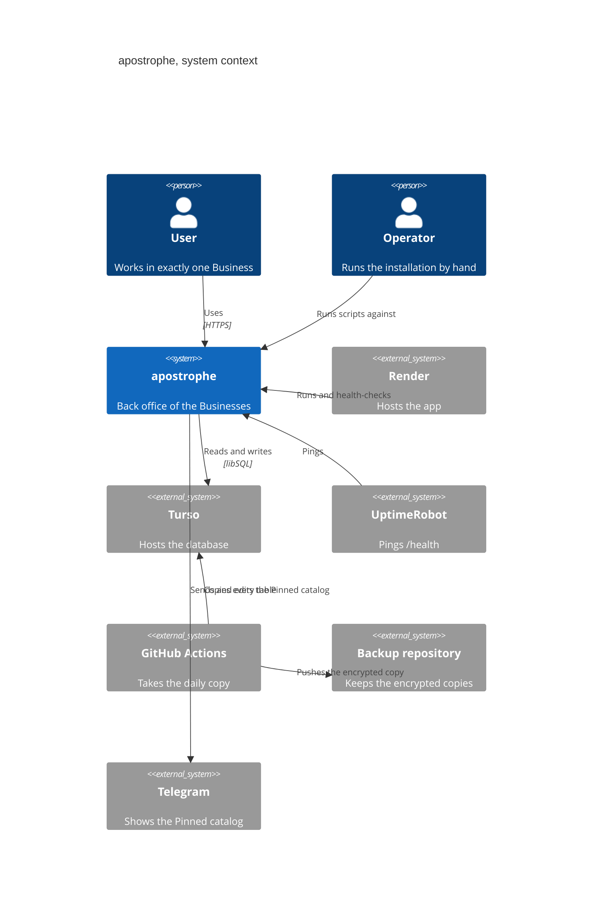

# Contexto

Quién usa apostrophe y con qué sistemas externos habla. Cada afirmación enlaza el archivo del repositorio en el que se apoya; los nombres dentro del diagrama van en inglés, como en el código y en [CONTEXT.md](../../CONTEXT.md).

## Vista de contexto

## Quiénes lo usan

- **User**: una persona que inicia sesión y trabaja en exactamente un Business ([CONTEXT.md](../../CONTEXT.md)). Entra por el navegador, contra la app que sirve [app/main.py](../../app/main.py) `create_app`, y cada pedido queda atado a su Business por la sesión ([modelo-de-datos.md](modelo-de-datos.md)).
- **Customer**: nunca inicia sesión. Ve el Catalog solo como el Pinned catalog del canal de Telegram del Business; lo edita la app, ver más abajo.
- **Operator**: quien instala y mantiene la app. Lo hace desde la terminal: [scripts/invite-business.sh](../../scripts/invite-business.sh) llama a [app/accounts/adapters/cli.py](../../app/accounts/adapters/cli.py) `main`, y [scripts/remove-business.sh](../../scripts/remove-business.sh) y [scripts/import-spreadsheet.sh](../../scripts/import-spreadsheet.sh) son los otros comandos suyos.

## Sistemas externos

- **Render** aloja la app. [render.yaml](../../render.yaml) declara un servicio web con `scripts/serve.sh` como comando de arranque y `/health` como chequeo de salud; [scripts/serve.sh](../../scripts/serve.sh) arranca uvicorn sobre la fábrica [app/main.py](../../app/main.py) `create_app`.
- **UptimeRobot** consulta `/health` sin sesión. La ruta la define [app/main.py](../../app/main.py) `health`, y [tests/test_health.py](../../tests/test_health.py) `test_health_answers_exactly_status_ok` fija que responde solo `status: ok` y ningún dato de un Business. Cómo se configura el monitor está en [deploy/README.md](../../deploy/README.md).
- **Turso** guarda la base de datos. La app llega por el driver libSQL: [app/db.py](../../app/db.py) `make_engine` elige las opciones de conexión según el nombre del driver y pasa el token como argumento de conexión, nunca dentro de la URL. [tests/test_libsql_driver.py](../../tests/test_libsql_driver.py) `test_make_engine_passes_the_auth_token_as_a_connect_arg_never_the_url` lo comprueba.
- **Copias de seguridad**: el workflow [.github/workflows/backup.yml](../../.github/workflows/backup.yml) corre una vez por día, copia cada tabla de Turso con [scripts/backup_copy.py](../../scripts/backup_copy.py) `copy_tables`, la cifra con la clave pública de [deploy/age-recipient.txt](../../deploy/age-recipient.txt) y empuja el archivo cifrado a un repositorio privado, una rama por copia. [scripts/drill.py](../../scripts/drill.py) `restore_and_check` restaura una copia en un destino de prueba y verifica su integridad, nunca contra la app en marcha. Todo el procedimiento está en [deploy/](../../deploy/).
- **Telegram** recibe el Pinned catalog: [app/pinned_catalog/adapters/telegram_http.py](../../app/pinned_catalog/adapters/telegram_http.py) `HttpTelegram` es el único adaptador que llega a su API HTTP. Manda texto plano con tramos en negrita ([app/pinned_catalog/adapters/telegram_http.py](../../app/pinned_catalog/adapters/telegram_http.py) `send`) y lo edita en el lugar ([app/pinned_catalog/adapters/telegram_http.py](../../app/pinned_catalog/adapters/telegram_http.py) `edit`); el contexto de esa decisión está en [docs/adr/0023-what-telegram-receives.md](../adr/0023-what-telegram-receives.md).

Cómo se reparten estas piezas dentro de la app: [contenedores.md](contenedores.md).
