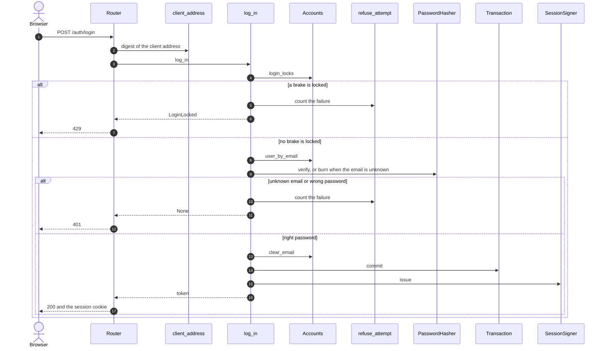
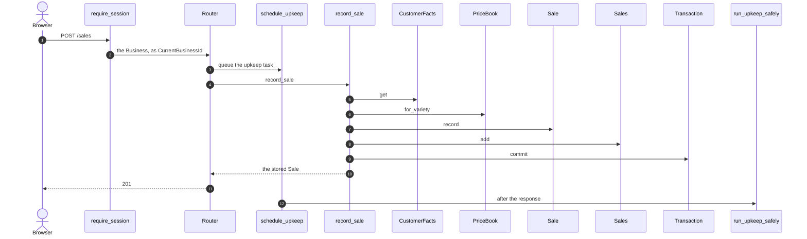
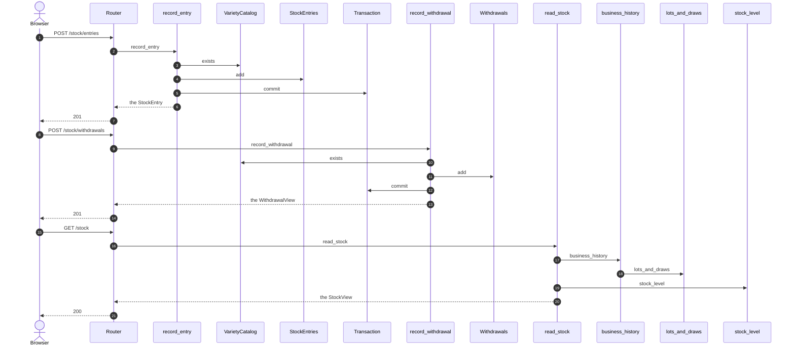
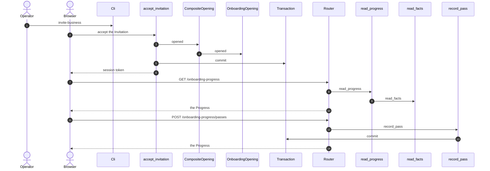

# Flujos clave

Cuatro recorridos, de punta a punta, tal como el código los hace hoy: iniciar sesión, registrar una venta con pago en el acto, mover stock y abrir un Business nuevo. Cada diagrama numera sus flechas con `autonumber` y termina en una tabla **Fuentes** con una fila por flecha: el paso, el archivo y el símbolo que lo define. Las flechas de vuelta (`-->>`) también llevan número. Los componentes que intervienen están en [componentes.md](componentes.md).

## Iniciar sesión

El freno de intentos cuenta por email y por dirección, y la sesión es un token firmado que lleva la huella de la contraseña.

**Fuentes**

| Paso | Archivo | Símbolo |
| --- | --- | --- |
| 1 | [app/accounts/adapters/router.py](../../app/accounts/adapters/router.py) | `login` |
| 2 | [app/accounts/adapters/deps.py](../../app/accounts/adapters/deps.py) | `client_address` |
| 3 | [app/accounts/application/sign_in.py](../../app/accounts/application/sign_in.py) | `log_in` |
| 4 | [app/accounts/application/ports.py](../../app/accounts/application/ports.py) | `login_locks` |
| 5 | [app/accounts/application/sign_in.py](../../app/accounts/application/sign_in.py) | `refuse_attempt` |
| 6 | [app/accounts/application/sign_in.py](../../app/accounts/application/sign_in.py) | `LoginLocked` |
| 7 | [app/accounts/adapters/router.py](../../app/accounts/adapters/router.py) | `as_http` |
| 8 | [app/accounts/application/ports.py](../../app/accounts/application/ports.py) | `user_by_email` |
| 9 | [app/accounts/domain/password.py](../../app/accounts/domain/password.py) | `verify` |
| 10 | [app/accounts/application/sign_in.py](../../app/accounts/application/sign_in.py) | `refuse_attempt` |
| 11 | [app/accounts/application/sign_in.py](../../app/accounts/application/sign_in.py) | `log_in` |
| 12 | [app/accounts/adapters/deps.py](../../app/accounts/adapters/deps.py) | `raise_unauthenticated` |
| 13 | [app/accounts/application/ports.py](../../app/accounts/application/ports.py) | `clear_email` |
| 14 | [app/shared/transaction.py](../../app/shared/transaction.py) | `Transaction` |
| 15 | [app/accounts/domain/session_token.py](../../app/accounts/domain/session_token.py) | `issue` |
| 16 | [app/accounts/application/sign_in.py](../../app/accounts/application/sign_in.py) | `log_in` |
| 17 | [app/accounts/adapters/router.py](../../app/accounts/adapters/router.py) | `login` |

En el paso 9, `burn` (en el mismo archivo que `verify`) gasta el mismo tiempo cuando el email no existe y `verify` no corre. `refuse_attempt` es una función de `sign_in.py`, no del puerto: en ambos pasos (5 y 10) cuenta los dos frenos y confirma antes de volver. Solo bloquea el freno que acaba de llegar al límite cuando ninguno estaba ya bloqueado al comenzar el intento, como en el paso 10; en el paso 5 hay un freno activo, así que solo cuenta y no fija ningún bloqueo. Un email mal formado nunca se guarda: solo cuenta la dirección, y esa rama no está dibujada. Las rutas siguientes llevan el token a [app/accounts/adapters/deps.py](../../app/accounts/adapters/deps.py) `require_session`, que lo abre con [app/accounts/application/sign_in.py](../../app/accounts/application/sign_in.py) `open_session`; el Business sale de ahí ([modelo-de-datos.md](modelo-de-datos.md)).

## Una venta con pago en el acto

El caso de uso resuelve todas las referencias y arma y valida la venta entera, pago incluido, antes de la primera y única llamada al repositorio; confirma una sola vez, al final. El upkeep del Pinned catalog corre después, ya respondido el pedido.

**Fuentes**

| Paso | Archivo | Símbolo |
| --- | --- | --- |
| 1 | [app/accounts/adapters/deps.py](../../app/accounts/adapters/deps.py) | `require_session` |
| 2 | [app/accounts/adapters/deps.py](../../app/accounts/adapters/deps.py) | `CurrentBusinessId` |
| 3 | [app/pinned_catalog/adapters/upkeep_trigger.py](../../app/pinned_catalog/adapters/upkeep_trigger.py) | `schedule_upkeep` |
| 4 | [app/sales/adapters/router.py](../../app/sales/adapters/router.py) | `record_sale` |
| 5 | [app/sales/application/ports.py](../../app/sales/application/ports.py) | `CustomerFacts` |
| 6 | [app/sales/application/ports.py](../../app/sales/application/ports.py) | `for_variety` |
| 7 | [app/sales/domain/sale.py](../../app/sales/domain/sale.py) | `record` |
| 8 | [app/sales/adapters/sql_sales.py](../../app/sales/adapters/sql_sales.py) | `SqlSales` |
| 9 | [app/shared/transaction.py](../../app/shared/transaction.py) | `Transaction` |
| 10 | [app/sales/application/record_sale.py](../../app/sales/application/record_sale.py) | `record_sale` |
| 11 | [app/sales/adapters/router.py](../../app/sales/adapters/router.py) | `record_sale` |
| 12 | [app/pinned_catalog/adapters/safe_upkeep.py](../../app/pinned_catalog/adapters/safe_upkeep.py) | `run_upkeep_safely` |

El paso 5 solo ocurre si la venta nombra un Customer. Si el repositorio rechaza una referencia borrada entre tanto, el caso de uso hace `rollback` y vuelve a preguntar antes de rechazar, y esa rama no está dibujada. [app/sales/adapters/sql_sales.py](../../app/sales/adapters/sql_sales.py) `SqlSales` guarda en el paso 8 la venta, sus líneas y el pago en el acto, todos con el id del Business de la sesión. La flecha del paso 3 no es una llamada del handler: es una dependencia del router que FastAPI resuelve antes de entrar a él. La tarea del paso 3 la agrega [app/main.py](../../app/main.py) `upkeep_gated`, la lista de dependencias de los routers de ventas, stock, productos y catálogo; si el pedido es rechazado, la tarea se descarta.

## Un movimiento de stock

Entra mercadería (Stock entry), sale por un retiro (Stock withdrawal) y el nivel se lee ordenando todo en un solo Lot order. Un retiro nunca se rechaza por falta de stock: los lotes posteriores se recalculan en la próxima lectura.

**Fuentes**

| Paso | Archivo | Símbolo |
| --- | --- | --- |
| 1 | [app/stock/adapters/router.py](../../app/stock/adapters/router.py) | `record_entry` |
| 2 | [app/stock/application/manage_entries.py](../../app/stock/application/manage_entries.py) | `record_entry` |
| 3 | [app/stock/application/ports.py](../../app/stock/application/ports.py) | `exists` |
| 4 | [app/stock/application/ports.py](../../app/stock/application/ports.py) | `StockEntries` |
| 5 | [app/shared/transaction.py](../../app/shared/transaction.py) | `Transaction` |
| 6 | [app/stock/application/manage_entries.py](../../app/stock/application/manage_entries.py) | `record_entry` |
| 7 | [app/stock/adapters/router.py](../../app/stock/adapters/router.py) | `record_entry` |
| 8 | [app/stock/adapters/router.py](../../app/stock/adapters/router.py) | `record_withdrawal` |
| 9 | [app/stock/application/manage_withdrawals.py](../../app/stock/application/manage_withdrawals.py) | `record_withdrawal` |
| 10 | [app/stock/application/ports.py](../../app/stock/application/ports.py) | `exists` |
| 11 | [app/stock/application/ports.py](../../app/stock/application/ports.py) | `Withdrawals` |
| 12 | [app/shared/transaction.py](../../app/shared/transaction.py) | `Transaction` |
| 13 | [app/stock/application/manage_withdrawals.py](../../app/stock/application/manage_withdrawals.py) | `WithdrawalView` |
| 14 | [app/stock/adapters/router.py](../../app/stock/adapters/router.py) | `record_withdrawal` |
| 15 | [app/stock/adapters/router.py](../../app/stock/adapters/router.py) | `get_stock` |
| 16 | [app/stock/application/read_stock.py](../../app/stock/application/read_stock.py) | `read_stock` |
| 17 | [app/stock/application/history.py](../../app/stock/application/history.py) | `business_history` |
| 18 | [app/stock/domain/lot_order.py](../../app/stock/domain/lot_order.py) | `lots_and_draws` |
| 19 | [app/stock/domain/stock_level.py](../../app/stock/domain/stock_level.py) | `stock_level` |
| 20 | [app/stock/application/read_stock.py](../../app/stock/application/read_stock.py) | `StockView` |
| 21 | [app/stock/adapters/router.py](../../app/stock/adapters/router.py) | `get_stock` |

En el paso 3, y en el 10 para el retiro, se revisa primero la Variety (404) y recién después las reglas del dominio (422). El paso 18 arma, por Variety, los lotes y los retiros del Stock: fecha primero y después orden de registro, con `rank` para desempatar entre una entrada, una línea de venta y una línea de retiro ([app/stock/domain/lot_order.py](../../app/stock/domain/lot_order.py) `LotOrder`). Los routers de stock también llevan el upkeep de la venta de arriba.

## Abrir un Business nuevo

El Operator imprime una Invitation, el User la acepta y, en la misma transacción que crea el Business, cada capacidad que siembra algo al abrir lo hace por el puerto `BusinessOpening`; el Onboarding es una de ellas. Después el User avanza con el Onboarding.

**Fuentes**

| Paso | Archivo | Símbolo |
| --- | --- | --- |
| 1 | [app/accounts/adapters/cli.py](../../app/accounts/adapters/cli.py) | `main` |
| 2 | [app/accounts/application/invitations.py](../../app/accounts/application/invitations.py) | `accept_invitation` |
| 3 | [app/main.py](../../app/main.py) | `CompositeOpening` |
| 4 | [app/onboarding/adapters/opening.py](../../app/onboarding/adapters/opening.py) | `OnboardingOpening` |
| 5 | [app/shared/transaction.py](../../app/shared/transaction.py) | `Transaction` |
| 6 | [app/accounts/application/invitations.py](../../app/accounts/application/invitations.py) | `accept_invitation` |
| 7 | [app/onboarding/adapters/router.py](../../app/onboarding/adapters/router.py) | `get_progress` |
| 8 | [app/onboarding/application/use_cases.py](../../app/onboarding/application/use_cases.py) | `read_progress` |
| 9 | [app/onboarding/application/facts.py](../../app/onboarding/application/facts.py) | `read_facts` |
| 10 | [app/onboarding/adapters/router.py](../../app/onboarding/adapters/router.py) | `get_progress` |
| 11 | [app/onboarding/adapters/router.py](../../app/onboarding/adapters/router.py) | `post_pass` |
| 12 | [app/onboarding/application/use_cases.py](../../app/onboarding/application/use_cases.py) | `record_pass` |
| 13 | [app/shared/transaction.py](../../app/shared/transaction.py) | `Transaction` |
| 14 | [app/onboarding/adapters/router.py](../../app/onboarding/adapters/router.py) | `post_pass` |

`accept_invitation` llama al puerto [app/accounts/application/ports.py](../../app/accounts/application/ports.py) `BusinessOpening` solo en la rama de Business nuevo, antes del único commit (pasos 3 a 5); una Invitation para sumarse a un Business existente no abre nada.

[app/onboarding/application/use_cases.py](../../app/onboarding/application/use_cases.py) `record_pass` guarda y confirma una sola vez, y termina el Onboarding cuando se cumplen los dos pasos obligatorios y cada paso opcional está hecho o pasado; `advance`, en el mismo archivo, hace lo mismo sin registrar un pase.
