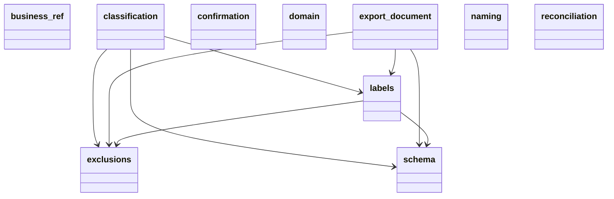
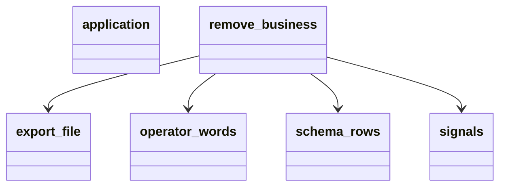
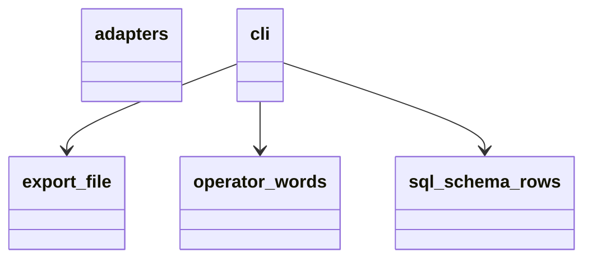
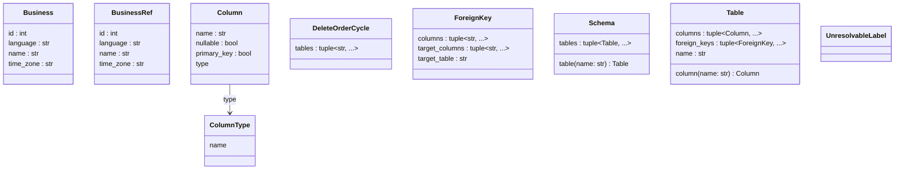
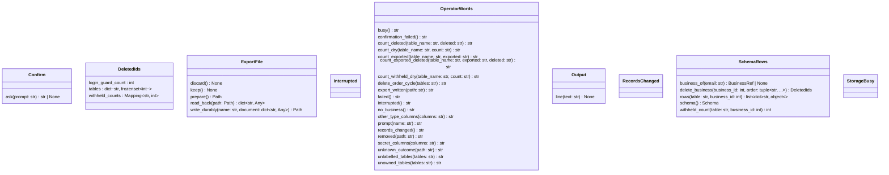

<!-- Generated by scripts/docs/generate.py. Do not edit; run `uv run --no-project python -m scripts.docs.generate` instead. -->

# business_removal

## Packages

Edges between layers are not drawn.

#### domain

#### application

#### adapters

## domain

## application

## adapters

```mermaid
classDiagram
  class ExportDirectoryRefused {
  }
  class ExportFileAlreadyExists {
  }
  class FileExportFile {
    discard() None
    keep() None
    prepare() Path
    read_back(path: Path) dict~str, Any~
    write_durably(name: str, document: dict~str, Any~) Path
  }
  class SqlSchemaRows {
    business_of(email: str) BusinessRef #124; None
    delete_business(business_id: int, order: tuple~str, ...~) DeletedIds
    rows(table: str, business_id: int) list~dict~str, object~~
    schema() Schema
    withheld_count(table: str, business_id: int) int
  }
  class TranslatedOperatorWords {
    busy() str
    confirmation_failed() str
    count_deleted(table_name: str, deleted: str) str
    count_dry(table_name: str, count: str) str
    count_exported(table_name: str, exported: str) str
    count_exported_deleted(table_name: str, exported: str, deleted: str) str
    count_withheld_dry(table_name: str, count: str) str
    delete_order_cycle(tables: str) str
    export_written(path: str) str
    failed() str
    interrupted() str
    no_business() str
    other_type_columns(columns: str) str
    prompt(name: str) str
    records_changed() str
    removed(path: str) str
    secret_columns(columns: str) str
    unknown_outcome(path: str) str
    unlabelled_tables(tables: str) str
    unowned_tables(tables: str) str
  }
  class _BusyTranslatingSchemaRows {
    business_of(email: str) BusinessRef #124; None
    delete_business(business_id: int, order: tuple~str, ...~) DeletedIds
    rows(table: str, business_id: int) list~dict~str, object~~
    schema() Schema
    withheld_count(table: str, business_id: int) int
  }
  class _StdinConfirm {
    ask(prompt: str) str #124; None
  }
  class _StreamOutput {
    line(text: str) None
  }
```

