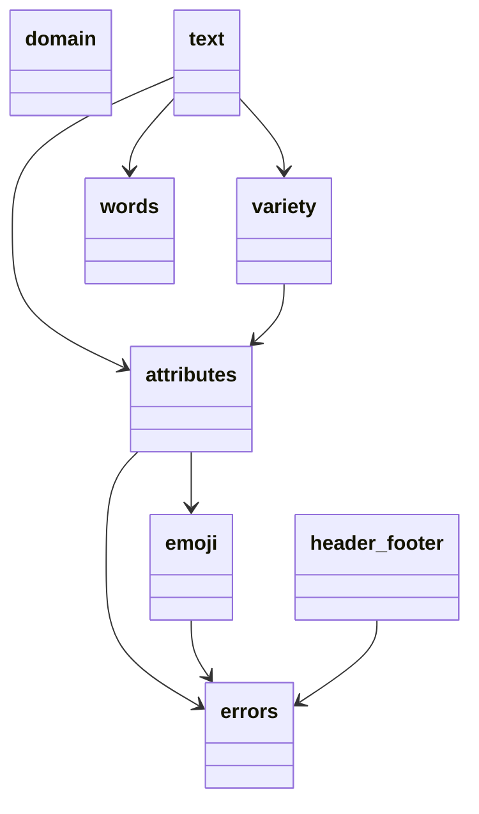
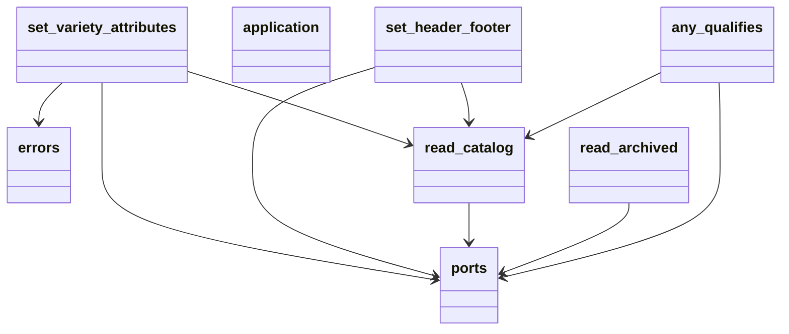

<!-- Generated by scripts/docs/generate.py. Do not edit; run `uv run --no-project python -m scripts.docs.generate` instead. -->

# catalog

## Packages

Edges between layers are not drawn.

#### domain

#### application

## domain

```mermaid
classDiagram
  class ArchivedCatalogVariety {
    id : int
    name : str
  }
  class Aroma {
    text : str
    of(raw: str) Aroma #124; None
  }
  class AromaTooLong {
    code : ClassVar~str~
  }
  class CatalogAttributes {
    aroma : Aroma #124; None
    emoji : CatalogEmoji #124; None
    indica_share : IndicaShare #124; None
    shown : bool
    default() CatalogAttributes
    of(shown: bool, emoji: str #124; None, indica_share: int #124; None, aroma: str #124; None) CatalogAttributes
  }
  class CatalogEmoji {
    value : str
    of(raw: str) CatalogEmoji
  }
  class CatalogEntry {
    attributes
    name : str
    price
  }
  class CatalogHeaderFooter {
    footer : str
    header : str
    of(header: str, footer: str) CatalogHeaderFooter
  }
  class CatalogPrice {
    bulk_minimum : Quantity #124; None
    bulk_price : int #124; None
    list_price : int
  }
  class CatalogRuleBroken {
  }
  class CatalogVariety {
    id : int
    name : str
    price : CatalogPrice #124; None
  }
  class CatalogWords {
    aroma : Callable~~str~, str~
    bulk : Callable~~str, str~, str~
    indica : Callable~~str, str~, str~
    nothing_to_offer : str
    price_per_gram : Callable~~str~, str~
  }
  class EmojiInvalid {
    code : ClassVar~str~
  }
  class FooterTooLong {
    code : ClassVar~str~
  }
  class HeaderTooLong {
    code : ClassVar~str~
  }
  class IndicaShare {
    percent : int
  }
  class IndicaShareInvalid {
    code : ClassVar~str~
  }
  AromaTooLong --|> CatalogRuleBroken
  CatalogEntry --> CatalogAttributes : attributes
  CatalogEntry --> CatalogPrice : price
  EmojiInvalid --|> CatalogRuleBroken
  FooterTooLong --|> CatalogRuleBroken
  HeaderTooLong --|> CatalogRuleBroken
  IndicaShareInvalid --|> CatalogRuleBroken
```

## application

```mermaid
classDiagram
  class ArchivedCatalogVarietyView {
    aroma : str #124; None
    emoji : str #124; None
    indica_share : int #124; None
    name : str
    shown : bool
    variety_id : int
  }
  class CatalogAttributesRepository {
    all() dict~int, CatalogAttributes~
    put(variety_id: int, attributes: CatalogAttributes) None
  }
  class CatalogHeaderFooterRepository {
    get() CatalogHeaderFooter
    put(header_footer: CatalogHeaderFooter) None
  }
  class CatalogLanguage {
    language_of(business_id: int) Language
  }
  class CatalogPricingSettings {
    current() PricingSettings
  }
  class CatalogStock {
    statuses(day: date) dict~int, StockStatus~
  }
  class CatalogVarieties {
    archived() list~ArchivedCatalogVariety~
    exists(variety_id: int) bool
    on(day: date) list~CatalogVariety~
    usable(variety_id: int) bool
  }
  class CatalogVarietyArchived {
  }
  class CatalogVarietyNotFound {
    code : ClassVar~str~
  }
  class CatalogVarietyView {
    aroma : str #124; None
    emoji : str #124; None
    id : int
    indica_share : int #124; None
    name : str
    shown : bool
    state : Literal
  }
  class CatalogView {
    footer : str
    header : str
    text : str #124; None
    varieties : list~CatalogVarietyView~
  }
  class CatalogWordsSource {
    words_for(language: Language) CatalogWords
  }
  class HeaderFooterDefaults {
    for_language(language: Language) CatalogHeaderFooter
  }
```

## adapters

No such layer in this package.
