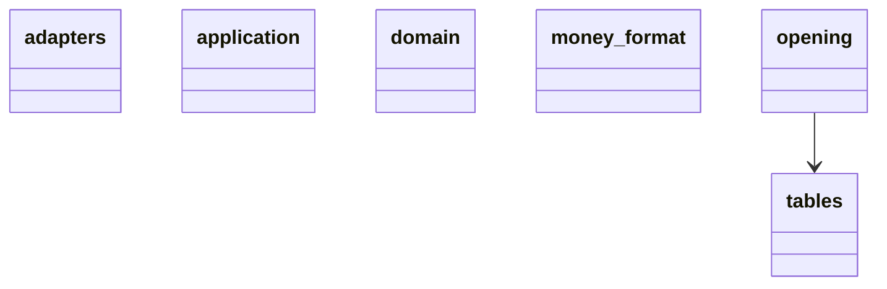
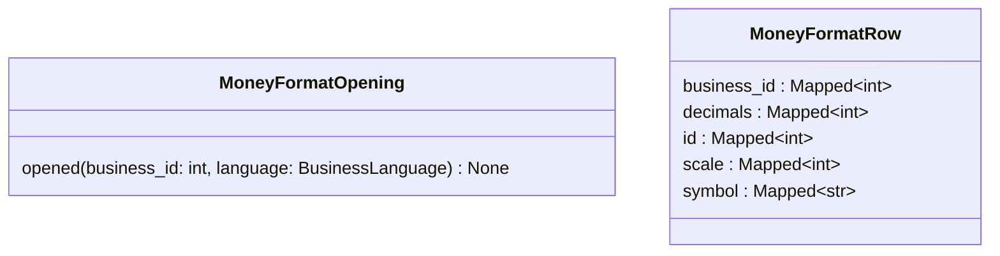

<!-- Generated by scripts/docs/generate.py. Do not edit; run `uv run --no-project python -m scripts.docs.generate` instead. -->

# money_format

## Packages

## domain

No classes in this layer.

## application

No classes in this layer.

## adapters

