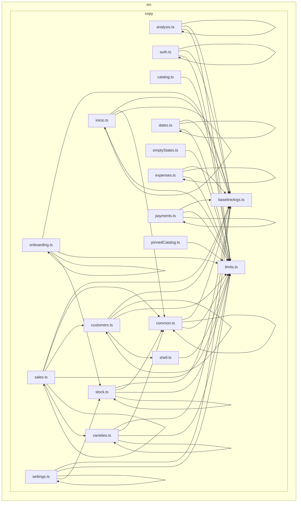

<!-- Generated by scripts/docs/generate.py. Do not edit; run `uv run --no-project python -m scripts.docs.generate` instead. -->

# copy

Only edges between files inside `copy/` are drawn; edges between folders are in [overview.md](overview.md).

