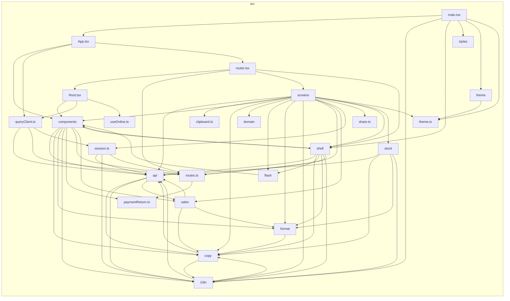

<!-- Generated by scripts/docs/generate.py. Do not edit; run `uv run --no-project python -m scripts.docs.generate` instead. -->

# overview

Each folder of `src/` is one node; the files directly in `src/` are drawn as files.

