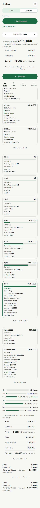

## Jobs

**Cuando** cierro una semana o un mes, o quiero saber por qué un período anduvo bien o mal, **quiero** ver desde el teléfono qué productos me dejan plata y cuánta, cómo se movieron las ventas, el Profit y el Cash en las últimas semanas y meses, qué día de la semana vende más y adónde se va la plata de las Expenses, **para** decidir qué reponer, a qué cambiarle el precio, qué empujar y en qué dejar de poner plata, sin la pestaña Análisis de la planilla y con Margins sacados del costo real de cada Lot.

Sirve al job de resultados del brief ("When I look at a day, a week or a month, I want sales, profit and cash side by side, so I can tell whether I make money and how much I actually have"), a lo largo de los períodos y por producto, y alimenta el job de stock. El control diario del Cash sigue siendo de Resultados (#7).

**Cuando** cierro una semana o un mes en Analysis, o veo que uno dejó menos de lo que esperaba, **quiero** ver en la fila de ese período lo que me costó lo vendido (Cost of goods sold) y lo que perdí por Stock shortfall, al lado del Profit, **para** entender de dónde salió el Profit sin volver a Home ni hacer cuentas, y confiar en que Analysis y Home dicen lo mismo.

Este job afina el primero para cada fila de semana y de mes; no es un job nuevo. Antes, el Cost of goods sold y el Stock shortfall de un período pasado no se veían en ningún lado: el Stock shortfall estaba solo dentro del Profit, sin poder separarlo, y Home muestra solo la semana y el mes en curso.

**Cuando** saco gramos de mi propio stock sin venderlos (para convidar en una fiesta y que la gente conozca el negocio, o para consumo propio), **quiero** registrarlo desde el teléfono en pocos toques (fecha, productos y gramos, Withdrawal reason), **para** mantener el stock bien y ver en el Profit lo que me costó promocionar el negocio y lo que consumí, sin registrar una venta que nadie hizo ni un Adjustment que se lee como Stock perdido. (Acá lo sirven las líneas de costo por Withdrawal reason; el Stock withdrawal se define en stock.md.)

**Cuando** saco stock sin venderlo, **quiero** registrarlo bajo un Withdrawal reason con mis propias palabras, **para que** Home y Analysis muestren cuánto me cuesta cada tipo de Stock withdrawal y cuánto baja mi Profit. (GH-318, parte de Withdrawal reasons: acá lo sirve una línea de costo por Withdrawal reason en la cabecera del mes, en cada fila de semana y de mes y desde el First record, en el orden de la lista del negocio; la lista se define en stock.md.)

**Cuando** llevo el negocio desde el teléfono entre pedidos o en medio de un chat con un cliente, varias veces por día, **quiero** que la app esté ordenada según lo que hago de verdad y con qué frecuencia, con Analysis a mano para la mirada semanal o mensual, **para** volver al cliente en vez de buscar entre menús. (El job de navegación, navigation.md.)

**Cuando** necesito registrar una Expense, sacar Stock, ver cómo va el negocio o cambiar una configuración desde el celular, **quiero** encontrarlo donde ya vive ese contexto (Analysis en Home, "Take from stock" en la vista de stock de Products, Settings en el encabezado), **para** terminar en pocos toques sin pasar por un menú que lo junta todo. (GH-651, el retiro de More, navigation.md: acá lo sirven el segmento Home | Analysis de Home y la tarjeta Expenses de Analysis.)

**Cuando** quiero saber cómo me fue en un mes, desde el teléfono y entre otras cosas, **quiero** elegir primero el mes y leer cada cifra de Analysis de arriba abajo, sin desplazarme de costado ni hacer zoom, **para** saber si gané plata ese mes y qué productos la dejaron. (GH-319, Analysis en el teléfono. Afina el primer job para el teléfono y cambia solo la disposición, nunca lo que muestra una sección. Antes, el dueño se desplazaba de costado y perdía a qué producto o período pertenecía una cifra, o esperaba a estar en la computadora.)

**Cuando** estoy en la pestaña Home del celular y quiero pasar entre la vista en vivo y la vista de historia de mi negocio, **quiero** que las dos opciones se llamen como las vistas que abren, Home y Analysis, **para** saber dónde estoy y adónde me lleva la otra opción sin un "Today" encima de otro. (#733, navigation.md: afina el job de navegación para el celular. Acá lo sirve el segmento de Analysis, con "Analysis" elegido y "Home" para volver.)

**Cuando** abro Home en el celular entre pedidos, **quiero** que arriba de la pantalla se vea qué día estoy mirando y poder pasar entre Home y Analysis con un toque, **para poder** ver cómo va el día o el mes. No necesito que la app me diga en qué Business estoy, porque ya lo sé. (Parte 2 de GH-723, navigation.md: afina el job de navegación para el celular. Acá lo sirve el mismo encabezado de Home, en el mismo lugar, con "Analysis" elegido; el mes que se lee lo sigue nombrando el selector de mes.)

Criterios de éxito:

1. **Respuestas sin cuentas**: desde una sola pantalla en el teléfono, un vendedor puede nombrar el producto de mayor Margin del mes elegido y el de menor Margin, la Best week de las últimas 8 semanas, el Best weekday y la Expense category que más se llevó ese mes.
2. **Un solo cálculo**: cada cifra es igual a lo que muestra Resultados (#7) para el mismo período y a un cálculo directo sobre las mismas ventas, Stock entries, Stock withdrawals, Payments y Expenses. Eso cubre ventas, Cost of goods sold, Stock shortfall, el costo de cada Withdrawal reason, Expenses, Profit y Cash, en cada fila de semana, cada fila de mes y desde el First record. Para la semana y el mes en curso, el Cost of goods sold y el Stock shortfall de las filas son iguales a los de Week y Month de Home. Para el mes en curso, el Stock shortfall es una sola cifra, que se lee igual en la cabecera del mes, en la fila del mes y en el Month de Home. 0 diferencias.
3. **Costo honesto** (ADR-0009, ADR-0010):
   - Los Margins salen del costo real de cada Lot, como están hoy los Lots.
   - Cuando el costo de una cifra incluye gramos pendientes, la cifra lo dice con sus propios gramos y nunca los toma como si costaran $0. Una cifra de costo que está toda pendiente nunca muestra "$ 0", aparezca donde aparezca.
   - El Stock perdido por un Adjustment negativo baja el Profit.
   - Los gramos retirados bajan el Profit en la línea de su Withdrawal reason, nunca dentro del Cost of goods sold, del Stock shortfall ni de un Margin.
   - Una Stock entry o un Stock withdrawal corregidos más tarde se ven en cada semana y mes pasados afectados la próxima vez que se abre la pantalla. Ningún período se cierra nunca.
4. **Nada leído solo por el color, nada inventado**: cada barra y cada fila llevan su propia cifra. Un período sin actividad muestra $0 o queda afuera por una regla explícita, nunca con una cifra de relleno.
5. **Los negocios nunca se mezclan** (ADR-0004): cada cifra cubre solo el negocio de la Session, y los nombres de los Withdrawal reasons también.
6. **Cada fila explica su Profit**: las 8 filas de semana y las 12 filas de mes muestran el Cost of goods sold, y el Stock shortfall cuando el período lo tiene, al lado de la línea de cada Withdrawal reason con Stock withdrawals en el período, las Expenses, el Profit y el Cash.
7. **Se lee de arriba abajo en el teléfono**: a 320 px y a 246 px (texto al 130 %), con un nombre de producto de 60 caracteres y cifras de nueve dígitos, el dueño puede cambiar de mes y leer cada sección sin desplazarse de costado.
8. **Nada se pierde en el teléfono**: cada cifra de cada fila de tabla aparece en su tarjeta con la misma etiqueta existente y en el mismo orden, y el selector de mes es el primer control del contenido, después del encabezado con el avatar "Settings", el segmento Home | Analysis y la tarjeta Expenses.
9. **La computadora no cambia**: la captura de `AnalisisCompu` sale igual que antes de las tarjetas del teléfono, y el segmento, el avatar y la tarjeta Expenses no se dibujan en una computadora.
10. **Se lee de un vistazo**: en el teléfono cada cifra principal entra en una línea, ningún texto mide menos de 12 px y cada zona de toque, las flechas del mes, el segmento y las acciones de la tarjeta Expenses incluidas, mide al menos 44×44.
11. **Nada cambia para un negocio existente** (GH-318, parte de Withdrawal reasons): ve las mismas cifras en cada fila, cabecera y línea desde el First record; la única diferencia visible es que "Promotion" ahora dice "Marketing".
12. **Se llega sin More** (GH-651): en el teléfono, Analysis se abre en 1 toque desde Home con el segmento Home | Analysis, y Expenses y su formulario se abren desde la tarjeta Expenses de Analysis.
13. **El segmento nombra sus vistas** (#733): en el teléfono, las opciones del segmento de Analysis dicen "Home" y "Analysis", en pantalla y en su nombre accesible; ninguna dice "Today", y "Home" vuelve a Home en 1 toque.
14. **El mismo encabezado que Home** (parte 2 de GH-723): en el teléfono, Analysis muestra la misma línea de fecha (el hoy del Business, nunca el mes que se lee), el mismo avatar y el mismo segmento, en el mismo lugar que Home, sin título visible y con un solo h1, oculto a la vista. Están en todos los estados de Analysis. En la computadora solo se ve el h1 "Analysis", como antes.

# Análisis

Dónde un negocio gana y pierde plata, a lo largo de los períodos y hasta cada producto: Margin por producto de un mes elegido; ventas, Cost of goods sold, Stock shortfall, Profit y Cash de las últimas 8 semanas y los últimos 12 meses; el patrón por día de la semana; los totales desde el First record, y las Expenses por Expense category. Es de solo lectura y lo ve solo su negocio (ADR-0004). Cada cifra que comparte con Resultados (#7) sale del cálculo de #7. El Cost of goods sold, el Stock shortfall y el costo de los Stock withdrawals por Withdrawal reason siguen a los Lots como están hoy (ADR-0009, ADR-0010). Lee ventas, stock (Stock entries, Stock withdrawals y la lista de Withdrawal reasons), Payments y Expenses. Se llega con el segmento Home | Analysis de Home en el teléfono y desde la barra lateral en la computadora (navigation.md). En el teléfono, además, es el lugar desde donde se llega a Expenses y al formulario de la Expense, por su tarjeta Expenses.

## Comportamiento

### Ventanas

- **Mes elegido**: abre en el mes en curso en hora argentina y se mueve de a un mes, como en Expenses. Va desde el mes del First record del negocio hasta el mes en curso. No hay rango a medida (no hay Dates).
- **Últimas 8 semanas**: semanas de lunes a domingo en hora argentina, la actual incluida, como en Sales.
- **Últimos 12 meses**: meses calendario, el actual incluido.
- **Desde el First record**: desde el registro más antiguo del negocio en la app (su venta, Stock entry, Stock withdrawal, Payment o Expense más antiguos) hasta hoy. Un Stock withdrawal con fecha anterior a todos los demás registros arranca la historia, así que su costo nunca queda afuera. La historia de la planilla es tarea del Spreadsheet import (#11).
- **Historia escasa**:
  - las semanas y los meses anteriores al First record no aparecen, sin filas de relleno;
  - dentro de la historia, una semana o un mes sin actividad muestran $0;
  - un negocio que todavía no tiene ningún registro de ninguno de los cinco tipos muestra una línea fija que dice que todavía no hay nada para analizar, y ninguna cifra.

### Definiciones compartidas (idénticas a Resultados #7)

- **Ventas** en las filas de semana, de mes y del total histórico: los totales de las ventas, envío incluido, pagadas o no, cada una en su propia fecha, como en Sales y Resultados. Los Stock withdrawals nunca son ventas.
- **Cost of goods sold, Expenses y Cash**: las definiciones de CONTEXT.md, leídas a través del cálculo de Resultados (#7), nunca de uno paralelo.
  - El Cost of goods sold es lo que cuestan los gramos de las Sale lines del período (Gifts incluidos), sacado de sus Lots como están hoy. Nunca incluye un Adjustment negativo ni un Stock withdrawal.
  - El Cash es Payments (On-the-spot payments y posteriores) en sus fechas − Expenses − Purchases en sus fechas.
- **Stock shortfall**: el costo de los gramos que sacan los Adjustments negativos del período, en la fecha del Adjustment, de sus Lots como están hoy, del más viejo al más nuevo, con la misma asignación que las Sale lines. Una parte que queda más allá de todos los Lots está pendiente, y la cifra lleva su propio "and N g without cost". Nunca incluye un Stock withdrawal y nunca entra en el Cost of goods sold.
- **Costo de cada Withdrawal reason** (una línea con el nombre del Withdrawal reason, por ejemplo "Marketing" u "Own use"): el costo de los gramos que sacan los Stock withdrawals del período con ese Withdrawal reason, en la fecha del Stock withdrawal, de sus Lots como están hoy, del más viejo al más nuevo, con la misma asignación. Una parte que queda más allá de todos los Lots está pendiente, y cada cifra lleva su propio "and N g without cost", que cuenta solo los gramos pendientes de su propio Withdrawal reason. Las líneas siguen el orden de la lista de Withdrawal reasons del negocio, y el nombre es el actual del Withdrawal reason, también en los períodos pasados. Un Withdrawal reason sin Stock withdrawals en la ventana no tiene línea.
- **Ventas de gramos con costo**: por Sale line, total de la línea × gramos con costo ÷ gramos de la línea, redondeado al peso con mitad hacia arriba. Una línea con todo su costo cuenta su total entero, una línea toda pendiente $0 y un Gift $0.
- **Profit**: ventas − Cost of goods sold − Stock shortfall − el costo de cada Withdrawal reason − Expenses.
  - Cuando parte de su costo está pendiente, el Profit se calcula sobre la parte con costo, dejando afuera las ventas de los gramos pendientes: ventas − (ventas sin envío − ventas de gramos con costo) − Cost of goods sold con costo − Stock shortfall con costo − el costo con costo de cada Withdrawal reason − Expenses.
  - Lleva "and N g without cost", donde N suma cada gramo pendiente que tiene detrás: gramos vendidos o regalados, gramos sacados por Adjustments negativos y gramos retirados con cualquier Withdrawal reason, cada uno contado en el período de su propia fecha.
  - Ejemplo: una semana que vendió 4 g todavía sin costo, cuyo conteo sacó 2 g todavía sin costo y que retiró 1 g con el Withdrawal reason Marketing todavía sin costo muestra el Profit con "and 7 g without cost", su Stock shortfall como "2 g without cost" y su Marketing como "1 g without cost".
  - La cifra de ventas que se muestra al lado sigue siendo la venta completa.
- **Los gramos pendientes** nunca se costean en $0 en ningún lado. Cada cifra que tocan lleva "and N g without cost", con N contando solo los gramos que esa cifra tiene detrás.
- **Una cifra de costo toda pendiente**:
  - Cuando todos los gramos detrás del Cost of goods sold, del Stock shortfall o de la línea de un Withdrawal reason están pendientes, la cifra muestra solo sus gramos pendientes en palabras (por ejemplo "2 g without cost"), nunca "$ 0" y nunca "$ 0 and N g without cost". La redacción exacta la decide diseño.
  - Vale en todo Analysis donde aparezca la cifra: las filas de semana y de mes, la cabecera del mes y las líneas desde el First record.
  - Una cifra con parte pendiente muestra su monto con costo más "and N g without cost".
  - La línea nunca se oculta porque su costo esté pendiente.
  - El Profit, los Margins, los Margin percentages y el Average margin siguen sus propias reglas.
  - La API dice si una cifra está toda pendiente, una vez por cifra; el front solo le da formato.

### El mes elegido, por producto

- **Filas**: solo los productos vendidos o regalados ese mes. Un producto que ese mes solo tuvo Stock withdrawals no tiene fila.
- **Ventas sin envío**: la suma de los totales guardados de las Sale lines del producto ese mes. Un Gift cuenta $0 y un Special price su total tipeado.
- **Participación en el mes**: sus ventas sin envío sobre las ventas sin envío del mes. No se muestra cuando las ventas sin envío del mes son $0.
- **Gramos**: gramos vendidos y gramos regalados, como dos cifras. Un Adjustment negativo y un Stock withdrawal no son ninguna de las dos, y quedan afuera de los gramos, el costo y el Margin de todo producto.
- **Cost of goods sold**: lo que cuestan sus gramos vendidos y regalados, de sus Lots como están hoy, con la marca de pendiente cuando corresponde.
- **Margin**: ventas de gramos con costo − Cost of goods sold con costo, en pesos; puede ser negativo. Sin gramos pendientes, las ventas de gramos con costo son iguales a las ventas sin envío.
- **Margin percentage**: el Margin sobre las ventas de gramos con costo del producto. No se muestra cuando estas son $0 (solo regalado, o con todos los gramos pendientes).
- **Gramos pendientes**: el Margin y el Margin percentage llevan "and N g without cost", con N contando solo los gramos pendientes vendidos y regalados de ese producto. Ejemplo: 10 g vendidos a $10.000, 6 g de una Purchase de $3.000 y 4 g pendientes, muestran ventas $10.000, Margin $3.000 "and 4 g without cost" y 50%.
- **Orden**: por Margin en pesos, de mayor a menor. Un Margin marcado se ordena por la cifra que muestra y conserva su marca.
- **Cabecera del mes**:
  - las ventas (envío incluido), los gramos vendidos o regalados y el Average margin;
  - el Average margin es el Margin total del mes sobre sus ventas de gramos con costo. Se marca cuando algún producto tiene gramos pendientes (contando solo gramos vendidos y regalados), y no tiene porcentaje cuando esas ventas son $0;
  - "Stock shortfall $ X" cuando el mes tiene algún Stock shortfall, con su propia marca de pendiente, o solo sus gramos pendientes cuando está todo pendiente. Es la misma cifra, y se lee igual, que la de la fila del mes y la del Month de Home;
  - "<motivo> $ X" para cada Withdrawal reason con un Stock withdrawal en el mes (por ejemplo "Marketing $ X" u "Own use $ X"), en el orden de la lista del negocio, cada una con su propia marca de pendiente (o solo sus gramos pendientes cuando está todo pendiente), aparte del Stock shortfall;
  - la pantalla aclara que la tabla de productos suma las ventas del mes menos el envío;
  - la cabecera no lleva un total de Cost of goods sold.
- **Un mes sin ventas ni Gifts**: totales en $0, sin filas de producto y con una línea fija que dice que ese mes no se vendió nada. Su Stock shortfall y las líneas de sus Withdrawal reasons se siguen mostrando cuando los tiene.

### Semana por semana (últimas 8) y mes por mes (últimos 12)

- **Cada fila**, en este orden (el mismo que Week y Month de Home, results.md):
  1. ventas;
  2. gramos vendidos o regalados, como una sola cifra;
  3. Cost of goods sold, en todas las filas;
  4. Stock shortfall, solo cuando el período tiene un Adjustment negativo;
  5. una línea por cada Withdrawal reason con un Stock withdrawal en el período, en el orden de la lista del negocio;
  6. Expenses;
  7. Profit;
  8. Cash.

  Los gramos retirados y ajustados nunca están en la cifra de gramos.
- **El Cost of goods sold** de una fila es el Cost of goods sold del período, también en los períodos pasados. Un período sin ventas muestra un $0 real. Nunca incluye un Stock shortfall ni un Stock withdrawal.
- **El Stock shortfall** de una fila es el Stock shortfall del período, una cifra aparte que nunca entra en el Cost of goods sold. Un período sin Adjustment negativo no tiene línea de Stock shortfall.
- **Gramos pendientes en una fila**:
  - El Cost of goods sold, el Stock shortfall y la línea de cada Withdrawal reason muestran cada uno su monto con costo más su propio "and N g without cost", o solo sus gramos pendientes cuando están todos pendientes (ver Definiciones compartidas).
  - N cuenta solo los gramos que esa cifra tiene detrás, cada uno en el período de su propia fecha:
    - Cost of goods sold: gramos vendidos y regalados;
    - Stock shortfall: gramos sacados por Adjustments negativos;
    - la línea de un Withdrawal reason: gramos retirados con ese Withdrawal reason.
  - El Profit sigue su propia regla y su N total.
  - Ejemplo: una semana con 4 g vendidos, 2 g sacados por Adjustment y 1 g retirado con el Withdrawal reason Marketing, todos todavía sin costo, muestra:
    - Cost of goods sold "4 g without cost";
    - Stock shortfall "2 g without cost";
    - Marketing "1 g without cost";
    - Profit "and 7 g without cost".
- **Coincidencia con Home**: para la semana y el mes en curso, el Cost of goods sold, el Stock shortfall y la línea de cada Withdrawal reason de la fila son iguales a los de Week y Month de Home. Cualquier diferencia es un defecto.
- **El Profit** incluye el Stock shortfall y el costo de cada Withdrawal reason, y lleva la marca de pendiente cuando corresponde.
- **Best week**: la de más ventas; si hay empate, la semana más reciente. Cuando las 8 semanas están en $0, no se marca ninguna. Los Stock withdrawals nunca la afectan.
- **Meses**: sin marca de "mejor".
- No se dibuja ningún gráfico, variación ni comparación entre períodos.

### Por día de la semana, desde el First record

- **Cada día de la semana, de lunes a domingo**: el total de ventas y la cantidad de ventas, según la fecha de cada venta en hora argentina. Los Stock withdrawals nunca cuentan.
- **Best weekday**: el de mayor total de ventas; si hay empate, el día que va antes en el orden de lunes a domingo. Cuando todos los días están en $0, no se marca ninguno.

### Desde el First record

- Ventas, Expenses, Profit y Cash, con las mismas definiciones que las filas de semana y de mes. Se agregan "Stock shortfall $ X" y una línea "<motivo> $ X" por cada Withdrawal reason con Stock withdrawals, en el orden de la lista, cuando los hay, cada uno con su propia marca de pendiente, o solo sus gramos pendientes cuando está todo pendiente. Sin total de Cost of goods sold.
- Se rotula como plata movida desde el First record, nunca como plata en mano: la app no tiene un monto inicial de Cash.

### Expenses por Expense category: el mes elegido y desde el First record

- Dos desgloses, cada uno con solo las Expense categories que tienen Expenses en su ventana, ordenadas por nombre como en Expenses, cada una con su total.
- Las Purchases son siempre una línea propia en los dos, $0 incluido, con "Kept apart, added in Stock". Nunca se cuentan dentro de las Expenses.
- Los Stock withdrawals nunca son Expenses y nunca aparecen acá.
- Cómo se ubican los dos desgloses lo decide diseño.

### En pantalla (`Analisis`, `AnalisisCompu`)

- **Dónde**: en el teléfono, una Tab root a la que se llega con el segmento Home | Analysis de Home: muestra la barra con Home marcada como activa y "+ New sale". En la computadora, "Analysis" en la barra lateral, debajo del separador (navigation.md). More ya no existe (GH-651).
- **Encabezado del teléfono** (compartido con Home desde la parte 2 de GH-723, navigation.md): el mismo encabezado de Home, en el mismo lugar, dibujado por el layout de ruta `HomeLayout` arriba del contenido y fuera de su área de contenido. Es un `div`, no es fijo y se va con el scroll. En este orden:
  1. Una fila con la línea de fecha, un lugar vacío y el avatar "Settings" al final. La línea de fecha es el hoy del Business como dd/mm, tomado del `me.today` de la Session, nunca el mes que se lee: ese lo nombra el selector de mes. Nunca se parte en dos líneas y se corta con puntos suspensivos antes de que el avatar se achique. El lugar vacío ocupa el lugar que el dibujo le da a "Sumar gráfico" y no tiene link, botón, rol, texto ni elemento enfocable.
  2. El segmento Home | Analysis.
  3. El único h1 de la pantalla, "Analysis", oculto a la vista: solo lo leen los lectores de pantalla. No hay título visible.

  No espera las cifras: está en los estados cargando, error, vacío y con datos, así que siempre se puede volver a Home o abrir Settings, y el `aria-busy` sigue en el área de contenido.
- **El segmento Home | Analysis** (solo en el teléfono): dentro del encabezado, debajo de la fila de la fecha, el mismo control de navegación de Home, un grupo con nombre accesible "Home view" de dos links de al menos 44 px, "Home" y "Analysis", con "Analysis" elegido (`aria-current="page"` y peso, nunca solo color). "Home" vuelve a Home. Ninguna opción dice "Today" (#733).
- **La tarjeta Expenses** (solo en el teléfono): debajo del segmento y antes de las cifras, con el título "Expenses", "Add expense" (abre el formulario de la Expense con la fecha de hoy) y "See the expenses" (abre Expenses), cada una de al menos 44 px (expenses.md). No espera las cifras: está en los estados cargando, error, vacío y con datos. Es solo una entrada; no muestra ninguna cifra.
- **Computadora**: la disposición de `AnalisisCompu`, con las tres secciones como tablas, y arriba solo el h1 visible "Analysis", sin nombre del Business. La disposición del teléfono nunca la cambia: su captura sigue igual, y la línea de fecha, el segmento, el avatar y la tarjeta Expenses no se dibujan.
- **Filas de semana y de mes**: en el teléfono son tarjetas (ver En el teléfono); en la computadora, cómo se ubican en una fila el Cost of goods sold, el Stock shortfall y las líneas de los Withdrawal reasons (líneas o subfilas) lo decide diseño. Cada cifra va en palabras, y lo pendiente y lo negativo se dicen con una palabra o un signo, nunca solo con el color, en los dos temas.
- **Gráficos**: solo el acento y los tokens; cada barra lleva su cifra. Las marcas de mejor, las marcas de pendiente y los negativos se dicen con una palabra o una forma, nunca solo con el color.
- **Idioma y formatos**: los textos están en el Product language (product-language.md), y cada uno sale del Copy module. El nombre de un Withdrawal reason es un dato del negocio y se muestra tal como está guardado. Los formatos siguen siendo argentinos: plata `$ 11.000`, gramos `3,5 g`, fechas `dd/mm`.
- **Solo lectura**: sin formularios y sin avisos emergentes; la tarjeta Expenses solo lleva a otras pantallas. Las cifras, y qué líneas de Withdrawal reason se muestran y en qué orden, vienen de la API cada vez que se abre la pantalla; el navegador no calcula ni ordena nada, tampoco si una cifra está toda pendiente.
- **Respuesta ante fallas**: la pérdida de red y los errores del servidor siguen accounts.md.

### En el teléfono (debajo del corte de 900 px)

- **El selector de mes primero**: es el primer control del contenido de Analysis, después del encabezado, el segmento Home | Analysis y la tarjeta Expenses. La regla de orden que Expenses aplica a su propio selector de mes está acotada a Expenses y nunca llega a Analysis.
- **Una sola disposición a la vez**:
  - En ancho de teléfono, las tres secciones (por producto, últimas 8 semanas, últimos 12 meses) se muestran como listas de tarjetas, y no hay ninguna tabla en la página.
  - En ancho de computadora se muestran como tablas, y no hay ninguna tarjeta en la página.
  - El selector de mes, los títulos de las secciones y la columna lateral son los mismos elementos en las dos disposiciones.
  - Ninguna cifra queda expuesta dos veces a la tecnología de asistencia.
  - Analysis no tiene formularios, así que cruzar los 900 px no pierde nada.
- **Tarjeta de producto**: el nombre, después las ventas, la participación en el mes, los gramos vendidos, los gramos regalados, el Cost of goods sold y el Margin con su Margin percentage. La participación y el Margin percentage aparecen con las mismas reglas que en la computadora.
- **Tarjeta de semana y tarjeta de mes**: la etiqueta del período, después las cifras de la fila en el orden de la fila (ver Semana por semana, más arriba). El Stock shortfall y la línea de cada Withdrawal reason aparecen solo cuando el período los tiene.
- **Mismas cifras, mismo orden, mismas etiquetas**: cada tarjeta lleva cada cifra de la fila que reemplaza, en el orden de esa fila, con las etiquetas que ya tiene el Copy module (y, para un Withdrawal reason, su nombre). Nada se reordena, se esconde detrás de un toque ni se pliega, y no hay saltos entre secciones.
- **Cifra principal**: las ventas son la cifra principal de una tarjeta. Entran en una línea, y su "$" nunca se separa de su número.
- **Ajuste**:
  - Los nombres, los nombres de Withdrawal reason y las etiquetas de período se cortan con puntos suspensivos. El nombre completo de un producto se sigue leyendo en la computadora y en su página, y el de un Withdrawal reason en Settings → Business → Withdrawal reasons.
  - Las cifras nunca se cortan, nunca pasan a otra línea, nunca se parten y nunca pierden su "$".
  - Una marca de pendiente ("and N g without cost", o "N g without cost" cuando toda la cifra está pendiente) va en la línea de abajo de su cifra, dentro de la misma tarjeta, y nunca se corta ni se recorta. Así, una cifra con parte pendiente nunca se lee como completa.
  - Nada se desplaza de costado a 320 px ni a 246 px (texto al 130 %), con un nombre de 60 caracteres y cifras de nueve dígitos. Ningún texto mide menos de 12 px. Cada zona de toque mide al menos 44×44, las flechas del mes incluidas. Las dos acciones de la tarjeta Expenses pasan a dos líneas antes que achicarse.
- **Marcas**: la marca de Best week, la línea de "no hubo mejor semana" y la línea del mes vacío se muestran con las mismas palabras que en la computadora. La tarjeta de la semana actual se distingue por la forma (un borde en su lado inicial), nunca solo por el color de fondo, y con una palabra solo si el Copy module ya la tiene.
- **Columna lateral**: las barras por día de la semana, las líneas desde el First record, los dos desgloses de Expenses y la línea de Purchases "Kept apart, added in Stock" conservan su contenido y su orden, y no se convierten en tarjetas. Cumplen los mismos límites de ajuste; los nombres largos de Expense category y de Withdrawal reason se cortan con puntos suspensivos.

### Restricciones

- El negocio sale de la Session. Cada ruta entra en el barrido de aislamiento y en la prueba de rutas protegidas.
- Ningún monto ni nombre, los de los Withdrawal reasons incluidos, va a los logs, la consola ni el almacenamiento del navegador (CODING_STANDARDS §9, ADR-0005).
- Cada regla del teléfono va debajo del corte de 900 px; por ellas, las capturas de la computadora no cambian.

## Métricas

- **Respuestas sin cuentas (criterio 1)**: una prueba del front sobre un negocio sembrado lee, solo desde la pantalla, el mejor y el peor producto por Margin, la Best week marcada, el Best weekday marcado y la Expense category más grande del mes. Cada una coincide con la respuesta esperada.
- **Un solo cálculo (criterio 2)**:
  - En cada semana, cada mes y la ventana histórica de una historia sembrada, las ventas, el Cost of goods sold, el Stock shortfall, el costo de cada Withdrawal reason, las Expenses, el Profit y el Cash son iguales a las cifras de Resultados (#7) y a un cálculo directo. 0 diferencias.
  - Las ventas de la tabla de productos suman las ventas del mes menos su envío.
  - La historia sembrada incluye un Adjustment negativo con costo, uno pendiente, una Sale line con gramos pendientes, tres o más Withdrawal reasons (uno renombrado y uno reordenado), un Stock withdrawal con costo de cada Withdrawal reason y un Stock withdrawal pendiente.
    - Sobre ella, el Cost of goods sold, el Stock shortfall y la línea de cada Withdrawal reason de cada fila de semana y de mes son iguales a un cálculo directo.
    - La semana y el mes en curso son iguales a `periods.week` y `periods.month` de `/panel`.
    - El Stock shortfall del mes en curso es el mismo, y se lee igual, en la cabecera, en la fila y en el Panel.
    - Las líneas de los Withdrawal reasons siguen el orden de la lista y llevan el nombre actual del Withdrawal reason.
    - 0 diferencias.
  - `tests/design/test_muestra_seed.py` compara las filas con el Panel en vez de afirmar que el Stock shortfall no está.
- **Nada cambia para un negocio existente (criterio 11)**: sobre una historia sembrada, antes y después de la migración de los Withdrawal reasons, cada fila, la cabecera del mes y las líneas desde el First record son idénticas; la única etiqueta que difiere es "Promotion" → "Marketing".
- **El First record incluye los Stock withdrawals (criterio 2)**: un Stock withdrawal con fecha anterior a todos los demás registros arranca la historia.
  - Sus filas de semana y de mes, y el Profit desde el First record, llevan su costo y son iguales a las cifras de Home para la misma semana y el mismo mes. 0 diferencias.
  - Un negocio cuyo único registro es un Stock withdrawal muestra esa historia, no la línea de que no hay nada para analizar.
- **Costo honesto (criterio 3)**: 100% de aprobación.
  - Una Stock entry o un Stock withdrawal con fecha atrasada o editados mueven el costo y el Margin de las semanas, los meses y los productos pasados afectados en la siguiente lectura, y nada más.
  - Los gramos pendientes siempre muestran sus gramos y nunca se costean en $0.
  - Un Adjustment negativo baja el Profit en su fecha por el costo de sus Lots, aparece en el Stock shortfall de su período y no mueve el Margin ni el Cost of goods sold de ningún producto.
  - Un Stock withdrawal de cada Withdrawal reason baja el Profit en su fecha por el costo de sus Lots y aparece en la línea de su Withdrawal reason. No mueve nada de esto:
    - la fila, los gramos, el Margin ni la participación de un producto;
    - el Average margin;
    - la Best week ni el Best weekday;
    - el Cost of goods sold ni el Stock shortfall.
  - La semana de ejemplo de 4 g / 2 g / 1 g muestra:
    - Cost of goods sold "4 g without cost";
    - Stock shortfall "2 g without cost";
    - Marketing "1 g without cost";
    - Profit "and 7 g without cost".
  - El N de cada cifra de una fila cuenta solo sus propios gramos. El N del Profit no cambia.
  - Una cifra toda pendiente muestra gramos, nunca "$ 0": en una fila, en la cabecera del mes (Stock shortfall y la línea de cada Withdrawal reason) y en las líneas desde el First record. Un mes en curso cuyo único Stock shortfall es de 2 g sin costo muestra "2 g without cost" tanto en la cabecera como en la fila.
- **Las filas explican el Profit (criterio 6)**: una prueba del front sobre una historia sembrada lee el Cost of goods sold en las 8 filas de semana y las 12 filas de mes, en el orden indicado, el Stock shortfall solo en los períodos con un Adjustment negativo, y la línea de cada Withdrawal reason solo en los períodos con un Stock withdrawal de ese Withdrawal reason, en el orden de la lista.
- **Matriz de Margin**: 100% de aprobación. Cubre:
  - un producto solo regalado (Margin negativo, sin Margin percentage);
  - una mezcla de vendida y regalada;
  - gramos pendientes: 10 g por $10.000, con 6 g que cuestan $3.000, muestran $3.000 "and 4 g without cost" y 50%, ordenada por la cifra que muestra;
  - una línea partida entre gramos con costo y pendientes, con el redondeo de mitad hacia arriba de sus ventas con costo;
  - un Adjustment negativo que queda afuera de la tabla de productos y cuenta como Stock shortfall;
  - un Stock withdrawal que queda afuera de la tabla de productos y cuenta en la línea de su Withdrawal reason;
  - un mes con solo Gifts (sin participación ni porcentaje de Average margin).
- **Best week y Best weekday**: 100% de aprobación. Cubre:
  - una Best week elegida por ventas, no por Profit;
  - un empate de semanas que va a la semana más reciente;
  - un empate de días que va al día que va antes;
  - todo en $0 sin ninguna marcada.
- **Nada inventado (criterio 4)**:
  - ninguna semana ni mes antes del First record;
  - filas en $0 dentro de la historia, Cost of goods sold incluido;
  - un mes vacío muestra su línea fija y ninguna fila de producto;
  - un período sin Adjustment negativo no muestra línea de Stock shortfall;
  - un período sin Stock withdrawal de un Withdrawal reason no muestra línea para ese Withdrawal reason;
  - un negocio sin registros muestra su línea fija;
  - cada barra lleva su cifra, y ningún estado se dice solo con el color.
- **Cifras que no cambian**: sobre la misma historia sembrada, estas conservan sus valores antes y después de que las filas sumaran el Cost of goods sold y el Stock shortfall:
  - el Profit y el Cash;
  - la cabecera del mes;
  - las cifras desde el First record;
  - la tabla por producto;
  - la Best week.

  El único cambio de presentación fuera de las filas es un Stock shortfall o la línea de un Withdrawal reason toda pendiente en la cabecera o desde el First record, que ahora muestra solo sus gramos en vez de "$ 0 and N g without cost".
- **Se lee de arriba abajo en el teléfono (criterio 7)**: con los datos extremos de la semilla (un nombre de 60 caracteres, un nombre de Withdrawal reason de 60 caracteres y cifras de nueve dígitos), a 320 px y a 246 px (130 %):
  - el Mobile check no encuentra desplazamiento de costado en ninguno de los estados recorridos de Analysis;
  - los nombres terminan en puntos suspensivos;
  - cada cifra está entera, con su "$";
  - una marca de pendiente se ve entera, en la línea de abajo de su cifra.
- **Nada se pierde en el teléfono (criterio 8)**: una prueba del front con `fetch` simulado, en una ventana de teléfono, encuentra:
  - el selector de mes como primer control del contenido, después del encabezado, el segmento y la tarjeta Expenses;
  - en cada sección, tarjetas que llevan cada cifra de las filas de su tabla, con las etiquetas existentes y en el orden de la fila;
  - ninguna tabla en la página;
  - la marca de Best week, "no hubo mejor semana" y la línea del mes vacío con sus palabras existentes;
  - la tarjeta de la semana actual distinguida por algo que no es el color de fondo.
- **Una sola disposición a la vez**: en una ventana de computadora, la misma prueba encuentra las tablas y ninguna tarjeta. En las dos ventanas, el selector de mes, los títulos de las secciones y la columna lateral son los mismos elementos.
- **La computadora no cambia (criterio 9)**: la captura de `AnalisisCompu` de `scripts/design/compare.sh` es idéntica antes y después, salvo la etiqueta "Promotion" que ahora dice "Marketing". En ancho de computadora, las pruebas del front no encuentran el avatar "Settings", el segmento ni la tarjeta Expenses.
- **Se lee de un vistazo (criterio 10)**: el Mobile check pasa en los estados recorridos de Analysis.
  - No queda ninguna entrada `touch-target`, `text-size`, `h-scroll`, `name-overflow` ni `figure-split` para una celda de contenido de Analysis que este trabajo arregló.
  - Cada entrada que pasó a verde se borra.
  - No se agrega ninguna fuera de las reglas de gate.md.
- **Se llega sin More (criterio 12)**: pruebas de Testing Library a través del router real, en ancho de teléfono: tocar "Analysis" en el segmento de Home lleva a `/analysis`; tocar "Home" en el de Analysis lleva a `/`; "Add expense" de la tarjeta abre el formulario de la Expense y "See the expenses" abre Expenses; Analysis tiene la barra, "+ New sale" y Home marcada como activa. 100% de aprobación.
- **El segmento nombra sus vistas (criterio 13, #733)**: en ancho de teléfono, el grupo "Home view" de Analysis tiene exactamente dos links, de nombre accesible "Home" y "Analysis", y ninguno "Today"; el proyecto e2e `mobile` pasa en `Analisis` y `AnalisisOscuro` sin ningún infractor agregado. 100% de aprobación.
- **El mismo encabezado que Home (criterio 14, parte 2 de GH-723)**: pruebas de Testing Library a través del router real (`HomeLayout.test.tsx`): en `/analysis` hay exactamente un h1, con `visualmente-oculto` en el teléfono y visible en la computadora, también cargando y con error; la línea de fecha muestra el hoy de la Session (`03/10` para 2026-10-03); la fila del encabezado no tiene otro elemento interactivo que las dos opciones del segmento y el avatar; cambiar de opción deja `router.state.historyAction === 'REPLACE'` con el índice del historial sin cambios, y la vista elegida abre arriba. El proyecto e2e `mobile` pasa en `Analisis` y `AnalisisOscuro` a 320, 360 y 390 px y al 130 %, con la línea de fecha en una sola línea y sin ningún infractor agregado, y la captura de `AnalisisCompu` no cambia. 100% de aprobación.
- **Aislamiento (criterio 5)**: cada ruta de Analysis está en el barrido y responde solo las cifras y los nombres de Withdrawal reason de su propio negocio, nunca los datos del otro negocio sembrado.
- **Sin eco**: después de una corrida completa del front, la consola y el almacenamiento del navegador no tienen montos ni nombres.
- **Velocidad**: la pantalla responde en menos de 300 ms con un año de unos cientos de ventas y unas decenas de productos (el disparador de revisión de ADR-0010).
- **Sin curl**: la corrida de punta a punta del front:
  - abre Analysis con el segmento Home | Analysis de Home en el teléfono, y con la opción de la barra lateral en la computadora;
  - retrocede un mes;
  - lee cada sección, incluidos el Cost of goods sold, el Stock shortfall y la línea de cada Withdrawal reason en las filas (tarjetas en el teléfono), un Withdrawal reason agregado por el dueño incluido.
- **Diseño**: `scripts/design/compare.sh` corre antes y después para Analysis, en teléfono y computadora y en los dos temas. Al PR se adjuntan las capturas, el resultado del e2e `mobile` y la cantidad de entradas en las listas de excepciones. Una pantalla que la herramienta no puede capturar se informa como "not compared".

## Fuera de alcance

- Un rango de fechas a medida (Dates) o un selector de semana.
- Editar cualquier cosa desde Analysis, la lista de Withdrawal reasons incluida (se edita en Settings → Business → Withdrawal reasons).
- Un monto inicial de Cash o la plata en mano.
- Stock shortfall por producto; el costo de cada Withdrawal reason por producto.
- Un total de Cost of goods sold en la cabecera del mes o desde el First record.
- Gráficos, variaciones o comparaciones entre períodos.
- Cambiar la nota fija de Home "includes pending cost".
- Cargar la historia de la planilla con el Spreadsheet import: #11.
- Exportar, imprimir o compartir lo que muestra Analysis.
- Actualizaciones en vivo entre socios mientras la pantalla está abierta.
- Pronósticos más allá de los Days left.
- Atar un Stock withdrawal a ventas posteriores: las promociones aplicadas se van a registrar en la venta misma (docs/adr/0060-the-applied-promotion-snapshot-is-typed-sale-promotion-rows-recorded-as-the-sale-stood-when-saved-and-never-recomputed.md; `sales.md`), no atadas después.
- Mostrar una línea en $0 para un Withdrawal reason sin Stock withdrawals en el período.
- En el teléfono: secciones plegables, saltos entre secciones, o textos nuevos para las tarjetas o la semana actual.
- La barra inferior, el "+ New sale" flotante y las etiquetas de la barra en Analysis (son de Navigation, parte 1 de GH-319).
- La pantalla Analysis rediseñada completa (sus pestañas Day/Week/Month/Year, la tarjeta Expenses con superficie propia y ubicada después de los resúmenes) y un conteo de Expenses en la tarjeta: los construye su propio issue de rediseño.
- Mostrar en el encabezado el período que se lee ("Octubre de 2026" en el dibujo) y una función detrás del lugar vacío ("Sumar gráfico" en el dibujo) (parte 2 de GH-723).

## Planificado en GH-318

Todavía no está construido. Hasta que salga la parte indicada, las secciones de arriba son lo que hace la app.

Cada pasaje nombra el ADR que lo decide, la parte que lo va a entregar y la oración actual que va a reemplazar. La parte que entrega un pasaje lo saca de acá y edita Comportamiento y Fuera de alcance en el mismo diff.

### Unidades: "and N … without cost" por unidad

Decidido en docs/adr/0056-a-stored-quantity-is-a-whole-number-of-hundredths-whatever-the-unit-and-decimals-only-validate-and-display.md; lo entrega la parte de unidades.

- Nunca se van a sumar cantidades de unidades distintas. Una cantidad pendiente se va a contar por unidad, así que una cifra va a decir "and N <label> without cost" una vez por cada unidad que tenga pendiente. Los gramos de una semana, de un mes y de un producto van a pasar a ser un monto por unidad, cada uno con su etiqueta.
- Va a reemplazar: "Lleva "and N g without cost", donde N suma cada gramo pendiente que tiene detrás" y "**Gramos**: gramos vendidos y gramos regalados, como dos cifras."

### Plata

Decidido en docs/adr/0058-money-crosses-the-wire-in-currency-units-as-decimal-and-is-stored-per-business-at-scale-0-or-2-behind-one-adapter-helper.md; lo entrega la parte de plata.

- Las ventas, los Margins y el Profit se van a calcular a partir de montos guardados en la escala del negocio. El redondeo de las ventas de cantidad con costo va a pasar por `round_half_up`, que la parte de plata crea en `app/shared/money.py` (ADR-0058). Subir los decimales de plata de un negocio va a dejar cada cifra con el mismo valor.
- Va a reemplazar: "**Ventas de gramos con costo**: por Sale line, total de la línea × gramos con costo ÷ gramos de la línea, redondeado al peso con mitad hacia arriba."

### El día del negocio

Decidido en docs/adr/0057-the-business-time-zone-replaces-argentina-days-today-is-worked-out-per-business-and-upkeep-is-due-when-its-last-check-was-not-on-the-business-s-own-today.md; lo entrega la parte de zona horaria.

- Las ventanas, las semanas y la tabla por día de la semana van a seguir la zona horaria propia del negocio.
- Va a reemplazar: "**Mes elegido**: abre en el mes en curso en hora argentina" y "**Cada día de la semana, de lunes a domingo**: el total de ventas y la cantidad de ventas, según la fecha de cada venta en hora argentina."

### Agrupar por categoría

Decidido en docs/adr/0055-configuration-is-stored-per-business-in-hexagons-split-by-reason-to-change-with-frozen-shared-values-read-through-each-reader-s-own-protocol.md; lo entrega la parte de categorías.

- La tabla del mes elegido se va a poder agrupar por categoría y subcategoría, además de por producto.
- Va a reemplazar: "**Mes elegido**: abre en el mes en curso en hora argentina" y "la pantalla aclara que la tabla de productos suma las ventas del mes menos el envío".
