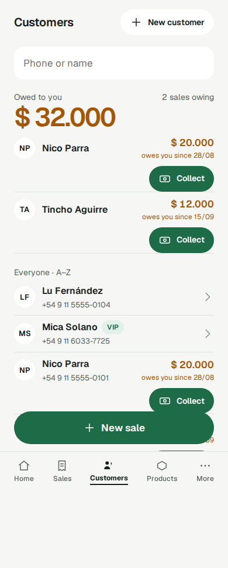
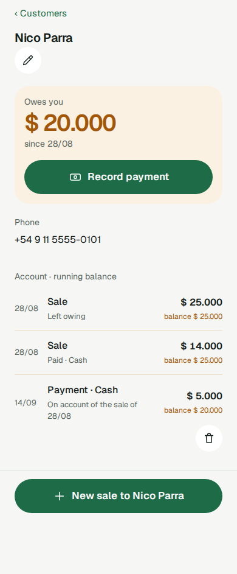
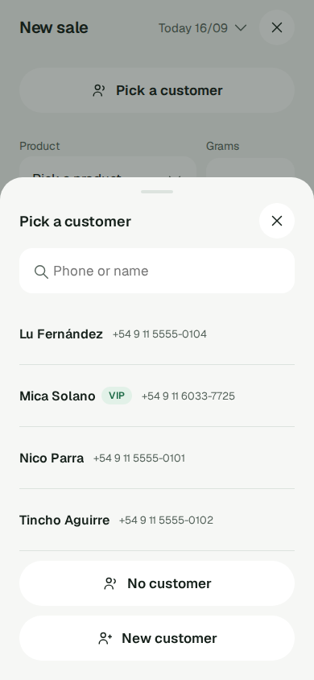
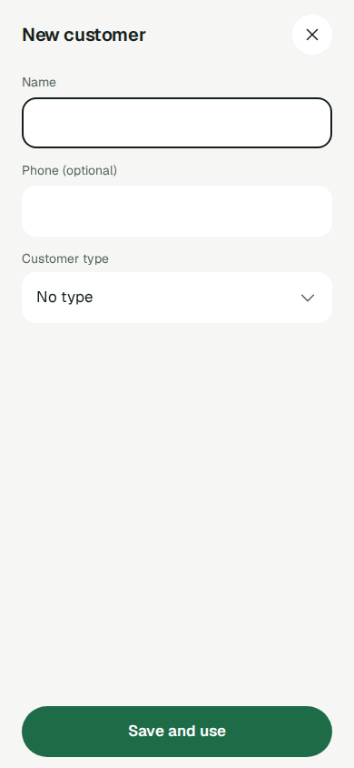
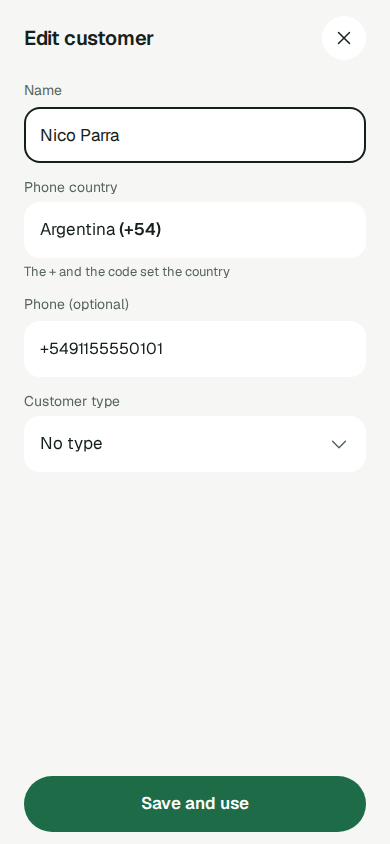
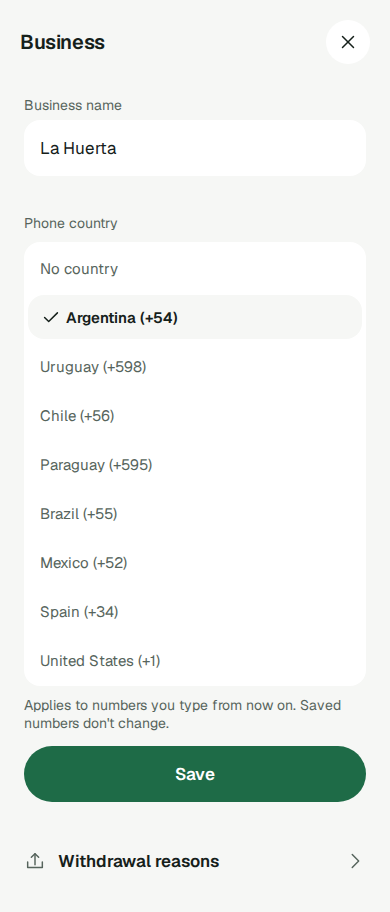

## Jobs

**Cuando** entrego un pedido o recibo un pago, **quiero** encontrar al cliente por parte de su nombre o de su número, o registrarlo en el momento si es nuevo, **para que** cada venta y cada deuda caiga en una persona real y yo sepa siempre quién me debe.

**Cuando** registro a un cliente (desde Customers, en medio de una venta o con la **Spreadsheet import** única) y no tengo su Phone number, **quiero** guardarlo igual con su nombre y agregar el número más adelante si algún día lo consigo, **para poder** registrar cada venta y cada deuda a nombre de la persona que de verdad debe, sin inventar un número ni dejar a esa persona fuera de la app.

**Cuando** agrego o edito el Phone number de un cliente, **quiero** tipearlo como lo diría en mi propio país y que la app lo guarde en forma internacional, **para que** la misma persona nunca quede registrada dos veces y yo nunca tipee a mano un código de país, sea cual sea el país de mi negocio. (GH-409, parte de GH-318: lo sirve el **Phone country** de Settings → Business.)

**Cuando** abro un Customer o recorro mi lista de Customers en el celular, **quiero** ver cada número agrupado como lo escribe la gente del país de ese mismo número, **para poder** leerlo, chequearlo y copiarlo sin contar mal los dígitos. (Parte 1 de GH-682: lo sirve el número agrupado de la fila de Customers, la ficha, la tarjeta de atrás y los dos selectores de Customer de New sale.)

**Cuando** tengo clientes habituales a los que trato distinto, **quiero** agruparlos en tipos a los que les pongo nombre yo y elegir el tipo de cada uno desde su ficha, **para poder** distinguirlos de un vistazo, y más adelante cobrarles según su tipo, sin depender de la memoria ni de notas. (GH-405, parte de GH-318: lo sirven los Customer types de Settings → Prices y el campo "Customer type" del formulario.)

**Cuando** configuro cómo fija sus precios mi negocio, registro el precio de un producto o entrego un pedido, **quiero** que la app use solo las **Pricing rules** que tiene mi negocio (un **Bulk price** si vendo por cantidad, y un VIP price que fijo por producto para mis VIP customers), **para poder** cobrarle a cada cliente exactamente lo que quiero sin escribir un **Special price** a mano, sin ver campos que no me aplican y sin que el precio de nadie cambie de sorpresa. (Lo sirve acá la pertenencia al VIP type, que sigue al interruptor Customer types; definido en pricing-settings.md.)

**Cuando** manejo mi negocio desde el celular, **quiero** mantener al día mis clientes desde el celular, **para poder** dejar de tenerlos en la planilla y tener datos reales cuando lleguen las ventas.

**Cuando** un cliente me paga parte o todo lo que debe, en efectivo o por transferencia, el mismo día o semanas después, **quiero** registrarlo desde el celular en pocos toques y ver que su Balance y su "owing since" bajan en el acto, **para** saber siempre quién me debe qué y desde cuándo, y que nada de lo que pagó o todavía debe se pierda ni caiga en la persona equivocada. (Lo sirve acá la sección "Owed to you" de Customers y su "Collect", y el Balance, la cuenta y Record payment de la ficha; definido en `payments.md`.)

**Cuando** manejo mi negocio desde el celular entre pedidos o en medio del chat con un cliente, varias veces por día, **quiero** que la app esté armada según lo que hago de verdad y con qué frecuencia, **para poder** volver con el cliente en lugar de buscar entre menús. (El job de **Navigation**, navigation.md: lo sirve acá Customers, que se abre en quién debe, con "Collect" en cada fila de deudor.)

**Cuando** un cliente me paga parte o todo lo que debe, o entre pedidos quiero saber quién todavía me debe y desde cuándo, **quiero** que Customers se abra en quién me debe (el total, y cada deudor con la deuda más vieja primero, con su Balance y desde cuándo) y cobrarle a cualquiera en un toque, **para poder** mantener cada Balance al día y perseguir primero las deudas más viejas, sin abrir fichas una por una, hacer cuentas ni completar campos que nunca uso.

**Cuando** registro una Expense o guardo un Customer desde el celular, **quiero** elegir su Expense category o su Customer type igual que elijo un Product o un Withdrawal reason (un campo con etiqueta que abre su propia lista, con búsqueda cuando la lista es larga), **para** terminar el formulario en pocos toques y que volver nunca tire lo que ya tipeé. (Parte 6 de GH-581, compartido con expenses.md y selector.md: acá lo sirve el campo "Customer type" del formulario del Customer.)

# Clientes

Las personas a quienes un **Business** le vende, cada una identificada dentro de ese Business por su propio registro, y vistas solo por ese Business (ADR-0004). El nombre es la forma en que un **User** reconoce a un **Customer**; el **Phone number** es un dato de contacto opcional.

Las **Sales** y los **Payments** se apoyan en esta capacidad: toda Sale y toda deuda pertenece a un Customer de acá. Cada Customer puede estar en un **Customer type** que define el vendedor, o en ninguno. Un **VIP customer** es un Customer del **VIP type** y paga el **VIP price** de un **Product** cuando lo tiene y es menor que lo que da cualquier otra regla. Esto vale solo en un Business con el interruptor Customer types activado (pricing-settings.md, sales.md).

El **Balance**, el **Owing since** y la cuenta de un Customer se definen en `payments.md` y se muestran en su ficha y en la sección "Owed to you" de Customers.

Corregir los datos de un cliente sirve a los mismos jobs. En un negocio con el interruptor Customer types activado, a un cliente del VIP type se le cobra su VIP price en cada venta en la que es el más bajo, así que el vendedor nunca tiene que acordarse de quién es amigo.

La sección "Owed to you" afina el job de pagos y el job de Navigation de arriba para Customers (GH-46); no es un job nuevo. Su protagonista es el vendedor, en el celular; la computadora, con dos paneles, es el mismo job en una pantalla más grande. Tiene dos momentos: cobrar (el principal: un cliente entrega plata, en medio del chat o al entregar) y revisar (entre pedidos o al final del día). Antes, quién debía vivía en una pantalla Owed to you aparte, cobrar una deuda llevaba cuatro toques desde Customers, y el formulario del cliente pedía un canal (Telegram o WhatsApp) que nada del producto usaba.

El job de los Customer types tiene dos momentos: una configuración puntual (el vendedor decide que algunos habituales forman un grupo propio y lo nombra en Settings → Prices → Customer types) y el uso diario (al dar de alta o editar un Customer, dice en qué grupo está). Antes, la única forma de agrupar era la marca VIP de sí o no, y cualquier otro grupo ("mayorista", "amigo") vivía en la cabeza del vendedor o en la Note de una Sale.

El job del **Phone country** (GH-409, ADR-0082) también tiene dos momentos: una configuración puntual (el vendedor elige el país de su negocio en Settings → Business → Phone country) y el uso diario (al dar de alta o editar un Customer, tipea el número como lo dice en voz alta). Antes, todo número tipeado sin `+` se leía como un celular argentino, fuera cual fuera el país del negocio: un vendedor de afuera tenía que tipear la forma internacional completa cada vez, y la regla argentina estaba fija en el código, justo el tipo de supuesto que el criterio 4 (**Assume nothing**) manda volver configurable.

El job del número agrupado (parte 1 de GH-682) no tiene configuración: es solo lectura. Las situaciones principales son copiar o marcar el número para escribirle a un Customer por Telegram o WhatsApp, y chequear que el número guardado es el correcto, por ejemplo cuando dos Customers se parecen; leérselo en voz alta al cliente es secundario y lo cubre la misma presentación. Antes, solo los números argentinos se mostraban agrupados, con una regla argentina fija en el front, y cualquier otro número se veía como una sola tira (`+59899123456`): un Business con Customers fuera de Argentina veía peor sus números que uno con Customers argentinos, en contra de **Assume nothing**. Se supone que ningún vendedor tiene hoy un atajo para esto; si lo tuviera, la definición sería la misma.

El campo "Customer type" se elige con el Selector desde la parte 6 de GH-581 (selector.md), igual que cualquier otro Growable set. Antes era un select nativo que no se comportaba como el resto: sin búsqueda, sin fila para borrar y sin que volver en el celular actuara sobre la lista.

Criterios de éxito:

1. Desde el celular, un vendedor encuentra a un Customer existente por parte del nombre o parte del número, o registra uno nuevo con o sin número, con la rapidez suficiente para que una Sale con un Customer nuevo siga llevando menos de un minuto.
2. Un Phone number es como máximo de un Customer en un Business, sin importar cómo se escriba. Registrarlo de nuevo, o cambiar el número de un Customer por uno que ya está en uso, se rechaza. El rechazo dice que el número ya pertenece a un Customer y nunca repite el número ni el nombre. Dos Customers sin número nunca chocan.
3. Los Customers de un Business son visibles solo para ese Business. Por id desde otro Business responden 404. Las listas y búsquedas desde otro Business no muestran ninguno. El mismo número puede ser un Customer en dos Businesses sin que ninguno de los dos lo sepa.
4. Todo lo de acá se hace desde el celular, sin ninguna llamada a la API a mano.
5. **Un Customer sin número es un Customer normal, no uno degradado.**
   - Se lo puede registrar, editar, encontrar por nombre, elegir para una Sale, dejar debiendo, saldar y listar en la sección "Owed to you" de Customers como a cualquier otro.
   - La ficha y la lista no muestran ninguna etiqueta vacía, ningún guion ni ningún "No phone" donde iría un número.
6. **Nada retrocede para los Customers que tienen número.**
   - La normalización, el rechazo del número mal formado, la unicidad (al registrar y al editar), la búsqueda por número y los rechazos que nunca repiten el número ni el nombre siguen todos como están.
   - Se puede quitar el número de un Customer, y sus Sales, Payments y Balance se quedan con él.
7. **Sin canal.** Un Customer no tiene canal (Telegram o WhatsApp): ni en la API, ni en los formularios, ni en la ficha, ni en la lista, ni en el **Business export**, ni en la base de datos. Quitarlo no cambia nada más de ningún Customer.
8. **El tipo sigue al interruptor y nunca se pierde.**
   - Mientras Customer types está apagado, ningún tipo, campo de tipo ni marca VIP se muestra en ninguna pantalla de Customer.
   - Al encenderlo de nuevo, toda pertenencia guardada vuelve como estaba, incluso para los Customers editados mientras estuvo apagado.
9. **Cobrar rápido.** Record payment se abre con el Customer elegido en 2 toques como máximo desde cualquier **Tab root** ("Collect" en una fila de Customers o en una fila de Home). Un Payment se registra en menos de un minuto, y "All" salda todo el Balance en un toque. En una computadora no lleva más toques que en el celular.
10. **Quién debe, de un vistazo.** Customers se abre en "Owed to you": el **Total owed**, la línea de cantidad ("1 sale owing" o "N sales owing") y cada deudor con el Owing since más viejo primero, cada uno con Balance y "since dd/mm". Todos de la A a la Z quedan abajo. Toda cifra sale de la API y es igual al bloque "Owed to you" de Home y a un cálculo directo. Sin scrollear la lista de la A a la Z y sin sumas.
11. **La ficha cierra el circuito.** Desde la ficha de un Customer el vendedor ve su Balance y su cuenta, "Record payment" (cuando debe) y "New sale to <name>", con ese Customer ya elegido.
12. **Los VIP de antes llegan a su tipo.** Después de la actualización, todo Customer que tenía la marca VIP está en el VIP type de su propio Business, y ningún otro Customer tiene tipo.
13. **Tipos propios desde el celular.** En el celular, un vendedor crea un tipo con nombre e ícono y se lo asigna a un Customer desde el formulario en menos de un minuto.
14. **Nada de lo cobrado ni de lo debido cambia.** Las Sales registradas, las **Price entries**, los Balances y los **Settlements** quedan exactamente como estaban. Una Sale nueva para un VIP customer de antes se cotiza igual que antes de la actualización.
15. **Los tipos no se mezclan.** Un Business nunca ve ni se entera de que existen los tipos de otro Business.
16. **El tipo se elige con el Selector** (parte 6 de GH-581). Con 12 o más Customer types, el vendedor encuentra uno buscando y lo elige; el formulario no tiene ningún otro tipo de selector para ese campo (ni select nativo, ni chips, ni radios, ni botones presionados).
17. **Volver nunca tira el formulario.** En el celular, volver con la lista de tipos abierta cierra solo la lista; volver con el formulario sin tocar vuelve a la pantalla madre; volver con cambios sin guardar pide la confirmación de descarte. Vale al dar de alta y al editar un Customer. En la computadora, Escape cierra solo el desplegable.
18. **Nada se pierde y nada engaña mientras carga.** El tipo se sigue pudiendo quitar ("No type"), el aviso "Add a customer type" sigue igual cuando no hay tipos, el rechazo por un tipo que ya no existe sigue igual, y mientras los tipos se cargan (o después de una carga fallida) no se muestra ni "No type" ni el aviso; una carga fallida se informa con la línea de falla existente de la app.
19. **Número local, guardado internacional.** Al dar de alta o editar un Customer en el celular, el vendedor tipea solo el número local, sin código de país, y se guarda y se muestra en forma internacional según el Phone country del Business.
20. **Una sola persona, se tipee como se tipee.** Un número que ya pertenece a otro Customer del Business se detecta como el mismo número, se haya tipeado en forma local o internacional, y nunca crea un segundo Customer.
21. **Los Businesses existentes no notan nada.** Argentina sigue siendo su Phone country con la regla de celular de hoy, y ningún número guardado cambia.
22. **Cada país con su regla.** El Phone country se cambia en Settings → Business → Phone country, y un Business fuera de Argentina recibe la regla de su propio país, no la argentina.
23. **Cada número, agrupado según su país** (parte 1 de GH-682). Todo número guardado de un país de la lista (Argentina, Uruguay, Chile, Paraguay, Brazil, Mexico, Spain, United States) se muestra agrupado con la regla de ese país, igual en los cinco lugares donde se lee un número: la fila de Customers, la ficha, la tarjeta de atrás, el selector de Customer de New sale y el paso de Customer de New sale. El campo del teléfono del formulario no es uno de ellos.
24. **Lo que no se puede agrupar se muestra tal cual.** Un número de un código de país fuera de la lista, o de un largo sin plantilla, se muestra exactamente como está guardado: nunca se oculta, se corta ni se cambia.
25. **Agrupar solo agrega espacios y guiones.** Los dígitos y el valor guardado nunca cambian; guardar, validar y la regla de que dos Customers nunca comparten un número no se tocan.
26. **Nada nuevo para el vendedor.** No aprende, tipea ni configura nada nuevo: ninguna opción, ninguna elección, ningún texto. El agrupado sale solo del número guardado, sea cual sea el Phone country del Business. Un Customer sin número no muestra ninguno.

## Comportamiento

- **Customer**: un nombre, un Phone number opcional y como máximo un Customer type. Un Customer se identifica por su propio registro (su id), nunca por su número. Su Balance y su Owing since se calculan a partir de sus Sales y Payments (`payments.md`) y nunca se guardan en el Customer.
- **Nombre**: obligatorio. Recortado, con los espacios internos colapsados, hasta 60 caracteres. No es único.
- **Sin canal**: el antiguo canal (Telegram o WhatsApp) se quitó del dominio, la API, los formularios, la ficha, la lista, el Business export y la base de datos.
  - Un pedido que todavía manda uno se completa bien: el canal se ignora, nunca se guarda, y ninguna respuesta lo lleva. El vendedor no ve diferencia, porque ningún formulario ofrece el campo.
  - **Los valores guardados se descartan para siempre.** La migración que elimina la columna no conserva copia en ningún lado; el producto no puede recuperarlos, y la eliminación no se puede deshacer desde adentro.
  - **Supuesto**: ningún vendedor va a necesitar los valores viejos del canal; quien los necesite igual puede encontrar al Customer por nombre o por número.
- **Customer type** (hexágono `customer_types`, ADR-0055):
  - Un tipo tiene un nombre obligatorio y un ícono obligatorio, y pertenece a un solo Business (`business_id` no nulo). La API lo devuelve como `{id, name, icon, is_vip}`; `is_vip` es de solo lectura y ningún pedido lo fija.
  - **Nombre**: de 1 a 40 caracteres después de recortar los espacios, texto libre, único dentro del Business sin importar mayúsculas, minúsculas ni espacios, tanto al crear como al renombrar. No hay límite de cantidad de tipos por Business.
  - **Ícono**: uno de un conjunto fijo de ocho claves neutras, guardadas tal cual: `circle` (el valor por defecto de un tipo nuevo), `star`, `heart`, `diamond`, `flag`, `tag`, `crown` y `bell`. Ninguno es de flor ni propio de un tipo de negocio. Una clave desconocida se rechaza (`customer_type.icon_unknown`). Siempre va junto al nombre del tipo, nunca solo (icon-and-text-rule.md); la única excepción es una celda del selector de íconos, que lleva su nombre accesible ("Circle", "Star", etcétera).
  - **Sin precio propio**: los tipos que crea el vendedor no llevan precio. Los precios por tipo los entrega la parte customer-type prices (ADR-0059).
  - **Un Business nuevo** arranca sin ningún tipo (ADR-0059).
  - **Eliminar**: un tipo se puede eliminar solo mientras no tiene ningún Customer. El rechazo (`customer_type.in_use`, 409) lleva cuántos Customers tiene. Ningún Customer queda sin tipo en silencio.
  - Los Customer types son un Growable set: nunca se declaran en `fixedSets.ts` ni se eligen con chips (selector.md).
- **Pertenencia**: un Customer está en un tipo o en ninguno (`customer.customer_type_id`, nulo cuando no tiene).
  - Se elige en el formulario del Customer y se puede cambiar o quitar (con "No type") en cualquier momento.
  - Un tipo de otro Business, o uno que ya no existe, responde 404 (`customer_type.not_found`), igual que cualquier otra referencia.
  - **Mientras Customer types está apagado**:
    - toda pertenencia sigue guardada, y la API la sigue devolviendo;
    - guardar un Customer nunca la cambia, sin importar lo que mande el pedido;
    - un Customer creado entonces no tiene tipo.
- **VIP type**: el tipo "VIP" que la actualización creó en cada Business existente, con el ícono `star` (ADR-0059), o que la Spreadsheet import crea (abajo). Es la única fila marcada `is_vip` de su Business (ADR-0070).
  - Es el único tipo cuya pertenencia da el VIP price en las Sales nuevas, con la regla de hoy: la Price entry tiene un VIP price y es menor que lo que da cualquier otra regla, y solo mientras Customer types está activado (sales.md, pricing-settings.md).
  - Lo identifica esa marca, puesta solo por la actualización o la Spreadsheet import, nunca su nombre: renombrarlo o cambiarle el ícono no cambia nada, y un tipo que el vendedor llama "VIP" no da ningún VIP price.
  - En la lista de tipos se ve como cualquier otro, sin ninguna marca propia.
  - Un Customer que entra al VIP type recibe el VIP price desde su próxima Sale; uno que sale deja de recibirlo. Las Sales ya registradas conservan su precio y su Pricing rule (ADR-0003).
  - Sigue las mismas reglas que cualquier tipo: una vez sin Customers se puede eliminar, y desde entonces nadie recibe el VIP price.
  - El campo `vip` de un Customer en la API es la pertenencia al VIP type, sea cual sea el interruptor; las pantallas lo ocultan mientras está apagado.
  - En la lista de Sales, la insignia VIP de una Sale muestra si el Customer está hoy en el VIP type, no cómo se fijó el precio de esa Sale (sales.md).
- **La marca VIP congelada** (`customer.is_vip`): se conserva con el valor que tenía, ya no se lee y nunca se vuelve a escribir para ningún Customer después de la actualización, por ningún camino (la API, la Spreadsheet import, la apertura de un Business). Un pedido que todavía manda `vip` se completa bien y el campo se ignora.
- **Phone country** (GH-409, ADR-0082): el país con el que un Business lee un número tipeado sin `+` y su código de país. Se guarda en `business.default_phone_country` como código ISO 3166-1 alfa-2, o nulo cuando no hay ninguno. La columna es de accounts; las reglas de cada país viven en una sola tabla compartida, `app/shared/phone_country.py`, que leen el dominio de customers y accounts.
  - **La lista** de esta versión, decidida por el dueño el 2026-11-07, en este orden: Argentina (AR), Uruguay (UY), Chile (CL), Paraguay (PY), Brazil (BR), Mexico (MX), Spain (ES) y United States (US). Cada país tiene su propia regla con sus propios tests: código de país, largo o largos válidos del número nacional, cómo se tipea un número local (su prefijo de larga distancia y, para Argentina, el `15`), una plantilla de agrupado por largo nacional y un ejemplo de cómo lo tipea un vendedor. La lista crece de a un país sin cambiar ningún número guardado. Ningún código de país de la lista es prefijo de otro. El orden lo da un solo lugar de la tabla (`listed_countries()`), que leen tanto `GET /business` como `GET /phone-countries`.

    | País | Código | Largo nacional | Prefijo de larga distancia | Particularidad | Agrupado por largo |
    |---|---|---|---|---|---|
    | AR | 54 | 10 | 0 | siempre celular: agrega el `9` y descarta el `15` | 10: `## ####-####`, después de `+54 9 ` |
    | UY | 598 | 8 | 0 | | 8: `## ### ###` |
    | CL | 56 | 9 | ninguno | | 9: `# #### ####` |
    | PY | 595 | 8 o 9 | 0 | | 9: `### ######`; 8: `## ######` |
    | BR | 55 | 10 u 11 | 0 | admite un código de operadora de 2 dígitos después del 0 | 11: `## #####-####`; 10: `## ####-####` |
    | MX | 52 | 10 | ninguno | descarta el `1` de celular viejo entre el 52 y los 10 dígitos | 10: `## #### ####` |
    | ES | 34 | 9 | ninguno | | 9: `### ### ###` |
    | US | 1 | 10 | 1 | | 10: `### ###-####` |

    Solo se controlan los largos, nunca los primeros dígitos del número nacional.
  - **La tabla se valida al cargar** (`PhoneCountryRule.__post_init__`): rechaza un largo sin plantilla, una plantilla para un largo que el país no tiene, una plantilla cuya cantidad de `#` no es su largo, cualquier separador que no sea espacio o guion, y un país sin ejemplo. Los mensajes nombran la regla rota, nunca un dato. Es el único lugar que declara códigos de país, largos, reglas de prefijo, plantillas y ejemplos; ningún otro módulo, archivo del front ni texto del Copy module repite ninguno.
  - **Los Businesses existentes** quedan en Argentina, con exactamente la regla de hoy.
  - **Un Business nuevo** arranca sin Phone country (cada camino que abre un Business, la aceptación de una Invitation y el comando del Operator, lo deja nulo): hasta que el vendedor elige uno, solo se acepta la forma internacional con `+`. No hay paso de Onboarding para él, y nunca se adivina a partir del idioma del teléfono.
  - Cualquier User del Business lo cambia en cualquier momento, sin paso de confirmación, desde Settings → Business → Phone country; también se puede volver a "No country". Ningún número guardado cambia: el país nuevo gobierna solo los números que se tipeen desde entonces.
  - **El Phone country nunca decide cómo se muestra un número guardado**: eso lo decide el código de país del propio número (abajo).
  - **API**: `GET /business` agrega `phone_country` (el código o `null`) y `phone_countries`, la lista `[{code, calling_code}]` en el orden de arriba; el front guarda solo los nombres de los países, en el Copy module. `PUT /business/phone-country`, con cuerpo `{"phone_country": "UY"}` o `{"phone_country": null}`, fija el del Business de la Session y nada más, y responde el valor guardado con las opciones. Un código fuera de la lista se rechaza con `business.phone_country_unknown` (422). No dispara ningún Upkeep.
  - **`GET /phone-countries`** (parte 1 de GH-682), ruta protegida del hexágono de customers: responde `[{code, calling_code, national_lengths, example}]`, con los largos de menor a mayor, en el orden de la lista, y sus pares `(code, calling_code)` son los mismos y en el mismo orden que `phone_countries` de `GET /business`. No lee nada propio del Business y responde lo mismo a todo Business, pero exige una Session.
- **Phone number**: opcional, único dentro del Business entre los Customers que tienen uno, guardado en una sola forma internacional. Se normaliza al dar de alta o editar un Customer, según estas reglas:
  - **Ninguno**: un valor faltante, `null`, o uno en blanco tras recortar significa que el Customer no tiene número. Se guarda como sin número, nunca como string vacío.
  - **Con `+` y el código de un país de la lista**: se normaliza con la regla de ese país, sea cual sea el Phone country del Business, así coincide con el mismo número tipeado en forma local. Se rechaza si no encaja en esa regla. Por eso un `+1` ya no es "cualquier otro código": sigue la regla de United States (`+1` y exactamente 10 dígitos).
  - **Con `+` y cualquier otro código**: un número de un país fuera de la lista. Se acepta tal como se escribió, sea cual sea el Phone country: se guarda como `+` y sus dígitos, que deben ser de 8 a 15 y no empezar con 0 (p. ej. `+44345678` y `+443456789012345`).
  - **Sin `+`, con un Phone country**: se quitan los separadores; los dígitos cuentan como internacionales cuando empiezan con el código del Phone country y tienen uno de los largos internacionales completos de ese país; si no, se leen como un número local de ese país: se descarta su prefijo de larga distancia (y, en Brazil, un código de operadora de 2 dígitos), y lo que queda debe tener un largo nacional válido. Se guarda como `+`, el código y el número nacional.
  - **Sin `+`, sin Phone country**: se rechaza; solo se acepta la forma con `+`.
  - **La regla de Argentina**, exactamente la de hoy:
    - `+54`, o un `54` a secas, seguido de 10 dígitos, o de un `9` y 10 dígitos, es un número argentino con su código de país, y se guarda como `+549` y los 10 dígitos;
    - cualquier otra cosa sin `+` es un número argentino local: se descartan un `0` inicial y el `15`, y deben quedar exactamente 10 dígitos, código de área incluido; se guarda como `+549` y esos 10 dígitos;
    - los teléfonos fijos no se rechazan: todo número argentino se trata como celular. Solo Argentina hace esto; los demás países aceptan cualquier número nacional de largo válido, fijos incluidos;
    - `11 2345-6789`, `011 15 2345-6789`, `+54 9 11 2345 6789`, `5491123456789` y `541123456789` pasan todos a ser `+5491123456789`.
  - **El resultado es el mismo se tipee como se tipee**, así que una grafía local y una internacional de un mismo número coinciden y la unicidad las detecta. La forma guardada, vuelta a normalizar con cualquier país o sin ninguno, queda igual.
  - **Un número sin tocar se conserva**: si al editar un Customer el pedido manda exactamente el número que ya tiene guardado, se conserva tal cual, sin volver a normalizarlo, sin chequear la unicidad y sin rechazarlo, aunque el Phone country haya cambiado desde que se guardó o ya no haya ninguno. Un número guardado que hoy ninguna regla produciría (p. ej. un `+521…` o un `+1` de otro largo) sigue cargando y se conserva así. Una grafía distinta del mismo número se vuelve a normalizar, y eso se acepta. Una escritura así nunca lee, interpreta ni valida la tabla de países.
  - **Rechazado**: un valor no en blanco que no encaja en ninguna regla (demasiado corto, demasiado largo, sin código de área, o sin `+` en un Business sin Phone country). Cada rechazo tiene su `code` en `contract.json` y nunca repite lo que se escribió ni el nombre:
    - `customer.phone_needs_country_code`: solo para un número sin `+` en un Business sin Phone country; dice "Start the number with + and the country code.";
    - `customer.phone_invalid`: cualquier otro número que no encaja; dice "Enter the number with its area code, or start with + and the country code.".
- **Número agrupado para leer** (parte 1 de GH-682, `PhoneNumber.display`): cómo se muestra un número guardado, calculado del valor guardado cada vez que se lee, nunca guardado, nunca calculado en una escritura y sin migración.
  - **Lo decide el código de país del propio número**, nunca el Phone country del Business: un número uruguayo se ve agrupado a la uruguaya en un Business con Argentina, en uno sin país y en uno con cualquier otro país.
  - Se busca el país por su código, se quita el código (y, en Argentina, el `9` de celular) y se aplica la plantilla del largo nacional que queda, con `+`, el código y un espacio adelante (`+54 9 ` en Argentina).
  - **Solo agrega espacios y guiones**: sin ellos, el número mostrado es exactamente el guardado.
  - **Lo que no encaja se muestra tal cual**: un código fuera de la lista, un número argentino sin el `9` de celular, o un largo sin plantilla, devuelve el valor guardado sin cambios, nunca oculto, cortado ni alterado.

    | Guardado | Se muestra |
    |---|---|
    | `+5491123456789` | `+54 9 11 2345-6789` |
    | `+59899123456` | `+598 99 123 456` |
    | `+56912345678` | `+56 9 1234 5678` |
    | `+595981123456` | `+595 981 123456` |
    | `+59521123456` | `+595 21 123456` |
    | `+5511912345678` | `+55 11 91234-5678` |
    | `+551112345678` | `+55 11 1234-5678` |
    | `+525512345678` | `+52 55 1234 5678` |
    | `+34612345678` | `+34 612 345 678` |
    | `+12125551234` | `+1 212 555-1234` |
    | `+59312345678` (código fuera de la lista) | `+59312345678` |
    | `+5212345` (largo sin plantilla) | `+5212345` |

  - **API**: cada Customer de la lista y del detalle (y de las respuestas de alta y edición, que pasan por el mismo armado) lleva `phone_display` (el número agrupado, o `null` sin número). El cambio es aditivo; `docs/api/openapi.json` y `tests/fixtures/openapi_snapshot.json` se regeneran en el mismo cambio.
  - El front nunca agrupa un número por su cuenta: muestra `phone_display` tal como llega, y ya no tiene formateador propio. Detectar el país no hace ninguna llamada de red ni escribe nada en el almacenamiento del navegador ni en el servidor.
- **Unicidad**: un número ya usado por otro Customer del mismo Business se rechaza (`customer.phone_taken`, "That phone number already belongs to another customer."), tanto al registrar como al editar, se haya tipeado en forma local o internacional. El rechazo nunca repite el número ni el nombre. Cualquier cantidad de Customers puede no tener número. Los números de otros Businesses nunca chocan y nunca se revelan.
- **Edición**: nombre, Phone number y Customer type (el tipo solo mientras Customer types está activado).
  - El Phone number pasa por la misma normalización, el mismo chequeo de unicidad y el mismo rechazo que al registrar, salvo el número guardado mandado sin tocar, que se conserva (arriba).
  - Se puede borrar, y el Customer queda sin número.
  - Las Sales, los Payments y el Balance pertenecen al Customer, no al número, así que siguen asociados cuando este cambia o se quita.
- **Lista y búsqueda**: una sola consulta. El Phone country no la cambia: la búsqueda compara con los dígitos guardados, así que una grafía local tipeada en la búsqueda no se normaliza.
  - El nombre coincide con la consulta en cualquier parte, sin importar mayúsculas ni acentos.
  - El número coincide con los dígitos de la consulta, sin un 0 inicial, en cualquier parte de los dígitos del número guardado. Un Customer sin número nunca coincide por número, y una consulta sin dígitos no coincide con ningún número.
  - Un Customer coincide si coincide el nombre o el número; un Customer sin número se encuentra por nombre.
  - Una consulta vacía devuelve todos los Customers.
  - Los resultados se ordenan por nombre.
  - No hay paginación, ni largo mínimo de consulta, ni filtro VIP ni por tipo, ni filtro para los Customers sin número.
- **Almacenamiento**: la columna del teléfono admite nulos; la unicidad dentro de un Business se aplica solo a los números guardados. Los Customers que existían antes de que el número fuera opcional conservaron sus números. La columna del canal se elimina con una migración en la cadena única de Alembic; todas las demás columnas y el nombre, el número, el VIP, las Sales, los Payments y el Balance de cada Customer quedan exactamente como estaban.
- **Migración del Phone country** (revisión `0029`, con `down_revision` `0028`, GH-409): agrega la columna nula `business.default_phone_country` (dos letras, sin valor por defecto) y la completa con `AR` para cada Business existente. Nunca cambia el valor de una columna que ya existía, ningún número guardado incluido; el comparador M3 compartido de `tests/migrations/` lo prueba.
- **Migración de los Customer types** (revisión `0020`, ADR-0059): agrega la tabla `customer_type` y la columna nula `customer.customer_type_id`, y nunca cambia el valor de una columna que ya existía.
  - Cada Business existente recibe un tipo "VIP" con el ícono `star`: su VIP type. Lo recibe incluso sin ningún VIP customer, así puede seguir dando el VIP price.
  - Solo los Customers con la marca VIP reciben ese tipo; ningún otro Customer recibe tipo.
  - La marca VIP queda guardada tal cual. El comparador M3 compartido de `tests/migrations/` lo prueba.
- **Spreadsheet import** (import.md): sigue leyendo los números de la planilla como argentinos (pasa Argentina de forma explícita), sea cual sea el Phone country del Business, y nunca lee ni fija el Phone country. Un VIP de la planilla entra al VIP type de ese Business; nunca escribe la marca congelada.
  - Si el Business ya tiene su VIP type, lo usa, se llame como se llame hoy.
  - Si la planilla tiene al menos un VIP y el Business no tiene VIP type, la Spreadsheet import lo crea con el nombre "VIP".
  - **Si en ese caso el Business ya tiene un tipo propio del vendedor llamado "VIP"** (sin importar mayúsculas ni espacios), la Spreadsheet import se detiene antes de escribir nada y le dice al Operator, con un texto fijo del Copy module en su terminal, que ese tipo existe y hay que renombrarlo o eliminarlo antes de volver a correrla. Nunca toma el tipo del vendedor como VIP type ni crea el VIP type con otro nombre. No es una **Unfinished row**: es un chequeo sobre el Business, previo a toda escritura, y no nombra ningún Customer ni monto.
- **Business export** (accounts.md, ADR-0015): las tablas de Customers y de Customer types siguen el esquema por reflexión, así que los Business exports nuevos y el registro de tablas y columnas de la **Business removal** llevan los Customer types y la pertenencia, y no llevan canal. El encabezado del Business (`{id, name, language, default_phone_country}`, más `last_sale_number` cuando el Business lo lleva) se lista a mano y ahora lleva el Phone country; un test que refleja la tabla `business` exige que el encabezado lleve cada una de sus columnas. Los Business exports escritos antes del cambio conservan lo que tenían; nada importa un Business export de vuelta. Las cantidades exportadas siguen siendo iguales a las eliminadas. El número agrupado no se exporta: es una cifra calculada.
- **Aislamiento (ADR-0004)**:
  - El Business sale de la **Session**, y el Phone country que se aplica es siempre el de ese Business.
  - El Customer de otro Business responde 404 tanto al leer como al editar; el Customer type de otro Business responde 404 al leer, renombrar, cambiar el ícono, eliminar y asignar.
  - Las listas y búsquedas no muestran ninguno de los Customers ni de los Customer types de otro Business.
  - Las rutas de Customer, de Customer type (`/api/customer-types`), `PUT /business/phone-country` y `GET /phone-countries` están en `tests/test_business_isolation.py` y en el test de rutas protegidas.
- **Sin eco**: ningún error, línea de log ni mensaje en pantalla repite un número.

### En pantalla: Customers

- **Customers** es una Tab root (navigation.md). En una computadora son dos paneles: la lista a la izquierda, la ficha del Customer seleccionado a la derecha. Customers no selecciona nada por su cuenta.
- **La pantalla se abre con dos secciones**, sin ninguna cifra de deuda tocable en su cabecera:
  1. **"Owed to you"**, arriba: el Total owed, la línea de cantidad ("1 sale owing" o "N sales owing"), y todo Customer cuyo Balance es mayor que $0, con el Owing since más viejo primero, los empates por nombre, cada fila con "Collect" (`payments.md`). Si nadie debe, dice un "Nobody owes you" fijo, sin nada para tocar, arriba de la lista completa de la A a la Z.
  2. **Everyone, A–Z**, abajo, ordenados por nombre.
- Toda cifra de Owed to you sale de la API y es igual al bloque "Owed to you" de Home; el navegador no calcula nada.
- **Toda fila de quien debe**, en cualquiera de las secciones y en los resultados de búsqueda, muestra el monto en ámbar con "owes you since dd/mm" debajo, nunca como chip, y un botón "Collect" (nombre accesible "Collect from <name>") que abre Record payment con ese Customer ya elegido, como un paso más en el historial de la app; volver o "Close" lo deja en un solo movimiento. Tocar el resto de la fila abre la ficha del Customer.
- **Quien tiene Credit** nunca aparece en Owed to you y no cuenta en ninguna cifra. En todos de la A a la Z muestra "Credit $ X" con el tratamiento neutro/azul, nunca verde ni ámbar.
- **Quien tiene un Balance de $0** no muestra nada sobre dinero.
- **El número en la fila** (`ClienteFila`, en Customers y en la lista de la tarjeta de atrás) es el número agrupado (`phone_display`), o el guardado tal cual cuando no encaja en ninguna plantilla. Las filas de "Owed to you" siguen sin número, como antes.
- **Quien no tiene número** no muestra nada en el lugar del número: ni guion, ni etiqueta vacía, ni "No phone".
- **La marca VIP** se muestra en las filas de la lista y en Pick a customer solo mientras Customer types está activado, y dice si el Customer está en el VIP type; nunca muestra el nombre ni el ícono de un tipo. Mientras está apagado, no se muestra nada en su lugar. Las filas no muestran el Customer type.
- **Búsqueda** por parte del nombre o del Phone number: mientras se escribe una consulta, las dos secciones se colapsan en una sola lista plana ordenada por nombre, con las coincidencias como arriba; un Customer que debe conserva su Balance, "owes you since dd/mm" y "Collect". Borrar la consulta trae de vuelta las dos secciones.
- **La ficha de un Customer** (`ClienteFicha`), una tarjeta con "‹ Customers":
  - teléfono, agrupado según el país de su propio código (p. ej. `+54 9 11 2345-6789`, `+598 99 123 456`), o tal como está guardado cuando su código no está en la lista o su largo no tiene plantilla; solo cuando hay uno (sin ninguno, la línea se omite por completo);
  - debajo, en su propia línea, su Customer type: primero el ícono y después el nombre (solo mientras Customer types está activado y el Customer tiene uno; sin tipo, la línea se omite). El tipo reemplaza el antiguo bloque "VIP / No";
  - "Owes you $ X since dd/mm" o "Credit $ X" (ninguno para un Balance de $0), la cuenta, "Record payment" solo cuando el Balance es mayor que $0, y "Delete payment" en los Payments posteriores (`payments.md`);
  - **"New sale to <name>"**, que abre New sale con ese Customer ya elegido (sales.md). La ficha no muestra "+ New sale".
  - Agregar un número más adelante es la edición ordinaria de la ficha; no hay ningún aviso para completarlo.
- **La tarjeta de atrás** (`CustomerCardBehind`) muestra el mismo número agrupado que la ficha, en el mismo campo con etiqueta.
- **Los selectores de Customer de New sale** (el selector de `NuevaVenta` y el paso de Customer de `NuevaVentaCliente`) muestran junto a cada nombre el mismo número agrupado. Nada más cambia en ellos: ni su búsqueda, ni su orden, ni lo que se elige.
- **El número nunca se corta**: en los cinco lugares se muestra en una sola línea, sin puntos suspensivos, con la tipografía, el tamaño, la posición y el color que ya tenía la línea del número. Es texto seleccionable, no un control.
- **El número se copia tal como se ve**, con sus espacios y guiones; no hay botón para copiar, ni link para llamar o escribir, ni copia de solo dígitos.
- **Record payment** (`Payment`) sigue payments.md sin cambios y su diseño, `Cobro.dc.html`, abierto con el Customer elegido desde una fila de deudor o desde la ficha.
- **Alta y edición** (`ClienteForm`, el formulario "New customer" dibujado en `NuevaVentaCliente` y `ClienteNuevo`): el mismo formulario al dar de alta desde Customers y al editar desde la ficha.
  - Sus campos son "Name" (el único marcado como obligatorio), el teléfono (opcional, y se puede borrar al editar) y "Customer type". El antiguo interruptor VIP ya no está. No hay campo de canal.
  - **El teléfono** acepta el número tal como lo dice el vendedor en el país de su Business; después de guardar se muestra agrupado según el país de su propio código. El formulario no agrega ningún selector de país: el país es el del Business.
  - **El ejemplo del teléfono** (su placeholder) sigue al Phone country, uno por país: AR `11 2345-6789`, UY `099 123 456`, CL `9 1234 5678`, PY `0981 123 456`, BR `(11) 91234-5678`, MX `55 1234 5678`, ES `612 34 56 78`, US `(212) 555-0123`; sin país, "+ and country code, then the number" (el único que sigue en el Copy module). Desde la parte 1 de GH-682 cada ejemplo de país vive en la tabla compartida de países y el front lo lee de `GET /phone-countries`; lo que ve el vendedor no cambia. Mientras el Business o la lista de países no cargaron, o si alguno de los dos falla, el campo no muestra ningún ejemplo, nunca uno equivocado.
  - Al editar, el teléfono muestra el número internacional guardado tal cual, sin agrupar (p. ej. `+5491155550101`), así que guardar sin tocarlo lo manda exactamente como está.
  - El creador de "Pick a customer" dentro de New sale (`NuevaVentaCliente`) usa los mismos campos de nombre y teléfono, sin "Customer type"; el Customer creado ahí no tiene tipo, y ese Customer se usa para la Sale.
  - **"Customer type"** se muestra solo mientras Customer types está activado. Desde la parte 6 de GH-581 es un Selector opcional (selector.md) sobre los tipos del Business:
    - cada opción muestra el nombre del tipo con su glifo (`glyphOf(type.icon)`) delante;
    - sin tipo elegido, el campo dice "No type" y la lista no tiene fila para borrar ni una fila "No type" repetida;
    - con un tipo elegido, la primera fila de la lista es la fila para borrar, "No type", que deja al Customer sin tipo;
    - con más de 8 tipos, la lista tiene búsqueda;
    - en el celular, la lista se abre en una Sheet como su propia entrada del historial sobre el formulario (dentro de un `SheetStackProvider` montado en la raíz de `ClienteForm`); volver o "Close" con la lista abierta cierra solo la lista, nunca el formulario. En la computadora es un desplegable con teclado, y Escape cierra solo el desplegable.
  - **Mientras los tipos se están cargando**, o después de una carga fallida, el campo está presente y cargando (deshabilitado, con su esqueleto), sin "No type" ni el aviso, porque todavía no se sabe si hay tipos. Guardar igual funciona y conserva el tipo que tiene el formulario, sin borrarlo por la carga fallida.
  - **Si la carga de los tipos falla**, debajo del campo se muestra la línea de falla que ya tiene la app: "No connection" sin red, o el reintento genérico ante un error del servidor (accounts.md), con el Attention icon y asociada al campo como su descripción, sin ningún texto nuevo. Los tipos no se vuelven a pedir solos (ni al recuperar la conexión ni al volver a la ventana) y la línea no ofrece reintentar con un toque: se vuelven a pedir al salir del formulario y volver a abrirlo. Cuando los tipos llegan, la línea desaparece y el campo pasa a ser el Selector, o el aviso si no hay ninguno.
  - **Sin ningún tipo en el Business** (una vez que la carga respondió con éxito), el campo muestra, en lugar del Selector, el **Tappable notice** "Add a customer type", que lleva a Settings → Prices → Customer types; el Customer queda sin tipo. Desaparece en cuanto existe al menos un tipo. Los tipos se crean solo en Settings; el vendedor vuelve al formulario por el camino de vuelta habitual, sin el tipo nuevo preelegido.
  - Ir a Settings desde el aviso sale del formulario: con cambios sin guardar, se pide la confirmación habitual de descartar, y lo que se escribió se pierde.
  - Si al guardar el tipo elegido ya no existe, un error en línea bajo el campo, asociado al campo como su descripción, dice "That type no longer exists. Pick another one.", la elección vuelve a "No type" (sin la marca "no longer available") y el vendedor elige de nuevo. El campo se asocia a un solo mensaje por vez: este rechazo o, si no lo hay, la línea de carga fallida.
  - Es un formulario: "Close", y una confirmación al salir con cambios sin guardar. Un formulario sin tocar se cierra de inmediato y vuelve a la pantalla madre.
- **Si sale bien**, el toast "Customer saved". Nunca lleva un nombre ni un número.
- **Los rechazos** se muestran en línea sobre el campo, con el string fijo del dominio, y conservan lo que se escribió. Nunca repiten el número ni el nombre. Un número rechazado (`customer.phone_invalid`, `customer.phone_needs_country_code` o `customer.phone_taken`) muestra su mensaje bajo el teléfono, tanto en el formulario de Customers como en el "New customer" de una Sale, con el error de campo de siempre (`campo__error`, anunciado con `role="alert"`).
- **Cómo se dibuja el ícono de un tipo**: en la lista de Customer types y en el selector de íconos, con los glifos del componente `Icono`; en la lista del Selector del formulario y en la ficha, con un símbolo de texto por clave (`glyphOf`). Para algunas claves (Bell, Tag) los dos dibujos no coinciden; unificarlos queda para una tarea posterior.
- **Diseño**: Customers, `ClienteFicha`, `Payment` y `NuevaVentaCliente` coinciden con `docs/product/design-system/pantallas/` en celular y computadora, en los dos temas. Donde el dibujo muestra el número en forma nacional (`11 2345-6789`), gana la definición escrita: el número agrupado con su código. El campo "Customer type" se muestra cerrado como Selector, diciendo "No type", en el bloque "Nuevo cliente" de `ClienteNuevo`, que dibuja ClienteNuevo, ClienteNuevoCompu, ClienteEditar y ClienteEditarCompu. Una diferencia de texto respecto de los docs se lista en el PR. Ningún estado se dice solo con color.
- **Respuesta de la app**: sin red muestra "No connection", un error del servidor el reintento genérico, y un Customer o un Customer type que ya no existe sigue la regla "That is gone." de accounts.md.

### En pantalla: Settings → Business → Phone country

- **Lugar**: un segundo campo "Phone country" en el formulario del grupo Business de Settings (`/settings/business`, la pantalla `ConfiguracionNegocio` del registro), debajo de "Business name". No se agrega ninguna fila nueva a Settings. Cualquier User del Business lo cambia. En el celular el formulario es una **Sheet**; en la computadora conserva su marco, sin pulido propio.
- **Opciones**: una lista de opciones siempre a la vista, una por fila (el mismo componente de Appearance y del idioma, apilado), que ofrece primero "No country" y después los países de `phone_countries`, en su orden, cada uno con su nombre y su código (p. ej. "Uruguay (+598)"). La opción elegida se marca con un check junto a su texto, nunca solo con color. Muestra el valor guardado: "Argentina (+54)" en un Business existente, "No country" en uno nuevo. Aparece cuando el Business cargó.
- **Debajo del control**, siempre visible y como su descripción accesible, la línea "Applies to numbers you type from now on. Saved numbers don't change.". No lleva Attention icon ni More info.
- **Guardar**: el nombre y el país se guardan con un solo "Save" compartido del formulario, sin paso de confirmación; lo que se muestra después es lo que respondió la API, con el toast "Saved". Con el cambio de este campo, los textos del formulario pasaron a ser genéricos: "Save", "Saved" y, al cerrar con cambios sin guardar, "Discard changes?" ("Keep editing" / "Discard"). El control de idioma de la misma pantalla sigue guardándose al tocarlo.
- **Si falla**: el formulario sigue abierto con la elección conservada y un error bajo el control; sin red, "No connection". El nombre y el país son dos pedidos: si el nombre se guarda y el país no, se muestra el error del país y el vendedor vuelve a guardar.
- Cambiarlo no toca ningún Customer, ni cómo se muestra ningún número guardado.
- Todo texto vive en el **Copy module** (la etiqueta, "No country", los nombres de los ocho países por código ISO y la línea de ayuda), `en-XA` se regenera, y ningún valor por defecto nuevo lleva una palabra de flor; los nombres de país son texto del producto, no datos del vendedor.

### En pantalla: Settings → Prices → Customer types

- **Lugar**: la ruta `/settings/prices/customer-types`, un formulario cuya pantalla madre es Settings → Prices (`scripts/design/screens.json`). Se llega desde la fila "Customer types" (rótulo y chevron) dentro del grupo Prices, que se muestra solo mientras el interruptor Customer types guardado está activado (pricing-settings.md), y desde el aviso "Add a customer type" del formulario del Customer. Queda a 3 toques de una Tab root (More → Settings → Prices → Customer types).
- **Lista** ("Customer types", con "Close"): cada tipo del Business en una fila con su ícono y su nombre, sin precio ni cantidad de Customers, y dos botones con nombre accesible, "Rename <name>" (lápiz) y "Delete <name>" (tacho). Abajo, "+ Customer type".
  - Sin ningún tipo: "No customer types yet" y el botón.
  - Si la carga falla: el ícono de atención y la oración tocable "Couldn't load the customer types. Tap to try again.".
- **Crear, renombrar, cambiar el ícono**: un solo formulario en una Sheet ("New customer type" o "Edit customer type"), con "Name" y "Icon", y "Save".
  - "Icon" es una grilla de las ocho opciones, cada celda de al menos 44×44 px con su nombre accesible; al crear, viene elegido el círculo; al editar, el ícono actual. No hay vista previa del ícono con el nombre.
  - Rechazos en línea, con el ícono de atención, conservando lo escrito, cada uno con su `code` en `web/src/api/contract.json`: "Give the type a name." (`customer_type.name_blank`), "Use 40 characters or fewer." (`customer_type.name_too_long`) y "You already have a type with that name." (`customer_type.name_taken`). Nunca repiten el nombre.
  - Si el tipo ya no existe: "This type no longer exists. Close this and check the list.".
  - "Close" o el gesto de volver con cambios sin guardar preguntan "Discard the changes?" ("Discard" / "Keep editing"); sin cambios, cierran de inmediato.
- **Eliminar**: un toque en el tacho. Un tipo vacío, el VIP type incluido, se elimina sin confirmación. Un tipo con Customers no se elimina y nada cambia: un aviso ámbar con el ícono de atención dice "1 customer is in this type. Move that customer to another type first." o "N customers are in this type. Move them to another type first.". No hay movimiento en bloque: se cambia un Customer a la vez desde su formulario.
- Las rutas de `/api/customer-types` responden igual con el interruptor encendido o apagado; es la pantalla la que se oculta.
- Todo texto vive en el **Copy module**, los nombres accesibles de los íconos incluidos, y ningún valor por defecto nuevo lleva una palabra de flor.

## Métricas

- **Números duplicados**: Customers que comparten un número guardado dentro de un Business, 0. Una restricción de la base de datos lo impone y un test lo cubre. (Criterio 2)
- **Sin choque sin número**: dos o más Customers sin número coexisten en un Business, probado. (Criterios 2, 5)
- **Matriz de normalización**: toda forma equivalente se resuelve en un solo número, toda forma inválida no en blanco se rechaza, y un valor en blanco se guarda como sin número. 100% aprobada. (Criterios 2, 6)
- **Matriz por país (criterios 19, 22)**: para cada uno de los ocho países, en tests de dominio, las formas local con y sin prefijo de larga distancia, con espacios o guiones, con el código sin `+` y con `+` se resuelven en un solo número guardado, y toda forma inválida no en blanco se rechaza; la forma guardada, vuelta a normalizar con cada país y sin ninguno, queda igual; y un test de propiedades por país muestra que una cadena sin `+` que se lee a la vez como internacional y como local da el mismo resultado. 100% aprobada.
- **La tabla de países**: un test muestra que cada código de país aparece una sola vez, que ninguno es prefijo de otro, que todo país tiene al menos un largo y que ninguno es prefijo de `44`. Tests de dominio cubren cada rechazo de `__post_init__` (un largo sin plantilla, una plantilla para un largo que no existe, una plantilla con otra cantidad de `#`, otro separador, un país sin ejemplo), que las plantillas de una regla no se pueden modificar, y que `PhoneNumber.of(example, country)` acepta el ejemplo de cada país.
- **El `+1` y los otros códigos**: los casos de "cualquier otro código" usan `+44345678` y `+443456789012345`, aceptados tal cual; `+12345678` y `+123456789012345` se rechazan, `+1` con 10 dígitos se acepta y da lo mismo que su forma local.
- **Sin duplicado entre grafías (criterio 20)**: para cada país, tests con TestClient registran un número en forma local y después en forma internacional (y al revés, también al editar), y el segundo se rechaza como ya usado: 0 Customers que comparten número.
- **Los existentes no notan nada (criterio 21)**: después de la migración, todo Business existente tiene `AR`; el comparador M3 compartido encuentra 0 valores cambiados en columnas existentes, ningún número guardado incluido; la matriz argentina existente pasa sin aflojar ninguna aserción.
- **El país se respeta (criterio 22)**: tests con TestClient muestran que cambiar el Phone country con `PUT /business/phone-country` hace que el próximo número local siga al país nuevo; que sin país un número local responde 422 `customer.phone_needs_country_code` y uno con `+` se acepta; que un código desconocido responde `business.phone_country_unknown`; y que un Customer cuyo número guardado ya no encaja en el país actual (o en ninguno) se guarda sin cambios cuando no se toca el número.
- **Desde el celular (criterios 19, 22)**: una corrida end-to-end en un viewport de celular (`web/e2e/phoneCountry.spec.ts`, 390×844) ve "No country" en un Business nuevo, elige Uruguay en Settings → Business, da de alta un Customer tipeando solo `099 123 456` y lo ve en su ficha como `+598…`.
- **La tabla de agrupado, exacta (criterio 23)**: tests de dominio comparan carácter por carácter las 10 filas de la tabla de agrupado: 10/10.
- **Lo que no encaja, tal cual (criterio 24)**: `+59312345678`, `+5212345` y un número generado de cada país con un largo sin plantilla vuelven exactamente como están guardados: 100%.
- **Solo separadores (criterio 25)**: un test parametrizado comprueba que quitar " " y "-" del número mostrado da el valor guardado, para cada fila de la tabla, cada caso que no encaja y un número generado por país y largo: 100%. Las suites de escritura de Customers pasan sin aflojar ninguna aserción.
- **Igual en los cinco lugares (criterio 23)**: tests del front muestran `phone_display` en la fila de Customers, la ficha, la tarjeta de atrás, el selector de New sale y el paso de Customer de New sale: 5/5. `web/src/format/phone.ts` y su test ya no existen, y ningún archivo del front agrupa un número por su cuenta.
- **El Phone country nunca decide (criterio 23)**: un test con TestClient devuelve el mismo `phone_display` para un número uruguayo en un Business con AR, en uno sin Phone country y en uno con otro país.
- **Nada nuevo (criterio 26)**: 0 opciones nuevas y 0 textos nuevos en pantalla; el ejemplo del teléfono por país y sin país es el mismo de antes. Un Customer sin número tiene `phone_display: null`, y los tests del front no muestran línea de número para él.
- **El contrato del agrupado**: tests con TestClient cubren `phone_display` en la lista y el detalle, y la forma y el orden de `GET /phone-countries`, igual para dos Businesses y con los mismos pares que `phone_countries` de `GET /business`; `docs/api/openapi.json` y `tests/fixtures/openapi_snapshot.json` están regenerados.
- **Sin eco**: ningún cuerpo de rechazo, línea de log ni toast contiene el número enviado, ninguna de sus secuencias de dígitos, el nombre de un Customer ni el nombre de un Customer type. Después de una corrida completa del front, la consola y el almacenamiento del navegador no tienen ningún nombre, número ni monto. (Criterios 2, 6, 17)
- **Rechazos del número**: tests cubren el mensaje con Phone country y el mensaje sin Phone country, en el formulario de Customers y en el "New customer" de una Sale, cada uno con su `code` en `contract.json`, verificado por `tests/test_refusal_codes.py`.
- **El control y el ejemplo**: tests del front muestran las opciones del Phone country en orden, guardar, la línea de ayuda, el error al guardar, el ejemplo del teléfono por país (tomado de `GET /phone-countries`) y sin país, y ningún ejemplo cuando falla la carga de la lista de países.
- **Cobertura de aislamiento**: toda ruta de Customer, de Customer type, `PUT /business/phone-country` y `GET /phone-countries` está en el barrido de aislamiento y en el test de rutas con acceso restringido; las de Customer y de Customer type responden 404 o vacío desde otro Business, y `GET /phone-countries` responde lo mismo a todo Business, sin ningún dato propio; asignar un tipo de otro Business responde 404. (Criterios 3, 15)
- **Tiempo de alta o búsqueda**:
  - registrar un Customer nuevo desde el celular se corre a través del front (`web/e2e/customers.spec.ts`) y el presupuesto de toques se cumple (`web/e2e/tapBudget.spec.ts`); su duración no la mide ningún test;
  - una búsqueda responde en menos de 300 ms con unas pocas docenas de Customers;
  - una Sale con un Customer nuevo, registrado desde "Pick a customer" con o sin número, se registra en la misma corrida del front (`web/e2e/customers.spec.ts`); su duración no la mide ningún test.

  (Criterio 1)
- **Ciclo de vida sin número**: a través de la API y de la corrida end-to-end del front, un Customer sin número se registra, se edita, se encuentra por nombre, se elige para una Sale que queda debiendo, se salda y se muestra en la sección "Owed to you" de Customers. 100% aprobada. (Criterio 5)
- **Sin relleno**: los tests del front no muestran línea de teléfono, ni guion, ni etiqueta vacía, ni "No phone" en la ficha y la lista de un Customer sin número. (Criterio 5)
- **Número quitado**: borrar el número de un Customer deja sin cambios sus Sales, Payments y Balance, probado. (Criterio 6)
- **Migración**: el número de cada Customer queda sin cambios después de la migración que lo hizo opcional, probado. (Criterio 6)
- **Sin canal (criterio 7)**:
  - después de la migración que lo elimina, ninguna respuesta, formulario, ficha, lista ni Business export de un Customer lleva un canal;
  - el nombre, el número, el VIP, las Sales, los Payments y el Balance de cada Customer quedan sin cambios antes y después: 0 diferencias, probado en la cadena única de Alembic;
  - un pedido que todavía manda un canal se completa bien y no guarda nada;
  - los campos de canal en pantalla y en la API pasan de 1 a 0 (la medida de negocio de "un campo menos");
  - la suite de Business removal pasa después de la migración: la cantidad exportada es igual a la eliminada para cada tipo, está presente todo campo guardado que lista accounts.md, y no hay ningún canal en el archivo.
- **El Business export y el Phone country**: el encabezado del Business lleva `default_phone_country`, y un test que refleja la tabla `business` exige que lleve cada una de sus columnas.
- **El tipo sigue al interruptor (criterio 8)**:
  - los tests del front no muestran ningún tipo en la ficha, ningún campo "Customer type" en el formulario, ninguna fila Customer types en Prices ni ninguna marca VIP en la lista, mientras Customer types está apagado;
  - una edición o un pedido que manda un tipo mientras está apagado deja sin cambios la pertenencia guardada, y un Customer creado entonces no tiene tipo;
  - volver a encenderlo muestra toda pertenencia guardada como antes.
- **Cobrar rápido (criterio 9)**: la corrida end-to-end del front, en viewports de celular y de computadora, toca "Collect from <name>" desde una fila de Customers y desde una fila de Home; Record payment se abre con el Customer elegido en 2 toques como máximo desde cada Tab root, nunca más en la computadora; "All" completa todo el Balance en un toque; se registra un Payment desde un viewport de celular, y un movimiento de volver regresa a la pantalla de la que vino. Ningún test mide la duración.
- **Quién debe, de un vistazo (criterio 10)**:
  - los tests del front muestran Owed to you arriba de todos de la A a la Z, la línea de cantidad en sus dos formas, los deudores con el más viejo primero y los empates por nombre, y "Nobody owes you" arriba de una lista completa de la A a la Z cuando nadie debe;
  - el total, la cantidad y el Balance y la fecha de cada deudor son iguales al bloque de Home y a un cálculo directo sobre las Sales y los Payments: 0 diferencias;
  - los Customers con Credit no están en ninguna sección ni en ninguna cifra, y muestran "Credit" solo en la lista de la A a la Z.
- **El layout de Customers**: los tests del front muestran "Collect" con su nombre accesible en cada fila de deudor (las dos secciones y los resultados de búsqueda), la búsqueda colapsando todo en una sola lista ordenada por nombre y las secciones volviendo cuando se borra.
- **La ficha (criterio 11)**: los tests del front y la corrida end-to-end muestran "Record payment" solo con un Balance mayor que $0, y "New sale to <name>" abriendo New sale con ese Customer elegido; la ficha no muestra "+ New sale".
- **Los VIP de antes llegan a su tipo (criterio 12)**: después de la migración, cada Business existente tiene exactamente un VIP type; sus miembros son exactamente los Customers con `vip = 1`; ningún otro Customer tiene tipo; el comparador M3 compartido encuentra 0 valores cambiados en columnas existentes.
- **Tipos propios desde el celular (criterio 13)**: la corrida end-to-end del front (`web/e2e/customerTypes.spec.ts`), en un viewport de celular, crea un tipo con nombre e ícono en Settings → Prices → Customer types y se lo asigna a un Customer desde el formulario, dentro del presupuesto de toques (6 toques y 1 campo desde More para crear, 5 toques desde Customers para asignar, el abrir y elegir del Selector incluidos); ningún test mide la duración. Las celdas del selector cumplen el tamaño de toque de §10 y el Mobile check pasa sin infractores nuevos.
- **Nada de lo cobrado ni de lo debido cambia (criterio 14)**:
  - para cada VIP customer de antes, el precio, la regla y el total de una Sale nueva son iguales antes y después de la actualización, por el mismo Product, día y gramos: 0 diferencias;
  - un Customer que entra al VIP type recibe el VIP price en su próxima Sale y uno que sale deja de recibirlo; un tipo creado por el vendedor llamado "VIP" no da nada; un VIP type renombrado sigue dando el VIP price;
  - las Sales, las Price entries, los Balances y los Settlements registrados quedan sin cambios: 0 diferencias.
- **Reglas de los tipos**: tests de la API cubren crear, renombrar y cambiar el ícono; el rechazo de un nombre en blanco, de más de 40 caracteres y repetido sin importar mayúsculas ni espacios (también al renombrar); el rechazo de un ícono desconocido; que un `is_vip` enviado se ignora; el rechazo de eliminar un tipo con Customers, que lleva la cantidad; y eliminar un tipo vacío, el VIP type incluido. Cada rechazo tiene su `code` en `contract.json`, verificado por `tests/test_refusal_codes.py`.
- **Formulario del tipo**: los tests del front muestran que el tipo se elige, se cambia y se quita con la fila "No type"; que el interruptor VIP ya no está; que "Add a customer type" aparece solo sin tipos y lleva a Settings → Prices → Customer types.
- **El tipo con el Selector (criterios 16, 17, 18)**, en los tests del front:
  - con 12 o más tipos sembrados, el Selector está presente y no hay ningún `<select>`, grupo de radios ni botón `aria-pressed` para el campo; tipear parte de un nombre en la búsqueda encuentra el tipo y tocarlo lo elige;
  - sin tipo elegido, la lista no tiene fila para borrar; con un tipo elegido, la fila para borrar deja "No type";
  - sin tipos, se muestra el aviso; mientras los tipos se cargan y después de una carga fallida, no se muestra "No type", ni el aviso, ni ningún texto de conjunto vacío;
  - con la carga fallida, la línea de falla existente aparece bajo el campo, asociada como su descripción, guardar conserva el tipo que tenía el formulario, y al volver a abrir el formulario con la carga exitosa la línea desaparece y queda el Selector, o el aviso si no hay tipos;
  - el rechazo por un tipo que ya no existe vuelve la elección a "No type" y muestra su línea;
  - al dar de alta y al editar: formulario sin tocar, volver va a la pantalla madre; con cambios sin guardar, volver pide la confirmación de descarte; con la lista abierta, volver cierra solo la lista; en la computadora, Escape cierra solo el desplegable.

  El chequeo `mobile` recorre el estado `customer/type-selector-open` sin infractores nuevos. 100% de aprobación.
- **La marca congelada**: después de la actualización, ningún camino de escritura (API, Spreadsheet import, apertura de un Business) cambia `customer.is_vip`, probado con un registro de sentencias que no encuentra ningún INSERT ni UPDATE que la nombre.
- **Spreadsheet import y el VIP type**: tests del import cubren que los VIP de la planilla entran al VIP type existente aunque esté renombrado; que sin VIP type se crea uno; y que sin VIP type y con un tipo del vendedor llamado "VIP" (también " vip ") el import se detiene con su texto fijo y deja 0 filas nuevas en todas las tablas.
- **Spreadsheet import y el Phone country**: tests del import muestran que lee `011 15 …` como `+549…` en un Business con otro Phone country y en uno sin ninguno, y que no cambia el Phone country.
- **Textos**: todo texto nuevo está en el Copy module, `en-XA` está regenerado, y ningún valor por defecto nuevo lleva una palabra de flor.
- **Sin regresiones**: las suites existentes de customers, payments y navigation pasan sin aflojar ninguna aserción.
- **Sin curl**: la corrida end-to-end del front agrega, encuentra y edita un Customer, agrega uno sin número, le asigna un tipo, abre Record payment desde "Collect" con el Customer elegido, y abre "New sale to <name>" con ese Customer elegido. (Criterio 4)
- **Diseño**: `scripts/design/compare.sh` se corre antes y después para Customers, `ClienteFicha`, `Payment`, `NuevaVentaCliente`, `ClienteNuevo`, Settings → Prices y Settings → Business, celular y computadora, claro y oscuro donde el registro tiene los dos, adjunto al PR y juzgado a ojo, con cada diferencia respecto del diseño listada. La lista y el formulario de Customer types y el control Phone country no tienen dibujo y se juzgan contra el diseño escrito; la tarjeta de atrás tampoco tiene dibujo.
- El Balance, la cuenta y las métricas de cifras de Owed to you viven en `payments.md`.

## Fuera de alcance

- Eliminar un Customer: va a tener Sales y Payments.
- Unificar duplicados; importar desde la planilla (import.md).
- Una nueva clave única para los Customers.
- Un filtro VIP o por tipo, o agrupar por tipo; un filtro, lista, insignia, orden o aviso para los Customers sin número.
- Mostrar el nombre o el ícono del Customer type en las filas de Customers, en Pick a customer o en Sales.
- Crear un Customer type desde el formulario del Customer, o volver al formulario con el tipo nuevo preelegido o con lo escrito conservado.
- Un campo "Customer type" en el creador de "Pick a customer" de New sale.
- Un texto nuevo, o un reintento con un toque, para la carga fallida de los tipos en el formulario del Customer.
- Mover en bloque los Customers de un tipo a otro.
- Precios por Customer type (parte customer-type prices, ADR-0059).
- Que la Spreadsheet import resuelva sola un choque con un tipo del vendedor llamado "VIP" (adoptarlo, renombrarlo o crear el VIP type con otro nombre).
- Un canal de Customer, o cualquier reemplazo para él; guardar una copia de los valores viejos del canal en cualquier lado.
- Una pantalla Owed to you aparte; una cifra de deuda tocable en la cabecera de Customers; cualquier filtro u orden de Customers más allá de lo definido acá.
- Importar de vuelta un Business export viejo.
- Otras reglas VIP (un porcentaje de descuento sobre el **List price**); activar o desactivar Customer types (pricing-settings.md).
- Hacer obligatorio el Phone number.
- Cambiar la búsqueda por número, o buscar por número de otra forma (si un número tipeado con separadores coincide en la búsqueda sigue sin decidirse).
- Reescribir un número ya guardado al cambiar el Phone country.
- Elegir el Phone country en el Onboarding o deducirlo del idioma del teléfono.
- Países fuera de los ocho de la lista: se siguen tipeando con `+` y su código, y se muestran tal como están guardados.
- Un selector de país por Customer en el formulario.
- Que la Spreadsheet import use o fije el Phone country.
- Mostrar el número agrupado dentro del campo del teléfono del formulario.
- Un botón para copiar, un link para llamar o escribir, o una copia de solo dígitos del número.
- Ayuda para tipear el número y cambios al ejemplo del teléfono (partes siguientes de GH-682).
