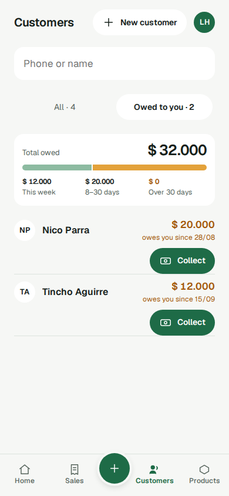
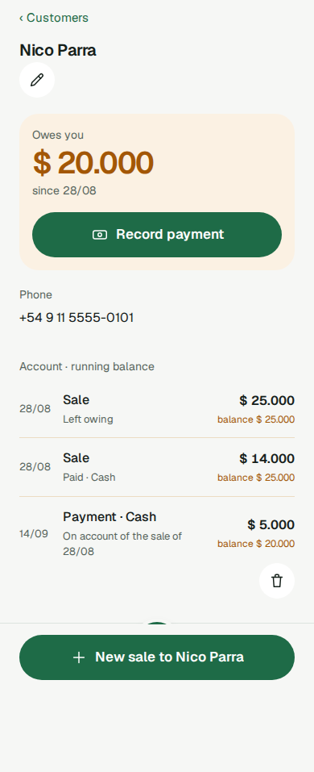
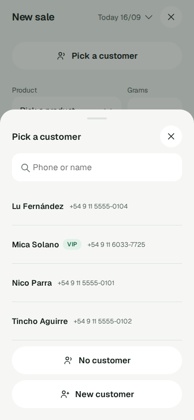
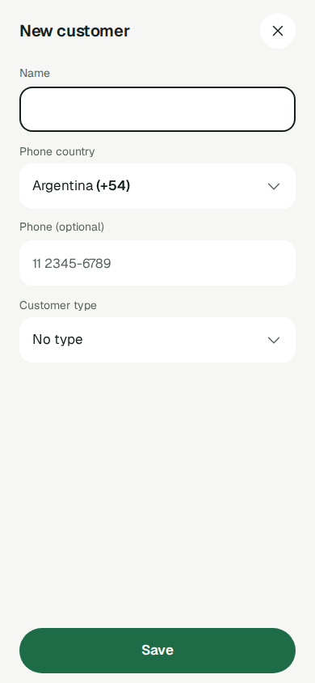
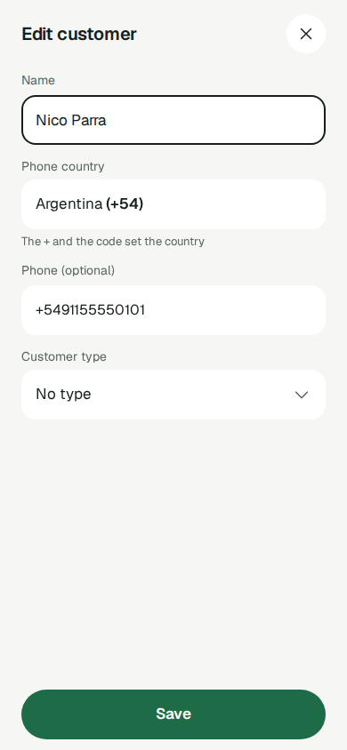

## Jobs

**Cuando** entrego un pedido o recibo un pago, **quiero** encontrar al cliente por parte de su nombre o de su número, o registrarlo en el momento si es nuevo, **para que** cada venta y cada deuda caiga en una persona real y yo sepa siempre quién me debe.

**Cuando** registro a un cliente (desde Customers, en medio de una venta o con la **Spreadsheet import** única) y no tengo su Phone number, **quiero** guardarlo igual con su nombre y agregar el número más adelante si algún día lo consigo, **para poder** registrar cada venta y cada deuda a nombre de la persona que de verdad debe, sin inventar un número ni dejar a esa persona fuera de la app.

**Cuando** agrego o edito el Phone number de un cliente, **quiero** tipearlo como lo diría en mi propio país y que la app lo guarde en forma internacional, **para que** la misma persona nunca quede registrada dos veces y yo nunca tipee a mano un código de país, sea cual sea el país de mi negocio. (GH-409, parte de GH-318. Desde la parte 2 de GH-682 no lo sirve una configuración del Business sino el **Phone country** que se elige por número en el formulario, con el **Detected country** por defecto.)

**Cuando** registro o edito un Customer desde el celular con su número adelante, **quiero** que el número se lea con el país correcto para ese número, por defecto el del lugar donde estoy, **para poder** guardarlo en pocos toques sin ir a Settings y confiar en que la misma persona nunca se convierte en dos Customers. (Parte 2 de GH-682: lo sirven el Selector "Phone country" del formulario del Customer, el Detected country y el bloqueo por el `+`.)

**Cuando** abro un Customer o recorro mi lista de Customers en el celular, **quiero** ver cada número agrupado como lo escribe la gente del país de ese mismo número, **para poder** leerlo, chequearlo y copiarlo sin contar mal los dígitos. (Parte 1 de GH-682: lo sirve el número agrupado de la fila de Customers, la ficha, la tarjeta de atrás y los dos selectores de Customer de New sale.)

**Cuando** tengo clientes habituales a los que trato distinto, **quiero** agruparlos en tipos a los que les pongo nombre yo y elegir el tipo de cada uno desde su ficha, **para poder** distinguirlos de un vistazo, y más adelante cobrarles según su tipo, sin depender de la memoria ni de notas. (GH-405, parte de GH-318: lo sirven los Customer types de Settings → Prices y el campo "Customer type" del formulario.)

**Cuando** registro una venta para un cliente que pertenece a uno de mis grupos de clientes, **quiero** que cada línea se cotice al precio que fijé para ese grupo y ese producto, **para** cobrarle a cada grupo su propio precio sin tipearlo ni sacarlo de memoria. (Parte customer-type prices de GH-318: lo sirve acá la pertenencia a un Customer type; los precios están en pricing-settings.md y la cotización de la línea en sales.md.)

**Cuando** configuro cómo fija sus precios mi negocio, registro el precio de un producto o entrego un pedido, **quiero** que la app use solo las **Pricing rules** que tiene mi negocio (un **Bulk price** si vendo por cantidad, y un VIP price que fijo por producto para mis VIP customers), **para poder** cobrarle a cada cliente exactamente lo que quiero sin escribir un **Special price** a mano, sin ver campos que no me aplican y sin que el precio de nadie cambie de sorpresa. (Lo sirve acá la pertenencia al VIP type, que sigue al interruptor Customer types; definido en pricing-settings.md.)

**Cuando** manejo mi negocio desde el celular, **quiero** mantener al día mis clientes desde el celular, **para poder** dejar de tenerlos en la planilla y tener datos reales cuando lleguen las ventas.

**Cuando** un cliente me paga parte o todo lo que debe, en efectivo o por transferencia, el mismo día o semanas después, **quiero** registrarlo desde el celular en pocos toques y ver que su Balance y su "owing since" bajan en el acto, **para** saber siempre quién me debe qué y desde cuándo, y que nada de lo que pagó o todavía debe se pierda ni caiga en la persona equivocada. (Lo sirve acá la vista "Owed to you" de Customers y su "Collect", y el Balance, la cuenta y Record payment de la ficha; definido en `payments.md`.)

**Cuando** manejo mi negocio desde el celular entre pedidos o en medio del chat con un cliente, varias veces por día, **quiero** que la app esté armada según lo que hago de verdad y con qué frecuencia, **para poder** volver con el cliente en lugar de buscar entre menús. (El job de **Navigation**, navigation.md: lo sirve acá Customers, que se abre en quién debe, con "Collect" en cada fila de deudor.)

**Cuando** un cliente me paga parte o todo lo que debe, o entre pedidos quiero saber quién todavía me debe y desde cuándo, **quiero** que Customers se abra en quién me debe (el total, y cada deudor con la deuda más vieja primero, con su Balance y desde cuándo) y cobrarle a cualquiera en un toque, **para poder** mantener cada Balance al día y perseguir primero las deudas más viejas, sin abrir fichas una por una, hacer cuentas ni completar campos que nunca uso.

**Cuando** abro Customers en el celular con poco tiempo, **quiero** ver de entrada si alguien me debe, y cuántos, y pasar a todos a los que les vendo cuando necesito a otra persona, **para poder** perseguir o cobrar lo que me deben sin scrollear entre gente que no debe nada. (Parte 1 de GH-831, entregada en GH-934: lo sirven las vistas "All · N" y "Owed to you · N" de Customers, con sus cantidades, y el estado "Nobody owes you".)

**Cuando** registro una Expense o guardo un Customer desde el celular, **quiero** elegir su Expense category o su Customer type igual que elijo un Product o un Withdrawal reason (un campo con etiqueta que abre su propia lista, con búsqueda cuando la lista es larga), **para** terminar el formulario en pocos toques y que volver nunca tire lo que ya tipeé. (Parte 6 de GH-581, compartido con expenses.md y selector.md: acá lo sirve el campo "Customer type" del formulario del Customer.)

**Cuando** abro Customers en el celular para perseguir lo que me deben, **quiero** pasar con un toque entre todos mis clientes y solo los que me deben, y ver cuántos hay en cada uno, **para** saber a cuántas personas tengo que perseguir sin recorrer toda la lista. (GH-947, parte 1 de GH-831: lo sirve el control de segmentos `CustomerSegments`, "All | Owed to you" con sus cantidades, construido y probado como componente; desde GH-934 está en la pantalla de Customers, en el celular y en la computadora.)

**Cuando** busco a un cliente entre las pocas docenas a las que les vendo, **quiero** que Customers muestre solo a las personas que coinciden con lo que tipeo, con quien me debe todavía marcado como deudor, **para** llegar enseguida a la persona correcta sin que los segmentos, la barra ni el Total owed se metan en el medio. (Parte 4 de GH-831, entregada en GH-937: lo sirven el colapso inmediato a la lista plana, "Searching…" mientras la respuesta está pendiente, la línea de sin coincidencias, la falla de la búsqueda y la vuelta a la vista que tenía al borrar la consulta.)

**Cuando** abro Customers para ver quién me debe y las cifras de lo que me deben no cargaron, **quiero** que la pantalla me lo diga y me deje reintentar con un toque, **para** nunca leer la lista simple como "nadie me debe" y conseguir las cifras reales sin salir. (Parte 3 de GH-831, GH-936: lo sirve el aviso `DebtorsUnavailable`, "Owed amounts did not load: tap to try again", con su reintento de la lectura de deudores.)

**Cuando** abro Customers para ver quién me debe plata, **quiero** ver de un vistazo cuánto me deben en total y cuánto de eso es viejo, **para** decidir si las deudas más viejas hay que perseguirlas ya, antes de recorrer la lista. (Parte 2 de GH-831, GH-935: lo sirve la tarjeta de resumen `OwedSummary` arriba de la vista "Owed to you", con el Total owed, la barra de antigüedad y su leyenda. Extiende a todo el Business el job de saber quién me debe qué y desde cuándo; no lo reemplaza.)

**Cuando** registro una venta o busco quién me debe y recuerdo a medias al cliente (un nombre tipeado sin acentos, parte de un nombre o un número tipeado como lo marcaría), **quiero** que la búsqueda se achique a las personas correctas mientras tipeo, **para** elegir al Customer que ya existe en un par de toques y nunca registrar dos veces a la misma persona. (Parte 1 de GH-1059: lo sirven la regla compartida de coincidencia de nombres `name_matches` y el orden `search_order_key`, en `app/shared/names.py`; el nombre es la entrada principal y el número, opcional, una segunda.)

**Cuando** doy de alta a una persona, o corrijo una, desde Customers, **quiero** que el botón diga solo lo que hace, **para poder** guardar sin preguntarme si además empieza o cambia una venta. (Parte 2 de GH-1067: lo sirve el botón "Save" del formulario del Customer, al dar de alta y al editar.)

# Clientes

Las personas a quienes un **Business** le vende, cada una identificada dentro de ese Business por su propio registro, y vistas solo por ese Business (ADR-0004). El nombre es la forma en que un **User** reconoce a un **Customer**; el **Phone number** es un dato de contacto opcional.

Las **Sales** y los **Payments** se apoyan en esta capacidad: toda Sale y toda deuda pertenece a un Customer de acá. Cada Customer puede estar en un **Customer type** que define el vendedor, o en ninguno. Un **VIP customer** es un Customer del **VIP type**: paga el **VIP price** de un **Product** (el **Customer-type price** del VIP type) cuando hay uno vigente y es menor o igual que lo que da cualquier otra regla. Esto vale solo en un Business con el interruptor Customer types activado (pricing-settings.md, sales.md).

El **Balance**, el **Owing since** y la cuenta de un Customer se definen en `payments.md` y se muestran en su ficha y en la vista "Owed to you" de Customers.

Corregir los datos de un cliente sirve a los mismos jobs. En un negocio con el interruptor Customer types activado, a un cliente del VIP type se le cobra su VIP price en cada venta en la que es el más bajo, así que el vendedor nunca tiene que acordarse de quién es amigo.

La vista "Owed to you" afina el job de pagos y el job de Navigation de arriba para Customers (GH-46); no es un job nuevo. Su protagonista es el vendedor, en el celular; la computadora, con dos paneles, es el mismo job en una pantalla más grande. Tiene dos momentos: cobrar (el principal: un cliente entrega plata, en medio del chat o al entregar) y revisar (entre pedidos o al final del día). Antes, quién debía vivía en una pantalla Owed to you aparte, cobrar una deuda llevaba cuatro toques desde Customers, y el formulario del cliente pedía un canal (Telegram o WhatsApp) que nada del producto usaba.

Las dos vistas de Customers (parte 1 de GH-831) sirven al job de ver de entrada si alguien debe y cuántos. La situación principal es perseguir plata: ver quién debe y desde cuándo, y cerrar con "Collect" en la fila del deudor; cobrar no es una situación aparte, es cómo termina esa. Encontrar a una persona para venderle o abrir su cuenta es la segunda. Antes, Customers era una sola pantalla combinada: "Owed to you" arriba y "Everyone" abajo, sin ninguna cantidad de Customers y sin un "nadie te debe" propio. La cantidad de "Owed to you" es la cifra para actuar; la de "All" es contexto. No se registra ningún atajo externo (planilla, preguntarle a un socio): la app ya reemplazó la planilla.

El job del control de segmentos (GH-947, parte 1 de GH-831) es el de perseguir deudas sin recorrer toda la lista. Antes no había forma de filtrar la lista a solo los deudores ni ninguna cantidad de cuántos Customers deben, y esa cantidad que faltaba es lo que el control agrega. GH-947 entregó el componente terminado y probado, todavía sin pantalla; GH-934 lo puso en Customers, con la vista "Owed to you" como apertura y el estado "Nobody owes you" cuando nadie debe. La vuelta a la opción elegida al volver desde "All" queda para #942.

El job de la búsqueda (parte 4 de GH-831, entregada en GH-937) es encontrar a una persona entre unas pocas docenas, desde el celular y con poco tiempo: casi siempre para cobrarle, ver lo que debe o venderle, y a veces para saber si ya es un Customer antes de darla de alta. Las dos situaciones son el mismo acto de encontrar a una persona, así que son un solo job. La búsqueda cubre solo la lista de Customers; New sale tiene su propia elección de Customer y esta parte no la toca. El Total owed y las cantidades de los segmentos responden otra pregunta ("cuánto me deben en total"), que no se hace mientras se busca, así que ocultarlos no hace perder nada. Antes de esta parte había dos huecos: mientras la respuesta estaba pendiente, las filas de la búsqueda anterior podían parecer la respuesta (en una red de casa lenta, eso puede llevar a abrir a la persona equivocada), y al borrar la búsqueda el vendedor perdía la vista que tenía y tenía que volver a tocar "All". Se supone que hoy el atajo es recorrer "All" a ojo; se registra solo como contexto.

El job de la regla compartida de nombres (parte 1 de GH-1059) es el mismo acto de encontrar a la persona que ya existe, para venderle o ver lo que debe, y nunca darla de alta dos veces: el dolor de la planilla en que una persona se volvía dos deudores. El nombre es la entrada principal y el número, que es un dato de contacto opcional, una segunda. Antes, una consulta que no estaba en blanco pero quedaba vacía al plegarla (por ejemplo, solo marcas combinantes) devolvía todos los Customers, y esa lista parecía un resultado real; además, la regla de nombres estaba escrita en más de un lugar, así que una búsqueda posterior podía encontrar a otras personas con el mismo texto. Esta parte deja una sola regla para todas las búsquedas por nombre; la búsqueda agrupada que la usa con su orden llega en las partes siguientes de GH-1059. No se registra que hoy los vendedores elijan a la persona equivocada: nada lo muestra.

El job de la tarjeta de resumen (parte 2 de GH-831, GH-935) responde "cuánto y qué tan viejo", nunca "a quién": elegir a quién escribirle sigue en las filas de deudores, que ya llevan el Balance y el Since de cada Customer. Antes, la vista "Owed to you" mostraba solo el Total owed como una cifra roja grande, y la única señal de antigüedad era la línea Since de cada deudor, leída una por una (o la planilla). La tarjeta reemplaza ese recorrido. Algunos vendedores también persiguen deudas desde sus chats de Telegram o WhatsApp; eso pasa fuera de la app y no cambia lo que muestra la tarjeta. Es un resumen de solo lectura: filtrar la lista por tramo de antigüedad sería otro job.

El job del aviso de cifras que no cargaron (parte 3 de GH-831, GH-936) afina el job de saber quién me debe qué y desde cuándo; no es una capacidad nueva. El riesgo que cubre es que una cifra que falta se lea como una cifra real: la lista plana sin explicación se puede leer como "nadie me debe". Antes, la falla era muda: el vendedor veía la lista plana y solo podía adivinar, o salir de Customers y volver. Home también muestra el Total owed, pero no se registra como alternativa del vendedor ni el aviso lo manda ahí: la solución es decirlo y reintentar en el lugar.

El job de los Customer types tiene dos momentos: una configuración puntual (el vendedor decide que algunos habituales forman un grupo propio y lo nombra en Settings → Prices → Customer types) y el uso diario (al dar de alta o editar un Customer, dice en qué grupo está). Antes, la única forma de agrupar era la marca VIP de sí o no, y cualquier otro grupo ("mayorista", "amigo") vivía en la cabeza del vendedor o en la Note de una Sale.

El job del **Phone country** nació en GH-409 (ADR-0082) como una configuración del Business en Settings → Business. Desde la parte 2 de GH-682 (ADR-20261111-phone-country-per-number, que reemplaza a ADR-0082) ya no tiene configuración: el país es de cada número, se elige en el formulario y su valor por defecto sale del lugar donde se usa la app. La regla es del dueño, del 2026-11-11. La situación principal es tipear un número local en el celular mientras se registra un Customer, desde New customer o desde "Pick a customer" en New sale, muchas veces hablando con el comprador. Pegar un número con `+` de Telegram o WhatsApp y editar un Customer son secundarios. Antes, un Business existente estaba fijo en Argentina y solo podía atender a un cliente de afuera tipeando "+código"; uno nuevo arrancaba sin país y su primer número local se rechazaba; y cambiar la configuración para un cliente leía mal todos los otros números locales desde entonces. El caso que más pesa es el de un vendedor que trabaja fuera de Argentina; el cliente ocasional de otro país es el segundo. No se optimiza para vendedores con clientes repartidos en muchos países: les alcanza el Selector con su búsqueda.

El job del número agrupado (parte 1 de GH-682) no tiene configuración: es solo lectura. Las situaciones principales son copiar o marcar el número para escribirle a un Customer por Telegram o WhatsApp, y chequear que el número guardado es el correcto, por ejemplo cuando dos Customers se parecen; leérselo en voz alta al cliente es secundario y lo cubre la misma presentación. Antes, solo los números argentinos se mostraban agrupados, con una regla argentina fija en el front, y cualquier otro número se veía como una sola tira (`+59899123456`): un Business con Customers fuera de Argentina veía peor sus números que uno con Customers argentinos, en contra de **Assume nothing**. Se supone que ningún vendedor tiene hoy un atajo para esto; si lo tuviera, la definición sería la misma.

El campo "Customer type" se elige con el Selector desde la parte 6 de GH-581 (selector.md), igual que cualquier otro Growable set. Antes era un select nativo que no se comportaba como el resto: sin búsqueda, sin fila para borrar y sin que volver en el celular actuara sobre la lista.

El job del rótulo del botón de guardar (parte 2 de GH-1067) es dar de alta o corregir a una persona desde Customers sabiendo exactamente qué pasa al tocar el botón. Antes, el formulario decía "Save and use" en los dos modos, aunque ninguno pone al Customer en una Sale: "and use" prometía algo que el botón no hace. El largo del rótulo en el celular no es el motivo; que "Save" sea más corto es un efecto lateral. El creador de "Pick a customer" de New sale es el único lugar donde guardar un Customer sí lleva a la Sale in progress, y conserva su propio rótulo.

Criterios de éxito:

1. Desde el celular, un vendedor encuentra a un Customer existente por parte del nombre o parte del número, o registra uno nuevo con o sin número, con la rapidez suficiente para que una Sale con un Customer nuevo siga llevando menos de un minuto.
2. Un Phone number es como máximo de un Customer en un Business, sin importar cómo se escriba. Registrarlo de nuevo, o cambiar el número de un Customer por uno que ya está en uso, se rechaza. El rechazo dice que el número ya pertenece a un Customer y nunca repite el número ni el nombre. Dos Customers sin número nunca chocan.
3. Los Customers de un Business son visibles solo para ese Business. Por id desde otro Business responden 404. Las listas y búsquedas desde otro Business no muestran ninguno. El mismo número puede ser un Customer en dos Businesses sin que ninguno de los dos lo sepa.
4. Todo lo de acá se hace desde el celular, sin ninguna llamada a la API a mano.
5. **Un Customer sin número es un Customer normal, no uno degradado.**
   - Se lo puede registrar, editar, encontrar por nombre, elegir para una Sale, dejar debiendo, saldar y listar en la vista "Owed to you" de Customers como a cualquier otro.
   - La ficha y la lista no muestran ninguna etiqueta vacía, ningún guion ni ningún "No phone" donde iría un número.
6. **Nada retrocede para los Customers que tienen número.**
   - La normalización, el rechazo del número mal formado, la unicidad (al registrar y al editar), la búsqueda por número y los rechazos que nunca repiten el número ni el nombre siguen todos como están.
   - Se puede quitar el número de un Customer, y sus Sales, Payments y Balance se quedan con él.
7. **Sin canal.** Un Customer no tiene canal (Telegram o WhatsApp): ni en la API, ni en los formularios, ni en la ficha, ni en la lista, ni en el **Business export**, ni en la base de datos. Quitarlo no cambia nada más de ningún Customer.
8. **El tipo sigue al interruptor y nunca se pierde.**
   - Mientras Customer types está apagado, ningún tipo, campo de tipo ni marca VIP se muestra en ninguna pantalla de Customer.
   - Al encenderlo de nuevo, toda pertenencia guardada vuelve como estaba, incluso para los Customers editados mientras estuvo apagado.
9. **Cobrar rápido.** Record payment se abre con el Customer elegido en 2 toques como máximo desde cualquier **Tab root** ("Collect" en una fila de Customers o en una fila de Home). Un Payment se registra en menos de un minuto, y "All" salda todo el Balance en un toque. En una computadora no lleva más toques que en el celular.
10. **Quién debe, de un vistazo.** Customers se abre siempre en la vista "Owed to you", también cuando nadie debe: la tarjeta de resumen con el **Total owed** y cada deudor con el Owing since más viejo primero, cada uno con Balance y "since dd/mm". En Customers no hay línea de cantidad de Sales ("N sales owing"); Home conserva la suya. Toda cifra sale de la API y es igual al bloque "Owed to you" de Home y a un cálculo directo. Sin scrollear entre los que no deben y sin sumas.
11. **La ficha cierra el circuito.** Desde la ficha de un Customer el vendedor ve su Balance y su cuenta, "Record payment" (cuando debe) y "New sale to <name>", con ese Customer ya elegido.
12. **Los VIP de antes llegan a su tipo.** Después de la actualización, todo Customer que tenía la marca VIP está en el VIP type de su propio Business, y ningún otro Customer tiene tipo.
13. **Tipos propios desde el celular.** En el celular, un vendedor crea un tipo con nombre e ícono y se lo asigna a un Customer desde el formulario en menos de un minuto.
14. **Nada de lo cobrado ni de lo debido cambia.** Las Sales registradas, las **Price entries**, los Balances y los **Settlements** quedan exactamente como estaban. Una Sale nueva para un VIP customer de antes se cotiza igual que antes de la actualización, también después de que los VIP prices pasaron a ser Customer-type prices del VIP type.
15. **Los tipos no se mezclan.** Un Business nunca ve ni se entera de que existen los tipos de otro Business, ni sus precios.
16. **El tipo se elige con el Selector** (parte 6 de GH-581). Con 12 o más Customer types, el vendedor encuentra uno buscando y lo elige; el formulario no tiene ningún otro tipo de selector para ese campo (ni select nativo, ni chips, ni radios, ni botones presionados).
17. **Volver nunca tira el formulario.** En el celular, volver con la lista de tipos abierta cierra solo la lista; volver con el formulario sin tocar vuelve a la pantalla madre; volver con cambios sin guardar pide la confirmación de descarte. Vale al dar de alta y al editar un Customer. En la computadora, Escape cierra solo el desplegable.
18. **Nada se pierde y nada engaña mientras carga.** El tipo se sigue pudiendo quitar ("No type"), el aviso "Add a customer type" sigue igual cuando no hay tipos, el rechazo por un tipo que ya no existe sigue igual, y mientras los tipos se cargan (o después de una carga fallida) no se muestra ni "No type" ni el aviso; una carga fallida se informa con la línea de falla existente de la app.
19. **Número local, guardado internacional.** Al dar de alta o editar un Customer en el celular, el vendedor tipea solo el número local, sin código de país, y se guarda en forma internacional según el Phone country que muestra el formulario; después se muestra agrupado según el país de su propio código (criterio 23).
20. **Una sola persona, se tipee como se tipee.** Un número que ya pertenece a otro Customer del Business se detecta como el mismo número, se haya tipeado en forma local o internacional y con el país que sea, y nunca crea un segundo Customer.
21. **Ningún número guardado cambia.** Quitar el Phone country de Settings no reescribe ningún número guardado, y la Spreadsheet import sigue leyendo los números de la planilla como argentinos.
22. **Cada país con su regla, elegido por número.** El país se elige en el formulario de cada Customer, nunca en Settings, y un número de un país de la lista recibe la regla de ese país, no la argentina.
23. **Cada número, agrupado según su país** (parte 1 de GH-682). Todo número guardado de un país de la lista (Argentina, Uruguay, Chile, Paraguay, Brazil, Mexico, Spain, United States) se muestra agrupado con la regla de ese país, igual en los cinco lugares donde se lee un número: la fila de Customers, la ficha, la tarjeta de atrás, el selector de Customer de New sale y el paso de Customer de New sale. El campo del teléfono del formulario no es uno de ellos.
24. **Lo que no se puede agrupar se muestra tal cual.** Un número de un código de país fuera de la lista, o de un largo sin plantilla, se muestra exactamente como está guardado: nunca se oculta, se corta ni se cambia.
25. **Agrupar solo agrega espacios y guiones.** Los dígitos y el valor guardado nunca cambian; guardar, validar y la regla de que dos Customers nunca comparten un número no se tocan.
26. **El agrupado no le pide nada al vendedor.** Mostrar un número agrupado no agrega ninguna opción, elección ni texto: sale solo del número guardado, sea cual sea el país con que se tipeó. Un Customer sin número no muestra ninguno.
27. **Local, sin tocar el país** (parte 2 de GH-682). Un vendedor en un país de la lista que no es Argentina (Uruguay, por ejemplo) guarda un número en forma local sin tocar el control de país.
28. **Otro país, una elección o ninguna.** Un cliente de otro país de la lista lleva una sola elección deliberada en el formulario, sin ir a Settings, o ninguna cuando el número se tipea con `+`.
29. **Nunca un país que no se vio.** Ningún número se guarda con un país que el vendedor no vio en pantalla: el formulario siempre muestra el país que se va a usar, y lo muestra bloqueado cuando lo decide el `+`.
30. **El país no agrega toques.** Registrar una Sale con un Customer nuevo, número local incluido, se sigue haciendo desde el celular en menos de un minuto: un número local del Detected country agrega 0 toques, y otro país agrega solo los 2 toques del Selector.
31. **El número sigue opcional.** En la operación normal, ni el número ni el país son un paso que el vendedor tenga que pasar para guardar un Customer o seguir con la Sale. Una carga fallida de la lista de países es un estado de error, no un requisito: el formulario muestra la línea de falla de la app y se recupera cerrándolo y volviéndolo a abrir; en "Pick a customer", un Customer existente o "No customer" siguen dejando avanzar la Sale.
32. **Dos vistas, cada una con su cantidad** (parte 1 de GH-831). Customers muestra "All · N" y "Owed to you · N", con las dos cantidades tal como las da la API (`customer_count` y `debtor_count`), y pasar de una a otra lleva un toque.
33. **Nadie debe, dicho claro.** Cuando nadie debe, la vista "Owed to you" dice solo "Nobody owes you": sin tarjeta de resumen, sin Total owed y sin lista vacía.
34. **Nada antes de que lleguen las cifras.** Mientras la lectura de deudores está pendiente, ninguna cantidad, ningún 0, ningún Total owed ni ningún "Nobody owes you" se muestra: el control muestra sus etiquetas como esqueleto y, en "Owed to you" sin consulta tipeada, la tarjeta de resumen se ve como su esqueleto, sin texto, dígito ni símbolo de moneda.
35. **Volver adonde estaba.** Al abrir un Customer y volver, el vendedor queda en la vista que tenía o en su búsqueda. Borrar una búsqueda vuelve en el acto a la vista que tenía antes de tipear, aunque ahora esté vacía; la pantalla nunca salta sola a "All". Salir de la pestaña y volver empieza otra vez en "Owed to you": la vista elegida nunca se guarda. (Que el foco vuelva a la opción elegida al volver desde "All" lo entrega #942.)
36. **La búsqueda como siempre, y nunca un callejón sin salida.** Mientras se tipea una búsqueda no hay vistas para cambiar, solo las coincidencias. Si la lectura de deudores falla, el vendedor igual tiene la lista completa de Customers, sin vistas ni cantidades, con el aviso que lo dice (criterio 41).
37. **Cuántos hay, antes de tocar** (GH-947). El control de segmentos muestra cuántos Customers tiene el Business y cuántos le deben antes de que el vendedor toque nada. "Le deben" es un Balance mayor que $0; los Credits no cuentan, la misma regla que el Total owed. Las dos cifras salen del servidor (#943); el teléfono solo les da formato.
38. **Un toque, en el celular.** Pasar de un segmento al otro lleva un toque. Cada opción tiene al menos 44 px de alto, un toque nunca selecciona texto y un doble toque nunca hace zoom.
39. **Nada engaña mientras carga.** Mientras las cifras están pendientes, se ven solo las dos etiquetas: ningún número, ningún "·" y ningún "0" que no sea real. Un 0 real se muestra como 0.
40. **Nombres para el lector de pantalla.** Un lector de pantalla anuncia "All" y "Owed to you" dentro del grupo "Customers view". La cifra se lee como descripción, solo el número y sin el "·", y nunca forma parte del nombre de la opción.
41. **La falla, dicha en palabras** (parte 3 de GH-831, GH-936). Cuando las cifras de lo que se debe no cargan, la pantalla lo dice con la oración "Owed amounts did not load: tap to try again" y el Attention icon. Mientras la lectura de deudores en pantalla no respondió con éxito, nunca muestra una cantidad en 0, un Total owed de $0, la barra, la tarjeta en $0 ni "Nobody owes you".
42. **Un toque reintenta, solo las cifras.** Un toque en el aviso vuelve a pedir solo la lectura de deudores, nunca la lista de Customers. Si sale bien, las vistas y sus cantidades vuelven en "Owed to you", sin recargar y sin salir de Customers. Si falla, el aviso queda y se puede tocar de nuevo.
43. **La lista sigue usable.** Durante toda la falla el vendedor puede buscar, encontrar a un Customer y abrir su cuenta; mientras hay una consulta tipeada, el aviso se corre y no estorba.
44. **Nunca una cifra vieja.** Si una nueva lectura de deudores falla después de que ya se mostraron cifras (por ejemplo, tras registrar un Payment), la pantalla cae a la lista plana con el aviso: el teléfono nunca conserva ni corrige cifras viejas, tampoco las de la tarjeta de resumen.
45. **También para quien no ve la pantalla.** La oración se anuncia de forma cortés cuando aparece el aviso y otra vez cuando un reintento falla, sin mover el foco; un simple redibujo no la vuelve a anunciar.
46. **La búsqueda colapsa en el acto** (parte 4 de GH-831). Apenas el vendedor tipea algo que no son solo espacios, la pantalla es solo la lista plana: los segmentos, la tarjeta y el Total owed desaparecen sin demora.
47. **Una respuesta pendiente nunca se confunde con la final.** Hasta que llega la respuesta, el vendedor ve solo "Searching…", nunca las filas de la consulta anterior.
48. **Sin coincidencias, dicho claro.** Cuando nadie coincide, la pantalla muestra solo la línea de sin coincidencias existente, nunca "Nobody owes you"; cuando la búsqueda falla, muestra la línea de falla de carga existente, nunca la de sin coincidencias.
49. **Un deudor encontrado sigue siendo deudor.** Un Customer que debe y aparece en la búsqueda conserva su fila de deudor, así su deuda nunca queda oculta por haberlo encontrado por nombre.
50. **Cuánto y qué tan viejo, de un vistazo** (parte 2 de GH-831, GH-935). En el celular, en "Owed to you", sin scrollear ni tocar, el vendedor puede decir el Total owed y cuánto de eso tiene más de 30 días. La leyenda lo dice en palabras y montos; la barra es una ayuda visual oculta para la tecnología asistiva.
51. **Una sola fuente.** La tarjeta y las filas de deudores salen de la misma lectura de deudores, y la app nunca calcula, suma, compara ni convierte un monto, una cantidad ni un tramo. Que los tres tramos sumen el Total owed es promesa del servidor, no algo que la pantalla chequea. La tarjeta nunca afirma que el Balance de una fila cae en un solo tramo: con el Settlement, la deuda de un Customer puede repartirse entre varios.
52. **Legible en todo caso.** La tarjeta se lee completa en los dos temas, a 320 px, con texto al 130 % en un ancho de 246 px, con montos de nueve dígitos y con un tramo en $0: ningún monto se corta, se achica ni lleva puntos suspensivos.
53. **Se encuentra como se recuerda** (parte 1 de GH-1059). `jose` encuentra a `José`; un pedazo de un nombre, también del medio de una palabra, encuentra a ese Customer; `011 5555` encuentra a un Customer guardado como `+54 11 5555…`; un Customer sin número se encuentra por nombre.
54. **Nada para buscar, nadie encontrado.** Una consulta que no está en blanco pero queda vacía al plegarla (por ejemplo, solo marcas combinantes) no coincide con ningún Customer y nunca muestra la lista completa como si fuera un resultado; `(0)` no coincide con ningún número. La puntuación que sobrevive al plegado se compara como cualquier otro texto. Una consulta en blanco (ausente, `""` o solo espacios) sigue listando a todos los Customers.
55. **El mismo orden de siempre.** La búsqueda de Customers conserva su orden: por nombre plegado y después por id. "Primero los que empiezan con la consulta" existe solo como `search_order_key`, para la búsqueda agrupada de las partes siguientes de GH-1059.
56. **El botón dice lo que hace** (parte 2 de GH-1067). Dar de alta un Customer desde Customers y editarlo terminan los dos en un botón que dice "Save"; ningún formulario de Customer que solo guarda dice "and use". El creador de "Pick a customer" de New sale conserva su propio rótulo, porque ahí guardar sí lleva a la Sale in progress. Las suites siguen en verde porque cada test que buscaba el rótulo viejo ahora busca "Save", sin volver a poner ningún elemento ni rótulo, visible u oculto (D-69509906).

## Comportamiento

- **Customer**: un nombre, un Phone number opcional y como máximo un Customer type. Un Customer se identifica por su propio registro (su id), nunca por su número. Su Balance y su Owing since se calculan a partir de sus Sales y Payments (`payments.md`) y nunca se guardan en el Customer.
- **Nombre**: obligatorio. Recortado, con los espacios internos colapsados, hasta 60 caracteres. No es único.
- **Sin canal**: el antiguo canal (Telegram o WhatsApp) se quitó del dominio, la API, los formularios, la ficha, la lista, el Business export y la base de datos.
  - Un pedido que todavía manda uno se completa bien: el canal se ignora, nunca se guarda, y ninguna respuesta lo lleva. El vendedor no ve diferencia, porque ningún formulario ofrece el campo.
  - **Los valores guardados se descartan para siempre.** La migración que elimina la columna no conserva copia en ningún lado; el producto no puede recuperarlos, y la eliminación no se puede deshacer desde adentro.
  - **Supuesto**: ningún vendedor va a necesitar los valores viejos del canal; quien los necesite igual puede encontrar al Customer por nombre o por número.
- **Customer type** (hexágono `customer_types`, ADR-0055):
  - Un tipo tiene un nombre obligatorio y un ícono obligatorio, y pertenece a un solo Business (`business_id` no nulo). La API lo devuelve como `{id, name, icon, is_vip}`; `is_vip` es de solo lectura y ningún pedido lo fija.
  - **Nombre**: de 1 a 40 caracteres después de recortar los espacios, texto libre, único dentro del Business sin importar mayúsculas, minúsculas ni espacios, tanto al crear como al renombrar. No hay límite de cantidad de tipos por Business.
  - **Ícono**: uno de un conjunto fijo de ocho claves neutras, guardadas tal cual: `circle` (el valor por defecto de un tipo nuevo), `star`, `heart`, `diamond`, `flag`, `tag`, `crown` y `bell`. Ninguno es propio de un tipo de negocio. Una clave desconocida se rechaza (`customer_type.icon_unknown`). Siempre va junto al nombre del tipo, nunca solo (icon-and-text-rule.md); la única excepción es una celda del selector de íconos, que lleva su nombre accesible ("Circle", "Star", etcétera).
  - **Precios**: un tipo puede tener Customer-type prices, filas con fecha por Product que se guardan y se leen en pricing-settings.md ("Los precios por Customer type", ADR-0059). En esta parte solo el VIP type los recibe, con el campo "VIP price" de una Price entry; los tipos que crea el vendedor no tienen precio hasta la parte de la pantalla de precios por tipo, y a sus Customers se los cotiza como a cualquiera.
  - **Un Business nuevo** arranca sin ningún tipo (ADR-0059).
  - **Eliminar**: un tipo se puede eliminar solo mientras no tiene ningún Customer. El rechazo (`customer_type.in_use`, 409) lleva cuántos Customers tiene, y el tipo conserva sus Customer-type prices. Ningún Customer queda sin tipo en silencio.
    - Eliminar un tipo vacío se lleva también sus Customer-type prices, en la misma transacción y antes que el tipo.
    - Las Sale lines ya cotizadas por ese tipo conservan su precio, su regla y su copia del nombre del tipo (sales.md).
  - Los Customer types son un Growable set: nunca se declaran en `fixedSets.ts` ni se eligen con chips (selector.md).
- **Pertenencia**: un Customer está en un tipo o en ninguno (`customer.customer_type_id`, nulo cuando no tiene).
  - Se elige en el formulario del Customer y se puede cambiar o quitar (con "No type") en cualquier momento.
  - Un tipo de otro Business, o uno que ya no existe, responde 404 (`customer_type.not_found`), igual que cualquier otra referencia.
  - Una Sale toma el tipo que tiene el Customer al guardarla; cambiarle el tipo después nunca vuelve a cotizar una Sale registrada (sales.md).
  - **Mientras Customer types está apagado**:
    - toda pertenencia sigue guardada, y la API la sigue devolviendo;
    - guardar un Customer nunca la cambia, sin importar lo que mande el pedido;
    - un Customer creado entonces no tiene tipo.
- **VIP type**: el tipo "VIP" que la actualización creó en cada Business existente, con el ícono `star` (ADR-0059), o que la Spreadsheet import crea (abajo). Es la única fila marcada `is_vip` de su Business (ADR-0070).
  - Es el único tipo cuya pertenencia da un precio en las Sales nuevas: su Customer-type price vigente para el Product (el VIP price de la Price entry que es el Current price), cuando es menor que lo que da cualquier otra regla o empata con el Bulk price, y solo mientras Customer types está activado (sales.md, pricing-settings.md).
  - Una línea nueva cotizada así guarda la regla del Customer type, con el tipo y una copia de su nombre, y muestra ese nombre en su insignia. Las líneas guardadas antes con la regla `vip` la conservan y siguen mostrando "VIP".
  - Lo identifica esa marca, puesta solo por la actualización o la Spreadsheet import, nunca su nombre: renombrarlo o cambiarle el ícono no cambia ningún precio, y un tipo que el vendedor llama "VIP" no da ningún VIP price.
  - En la lista de tipos se ve como cualquier otro, sin ninguna marca propia.
  - Un Customer que entra al VIP type recibe el VIP price desde su próxima Sale; uno que sale deja de recibirlo. Las Sales ya registradas conservan su precio y su Pricing rule (ADR-0003).
  - Sigue las mismas reglas que cualquier tipo: una vez sin Customers se puede eliminar, y se lleva sus Customer-type prices. Desde entonces nadie recibe el VIP price, y el campo "VIP price" del formulario de precio deja de mostrarse (pricing-settings.md).
  - El campo `vip` de un Customer en la API es la pertenencia al VIP type, sea cual sea el interruptor; las pantallas lo ocultan mientras está apagado.
  - En la lista de Sales, la insignia VIP de una Sale muestra si el Customer está hoy en el VIP type, no cómo se fijó el precio de esa Sale (sales.md).
- **La marca VIP congelada** (`customer.is_vip`): se conserva con el valor que tenía, ya no se lee y nunca se vuelve a escribir para ningún Customer después de la actualización, por ningún camino (la API, la Spreadsheet import, la apertura de un Business). Un pedido que todavía manda `vip` se completa bien y el campo se ignora. Un test de arquitectura impide que el código fuera de las migraciones y de la definición de la tabla la nombre.
- **Phone country** (parte 2 de GH-682, ADR-20261111-phone-country-per-number, que reemplaza a ADR-0082): el país con el que se lee un número tipeado sin `+` ni código de país, elegido por número en el formulario del Customer. **No se guarda**: la forma internacional del número ya lo lleva. No es una configuración del Business y no está en Settings. Las reglas de cada país viven en una sola tabla compartida, `app/shared/phone_country.py`.
  - **La lista** de esta versión, decidida por el dueño el 2026-11-07, en este orden: Argentina (AR), Uruguay (UY), Chile (CL), Paraguay (PY), Brazil (BR), Mexico (MX), Spain (ES) y United States (US). Cada país tiene su propia regla con sus propios tests: código de país, largo o largos válidos del número nacional, cómo se tipea un número local (su prefijo de larga distancia y, para Argentina, el `15`), una plantilla de agrupado por largo nacional y un ejemplo de cómo lo tipea un vendedor. La lista crece de a un país sin cambiar ningún número guardado ni tocar el formulario ni el Copy module, y crecerla es trabajo aparte (#330/#318). Ningún código de país de la lista es prefijo de otro. El orden lo da un solo lugar de la tabla (`listed_countries()`), que lee `GET /phone-countries`.

    | País | Código | Largo nacional | Prefijo de larga distancia | Particularidad | Agrupado por largo |
    |---|---|---|---|---|---|
    | AR | 54 | 10 | 0 | siempre celular: agrega el `9` y descarta el `15` | 10: `## ####-####`, después de `+54 9 ` |
    | UY | 598 | 8 | 0 | | 8: `## ### ###` |
    | CL | 56 | 9 | ninguno | | 9: `# #### ####` |
    | PY | 595 | 8 o 9 | 0 | | 9: `### ######`; 8: `## ######` |
    | BR | 55 | 10 u 11 | 0 | admite un código de operadora de 2 dígitos después del 0 | 11: `## #####-####`; 10: `## ####-####` |
    | MX | 52 | 10 | ninguno | descarta el `1` de celular viejo entre el 52 y los 10 dígitos | 10: `## #### ####` |
    | ES | 34 | 9 | ninguno | | 9: `### ### ###` |
    | US | 1 | 10 | 1 | | 10: `### ###-####` |

    Solo se controlan los largos, nunca los primeros dígitos del número nacional.
  - **La tabla se valida al cargar** (`PhoneCountryRule.__post_init__`): rechaza un largo sin plantilla, una plantilla para un largo que el país no tiene, una plantilla cuya cantidad de `#` no es su largo, cualquier separador que no sea espacio o guion, y un país sin ejemplo. Los mensajes nombran la regla rota, nunca un dato. Es el único lugar que declara códigos de país, largos, reglas de prefijo, plantillas y ejemplos; ningún otro módulo, archivo del front ni texto del Copy module repite ninguno.
  - **`GET /phone-countries`** (parte 1 de GH-682), ruta protegida del hexágono de customers: responde `[{code, calling_code, national_lengths, example}]`, con los largos de menor a mayor y en el orden de la lista. No lee nada propio del Business y responde lo mismo a todo Business, pero exige una Session. Es la única fuente de la lista para el front.
  - **Lo que queda de la configuración vieja**: la columna `business.default_phone_country` sigue en la base de datos hasta la parte 3 de GH-682, pero ningún código la lee ni la escribe, y no se usa para sembrar nada: ni el Detected country ni ningún formulario parten de ella. `GET /business` ya no lleva `phone_country` ni `phone_countries`, y `PUT /business/phone-country` ya no existe.
  - **El Phone country nunca decide cómo se muestra un número guardado**: eso lo decide el código de país del propio número (abajo).
- **Detected country** (parte 2 de GH-682): el Phone country que propone el formulario por defecto, calculado solo en el dispositivo por `detectCountry(languages, timeZone, listed)` en `web/src/phone/`. Solo `web/src/phone/device.ts` lee el idioma y la zona horaria del dispositivo. No hace ninguna llamada de red, no escribe nada en el almacenamiento del navegador ni en el servidor, y nunca se envía como tal: el pedido lleva solo el país que muestra el formulario.
  - **Orden**, fijado por el pedido de la regla del dueño:
    1. la primera entrada de `navigator.languages` cuya región está en la lista (las entradas sin región se saltean);
    2. si no hay, el país de la zona horaria del dispositivo según `zoneCountries.json`, cuando está en la lista;
    3. si no, Other.
  - **`zoneCountries.json`** lo genera `scripts/phone/zone_countries.py` a partir del `zone1970.tab` de `tzdata` (o `zone.tab` si falta): cada zona va al primer país de la lista de su línea. El script lleva una lista fija de alias: `America/Buenos_Aires`, `America/Cordoba`, `America/Catamarca`, `America/Jujuy`, `America/Mendoza`, `America/Rosario`, `US/*`, `Brazil/*`, `Mexico/*`, `Chile/Continental`, `Chile/EasterIsland`, `America/Fort_Wayne`, `America/Indianapolis`, `America/Louisville` y `Navajo`.
  - **Caso conocido**: un vendedor argentino con el teléfono en `en-US` recibe United States por defecto. Lo ve en el formulario antes de guardar (criterio 29) y lo cambia con una elección (criterio 28). Se supone que los vendedores con el idioma del teléfono en una región distinta de donde venden son minoría.
  - **El formulario nunca recuerda una elección**: cada formulario nuevo parte del Detected country.
- **El país que muestra el formulario** (`shownCountry(text, picked, listed)`):
  - un texto que empieza con `+` se compara con los códigos de país servidos: un código de la lista da ese país, bloqueado; un código fuera de la lista o incompleto da Other, bloqueado;
  - si no, es el país elegido (`picked`), sin bloquear.
  - El servidor lee el `+` con la misma regla (`PhoneNumber.plus_digits`), y un archivo de casos compartido (`web/src/phone/plusCases.json`) comprueba que el front y el servidor coinciden.
- **API de escritura** (`app/customers`): `CustomerIn` y `CustomerPatchIn` llevan `phone_country: str | None`, un string simple. `register_customer` y `edit_customer` reciben el código pedido; el puerto `PhoneCountryReader` ya no existe. Las reglas, en orden:
  1. **Sin tocar** (solo al editar): un número sin cambios, o igual al guardado, se conserva y su país nunca se lee.
  2. **En blanco**: no hay número, y el país se ignora.
  3. **Con `+`**: sigue su propio código, y el país enviado se ignora aunque no exista.
  4. **Sin `+`**: con un país `null` (Other) se rechaza con `customer.phone_needs_country_code`; con un string fuera de la lista, 422 `customer.phone_country_unknown` (antes `business.phone_country_unknown`); con un país de la lista, se lee con la regla de ese país.
  - Un PATCH que manda solo `phone_country` no cambia nada.
- **Phone number**: opcional, único dentro del Business entre los Customers que tienen uno, guardado en una sola forma internacional. Se normaliza al dar de alta o editar un Customer, según estas reglas:
  - **Ninguno**: un valor faltante, `null`, o uno en blanco tras recortar significa que el Customer no tiene número. Se guarda como sin número, nunca como string vacío.
  - **Con `+` y el código de un país de la lista**: se normaliza con la regla de ese país, sea cual sea el país enviado, así coincide con el mismo número tipeado en forma local. Se rechaza si no encaja en esa regla. Por eso un `+1` no es "cualquier otro código": sigue la regla de United States (`+1` y exactamente 10 dígitos).
  - **Con `+` y cualquier otro código**: un número de un país fuera de la lista. Se acepta tal como se escribió: se guarda como `+` y sus dígitos, que deben ser de 8 a 15 y no empezar con 0 (p. ej. `+44345678` y `+443456789012345`).
  - **Sin `+`, con un país de la lista**: se quitan los separadores; los dígitos cuentan como internacionales cuando empiezan con el código de ese país y tienen uno de sus largos internacionales completos; si no, se leen como un número local de ese país: se descarta su prefijo de larga distancia (y, en Brazil, un código de operadora de 2 dígitos), y lo que queda debe tener un largo nacional válido. Se guarda como `+`, el código y el número nacional.
  - **Sin `+`, con Other**: se rechaza; solo se acepta la forma con `+`.
  - **La regla de Argentina**, exactamente la de antes:
    - `+54`, o un `54` a secas, seguido de 10 dígitos, o de un `9` y 10 dígitos, es un número argentino con su código de país, y se guarda como `+549` y los 10 dígitos;
    - cualquier otra cosa sin `+` es un número argentino local: se descartan un `0` inicial y el `15`, y deben quedar exactamente 10 dígitos, código de área incluido; se guarda como `+549` y esos 10 dígitos;
    - los teléfonos fijos no se rechazan: todo número argentino se trata como celular. Solo Argentina hace esto; los demás países aceptan cualquier número nacional de largo válido, fijos incluidos;
    - `11 2345-6789`, `011 15 2345-6789`, `+54 9 11 2345 6789`, `5491123456789` y `541123456789` pasan todos a ser `+5491123456789`.
  - **El resultado es el mismo se tipee como se tipee**, así que una grafía local y una internacional de un mismo número coinciden y la unicidad las detecta. La forma guardada, vuelta a normalizar con cualquier país o con Other, queda igual.
  - **Un número sin tocar se conserva**: si al editar un Customer el pedido manda exactamente el número que ya tiene guardado, se conserva tal cual, sin volver a normalizarlo, sin chequear la unicidad y sin rechazarlo, sea cual sea el país enviado, aunque no exista. Un número guardado que hoy ninguna regla produciría (p. ej. un `+521…` o un `+1` de otro largo) sigue cargando y se conserva así. Una grafía distinta del mismo número se vuelve a normalizar, y eso se acepta. Una escritura así nunca lee, interpreta ni valida la tabla de países ni `phone_country`. Además, el formulario de edición no manda ni `phone` ni `phone_country` cuando el texto del teléfono no cambió.
  - **Rechazado**: un valor no en blanco que no encaja en ninguna regla (demasiado corto, demasiado largo, sin código de área, o sin `+` con Other). Cada rechazo tiene su `code` en `contract.json` y nunca repite lo que se escribió ni el nombre:
    - `customer.phone_needs_country_code`: solo para un número sin `+` con Other; dice "Start the number with + and the country code.";
    - `customer.phone_country_unknown`: un país enviado fuera de la lista para un número sin `+`; el formulario no puede llegar a él, y en pantalla es el error genérico;
    - `customer.phone_invalid`: cualquier otro número que no encaja. En pantalla, con un país de la lista, el formulario dice "That doesn't look like {adjective} number. It needs {lengths} digits after the country code." (el adjetivo lleva su artículo, p. ej. "an Argentine", "a Uruguayan", "a US"); con Other dice "Enter the number with its area code, or start with + and the country code.".
- **Número agrupado para leer** (parte 1 de GH-682, `PhoneNumber.display`): cómo se muestra un número guardado, calculado del valor guardado cada vez que se lee, nunca guardado, nunca calculado en una escritura y sin migración.
  - **Lo decide el código de país del propio número**, nunca el país con que se tipeó: un número uruguayo se ve agrupado a la uruguaya en cualquier Business.
  - Se busca el país por su código, se quita el código (y, en Argentina, el `9` de celular) y se aplica la plantilla del largo nacional que queda, con `+`, el código y un espacio adelante (`+54 9 ` en Argentina).
  - **Solo agrega espacios y guiones**: sin ellos, el número mostrado es exactamente el guardado.
  - **Lo que no encaja se muestra tal cual**: un código fuera de la lista, un número argentino sin el `9` de celular, o un largo sin plantilla, devuelve el valor guardado sin cambios, nunca oculto, cortado ni alterado.

    | Guardado | Se muestra |
    |---|---|
    | `+5491123456789` | `+54 9 11 2345-6789` |
    | `+59899123456` | `+598 99 123 456` |
    | `+56912345678` | `+56 9 1234 5678` |
    | `+595981123456` | `+595 981 123456` |
    | `+59521123456` | `+595 21 123456` |
    | `+5511912345678` | `+55 11 91234-5678` |
    | `+551112345678` | `+55 11 1234-5678` |
    | `+525512345678` | `+52 55 1234 5678` |
    | `+34612345678` | `+34 612 345 678` |
    | `+12125551234` | `+1 212 555-1234` |
    | `+59312345678` (código fuera de la lista) | `+59312345678` |
    | `+5212345` (largo sin plantilla) | `+5212345` |

  - **API**: cada Customer de la lista y del detalle (y de las respuestas de alta y edición, que pasan por el mismo armado) lleva `phone_display` (el número agrupado, o `null` sin número). `docs/api/openapi.json` y `tests/fixtures/openapi_snapshot.json` se regeneran en el mismo cambio que cualquier cambio de ruta o esquema.
  - El front nunca agrupa un número por su cuenta: muestra `phone_display` tal como llega, y no tiene formateador propio.
- **Unicidad**: un número ya usado por otro Customer del mismo Business se rechaza (`customer.phone_taken`, "That phone number already belongs to another customer."), tanto al registrar como al editar, se haya tipeado en forma local o internacional y con el país que sea. El rechazo nunca repite el número ni el nombre. Cualquier cantidad de Customers puede no tener número. Los números de otros Businesses nunca chocan y nunca se revelan.
- **Edición**: nombre, Phone number y Customer type (el tipo solo mientras Customer types está activado).
  - El Phone number pasa por la misma normalización, el mismo chequeo de unicidad y el mismo rechazo que al registrar, salvo el número guardado mandado sin tocar, que se conserva (arriba).
  - Se puede borrar, y el Customer queda sin número.
  - El país de un número guardado se corrige editando el número; no hay un control para cambiar solo el país.
  - Las Sales, los Payments y el Balance pertenecen al Customer, no al número, así que siguen asociados cuando este cambia o se quita.
- **Lista y búsqueda**: una sola consulta (`GET /api/customers?q=`, `find_customers`). El país no la cambia: la búsqueda compara con los dígitos guardados, así que una grafía local tipeada en la búsqueda no se normaliza.
  - **El nombre** coincide solo mediante la regla compartida `name_matches(name, query)` de `app/shared/names.py` (parte 1 de GH-1059), que usa `Customer.matches` para su mitad del nombre: la consulta plegada (sin mayúsculas ni acentos) tiene que no estar vacía y estar contenida en el nombre plegado, en cualquier parte, también en el medio de una palabra. Una consulta plegada vacía no coincide con ningún nombre. La puntuación que sobrevive al plegado se compara como cualquier otro texto. Ningún otro módulo escribe una segunda regla de plegado de nombres.
  - **El número** coincide con los dígitos de la consulta, sin un 0 inicial, en cualquier parte de los dígitos del número guardado, como una sola tira contigua: dígitos no contiguos no coinciden. Un Customer sin número nunca coincide por número, y una consulta sin dígitos (o cuyos dígitos quedan vacíos al quitar el 0, como `(0)`) no coincide con ningún número. La parte 1 de GH-1059 no cambia esta mitad.
  - Un Customer coincide si coincide el nombre o el número; un Customer sin número se encuentra por nombre.
  - **Una consulta en blanco** (ausente, `""` o solo espacios) devuelve todos los Customers: `Customer.matches` conserva su chequeo de consulta en blanco, que corre sobre la consulta recortada antes de plegarla.
  - **Una consulta que no está en blanco pero queda vacía al plegarla** (por ejemplo, solo marcas combinantes) no coincide con ningún Customer: desde la parte 1 de GH-1059 `GET /api/customers?q=` devuelve la lista vacía, nunca la lista completa. En pantalla se ve la línea de sin coincidencias existente, sin ningún texto nuevo.
  - Los resultados se ordenan por nombre plegado y después por id, sin cambios.
  - **`search_order_key(name, query, id)`**, en el mismo `app/shared/names.py`: pone primero los nombres cuyo plegado empieza con la consulta plegada, después ordena por nombre plegado y después por id. Es el único orden de los grupos de la búsqueda agrupada de las partes siguientes de GH-1059; la búsqueda de Customers no lo usa.
  - No hay paginación, ni largo mínimo de consulta, ni filtro VIP ni por tipo, ni filtro para los Customers sin número.
  - La parte 4 de GH-831 no cambia cómo coincide la búsqueda; se supone que ya ignora los espacios de los extremos de una consulta. Una consulta de solo espacios se pide como la consulta vacía (la lista completa) y comparte su entrada en caché.
- **Lectura de deudores** (`GET /api/payments/debtors`, definida en payments.md): además de las filas de deudores y el Total owed, lleva `customer_count` (cuántos Customers tiene el Business), `debtor_count` (cuántos tienen un Balance mayor que $0; un Credit nunca cuenta) y `buckets` (`this_week`, `days_8_30`, `over_30`). Desde la parte 1 de GH-831 el tipo `Debtors` del front (`web/src/api/payments.ts`) los lleva como campos obligatorios. Desde la parte 2 de GH-831 (GH-935) los `buckets` se muestran, tal como llegan, en la tarjeta de resumen de "Owed to you" (abajo); la regla que reparte lo adeudado entre los tramos es de la lectura de deudores (payments.md) y esta capacidad no la redefine. Desde GH-934 Customers pide esta lectura siempre, también con una consulta tipeada: es una sola lectura en caché por visita. El front nunca divide, suma, redondea, compara ni pasa a porcentaje una cantidad, un bucket ni un monto.
- **Almacenamiento**: la columna del teléfono admite nulos; la unicidad dentro de un Business se aplica solo a los números guardados. Los Customers que existían antes de que el número fuera opcional conservaron sus números. La columna del canal se elimina con una migración en la cadena única de Alembic; todas las demás columnas y el nombre, el número, el VIP, las Sales, los Payments y el Balance de cada Customer quedan exactamente como estaban.
- **Migración del Phone country** (revisión `0029`, con `down_revision` `0028`, GH-409): agregó la columna nula `business.default_phone_country` (dos letras, sin valor por defecto) y la completó con `AR` para cada Business existente, sin cambiar el valor de ninguna columna que ya existía. Desde la parte 2 de GH-682 nadie la lee; la quita la parte 3.
- **Migración de los Customer types** (revisión `0020`, ADR-0059): agrega la tabla `customer_type` y la columna nula `customer.customer_type_id`, y nunca cambia el valor de una columna que ya existía.
  - Cada Business existente recibe un tipo "VIP" con el ícono `star`: su VIP type. Lo recibe incluso sin ningún VIP customer, así puede seguir dando el VIP price.
  - Solo los Customers con la marca VIP reciben ese tipo; ningún otro Customer recibe tipo.
  - La marca VIP queda guardada tal cual. El comparador M3 compartido de `tests/migrations/` lo prueba.
- **Spreadsheet import** (import.md): sigue leyendo los números de la planilla como argentinos (`register_imported_customer` pasa Argentina de forma explícita), y nunca lee ni fija ningún país del Business. Un VIP de la planilla entra al VIP type de ese Business; nunca escribe la marca congelada.
  - Si el Business ya tiene su VIP type, lo usa, se llame como se llame hoy.
  - Si la planilla tiene al menos un VIP y el Business no tiene VIP type, la Spreadsheet import lo crea con el nombre "VIP", antes de escribir las Price entries, así sus VIP prices se guardan como Customer-type prices de ese tipo.
  - **Si en ese caso el Business ya tiene un tipo propio del vendedor llamado "VIP"** (sin importar mayúsculas ni espacios), la Spreadsheet import se detiene antes de escribir nada y le dice al Operator, con un texto fijo del Copy module en su terminal, que ese tipo existe y hay que renombrarlo o eliminarlo antes de volver a correrla. Nunca toma el tipo del vendedor como VIP type ni crea el VIP type con otro nombre. No es una **Unfinished row**: es un chequeo sobre el Business, previo a toda escritura, y no nombra ningún Customer ni monto.
- **Business export** (accounts.md, ADR-0015): las tablas de Customers y de Customer types siguen el esquema por reflexión, así que los Business exports nuevos y el registro de tablas y columnas de la **Business removal** llevan los Customer types, sus Customer-type prices y la pertenencia, y no llevan canal. El encabezado del Business (`{id, name, language, default_phone_country}`, más `last_sale_number` cuando el Business lo lleva) se lista a mano y sigue llevando `default_phone_country` mientras la columna exista (hasta la parte 3 de GH-682); un test que refleja la tabla `business` exige que el encabezado lleve cada una de sus columnas. Los Business exports escritos antes del cambio conservan lo que tenían; nada importa un Business export de vuelta. Las cantidades exportadas siguen siendo iguales a las eliminadas. El número agrupado no se exporta: es una cifra calculada.
- **Aislamiento (ADR-0004)**:
  - El Business sale de la **Session**; el país de un número sale del pedido y nunca de otro Business.
  - El Customer de otro Business responde 404 tanto al leer como al editar; el Customer type de otro Business responde 404 al leer, renombrar, cambiar el ícono, eliminar y asignar.
  - Las listas y búsquedas no muestran ninguno de los Customers ni de los Customer types de otro Business, y un Customer-type price de otro Business nunca cotiza una línea. Toda búsqueda filtra por el Business de la Session, mediante repositorios armados para ese Business; ningún path, consulta ni cuerpo nombra un Business.
  - Las rutas de Customer, de Customer type (`/api/customer-types`) y `GET /phone-countries` están en `tests/test_business_isolation.py` y en el test de rutas protegidas.
- **Sin eco**: ningún error, línea de log ni mensaje en pantalla repite un número.

### En pantalla: Customers

- **Customers** es una Tab root (navigation.md). En una computadora son dos paneles: la lista a la izquierda, la ficha del Customer seleccionado a la derecha. Customers no selecciona nada por su cuenta. Su cabecera no tiene ninguna cifra de deuda tocable.
- **Orden de arriba hacia abajo**: la cabecera, el campo de búsqueda, el control de vistas (`CustomerSegments`) y el contenido de la vista elegida. Cuando la lectura de deudores falló, en lugar del control va el aviso `DebtorsUnavailable` y debajo la lista plana.
- **Las dos vistas** (parte 1 de GH-831, entregada en GH-934; el control es `CustomerSegments` en `web/src/screens/clientes/`, de GH-947): un control segmentado con dos opciones, "All · N" y "Owed to you · N", en ese orden.
  - En el celular sigue los dibujos `Clientes.dc.html` y `ClientesOscuro.dc.html`; en la computadora, los mismos componentes van arriba del panel de la lista (`ClientesCompu.dc.html`).
  - "All" muestra el `customer_count` de la lectura de deudores y "Owed to you" su `debtor_count`, tal como llegan. La pantalla le pasa al control `customerCount`, `debtorCount` y `pending` mediante `segmentCounts` (`CustomerSearch.ts`), que lee solo si hay respuesta lista, nunca un valor.
  - Las opciones salen del **Fixed set** `CUSTOMER_SEGMENTS` (all, owed), declarado con su motivo en `web/src/components/fixedSets.ts` (ADR-0074); ninguna pantalla tiene su propia lista.
  - El grupo tiene el nombre accesible "Customers view" y la opción elegida está marcada por su relleno y su `aria-checked`, nunca solo por color. Cada opción mide al menos 44 px de alto (`.segmentos-clientes .selector-pago__opcion` con `min-height: var(--alto-tocable)`), no es texto seleccionable (`user-select: none`) y no dispara el zoom por doble toque (`touch-action: manipulation`).
  - Pasar de una vista a otra es un toque.
- **Qué vista se abre y cuánto dura**:
  - Customers se abre siempre en "Owed to you", también cuando nadie debe.
  - La vista elegida vive en el contexto del layout de `/clientes` (`segment` y `setSegment` en `web/src/screens/clientes/CustomerSearch.ts`, con el estado en `ClientesLayout.tsx`), junto a la consulta: dura mientras el vendedor está en Customers, ir a la ficha de un Customer y volver incluido, y al salir a otra pestaña y volver empieza otra vez en "Owed to you". Cambiar la consulta nunca cambia la vista. Cuando la lectura de deudores pasa de `failed` a `ready` sin consulta tipeada (un reintento exitoso desde el aviso de falla, u otra lectura que sale bien), la vista pasa a "Owed to you", aunque antes estuviera elegida "All"; si llega con una consulta tipeada, la vista no cambia.
  - Nunca se guarda en el dispositivo, en la dirección ni en el servidor.
- **Qué se dibuja**: unas pocas decisiones puras, en `CustomerSearch.ts`, y una sola lectura de la consulta de deudores, `useDebtors()`, que usan `Clientes`, `CustomersBehind` y, por prop, `TeDeben` (que desde GH-936 no tiene consulta propia). `debtorsState` dice si la lectura de deudores está `ready` (hay datos y la última lectura no falló, aunque se esté volviendo a pedir), `failed` (la última lectura falló, haya o no datos anteriores en caché; también cuando no hay datos y ya hubo una falla, así un reintento sin datos sigue `failed` mientras corre) o `pending` (todavía no respondió ninguna). Desde GH-936, datos viejos con una lectura nueva fallida cuentan como `failed`, nunca como `ready`: una cifra vieja después de un Payment sería una cifra equivocada. `useDebtors` entrega los datos solo cuando la lectura está `ready`; si no, ninguno. `customersView` devuelve `flat` con una consulta tipeada que no sean solo espacios (`typedQuery`), o con la lectura `failed`; si no, la vista elegida. Desde la parte 4 de GH-831 sigue la consulta tipeada (`query`), no el valor con demora: colapsa en el acto al tipear y vuelve en el acto a la vista elegida al borrar. Ninguna de las dos lee una cantidad, un bucket ni un monto. `Clientes` lee el estado de la lectura una sola vez (`debtorsRead`) y con él decide, junto con la vista, el esqueleto de la tarjeta (`owed` y `pending`), la vista "Owed to you" (`owed` y `ready`) y la lista de "All" (`all` y `ready`).
  - `listKeyQuery(query, debounced)` es la única consulta que recibe la lectura de la lista: `''` apenas lo tipeado queda en blanco, y si no, el valor con demora. Así, borrar la consulta pide en el acto la lista completa, y una consulta de solo espacios comparte la entrada de la lista completa. Los datos de reemplazo (la respuesta anterior mientras llega la nueva) se conservan solo mientras esa consulta no está en blanco; para `''` no hay reemplazo.
  - `customersListState` decide qué muestra la lista: `loading`, `searching`, `failed`, `no-match`, `empty` o `rows`. Con una consulta tipeada: `searching` mientras la consulta pedida todavía no alcanzó lo tipeado (la demora) o la respuesta está pendiente, es de reemplazo o está en curso; después `failed` si la lectura falló; después `no-match` si la lista vino vacía; si no, `rows`. Sin consulta: `loading` mientras está pendiente, después `failed`, después `empty`, si no `rows`. Las filas se dibujan solo en `rows`.
- **La vista "Owed to you"** (`TeDeben`, que recibe los datos ya listos de `useDebtors`):
  - la tarjeta de resumen `OwedSummary` (abajo, "Componente: tarjeta de resumen"), que desde la parte 2 de GH-831 reemplaza la cifra sola del Total owed (`ventas__resumen` / `cifra-xl monto-deuda`), y debajo todo Customer cuyo Balance es mayor que $0, en el orden que da la API: el Owing since más viejo primero, cada fila con "Collect" (`payments.md`). En Customers no hay ningún otro Total owed;
  - no lleva título de sección ni la línea de cantidad de Sales ("1 sale owing" / "N sales owing"); Home conserva la suya;
  - el contenedor de la lista lleva `tabIndex=-1` y `data-place={OWED_PLACE}`;
  - **cuando nadie debe** (`debtor_count` 0) muestra solo la línea fija "Nobody owes you" (`EMPTY_STATE_KEYS.nobodyOwes`), con el estilo de título de estado vacío de la app (`encabezado__titulo`, `data-copy="emptyTitle"`), sin tarjeta, botón ni Attention icon, sin nada para tocar, sin tarjeta de resumen ni Total owed y sin lista vacía; lleva `tabIndex=-1` y `data-place={OWED_PLACE}`.
- **La vista "All"**: todos los Customers ordenados por nombre (`listCustomers`), con sus filas de siempre: la fila de deudor con su "since", "Credit" para quien tiene Credit y la fila sin nada sobre dinero para quien no debe. No lleva tarjeta de resumen, Total owed ni título, en ningún estado. La antigua sección "Everyone" y su texto ya no existen.
- **Mientras la lectura de deudores está pendiente** (la primera, antes de que responda ninguna): la pantalla espera las dos lecturas (`LoadingWhile active={isPending || debtors.state === 'pending'}`); el control muestra sus etiquetas sin cantidad y sin "·", como esqueleto. Debajo, en "Owed to you" sin consulta tipeada (también al abrir Customers), va el esqueleto de la tarjeta de resumen (`OwedSummarySkeleton`), sin texto, dígito ni símbolo y oculto para la tecnología asistiva; en "All" no se dibuja nada debajo. Las dos opciones se pueden tocar; tocar "All" mientras carga no muestra nada debajo hasta que la lectura responde. Como antes de la respuesta la pantalla no sabe si alguien debe, el esqueleto se ve también cuando la respuesta resulta ser "Nobody owes you". Nunca se muestra un 0, una cantidad, el Total owed ni "Nobody owes you" antes de que la lectura responda con éxito. Un reintento después de una falla nunca vuelve a este esqueleto.
- **Si la lectura de deudores falla** (GH-936, parte 3 de GH-831): el vendedor ve la lista plana de todos los Customers, ordenada por nombre, sin control de vistas, sin cantidades, sin Total owed, sin barra, sin tarjeta y sin "Nobody owes you", y arriba de ella el aviso `DebtorsUnavailable` (`web/src/screens/clientes/DebtorsUnavailable.tsx`, que exporta `DebtorsSlot`, dibujado por `Clientes.tsx` entre el campo de búsqueda y las filas). Las filas de quien debe conservan "Collect". Customers nunca queda en un callejón sin salida porque falló una cantidad. Una falla de la lista de Customers sigue mostrando "No connection" o el reintento genérico; cuando fallan las dos lecturas, el aviso no se dibuja y ese es el único reintento en pantalla.
  - **El aviso** es una tarjeta de **Tappable notice** (`Boton variant="notice"`, en fila) con el **Attention icon** al principio y la oración "Owed amounts did not load: tap to try again", sin punto final. La oración es su único texto y su nombre accesible. No lleva chevron, porque no abre nada: reintenta en el lugar. Mide al menos 44 px de alto (`--alto-tocable`), usa solo tokens, sin hex, y se juzga primero en el celular. Su lugar se reserva en el mismo dibujo que las filas, así la lista no salta cuando llega el aviso, y se va junto con él.
  - **Se dibuja solo** sobre una lista plana que respondió: lectura de deudores `failed`, ninguna consulta tipeada y la lista de Customers con respuesta y sin falla.
  - **Se corre con una consulta**: mientras hay una consulta tipeada no se muestra; al borrarla vuelve si la lectura sigue fallida.
  - **El reintento**: un toque llama a `refetch()` de la lectura de deudores solamente, nunca a la lista de Customers. Mientras la lectura vuelve a correr (la lectura sigue `failed` y está pidiendo), el aviso y la lista plana quedan como están, sin esqueleto y sin saltos. El aviso conserva su tarjeta, su ícono y su oración, toma el aspecto deshabilitado que ya tiene la app (`.boton-aviso[aria-disabled='true']`, opacidad 0,6, sin `disabled` nativo, así el foco queda en él) y lleva `aria-busy="true"` y `aria-disabled="true"`, sin palabras, íconos, spinner ni tokens de color nuevos. Un segundo toque no manda nada. El estado ocupado se lee del estado de la propia consulta, nunca de una marca guardada en la pantalla.
  - **Si el reintento falla**, el aviso vuelve a su aspecto normal y se puede tocar otra vez; el botón es el mismo y conserva el foco. **Si sale bien**, las vistas y sus cantidades reemplazan al aviso y la vista elegida pasa a ser "Owed to you".
  - **Sin reintento automático propio**: el aviso no agrega ninguno. Las lecturas que la consulta ya hace por defecto (al volver a la ventana o al montar la pantalla) siguen, y la pantalla las sigue igual que a un toque, la llegada a "Owed to you" incluida.
  - **Después de cifras ya mostradas**: si una nueva lectura de deudores falla (por ejemplo, la que sigue a registrar un Payment), la pantalla cae a la lista plana con el aviso; el teléfono nunca conserva ni corrige cifras viejas. La tarjeta de resumen se va con ellas: nunca queda una tarjeta con datos viejos (decisión 2 del humano en GH-935).
  - **Sin Customers**: el aviso va arriba del estado vacío propio de la lista, que conserva sus palabras, y nunca aparece "Nobody owes you".
  - **Para el lector de pantalla**: el lugar del aviso es una región `role="status"` cortés siempre montada; el botón entra después de que la pantalla deja de estar `aria-busy`, así la oración se anuncia cuando aparece el aviso, y otra vez cuando un reintento falla (se reemplaza solo el texto, no el botón). El foco no se mueve y un simple redibujo no la vuelve a anunciar.
  - **Detrás del formulario de un Customer nuevo** el aviso no se dibuja: ahí la pantalla es inerte y muestra solo la lista plana.
- Toda cifra de "Owed to you" sale de la API y es igual al bloque "Owed to you" de Home; el navegador no calcula nada.
- **El tipo de cada fila** sale solo del campo `standing` de la API, y su línea "since" de `owing_since`; `ClienteFila` no cambia. Ningún archivo de `web/src/screens/clientes/` compara un Balance ni ningún monto.
- **Toda fila de quien debe**, en cualquiera de las dos vistas, en los resultados de búsqueda y en la lista plana, muestra el monto en ámbar con "owes you since dd/mm" debajo, nunca como chip, y un botón "Collect" (nombre accesible "Collect from <name>") que abre Record payment con ese Customer ya elegido, como un paso más en el historial de la app; volver o "Close" lo deja en un solo movimiento. Tocar el resto de la fila abre la ficha del Customer.
- **Quien tiene Credit** nunca aparece en "Owed to you" y no cuenta en ninguna cifra ni en `debtor_count`. En la vista "All" muestra "Credit $ X" con el tratamiento neutro/azul, nunca verde ni ámbar.
- **Quien tiene un Balance de $0** no muestra nada sobre dinero.
- **El número en la fila** (`ClienteFila`, en Customers y en la lista de la tarjeta de atrás) es el número agrupado (`phone_display`), o el guardado tal cual cuando no encaja en ninguna plantilla. Las filas de "Owed to you" siguen sin número, como antes.
- **Quien no tiene número** no muestra nada en el lugar del número: ni guion, ni etiqueta vacía, ni "No phone".
- **La marca VIP** se muestra en las filas de la lista y en Pick a customer solo mientras Customer types está activado, y dice si el Customer está en el VIP type; nunca muestra el nombre ni el ícono de un tipo. Mientras está apagado, no se muestra nada en su lugar. Las filas no muestran el Customer type.
- **Búsqueda** por parte del nombre o del Phone number (parte 4 de GH-831, entregada en GH-937, para lo que sigue):
  - **Mientras se tipea**: apenas la consulta tipeada (`query`) tiene algo que no son solo espacios, el control de vistas, la tarjeta y el Total owed desaparecen en el acto y se ve una sola lista plana ordenada por nombre, debajo de la fila del título y del campo. Una consulta de solo espacios cuenta como ninguna: nada colapsa.
  - **Mientras la respuesta está pendiente** (la demora antes de pedir, datos de reemplazo o pedido en curso): la lista plana (`.lista-clientes`) muestra solo la línea existente "Searching…", con `aria-busy="true"` y ese mismo texto como nombre accesible, nunca las filas de la consulta anterior como si fueran la respuesta ni la línea de sin coincidencias. Cada cambio de lo tipeado vuelve a empezar la espera.
  - **Con respuesta**: las coincidencias como arriba; un Customer que debe conserva su fila de deudor, con su Balance, "owes you since dd/mm" y "Collect". El tipo de la fila sale solo de `standing`.
  - **Sin coincidencias**: la línea de sin coincidencias existente (`EMPTY_STATE_KEYS.customersList`, `data-copy="emptyTitle"`), palabra por palabra, solo cuando la respuesta no es de reemplazo ni está en curso (`!isPlaceholderData && !isFetching`) y la lista está vacía bajo una consulta no vacía. Nada más: ni segmentos, ni tarjeta, ni "Nobody owes you". Nunca durante una respuesta pendiente. Esa línea dice hoy "You have not added any customers yet.", también bajo una consulta tipeada; si hace falta un texto propio para la búsqueda lo decide el dueño, como trabajo aparte. Desde la parte 1 de GH-1059 es también lo que se ve con una consulta que queda vacía al plegarla, porque la API devuelve la lista vacía; la pantalla no cambia.
  - **Si la búsqueda falla**: se ve solo la línea de falla de carga existente de la pantalla ("No connection" o el reintento genérico), sin filas, segmentos, tarjeta, Total owed ni "Nobody owes you"; nunca la línea de sin coincidencias, porque la app no sabe que nadie coincide, y nunca las filas anteriores como respuesta. Se sale editando o borrando la consulta; no hay un reintento propio.
  - **Al borrar la consulta**: vuelve en el acto a la vista elegida antes de tipear, guardada en el contexto del layout (`CustomerSearch.ts`, con el estado en `ClientesLayout.tsx`), aunque ahora esté vacía. "Owed to you" sin nadie que deba muestra "Nobody owes you", y solo una vez que la lectura de deudores respondió con éxito; mientras está pendiente se ve el esqueleto, y si falló, la lista plana con el aviso de falla. La pantalla nunca salta sola a "All". "All" recién vuelta nunca muestra las coincidencias de la consulta anterior como si fueran la lista completa: muestra la lista completa en caché, o, mientras está pendiente, el tratamiento de carga existente de la pantalla (`LoadingWhile`).
  - **Cómo se borra**: el campo es `type="search"`; no hay un control propio para borrar, así que en los teléfonos que no muestran la × nativa se borra a mano.
  - **Al volver de un Customer abierto desde los resultados**: sin cambios respecto de lo que Customers ya hace (la llamada a `useReturnToPlace` no cambia). Sea cual sea el estado de la consulta al volver, valen las reglas de arriba: una consulta no vacía muestra la lista plana, y una vacía, la vista elegida.
  - **Al salir de la pestaña**: la vista elegida se pierde con el layout, y la próxima apertura es en "Owed to you".
  - No agrega ningún texto: "Searching…", la línea de sin coincidencias y la línea de falla de carga ya existen.
- **Detrás del formulario de un Customer nuevo** (`CustomersBehind`, en la computadora y debajo de la Sheet): dibuja el mismo `CustomerSegments` y sigue el mismo `customersView`, con las filas de la lista: en "Owed to you", la misma tarjeta de resumen (`OwedSummary`, un solo componente, no una copia) y los deudores (nada cuando nadie debe, sin texto de vacío), o todos en "All". La cifra vieja `cifra-xl monto-deuda` ya no está. Ahí el control y la tarjeta no responden, y se dibujan solo con datos ya resueltos, así la página no se mueve bajo el formulario: mientras la lectura está pendiente no dibuja nada, tampoco el esqueleto de la tarjeta. Pide la lista con la misma `listKeyQuery` (una consulta de solo espacios es la de la lista completa) y dibuja filas solo cuando `customersListState` dice `rows`. Lee la lectura de deudores con el mismo `useDebtors`, así que con la lectura `failed` (también con datos viejos en caché) muestra la lista plana sin cantidades, sin tarjeta y sin el aviso.
- **Volver a su lugar**: al volver de la ficha de un Customer o de Record payment, el foco va al "Collect" del Customer cuando sigue en pantalla (también en la lista plana con el aviso); si no, al contenedor de la lista de "Owed to you" o a "Nobody owes you" (`owedPlace(root)`); si no están en pantalla, al aviso de falla (su botón, o su lugar mientras el botón llega, y entonces pasa al botón en cuanto aparece, marcado con `data-place` `debtors-notice`); y si tampoco está, al campo de búsqueda (`owedOrSearch`, que desde GH-936 suma el aviso). La vuelta está lista recién cuando ninguna de las dos lecturas está en curso. La vista elegida se conserva, pero desde "All" el foco cae en el campo de búsqueda, no en la opción elegida, hasta que #942 entregue `segmentPlace` (la opción elegida como segundo lugar). `owedPlace()`, `OWED_PLACE` y `useReturnToPlace.ts` no cambian, y la vuelta de Home y de la tarjeta sigue igual.
- **La ficha de un Customer** (`ClienteFicha`), una tarjeta con "‹ Customers":
  - teléfono, agrupado según el país de su propio código (p. ej. `+54 9 11 2345-6789`, `+598 99 123 456`), o tal como está guardado cuando su código no está en la lista o su largo no tiene plantilla; solo cuando hay uno (sin ninguno, la línea se omite por completo);
  - debajo, en su propia línea, su Customer type: primero el ícono y después el nombre (solo mientras Customer types está activado y el Customer tiene uno; sin tipo, la línea se omite). El tipo reemplaza el antiguo bloque "VIP / No";
  - "Owes you $ X since dd/mm" o "Credit $ X" (ninguno para un Balance de $0), la cuenta, "Record payment" solo cuando el Balance es mayor que $0, y "Delete payment" en los Payments posteriores (`payments.md`);
  - **"New sale to <name>"**, que abre New sale con ese Customer ya elegido (sales.md). La ficha muestra la barra con su + en el celular (navigation.md), y el + abre una New sale en blanco; "New sale to <name>" es la acción propia de la ficha.
  - Agregar un número más adelante es la edición ordinaria de la ficha; no hay ningún aviso para completarlo.
- **La tarjeta de atrás** (`CustomerCardBehind`) muestra el mismo número agrupado que la ficha, en el mismo campo con etiqueta.
- **Los selectores de Customer de New sale** (el selector de `NuevaVenta` y el paso de Customer de `NuevaVentaCliente`) muestran junto a cada nombre el mismo número agrupado. Nada más cambia en ellos: ni su búsqueda, ni su orden, ni lo que se elige.
- **El número nunca se corta**: en los cinco lugares se muestra en una sola línea, sin puntos suspensivos, con la tipografía, el tamaño, la posición y el color que ya tenía la línea del número. Es texto seleccionable, no un control.
- **El número se copia tal como se ve**, con sus espacios y guiones; no hay botón para copiar, ni link para llamar o escribir, ni copia de solo dígitos.
- **Record payment** (`Payment`) sigue payments.md sin cambios y su diseño, `Cobro.dc.html`, abierto con el Customer elegido desde una fila de deudor o desde la ficha.
- **Alta y edición** (`ClienteForm`, el formulario "New customer" dibujado en `NuevaVentaCliente` y `ClienteNuevo`): el mismo formulario al dar de alta desde Customers (`/customers/new`) y al editar desde la ficha (`/customers/{id}/edit`). Los campos de nombre, país y teléfono son los de `CustomerFields`, compartidos con el creador de "Pick a customer".
  - **El botón de guardar dice "Save"** en los dos modos (parte 2 de GH-1067), porque ninguno de los dos pone al Customer en una Sale: solo lo guardan. Usa el texto `common:save`, leído como lo leen los usos no deprecados, nunca `COMMON_TEXT.save` (`@deprecated`). Antes decía "Save and use" (`CUSTOMERS_TEXT.saveAndUse`, que ya no existe). El creador de "Pick a customer" de New sale (`NuevaVentaCliente`) conserva su propio rótulo, `SALES_TEXT.createCustomer`, porque ahí guardar sí lleva a la Sale in progress.
  - Sus campos son "Name" (el único marcado como obligatorio), "Phone country", el teléfono (opcional, y se puede borrar al editar) y "Customer type". El antiguo interruptor VIP ya no está. No hay campo de canal.
  - **"Phone country"** (parte 2 de GH-682) es un Selector obligatorio (selector.md), con búsqueda, sobre la lista que sirve `GET /phone-countries`; no es una lista incorporada y no tiene fila para borrar.
    - Sus opciones son los ocho países servidos, en su orden, como "Name (+code)", con el "(+code)" en un span de cifras sin corte de línea, y después "Other (type + and the code)". Los nombres de los países son texto del producto en el Copy module, con la clave de su código ISO; los códigos salen de la lista servida.
    - En el celular (menos de 900 px) va arriba del teléfono, a todo el ancho; en la computadora va al lado del teléfono, con un ancho fijo de 240 px, y el teléfono toma el resto de la fila.
    - **Al dar de alta**, la detección corre una sola vez cuando la lista resuelve, y solo si no se eligió nada y el teléfono no tiene `+`: el campo muestra el Detected country. El formulario nunca recuerda una elección.
    - **Al editar** un Customer con número, el país sale del código del número guardado y el campo se abre bloqueado (Other para un código fuera de la lista). Al editar uno sin número, se comporta como un alta: la detección corre una vez.
    - **Con un `+` en el teléfono**, el campo está bloqueado (ver el estado "Bloqueado" de selector.md) con la línea de motivo visible "The + and the code set the country": un código de la lista muestra ese país, uno fuera de la lista o incompleto muestra Other. Borrar el `+` lo desbloquea y conserva el último país mostrado.
    - Lo tipeado en el teléfono nunca se reescribe.
    - **Mientras `GET /phone-countries` está pendiente o falló**, el campo está en `loading` (con su esqueleto, nunca un país supuesto) y "Save" está deshabilitado. Sin la lista, el formulario no puede mostrar el país que va a usar. Si la carga falla, debajo de los campos se muestra la línea de falla que ya tiene la app: "No connection" sin red, o el error genérico ante un error del servidor, con el Attention icon y sin ningún texto nuevo. No hay un botón para reintentar: la lista se vuelve a pedir al cerrar el formulario y volver a abrirlo. En "Pick a customer", elegir un Customer existente o "No customer" sigue dejando avanzar la Sale.
    - El pedido manda el código del país mostrado, o `null` con Other.
  - **El teléfono** acepta el número tal como lo dice el vendedor en el país mostrado; después de guardar se muestra agrupado según el país de su propio código.
  - **El ejemplo del teléfono** (su placeholder) es el `example` servido del país mostrado; con Other, "+ and country code, then the number" (el único que vive en el Copy module). Ningún texto del Copy module dice un largo, un código de país ni un ejemplo; las claves `phoneHint<XX>` ya no existen. Mientras la lista no cargó, o si falla, el campo no muestra ningún ejemplo, nunca uno equivocado.
  - Al editar, el teléfono muestra el número internacional guardado tal cual, sin agrupar (p. ej. `+5491155550101`), y si no se toca, el pedido no lo manda.
  - Un número local con Other se rechaza al guardar; hasta entonces lo guía el ejemplo. No hay aviso en línea previo.
  - El creador de "Pick a customer" dentro de New sale (`NuevaVentaCliente`) usa los mismos campos de nombre, país y teléfono, sin "Customer type"; el Customer creado ahí no tiene tipo, y ese Customer se usa para la Sale. La lista de Phone countries se abre ahí por encima del creador, y la Sale y el creador de abajo quedan inertes mientras está abierta.
  - **"Customer type"** se muestra solo mientras Customer types está activado. Desde la parte 6 de GH-581 es un Selector opcional (selector.md) sobre los tipos del Business:
    - cada opción muestra el nombre del tipo con su glifo (`glyphOf(type.icon)`) delante;
    - sin tipo elegido, el campo dice "No type" y la lista no tiene fila para borrar ni una fila "No type" repetida;
    - con un tipo elegido, la primera fila de la lista es la fila para borrar, "No type", que deja al Customer sin tipo;
    - con más de 8 tipos, la lista tiene búsqueda;
    - en el celular, la lista se abre en una Sheet como su propia entrada del historial sobre el formulario (dentro de un `SheetStackProvider` montado en la raíz de `ClienteForm`); volver o "Close" con la lista abierta cierra solo la lista, nunca el formulario. En la computadora es un desplegable con teclado, y Escape cierra solo el desplegable.
  - **Mientras los tipos se están cargando**, o después de una carga fallida, el campo está presente y cargando (deshabilitado, con su esqueleto), sin "No type" ni el aviso, porque todavía no se sabe si hay tipos. Guardar igual funciona (salvo que lo frene la lista de países, arriba) y conserva el tipo que tiene el formulario, sin borrarlo por la carga fallida.
  - **Si la carga de los tipos falla**, debajo del campo se muestra la línea de falla que ya tiene la app: "No connection" sin red, o el reintento genérico ante un error del servidor (accounts.md), con el Attention icon y asociada al campo como su descripción, sin ningún texto nuevo. Los tipos no se vuelven a pedir solos (ni al recuperar la conexión ni al volver a la ventana) y la línea no ofrece reintentar con un toque: se vuelven a pedir al salir del formulario y volver a abrirlo. Cuando los tipos llegan, la línea desaparece y el campo pasa a ser el Selector, o el aviso si no hay ninguno.
  - **Sin ningún tipo en el Business** (una vez que la carga respondió con éxito), el campo muestra, en lugar del Selector, el **Tappable notice** "Add a customer type", que lleva a Settings → Prices → Customer types; el Customer queda sin tipo. Desaparece en cuanto existe al menos un tipo. Los tipos se crean solo en Settings; el vendedor vuelve al formulario por el camino de vuelta habitual, sin el tipo nuevo preelegido.
  - Ir a Settings desde el aviso sale del formulario: con cambios sin guardar, se pide la confirmación habitual de descartar, y lo que se escribió se pierde.
  - Si al guardar el tipo elegido ya no existe, un error en línea bajo el campo, asociado al campo como su descripción, dice "That type no longer exists. Pick another one.", la elección vuelve a "No type" (sin la marca "no longer available") y el vendedor elige de nuevo. El campo se asocia a un solo mensaje por vez: este rechazo o, si no lo hay, la línea de carga fallida.
  - Es un formulario: "Close", y una confirmación al salir con cambios sin guardar. Un formulario sin tocar se cierra de inmediato y vuelve a la pantalla madre.
- **Si sale bien**, el toast "Customer saved". Nunca lleva un nombre ni un número.
- **Los rechazos** se muestran en línea sobre el campo, con el string fijo del dominio, y conservan lo que se escribió. Nunca repiten el número ni el nombre. Un número rechazado (`customer.phone_invalid`, `customer.phone_needs_country_code`, `customer.phone_country_unknown` o `customer.phone_taken`) muestra su mensaje bajo el teléfono, tanto en el formulario de Customers como en el "New customer" de una Sale, con el error de campo de siempre (`campo__error`, anunciado con `role="alert"`). El de `customer.phone_invalid` con un país de la lista dice "That doesn't look like {adjective} number. It needs {lengths} digits after the country code.": el adjetivo del país, con su artículo, vive en el Copy module con la clave de su código ISO, y `{lengths}` sale del `national_lengths` servido, unido con comas y "or" antes del último; con Other, el texto genérico de siempre.
- **Cómo se dibuja el ícono de un tipo**: en la lista de Customer types y en el selector de íconos, con los glifos del componente `Icono`; en la lista del Selector del formulario y en la ficha, con un símbolo de texto por clave (`glyphOf`). Para algunas claves (Bell, Tag) los dos dibujos no coinciden; unificarlos queda para una tarea posterior.
- **Textos**: las etiquetas "All" y "Owed to you" del control y el nombre accesible "Customers view" viven en `web/src/copy/customers.ts`; "Nobody owes you" reusa `EMPTY_STATE_KEYS.nobodyOwes`. La oración del aviso de falla, "Owed amounts did not load: tap to try again" (43 caracteres), es la clave `debtorsUnavailable` de `CUSTOMERS_TEXT`, registrada en `LIMITED_COPY`; el estado ocupado no agrega palabras. La clave de "Everyone" ya no existe y `en.baseline.json` está regenerado; `customers.ts` todavía no tiene JSON de idioma (#351), así que `en-XA` no tuvo nada que regenerar. La búsqueda de la parte 4 de GH-831 no agrega ninguna clave: reusa "Searching…", la línea de sin coincidencias y la línea de falla de carga existentes. La tarjeta de resumen (parte 2 de GH-831) suma cinco claves propias en `web/src/copy/locales/en/common.json`, no compartidas con el bloque "Owed to you" de Home: `owedSummaryName` ("Summary of what customers owe"), `owedSummaryTotal` ("Total owed"), `owedSummaryThisWeek` ("This week"), `owedSummaryDays8to30` ("8–30 days", con raya corta U+2013) y `owedSummaryOver30` ("Over 30 days"); `en-XA` está regenerado. La parte 1 de GH-1059 no agrega ni cambia ninguna clave. La parte 2 de GH-1067 quita la clave `saveAndUse` de `CUSTOMERS_TEXT` y su línea de `en.baseline.json`; el botón de guardar del formulario reusa `common:save` y no agrega ninguna clave.
- **Diseño**: Customers, `ClienteFicha`, `Payment` y `NuevaVentaCliente` coinciden con `docs/product/design-system/pantallas/` en celular y computadora, en los dos temas. Las vistas de Customers siguen `Clientes.dc.html`, `ClientesOscuro.dc.html` y `ClientesCompu.dc.html`, que confirman el control, el orden de sus opciones ("All" primero), la vista con que se abre ("Owed to you") y dónde va en el celular y en la computadora. Diferencias aceptadas por regla escrita: el control es `SegmentedChoice` (píldora, `role=radio`) y no el tablist del dibujo (radio de 10 px, opción elevada blanca), que a ojo es el mismo control; el alto es de 44 px y no 36 px; y la acción de la fila dice "Collect" y no "Le pagaron". La tarjeta de resumen y su barra siguen `Clientes.dc.html:28-40` y `ClientesOscuro.dc.html` desde la parte 2 de GH-831, con las diferencias aceptadas que lista "Componente: tarjeta de resumen"; el botón de recordatorio por WhatsApp del dibujo es de partes posteriores de GH-831. Ningún dibujo muestra "All" elegida, una búsqueda tipeada, "Searching…", sin coincidencias, la búsqueda fallida, la vuelta a la vista elegida al borrar, nadie debe, la carga, la lectura fallida con su aviso ni el reintento en curso: esos estados siguen esta definición (Drawing as guide); el aviso de falla se arma con la tarjeta de reintento que ya usa Settings → Prices → Customer types. Donde el dibujo muestra el número en forma nacional (`11 2345-6789`), gana la definición escrita: el número agrupado con su código. El campo "Customer type" se muestra cerrado como Selector, diciendo "No type", en el bloque "Nuevo cliente" de `ClienteNuevo`, que dibuja ClienteNuevo, ClienteNuevoCompu, ClienteEditar y ClienteEditarCompu. El dibujo no tiene el Selector "Phone country": las filas `NuevaVentaCliente*` y las del formulario se juzgan a ojo contra esta definición (Drawing as guide). El botón de guardar del formulario dice "Save" y no el "Guárdá y usá" de `ClienteNuevo.dc.html`: diferencia aceptada por el humano en la parte 2 de GH-1067 (desvío de dibujo #1, con marca), porque un control nunca promete una acción que no hace (regla del dueño del 2026-11-19). Una diferencia de texto respecto de los docs se lista en el PR. Ningún estado se dice solo con color: ningún color entra a un componente como valor hex, y todo selector con un color de estado tiene su entrada en `colorCensus.ts`.
- **Respuesta de la app**: sin red muestra "No connection", un error del servidor el reintento genérico, y un Customer o un Customer type que ya no existe sigue la regla "That is gone." de accounts.md.

### Componente: control de segmentos de Customers

- **Qué es** (GH-947, parte 1 de GH-831): el control "All | Owed to you" con la cantidad de cada segmento, construido como componente con sus propios tests. Desde GH-934 está en Customers (arriba, "Las dos vistas") y detrás del formulario de un Customer nuevo.
- **Dónde vive**: `web/src/screens/clientes/CustomerSegments.tsx` es el único que dibuja el control. Sus opciones salen de `CUSTOMER_SEGMENTS` (`all`, `owed`, un Fixed set de `fixedSets.ts`), nunca de un arreglo escrito en el lugar. Sus props son `segment`, `onChange`, `customerCount`, `debtorCount` y `pending`. GH-934, al conectarlo, quitó su entrada de `web/scripts/docs/front-exclude.json` (D-62e6dc23).
- **Las cifras**: `customerCount` es la cantidad de Customers del Business y `debtorCount` la de Customers con un Balance mayor que $0; los Credits no cuentan, la misma regla que el Total owed. Las dos salen del servidor (#943). El front solo les da formato: ningún TypeScript divide, suma, redondea ni compara una cifra, y ninguna cifra se prueba como verdadera o falsa.
- **Formato**: `segmentCount(n)` en `web/src/format/counts.ts` devuelve la cifra ya separada en su marca (`·`) y su número, formateado con `es-AR` y el punto argentino de miles; en pantalla se ve `· 1.234`. Da formato a lo que recibe, sin ningún control de negativos. La cifra usa el mismo estilo de texto que la etiqueta, en **Tabular figures** (la clase de cifras `cifra-n`).
- **Nombres accesibles**: cada radio se llama exactamente "All" o "Owed to you", la etiqueta del Fixed set, y el grupo se llama "Customers view" (la clave `customersView` del Copy module en `web/src/copy/customers.ts`, con `en.baseline.json` regenerado; `customers.ts` todavía no tiene JSON de idioma (#351), así que `en-XA` no tuvo nada que regenerar). La marca y el número van juntos en un span `aria-hidden`, así que la cifra nunca forma parte del nombre; `aria-describedby` apunta directo al número, y lo que se lee como descripción es solo "1.234". El "·" es decoración y queda oculto para el lector de pantalla.
- **`SegmentedChoice`** (`web/src/components/SegmentedChoice.tsx`) suma un `suffix` opcional, por valor, para esto. Con un `suffix`, el nombre accesible sigue siendo la etiqueta del Fixed set y la cifra visible se asocia por `aria-describedby`; si la opción ya tiene su propia descripción (`optionState`), la de la cifra va después. Sin él, el marcado queda exactamente como antes para todos los demás usos (`SelectorPago`, `CurrencyAndDecimals`).
- **Siempre se puede tocar**: ninguna opción se deshabilita ni se oculta nunca, ni con una cifra en 0 ni mientras `pending`. Un 0 es una respuesta real ("nadie me debe"), así que "Owed to you · 0" se puede tocar. Pasar de una opción a la otra funciona mientras las cifras cargan; la cifra nunca condiciona el toque.
- **Mientras `pending`**: se ven solo las dos etiquetas, sin cifra, sin "·" y sin `aria-describedby`; nunca un esqueleto ni un "0" que no sea real. El componente ignora `customerCount` y `debtorCount`. No tiene un estado de error propio: en Customers, una lectura fallida no dibuja el control (la pantalla muestra la lista plana con el aviso `DebtorsUnavailable`). Un 0 real se muestra como `· 0`.
- **En el celular**: cada opción tiene al menos 44 px de alto (`--alto-tocable`); `user-select: none`, `touch-action: manipulation` y el estado presionado vienen de las reglas compartidas de `.selector-pago__opcion`, así que un toque nunca selecciona texto y un doble toque nunca hace zoom.
- **Ancho angosto**: las dos opciones comparten el ancho en partes iguales, una al lado de la otra. Cuando la etiqueta y la cifra no entran, se parten en otra línea dentro de su propia opción, que crece más de 44 px; la marca y el número quedan juntos. No hay puntos suspensivos, nada se achica por debajo de un tamaño legible y la cifra nunca se saca. El alto mínimo y el partido son una regla propia de `.segmentos-clientes`, así que los demás usos de `SegmentedChoice` no cambian. D-8ecb8c1d no se aplica: cubre las acciones de la fila del título del teléfono, no una elección de dos opciones.
- **Estado elegido**: marca toda la opción (superficie y peso 600, nunca solo color) y no le cambia el estilo a la cifra por separado: la cifra no tiene color propio y toma el de su opción. El control no agrega ningún selector de color de estado ni ningún valor hex; el tema oscuro, el foco y el presionado salen de los tokens y reglas existentes.
- **Dibujo**: el control está dibujado en `Clientes.dc.html` y `ClientesOscuro.dc.html`, en el grupo "Vista" de la cabecera (`Todos · 38` / `Por cobrar · 6`). Tiene tres diferencias con el dibujo, cada una decidida por una regla escrita: el alto es de al menos 44 px y no los 36 px del dibujo (§10); la cifra es una descripción y no parte del nombre; y la pista, la sombra y el radio salen de `SegmentedChoice` (pista `--papel`, radio de píldora, sin sombra), que a ojo es el mismo diseño (Drawing as guide). Ningún dibujo cubre los estados pendiente, cero y partido, que salen de esta definición. Customers se abre en "Owed to you", igual que el dibujo.

### Componente: tarjeta de resumen (`OwedSummary`)

- **Qué es** (GH-935, parte 2 de GH-831): la tarjeta arriba de las filas de "Owed to you" que dice cuánto se debe en total y qué tan vieja es esa deuda: el Total owed, una barra de antigüedad y una leyenda de tres líneas. Es de solo lectura: nada en ella se toca (sin botón, link, estado presionado ni chevron), no filtra la lista y "Collect" sigue en cada fila de deudor.
- **Dónde vive**: `web/src/screens/clientes/OwedSummary.tsx`, un solo componente que montan `TeDeben` (en su rama con `debtor_count` distinto de 0) y `CustomersBehind`, nunca una copia. No hace ninguna consulta: recibe el `Debtors` ya resuelto de `useDebtors`.
- **Cuándo se muestra**: solo en "Owed to you", con la lectura de deudores `ready` y alguien que debe. Nunca en "All", con una consulta tipeada, cuando nadie debe (ahí va "Nobody owes you") ni con la lectura `failed`. Si una lectura nueva falla después de mostrarla, la tarjeta se va con el resto de las cifras y queda la lista plana con el aviso y su reintento (decisión 2 del humano en GH-935, que sigue a `debtorsState` de GH-936).
- **Lugar**: en el flujo de la página, arriba del contenido de "Owed to you", debajo del campo de búsqueda y del control de vistas. Se va con el scroll: no queda fija.
- **La tarjeta**: un `<section>` con el nombre accesible "Summary of what customers owe", sobre `--superficie`, con 14 px de relleno, radio `--radio-campo` (16 px) y 10 px entre sus bloques.
- **La fila del total**: un grupo (`role="group"`) con el nombre accesible "Total owed", con la etiqueta "Total owed" (13 px, apagada) y el `total_owed` de la API pasado por el formateador de dinero de la app, en la clase de cifra `cifra-m` (Tabular figures). Etiqueta y cifra comparten una fila alineada por la base; cuando no entran (un total de nueve dígitos a 320 px, o texto al 130 % en 246 px), la cifra baja a su propia línea, debajo de la etiqueta y alineada a la izquierda. Nunca se corta, se achica ni lleva puntos suspensivos. Lo decide solo CSS.
- **La barra**: `aria-hidden`, 10 px de alto, radio de 5 px y `overflow: hidden`, con tres partes en este orden:
  - This week, en `--deuda-reciente`;
  - 8–30 days, en `--acento-calido`;
  - Over 30 days, en `--deuda`.

  Cada parte recibe su monto de la API, tal como llega, como la propiedad CSS `--amount`, y CSS fija `flex: calc(var(--amount) * 100) 1 0; min-width: 0`; el `* 100` mantiene la barra llena con un total menor que 1 a 2 decimales. Una parte en $0 no tiene ancho. No hay ancho mínimo: una parte muy chica junto a las otras puede dibujarse en menos de un píxel, y la leyenda da el monto exacto. Cada parte después de la primera se separa con un `box-shadow` interior de 2 px en `--superficie`, nunca con `gap`.
- **La leyenda**: un `<ul>` con siempre tres líneas, en el orden fijo "This week", "8–30 days" (con raya corta) y "Over 30 days". Un tramo en $0 conserva su línea, con su monto en $0.
  - Cada línea se nombra por su palabra (`aria-labelledby`) y contiene su propio monto, así que se lee como la palabra con su monto.
  - El monto va en negrita sobre su palabra (12 px, apagada), en la clase de cifra `cifra-n` con `white-space: nowrap`, pasado por el mismo formateador de dinero.
  - Los montos de This week y 8–30 days van en `--tinta`; el de Over 30 days va en `--deuda`, también en $0. La palabra dice el tramo, así que el color nunca es la única señal.
- **Tres disposiciones de la leyenda**, decididas solo por CSS a partir del contenido y de anchos en `ch`, sin ningún umbral en px:
  1. tres columnas, con el monto sobre la palabra, cuando entran (390 px);
  2. líneas apiladas, con la palabra a la izquierda y el monto a la derecha (320 px con montos de nueve dígitos);
  3. líneas apiladas, con el monto sobre su palabra, a todo el ancho (texto al 130 % en 246 px con montos de nueve dígitos).

  En las tres, el orden es el mismo, nada se corta, se achica ni desborda, y nada se parte dentro de un monto.
- **`--figure-ch`**: el único número que la tarjeta le pasa a CSS sobre sus montos: cuántos `ch` puede ocupar un monto de nueve dígitos en el Money format del Business. Lo calcula `figureChOf` (`web/src/screens/clientes/figureCh.ts`) solo a partir del Money format: los puntos de código del símbolo, más 11 (nueve dígitos con sus dos puntos de miles y el espacio después del símbolo), más los decimales con su separador cuando los hay. Nunca lee un monto.
- **El esqueleto** (`OwedSummarySkeleton`, en el mismo archivo): las mismas clases que la tarjeta, con un bloque de una línea de alto en `--linea` donde va cada texto (el bloque del monto de cada línea con el ancho de `--figure-ch`, así la leyenda se apila en los mismos anchos que la tarjeta). Es `aria-hidden`, sin texto, dígito, símbolo de moneda, rol ni nombre, así que nunca lleva el nombre "Summary of what customers owe". Lo dibuja `Clientes` solo con "Owed to you", sin consulta tipeada y con la lectura `pending`; nunca en "All" ni detrás del formulario de un Customer nuevo. La leyenda mide lo mismo que la de la tarjeta, así que las filas no saltan al llegar los datos.
- **Sin aritmética**: ningún TypeScript divide, suma, redondea, compara ni pasa a porcentaje un monto, un tramo ni una cantidad; el ancho de cada parte sale solo de CSS. Las propiedades `--amount` y `--figure-ch` se declaran con una ampliación de `CSSProperties` de React en el mismo archivo, sin conversión forzada ni `any`.
- **Colores y censo**: ningún color entra como valor hex. `colorCensus.ts` registra `.owed-summary__part--recent`, `.owed-summary__part--middle` y `.owed-summary__part--old` (decorativas, cada una nombrada por su línea de la leyenda) y `.owed-summary__amount--old` (el monto de Over 30 days, nombrado por su palabra), las cuatro con sus tests en `screens/clientes/OwedSummary.test.tsx`. La entrada de `.monto-deuda` ya no nombra a `TeDeben` ni a `CustomersBehind`. El token `--deuda-reciente` (claro `#8dbba1`; oscuro `#3d7a5c`, a ojo igual al `#3E7A5A` del dibujo) lo declaró #977, con su fila en la tabla de tokens; esta parte solo lo lee.
- **La cifra vieja ya no está**: la cifra sola del Total owed (`ventas__resumen` / `cifra-xl monto-deuda`) se quitó de `TeDeben` y de `CustomersBehind`. Cada uso del e2e que la buscaba se migró en el mismo cambio al grupo "Total owed" dentro de la región "Summary of what customers owe", sin volver a poner ningún elemento, visible u oculto (D-69509906).
- **Dibujo**: `Clientes.dc.html:28-40` y `ClientesOscuro.dc.html`. Coinciden el lugar, la estructura, el orden y el contenido. Diferencias aceptadas:
  - el separador de la barra es un `box-shadow` interior y no el `gap: 2px` del dibujo; a ojo es igual y lo pidió el pedido;
  - Over 30 days, su monto y su parte de la barra van en `--deuda` (ámbar) y no en el rojo del dibujo: `--negativo` significa ganancia o pérdida, y el guardia del censo de colores lo prohíbe acá (decisión 2 del humano en GH-935). Las partes 8–30 days y Over 30 days quedan como dos ámbares, más cercanos que el ámbar y el rojo dibujados; cada una se nombra por su línea, así que el color nunca es la única señal;
  - la cifra del total va en `cifra-m` (25 px / 600) y no en los 26 px dibujados, una diferencia que no se ve a ojo;
  - la tarjeta no lleva la sombra suave ni el margen superior de 4 px del dibujo; es pulido y no cambia lo que lee el vendedor.

  El esqueleto, la fila del total apilada y la leyenda apilada no están dibujados: siguen esta definición (Drawing as guide).

### En pantalla: Settings → Business, sin Phone country

- Desde la parte 2 de GH-682, el grupo Business de Settings (`/settings/business`) ya no tiene el campo "Phone country" ni su línea de ayuda; sus textos (la etiqueta, la línea de ayuda, "No country", la confirmación y los errores) salen del Copy module y de `en-XA`. El resto del grupo queda como lo define accounts.md.

### En pantalla: Settings → Prices → Customer types

- **Lugar**: la ruta `/settings/prices/customer-types`, un formulario cuya pantalla madre es Settings → Prices (`scripts/design/screens.json`). Se llega desde la fila "Customer types" (rótulo y chevron) dentro del grupo Prices, que se muestra solo mientras el interruptor Customer types guardado está activado (pricing-settings.md), y desde el aviso "Add a customer type" del formulario del Customer. Queda a 3 toques de una Tab root (More → Settings → Prices → Customer types).
- **Lista** ("Customer types", con "Close"): cada tipo del Business en una fila con su ícono y su nombre, sin precio ni cantidad de Customers, y dos botones con nombre accesible, "Rename <name>" (lápiz) y "Delete <name>" (tacho). Abajo, "+ Customer type".
  - Sin ningún tipo: "No customer types yet" y el botón.
  - Si la carga falla: el ícono de atención y la oración tocable "Couldn't load the customer types. Tap to try again.".
- **Crear, renombrar, cambiar el ícono**: un solo formulario en una Sheet ("New customer type" o "Edit customer type"), con "Name" y "Icon", y "Save".
  - "Icon" es una grilla de las ocho opciones, cada celda de al menos 44×44 px con su nombre accesible; al crear, viene elegido el círculo; al editar, el ícono actual. No hay vista previa del ícono con el nombre.
  - Rechazos en línea, con el ícono de atención, conservando lo escrito, cada uno con su `code` en `web/src/api/contract.json`: "Give the type a name." (`customer_type.name_blank`), "Use 40 characters or fewer." (`customer_type.name_too_long`) y "You already have a type with that name." (`customer_type.name_taken`). Nunca repiten el nombre.
  - Si el tipo ya no existe: "This type no longer exists. Close this and check the list.".
  - "Close" o el gesto de volver con cambios sin guardar preguntan "Discard the changes?" ("Discard" / "Keep editing"); sin cambios, cierran de inmediato.
- **Eliminar**: un toque en el tacho. Un tipo vacío, el VIP type incluido, se elimina sin confirmación, junto con sus Customer-type prices. Un tipo con Customers no se elimina y nada cambia: un aviso ámbar con el ícono de atención dice "1 customer is in this type. Move that customer to another type first." o "N customers are in this type. Move them to another type first.". No hay movimiento en bloque: se cambia un Customer a la vez desde su formulario.
- Las rutas de `/api/customer-types` responden igual con el interruptor encendido o apagado; es la pantalla la que se oculta.
- Todo texto vive en el **Copy module**, los nombres accesibles de los íconos incluidos, y ningún valor por defecto nuevo lleva una palabra propia de un solo tipo de negocio.

## Métricas

- **Números duplicados**: Customers que comparten un número guardado dentro de un Business, 0. Una restricción de la base de datos lo impone y un test lo cubre. (Criterio 2)
- **Sin choque sin número**: dos o más Customers sin número coexisten en un Business, probado. (Criterios 2, 5)
- **Matriz de normalización**: toda forma equivalente se resuelve en un solo número, toda forma inválida no en blanco se rechaza, y un valor en blanco se guarda como sin número. 100% aprobada. (Criterios 2, 6)
- **Matriz por país (criterios 19, 22)**: para cada uno de los ocho países, en tests de dominio, las formas local con y sin prefijo de larga distancia, con espacios o guiones, con el código sin `+` y con `+` se resuelven en un solo número guardado, y toda forma inválida no en blanco se rechaza; la forma guardada, vuelta a normalizar con cada país y con Other, queda igual; y un test de propiedades por país muestra que una cadena sin `+` que se lee a la vez como internacional y como local da el mismo resultado. 100% aprobada.
- **La tabla de países**: un test muestra que cada código de país aparece una sola vez, que ninguno es prefijo de otro, que todo país tiene al menos un largo y que ninguno es prefijo de `44`. Tests de dominio cubren cada rechazo de `__post_init__` (un largo sin plantilla, una plantilla para un largo que no existe, una plantilla con otra cantidad de `#`, otro separador, un país sin ejemplo), que las plantillas de una regla no se pueden modificar, y que `PhoneNumber.of(example, country)` acepta el ejemplo de cada país.
- **El `+1` y los otros códigos**: los casos de "cualquier otro código" usan `+44345678` y `+443456789012345`, aceptados tal cual; `+12345678` y `+123456789012345` se rechazan, `+1` con 10 dígitos se acepta y da lo mismo que su forma local.
- **Sin duplicado entre grafías (criterio 20)**: para cada país, tests con TestClient registran un número en forma local con su país y después en forma internacional (y al revés, también al editar), y el segundo se rechaza como ya usado: 0 Customers que comparten número.
- **Las reglas de escritura del país (criterios 19, 22, 29)**: `tests/customers/test_customers_phone_country_api.py`, con TestClient, al registrar y al editar, cubre la forma local de cada país con su código; el `+` que manda sobre el país enviado; un número sin tocar con un país inexistente, que se guarda sin cambios; un número en blanco; `null` (Other) con un número local, que responde 422 `customer.phone_needs_country_code`; un país fuera de la lista, que responde 422 `customer.phone_country_unknown`; la unicidad entre grafías; y la búsqueda por dígitos. Un PATCH con solo `phone_country` no cambia nada: 100%.
- **El `+` igual en el front y en el servidor**: `tests/customers/test_phone_plus_parity.py` y su par de vitest leen los mismos casos de `web/src/phone/plusCases.json`, y `PhoneNumber.plus_digits` y `shownCountry` coinciden en todos.
- **Ningún número guardado cambia (criterio 21)**: quitar `PUT /business/phone-country` y el campo de `GET /business` no toca ninguna fila de Customer; la matriz argentina existente pasa sin aflojar ninguna aserción.
- **El Detected country (criterio 27)**: tests unitarios de `detectCountry` cubren la región de idioma primero, la entrada sin región salteada, la zona horaria como alternativa, una zona alias y Other; espían `fetch` y el almacenamiento del navegador y no encuentran ninguna llamada ni escritura. Un barrido del código falla si un archivo de `web/src` fuera de `web/src/phone/` lee el idioma o la zona horaria del dispositivo. `tests/customers/test_zone_countries.py` falla si a `zoneCountries.json` le falta una zona de `tzdata` de alguno de los ocho países o si un valor no es un `PhoneCountry`: 0 faltantes.
- **El país mostrado y el bloqueo (criterios 28, 29)**: tests unitarios de `shownCountry` cubren un código de la lista (bloqueado), uno fuera de la lista y uno incompleto (Other, bloqueado), y un texto sin `+` (el elegido, sin bloquear). Tests de Testing Library muestran:
  - que tipear "+598…" deja Uruguay bloqueado y manda UY;
  - que borrar el `+` conserva Uruguay, y que elegir Argentina manda AR;
  - que editar sobre "+598…" abre bloqueado y que un Save sin tocar no manda ni el número ni el país;
  - que editar muestra cada uno de los ocho países;
  - que editar un Customer sin número corre la detección;
  - que "Save" está deshabilitado mientras carga la lista, y que una carga fallida muestra la línea de falla;
  - que el ejemplo sigue al Selector;
  - que el rechazo nombra el país y los largos, y con Other muestra el texto genérico.

  100% aprobada.
- **Desde el celular (criterios 27, 28, 29)**: `web/e2e/phoneCountry.spec.ts` corre en su propio proyecto de Playwright (`phone-country-uy`) con `es-UY` y `America/Montevideo` en 390×844:
  - da de alta un Customer uruguayo tipeando `099 123 456` sin tocar el Selector y lo ve en su ficha como `+598 99 123 456`;
  - da de alta uno argentino eligiendo Argentina y tipeando la forma local;
  - tipea un número con `+` y ve el Selector bloqueado;
  - edita cada uno y ve su propio país;
  - abre Settings → Business y no encuentra Phone country.
- **El país no agrega toques (criterio 30)**: en `web/e2e/tapBudget.spec.ts`, el presupuesto de toques para dar de alta un Customer y para una Sale con un Customer nuevo desde "Pick a customer" no crece con un número local del Detected country (0 toques más), y otro país agrega exactamente los 2 toques del Selector; su duración no la mide ningún test.
- **El número sigue opcional (criterio 31)**: tests del front y de la API registran un Customer sin número con la lista de países cargada, sin tocar el Selector; la corrida end-to-end existente del ciclo sin número pasa sin cambios.
- **El Mobile check del formulario**: el chequeo `mobile` recorre `customer/country-selector-open`, `customer/country-selector-loading` (con la API retenida), `customer/country-selector-locked` ("+598 99 123 456") y `sale/customer-country-selector-open` (la lista abierta dentro de "Pick a customer") sin infractores nuevos y sin entradas nuevas en las listas de infractores.
- **La tabla de agrupado, exacta (criterio 23)**: tests de dominio comparan carácter por carácter las 10 filas de la tabla de agrupado: 10/10.
- **Lo que no encaja, tal cual (criterio 24)**: `+59312345678`, `+5212345` y un número generado de cada país con un largo sin plantilla vuelven exactamente como están guardados: 100%.
- **Solo separadores (criterio 25)**: un test parametrizado comprueba que quitar " " y "-" del número mostrado da el valor guardado, para cada fila de la tabla, cada caso que no encaja y un número generado por país y largo: 100%. Las suites de escritura de Customers pasan sin aflojar ninguna aserción.
- **Igual en los cinco lugares (criterio 23)**: tests del front muestran `phone_display` en la fila de Customers, la ficha, la tarjeta de atrás, el selector de New sale y el paso de Customer de New sale: 5/5. Ningún archivo del front agrupa un número por su cuenta.
- **El país con que se tipeó nunca decide el agrupado (criterio 23)**: un test con TestClient devuelve el mismo `phone_display` para un número uruguayo registrado con `+` y registrado en forma local con UY.
- **El agrupado no pide nada (criterio 26)**: un Customer sin número tiene `phone_display: null`, y los tests del front no muestran línea de número para él.
- **El contrato**: tests con TestClient cubren `phone_display` en la lista y el detalle, la forma y el orden de `GET /phone-countries`, igual para dos Businesses, y que `GET /business` ya no lleva `phone_country` ni `phone_countries`; `PUT /business/phone-country` responde como una ruta inexistente. `docs/api/openapi.json` y `tests/fixtures/openapi_snapshot.json` están regenerados, y el PR lleva su línea `Breaking-API:` (ADR-0066).
- **Una sola fuente de las reglas de cada país**: ningún archivo del front ni texto del Copy module dice un largo, un código de país ni un ejemplo; un barrido del Copy module falla ante dígitos de un código o un largo en las claves del teléfono, y otro exige un nombre y un adjetivo no vacíos para cada país servido, en inglés y en `en-XA`. Las claves `phoneHint<XX>` y `web/src/api/phoneCountry.ts` ya no existen.
- **Sin eco**: ningún cuerpo de rechazo, línea de log ni toast contiene el número enviado, ninguna de sus secuencias de dígitos, el nombre de un Customer ni el nombre de un Customer type. Después de una corrida completa del front, la consola y el almacenamiento del navegador no tienen ningún nombre, número, monto ni país detectado. (Criterios 2, 6, 17)
- **Rechazos del número**: tests cubren `customer.phone_invalid` (por país y con Other), `customer.phone_needs_country_code` y `customer.phone_country_unknown`, en el formulario de Customers y en el "New customer" de una Sale, cada uno con su `code` en `contract.json` y `refusalKeys.json`, verificado por `tests/test_refusal_codes.py`.
- **Cobertura de aislamiento**: toda ruta de Customer, de Customer type y `GET /phone-countries` está en el barrido de aislamiento y en el test de rutas con acceso restringido; las de Customer y de Customer type responden 404 o vacío desde otro Business, y `GET /phone-countries` responde lo mismo a todo Business, sin ningún dato propio; asignar un tipo de otro Business responde 404; el barrido siembra Customer-type prices del otro Business. (Criterios 3, 15)
- **Tiempo de alta o búsqueda**:
  - registrar un Customer nuevo desde el celular se corre a través del front (`web/e2e/customers.spec.ts`) y el presupuesto de toques se cumple (`web/e2e/tapBudget.spec.ts`); su duración no la mide ningún test;
  - una búsqueda responde en menos de 300 ms con unas pocas docenas de Customers;
  - una Sale con un Customer nuevo, registrado desde "Pick a customer" con o sin número, se registra en la misma corrida del front (`web/e2e/customers.spec.ts`); su duración no la mide ningún test.

  (Criterio 1)
- **La regla compartida de nombres (criterios 53 a 55, parte 1 de GH-1059)**: `tests/search/test_matching.py`, una tabla de pytest, 100% aprobada:
  - `jose` encuentra a `José`;
  - un pedazo del medio de una palabra encuentra el nombre;
  - `011 5555` encuentra a `+54 11 5555…`;
  - `(0)` no coincide con ningún número;
  - un Customer sin número se encuentra solo por nombre;
  - dígitos no contiguos no coinciden;
  - una consulta de solo marcas combinantes no coincide con nada;
  - `search_order_key` pone primero los nombres que empiezan con la consulta.

  Un caso de la API de customers con TestClient: una consulta de solo marcas combinantes responde la lista vacía, y `q` ausente, `""` y solo espacios siguen respondiendo todos los Customers del Business, ordenados por nombre plegado. pytest completo, `mypy --strict` y ruff en verde, sin nada silenciado. Un solo módulo, `app/shared/names.py`, pliega nombres para buscar: 0 reglas de plegado duplicadas.
- **Ciclo de vida sin número**: a través de la API y de la corrida end-to-end del front, un Customer sin número se registra, se edita, se encuentra por nombre, se elige para una Sale que queda debiendo, se salda y se muestra en la vista "Owed to you" de Customers. 100% aprobada. (Criterio 5)
- **Sin relleno**: los tests del front no muestran línea de teléfono, ni guion, ni etiqueta vacía, ni "No phone" en la ficha y la lista de un Customer sin número. (Criterio 5)
- **Número quitado**: borrar el número de un Customer deja sin cambios sus Sales, Payments y Balance, probado. (Criterio 6)
- **Migración**: el número de cada Customer queda sin cambios después de la migración que lo hizo opcional, probado. (Criterio 6)
- **Sin canal (criterio 7)**:
  - después de la migración que lo elimina, ninguna respuesta, formulario, ficha, lista ni Business export de un Customer lleva un canal;
  - el nombre, el número, el VIP, las Sales, los Payments y el Balance de cada Customer quedan sin cambios antes y después: 0 diferencias, probado en la cadena única de Alembic;
  - un pedido que todavía manda un canal se completa bien y no guarda nada;
  - los campos de canal en pantalla y en la API pasan de 1 a 0 (la medida de negocio de "un campo menos");
  - la suite de Business removal pasa después de la migración: la cantidad exportada es igual a la eliminada para cada tipo, está presente todo campo guardado que lista accounts.md, y no hay ningún canal en el archivo.
- **El Business export y la columna vieja**: el encabezado del Business lleva `default_phone_country` mientras la columna exista, y un test que refleja la tabla `business` exige que lleve cada una de sus columnas.
- **El tipo sigue al interruptor (criterio 8)**:
  - los tests del front no muestran ningún tipo en la ficha, ningún campo "Customer type" en el formulario, ninguna fila Customer types en Prices ni ninguna marca VIP en la lista, mientras Customer types está apagado;
  - una edición o un pedido que manda un tipo mientras está apagado deja sin cambios la pertenencia guardada, y un Customer creado entonces no tiene tipo;
  - volver a encenderlo muestra toda pertenencia guardada como antes.
- **Cobrar rápido (criterio 9)**: la corrida end-to-end del front, en viewports de celular y de computadora, toca "Collect from <name>" desde una fila de Customers y desde una fila de Home; Record payment se abre con el Customer elegido en 2 toques como máximo desde cada Tab root, nunca más en la computadora; "All" completa todo el Balance en un toque; se registra un Payment desde un viewport de celular, y un movimiento de volver regresa a la pantalla de la que vino. Ningún test mide la duración.
- **Quién debe, de un vistazo (criterios 10, 32)**:
  - los tests del front (Testing Library, fetch simulado, `Clientes.test.tsx` y `TeDeben.test.tsx`) muestran que la pantalla se abre en "Owed to you", que las dos cantidades del control son las de la API (`customer_count` y `debtor_count`), los deudores en el orden de la API, y ninguna línea "N sales owing" ni texto "Everyone" en Customers;
  - el total y el Balance y la fecha de cada deudor son iguales al bloque de Home y a un cálculo directo sobre las Sales y los Payments: 0 diferencias;
  - un toque en "All" cambia la vista; en "All", un deudor muestra su fila de deudor y un Customer con Credit muestra "Credit";
  - los Customers con Credit no están en "Owed to you" ni en ninguna cifra.
- **La decisión de qué se dibuja**: tests unitarios de `debtorsState` y `customersView` (`CustomerSearch.test.ts`) cubren pendiente (sin ninguna falla todavía), lista, lista mientras se vuelve a pedir sin falla, fallida, un reintento sin datos en curso después de una falla (que sigue `failed`), datos anteriores con una nueva lectura fallida (que desde GH-936 es `failed`), una consulta tipeada, una consulta de solo espacios que no colapsa y una consulta recién borrada que vuelve en el acto a la vista elegida. Un test de `useDebtors` (`useDebtors.test.tsx`, con un QueryClient real y fetch simulado) muestra que, después de una primera lectura fallida, un reintento en curso está `failed` y ocupado. `CustomersBehind.test.tsx` muestra que con datos en caché y una lectura nueva fallida no hay cantidades, Total owed, barra, tarjeta ni "Nobody owes you", sino la lista plana. `CustomerSearch.test.ts` cubre además `typedQuery` y `listKeyQuery` (solo espacios, y lo tipeado en blanco con un valor con demora que no lo está) y cada rama de `customersListState`, incluida una lista vacía bajo una consulta pedida que todavía no alcanzó lo tipeado, que da `searching`.
- **Nadie debe y nada antes de tiempo (criterios 33, 34)**: con `debtor_count` 0, los tests muestran "Nobody owes you" y ninguna fila ni tarjeta; con la lectura de deudores pendiente, el control no muestra ningún dígito, no aparece "Nobody owes you" y en "Owed to you" solo está el esqueleto de la tarjeta, sin dígito ni símbolo de moneda.
- **Volver adonde estaba (criterio 35)**: los tests del front comprueban que elegir "All", tipear y borrar la consulta vuelve a "All"; que tipear en "Owed to you" y borrar vuelve a "Owed to you"; que un montaje nuevo abre en "Owed to you"; y que en la computadora, con "All" elegida, abrir una tarjeta y volver deja "All" elegida; los tests de vuelta de Home y de la tarjeta pasan sin cambios. Los tres tests de foco (desde "Owed to you", desde "All" y con una consulta tipeada) los entrega #942 junto con `segmentPlace`.
- **La búsqueda y la falla (criterio 36)**: una consulta tipeada, o una lectura de deudores fallida mientras la lista de Customers responde, muestran la lista plana sin control de vistas; "Collect" con su nombre accesible sigue en cada fila de deudor de la lista plana.
- **La falla, dicha en palabras (criterios 41 a 45, GH-936)**, en tests de Testing Library con fetch simulado (`Clientes.test.tsx` y `DebtorsUnavailable.test.tsx`), 100% aprobados:
  - una lectura de deudores fallida muestra el aviso, con la oración como nombre accesible y el Attention icon, y la lista plana, sin vistas, cantidades, tarjeta, barra ni "Nobody owes you";
  - tocar el aviso vuelve a pedir solo `/payments/debtors`, nunca la lista de Customers; si sale bien, aparecen las vistas y sus cantidades con "Owed to you" elegida, aunque antes estuviera "All";
  - con una consulta tipeada, el aviso no está, y una lectura exitosa que llega mientras tanto no cambia la vista;
  - mientras el reintento corre, no hay esqueleto, la lista queda, el aviso lleva `aria-busy="true"` y un segundo toque no manda un segundo pedido;
  - un reintento que falla deja el aviso, el mismo botón con el foco, que se puede tocar otra vez;
  - cuando fallan las dos lecturas, se ve solo el reintento de la lista ("No connection" o el genérico) y ningún nodo tiene la oración;
  - una nueva lectura fallida después de cifras ya mostradas cae a la lista plana con el aviso, sin ninguna cifra vieja;
  - sin Customers, se ven el aviso y el estado vacío de la lista, y nunca "Nobody owes you";
  - la oración está en una región viva cortés, el botón entra cuando la pantalla ya no está `aria-busy`, se anuncia al aparecer y al volver tras un reintento fallido, y no se vuelve a anunciar en un simple redibujo; el foco no se mueve;
  - volver de Record payment con la lectura fallida lleva el foco al "Collect" del Customer en la lista plana, o al aviso cuando la fila ya no está.

  Cómo lo anuncian TalkBack y VoiceOver se comprueba de oído en un dispositivo, y lo dice el PR.
- **El Mobile check de la falla**: el WalkState `ClientesSinCifras` (en `web/src/mobile-standard/statesGettingIn.ts`, junto a `EstadosReintento`, con su nombre en `STATE_NAMES` de `registry.ts`) abre Customers respondiendo `/api/payments/debtors` con estado 500 (la misma forma de `reads` que `EstadosReintento`) y espera la oración; su fila de `scripts/design/screens.json` es `ClientesAvisoDeudores` (`walked_as: ClientesSinCifras`). Pasa sin ninguna entrada nueva en las listas de infractores: comparte las de `Clientes` (`offendersAs`), porque es la misma página con el aviso arriba de la lista. El aviso mide al menos 44 px de alto.
- **La búsqueda de punta a punta (criterios 46 a 49, parte 4 de GH-831)**, en tests de Testing Library con fetch simulado, 100% aprobados:
  - tipear oculta en el acto los segmentos y la tarjeta;
  - una consulta de solo espacios no colapsa la pantalla;
  - un deudor del resultado conserva su fila de deudor;
  - una respuesta pendiente muestra "Searching…" bajo `aria-busy` sin las filas anteriores ni la línea de sin coincidencias;
  - la primera tecla nunca muestra la lista completa como respuesta;
  - sin coincidencias se ve solo la línea de sin coincidencias, nunca durante una respuesta pendiente y nunca junto a "Nobody owes you", segmentos o tarjeta;
  - una búsqueda fallida muestra la línea de falla de carga, no la de sin coincidencias;
  - tipear "ni" y borrar antes de que pase la demora nunca pide `q=ni`.
- **La tarjeta de resumen (criterios 50 a 52, parte 2 de GH-831, GH-935)**, en tests de Testing Library con fetch simulado, 100% aprobados:
  - `OwedSummary.test.tsx`: el grupo "Total owed" muestra el `total_owed` de la API; cada línea de la leyenda se nombra por su palabra y contiene su propio monto; un tramo en $0 conserva su línea con su `$ 0`; `--amount` de cada parte de la barra es el valor de la API; el esqueleto no tiene dígito, símbolo de moneda ni el nombre de la región; `figureChOf` da el ancho esperado para "$" con 0 decimales, "$" con 2 y un símbolo de 4 puntos de código;
  - `Clientes.test.tsx`: con la lectura retenida se ve el esqueleto y no la región; al soltarla aparece la región; una lectura nueva que responde 500 deja la lista plana con el aviso, sin tarjeta; una primera falla no muestra región ni esqueleto, solo la lista plana; "All" retenida no muestra esqueleto; con una consulta tipeada o sin nadie que deba no hay tarjeta;
  - `TeDeben.test.tsx` y `CustomersBehind.test.tsx`: los dos dibujan la misma tarjeta desde la misma lectura, `CustomersBehind` no dibuja nada mientras está pendiente, y la cifra vieja `cifra-xl monto-deuda` ya no está en ninguno.
- **La tarjeta en el navegador (criterios 50 a 52)**: `web/e2e/owedSummary.spec.ts` (proyecto `secure-origin`, con respuestas simuladas de `/api/payments/debtors`) comprueba que una parte en $0 mide 0 px, que el ancho de cada parte sigue su parte del total con 1 px de tolerancia y que las partes llenan la barra; que un total menor que 1 a 2 decimales (0,50 = 0,30 / 0,20 / 0) muestra primero `$ 0,50` y llena la barra; que la leyenda del esqueleto mide lo mismo que la de la tarjeta (1 px de tolerancia) y la tarjeta entera difiere a lo sumo en una línea de la fila del total, a 390, 320 y 246 px; y las tres disposiciones de la leyenda: tres columnas con el monto sobre la palabra a 390 px, apiladas con la palabra a la izquierda del monto a 320 px con nueve dígitos, y apiladas con el monto sobre la palabra a 246 px con nueve dígitos.
- **El Mobile check de la tarjeta**: la fila existente `Clientes` y su gemela oscura, que abren en "Owed to you", recorren la tarjeta y su esqueleto sin ninguna entrada nueva en las listas de infractores. Los WalkStates y las filas de `screens.json` propias de la tarjeta (la tarjeta, un tramo en $0 y montos de nueve dígitos) y su contraste en los dos temas los entrega #978.
- **El e2e sin restaurar nada**: cada uso de "Everyone" y de la línea "N sales owing" de Customers se migró en el mismo cambio, sin volver a poner ningún elemento, visible u oculto (D-69509906). `web/e2e/helpers/openScreens.ts` suma `openAllCustomers`, que elige el radio "All" dentro del grupo "Customers view", y lo usan los specs que esperan a alguien que no debe en la lista; los specs migrados son `customers`, `clientesCobrar`, `cobroHoja`, `customerSheet`, `payments`, `phoneCountry`, `sales` y `scrollOnNavigate`. La parte 4 de GH-831 no quitó ni movió ningún elemento que el e2e use: "Searching…" y `.lista-clientes` no son puntos de referencia del e2e, que solo usa `.lista-clientes__nombre` y `.lista-clientes__telefono` de `ClienteFila`. La parte 2 de GH-831 quitó la cifra sola del Total owed de Customers, y sus usos en `clientesCobrar.spec.ts`, `payments.spec.ts` y `panel.spec.ts` pasaron al grupo "Total owed" dentro de la región "Summary of what customers owe"; los usos de `.cifra-xl` y `.monto-deuda` de otras pantallas siguen igual. La parte 2 de GH-1067 cambió el rótulo del botón de guardar del formulario del Customer, y cada uso del e2e que buscaba "Save and use" (los helpers `seed.ts` y `ledger.ts` y cada spec que lo usaba) pasó en el mismo cambio a `getByRole('button', { name: 'Save', exact: true })`; en `phoneCountry.spec.ts`, el `saveAndUse()` local pasó a llamarse `save()`.
- **El botón dice lo que hace (criterio 56, parte 2 de GH-1067)**: tests de Testing Library con fetch simulado muestran "Save" al editar un Customer y en `/customers/new`, y que el creador de "Pick a customer" de New sale sigue mostrando su rótulo `createCustomer`. `grep -rn "Save and use\|saveAndUse" web/src web/e2e` no encuentra nada: 0 usos. Ningún elemento ni rótulo se vuelve a poner, visible u oculto, para que un locator lo encuentre (D-69509906). tsc, oxlint, vitest y e2e en verde, y el chequeo del `en.baseline.json` también. El PR lista en una línea la diferencia con `ClienteNuevo.dc.html` ("Guárdá y usá" en el dibujo, "Save" en la app, desvío #1).
- **El Mobile check de las vistas**: los estados existentes de Customers muestran el control y pasan sin infractores nuevos. La entrada `false-empty` de `Clientes` (issue 46, "You have not added any customers yet.") se quitó porque la apertura en "Owed to you" la arregla. La parte 4 de GH-831 agrega a WalkState (`statesRecords.ts` y `STATE_NAMES` de `registry.ts`) los cuatro estados de la búsqueda: `customer/search-held` (la lectura retenida en un nuevo pedido, solo "Searching…"), `customer/search-answered` (un deudor de la muestra encontrado, con su fila de deudor), `customer/search-no-match` (una consulta que no coincide con nadie) y `customer/search-cleared-to-all` ("All" elegida, una búsqueda tipeada y respondida, y borrada de vuelta a "All" con la lista completa). La fase retenida de `ClientesBusqueda` ahora retiene las dos primeras lecturas (Customers y deudores). `scripts/design/screens.json` suma tres filas de captura comparadas contra `Clientes`: `ClientesBusquedaResultado`, `ClientesBusquedaSinResultado` y `ClientesBusquedaLimpiada`. La búsqueda retenida no tiene fila de captura (no se puede capturar con la lectura retenida): se revisa a ojo en el PR y se informa como "not compared"; la búsqueda fallida tampoco tiene fila. Ninguna entrada nueva en las listas de infractores: el estado borrado termina en la página de Customers con la búsqueda vacía y usa la entrada que la fila `Clientes` ya tenía (`offendersAs: 'Clientes'`). Los estados de vistas que no son de la búsqueda ("Owed to you" elegida, "All" elegida, nadie debe, deudores cargando retenidos) los entrega #942.
- **La ficha (criterio 11)**: los tests del front y la corrida end-to-end muestran "Record payment" solo con un Balance mayor que $0, y "New sale to <name>" abriendo New sale con ese Customer elegido; la ficha muestra la barra con su +, y "New sale to <name>" es su propia acción.
- **Los VIP de antes llegan a su tipo (criterio 12)**: después de la migración, cada Business existente tiene exactamente un VIP type; sus miembros son exactamente los Customers con `vip = 1`; ningún otro Customer tiene tipo; el comparador M3 compartido encuentra 0 valores cambiados en columnas existentes.
- **Tipos propios desde el celular (criterio 13)**: la corrida end-to-end del front (`web/e2e/customerTypes.spec.ts`), en un viewport de celular, crea un tipo con nombre e ícono en Settings → Prices → Customer types y se lo asigna a un Customer desde el formulario, dentro del presupuesto de toques (6 toques y 1 campo desde More para crear, 5 toques desde Customers para asignar, el abrir y elegir del Selector incluidos); ningún test mide la duración. Las celdas del selector cumplen el tamaño de toque de §10 y el Mobile check pasa sin infractores nuevos.
- **Nada de lo cobrado ni de lo debido cambia (criterio 14)**:
  - para cada VIP customer de antes, el precio por gramo, el total y la insignia mostrada de una Sale nueva son iguales antes y después de la actualización y de la migración de los Customer-type prices, por el mismo Product, día y gramos: 0 diferencias;
  - un Customer que entra al VIP type recibe el VIP price en su próxima Sale y uno que sale deja de recibirlo; un tipo creado por el vendedor llamado "VIP" no da nada; un VIP type renombrado sigue dando el VIP price;
  - las Sales, las Price entries, los Balances y los Settlements registrados quedan sin cambios: 0 diferencias.
- **Reglas de los tipos**: tests de la API cubren crear, renombrar y cambiar el ícono; el rechazo de un nombre en blanco, de más de 40 caracteres y repetido sin importar mayúsculas ni espacios (también al renombrar); el rechazo de un ícono desconocido; que un `is_vip` enviado se ignora; el rechazo de eliminar un tipo con Customers, que lleva la cantidad y conserva sus Customer-type prices; y eliminar un tipo vacío, el VIP type incluido, que deja 0 Customer-type prices suyos mientras las líneas registradas conservan su copia del nombre. Cada rechazo tiene su `code` en `contract.json`, verificado por `tests/test_refusal_codes.py`.
- **Formulario del tipo**: los tests del front muestran que el tipo se elige, se cambia y se quita con la fila "No type"; que el interruptor VIP ya no está; que "Add a customer type" aparece solo sin tipos y lleva a Settings → Prices → Customer types.
- **El tipo con el Selector (criterios 16, 17, 18)**, en los tests del front:
  - con 12 o más tipos sembrados, el Selector está presente y no hay ningún `<select>`, grupo de radios ni botón `aria-pressed` para el campo; tipear parte de un nombre en la búsqueda encuentra el tipo y tocarlo lo elige;
  - sin tipo elegido, la lista no tiene fila para borrar; con un tipo elegido, la fila para borrar deja "No type";
  - sin tipos, se muestra el aviso; mientras los tipos se cargan y después de una carga fallida, no se muestra "No type", ni el aviso, ni ningún texto de conjunto vacío;
  - con la carga fallida, la línea de falla existente aparece bajo el campo, asociada como su descripción, guardar conserva el tipo que tenía el formulario, y al volver a abrir el formulario con la carga exitosa la línea desaparece y queda el Selector, o el aviso si no hay tipos;
  - el rechazo por un tipo que ya no existe vuelve la elección a "No type" y muestra su línea;
  - al dar de alta y al editar: formulario sin tocar, volver va a la pantalla madre; con cambios sin guardar, volver pide la confirmación de descarte; con la lista abierta, volver cierra solo la lista; en la computadora, Escape cierra solo el desplegable.

  El chequeo `mobile` recorre el estado `customer/type-selector-open` sin infractores nuevos. 100% de aprobación.
- **La marca congelada**: después de la actualización, ningún camino de escritura (API, Spreadsheet import, apertura de un Business) cambia `customer.is_vip`, probado con un registro de sentencias que no encuentra ningún INSERT ni UPDATE que la nombre; el test de arquitectura de columnas congeladas no encuentra ningún módulo fuera de las migraciones y de la definición de la tabla que la nombre.
- **Spreadsheet import y el VIP type**: tests del import cubren que los VIP de la planilla entran al VIP type existente aunque esté renombrado; que sin VIP type se crea uno; y que sin VIP type y con un tipo del vendedor llamado "VIP" (también " vip ") el import se detiene con su texto fijo y deja 0 filas nuevas en todas las tablas.
- **Spreadsheet import y el país**: tests del import muestran que lee `011 15 …` como `+549…` en cualquier Business, y que no lee ni escribe `business.default_phone_country`.
- **Textos**: todo texto nuevo está en el Copy module, `en-XA` está regenerado donde el módulo tiene JSON de idioma, `en.baseline.json` está regenerado, la oración del aviso de falla está en `LIMITED_COPY` y cumple el límite de 80 caracteres, la clave de "Everyone" y las de Settings → Business → Phone country ya no existen, y ningún valor por defecto nuevo lleva una palabra propia de un solo tipo de negocio. La parte 4 de GH-831 no agrega ni cambia ninguna clave. La parte 2 de GH-831 agrega las cinco claves de la tarjeta de resumen en `common.json`, con `en-XA` regenerado. La parte 1 de GH-1059 no agrega ni cambia ninguna clave. La parte 2 de GH-1067 quita `saveAndUse` de `customers.ts` y de `en.baseline.json` y no agrega ninguna clave.
- **El control de segmentos (criterios 32 a 35, GH-947)**, en tests de Testing Library del componente, 100% aprobados:
  - los dos radios se llaman exactamente "All" y "Owed to you" y el grupo "Customers view"; ninguna cifra forma parte de un nombre;
  - las cifras salen de `customerCount` y `debtorCount`, se ven como `· 1.234` y cada una se asocia a su opción por `aria-describedby`, con una descripción que es exactamente el número, sin "·";
  - un 0 real se ve como `· 0`;
  - con `pending`, ningún dígito, ningún "·" y ninguna descripción;
  - las dos opciones siguen habilitadas y cambian de segmento con una cifra en 0 y mientras `pending`;
  - `aria-checked` sigue a `segment`;
  - `SegmentedChoice` sin `suffix` se dibuja exactamente como antes, y con una descripción propia de la opción y una cifra lleva las dos, la propia primero;
  - `segmentCount` da el formato con el punto de miles (0, 999, 1.000, 1.234, 1.234.567).

  Lo que ve el vendedor en Customers se mide con los tests de pantalla de arriba; el recorrido del Mobile check de los estados de vistas que no son de la búsqueda, el ancho angosto y `en-XA` incluidos, lo entrega #942.
- **Sin regresiones**: las suites existentes de customers, payments y navigation pasan sin aflojar ninguna aserción.
- **Sin curl**: la corrida end-to-end del front agrega, encuentra y edita un Customer, agrega uno sin número, le asigna un tipo, abre Record payment desde "Collect" con el Customer elegido, y abre "New sale to <name>" con ese Customer elegido. (Criterio 4)
- **Diseño**: `scripts/design/compare.sh` se corre antes y después para Customers, `ClienteFicha`, `Payment`, `NuevaVentaCliente`, `ClienteNuevo`, Settings → Prices y Settings → Business, celular y computadora, claro y oscuro donde el registro tiene los dos, adjunto al PR y juzgado a ojo, con cada diferencia respecto del diseño listada. El lado construido de la captura usa `es-AR` y `America/Argentina/Buenos_Aires`, para que el Detected country sea siempre el mismo. La lista y el formulario de Customer types y el Selector "Phone country" no tienen dibujo y se juzgan contra el diseño escrito; la tarjeta de atrás tampoco tiene dibujo. Las Screen images `ClienteNuevo` y `ClienteEditar` se vuelven a generar. La fila `ClientesAvisoDeudores` queda not compared: la captura no puede simular el 500 de la lectura de deudores (solo el recorrido `ClientesSinCifras` lo hace), así que el aviso se juzga a ojo con una captura del teléfono adjunta al PR, la legibilidad del aviso ocupado incluida. No hay Screen image de ese estado. Para la parte 4 de GH-831, las filas `Clientes`, `ClientesBusquedaResultado`, `ClientesBusquedaSinResultado` y `ClientesBusquedaLimpiada` se capturaron sin fallas y se juzgaron contra la definición escrita, porque `Clientes.dc.html` dibuja solo Customers en reposo. La tarjeta de resumen de la parte 2 de GH-831 se juzgó leyendo el código contra `Clientes.dc.html:28-40` y `ClientesOscuro.dc.html`, porque no llegó ninguna captura lado a lado; sus diferencias aceptadas están en "Componente: tarjeta de resumen". La parte 2 de GH-1067 lista en el PR la diferencia del botón de guardar con `ClienteNuevo.dc.html` (desvío #1, aceptado por el humano).
- El Balance, la cuenta y las métricas de cifras de Owed to you viven en `payments.md`.

## Fuera de alcance

- Eliminar un Customer: va a tener Sales y Payments.
- Unificar duplicados; importar desde la planilla (import.md).
- Una nueva clave única para los Customers.
- Un filtro VIP o por tipo, o agrupar por tipo; un filtro, lista, insignia, orden o aviso para los Customers sin número.
- Mostrar el nombre o el ícono del Customer type en las filas de Customers, en Pick a customer o en Sales.
- Crear un Customer type desde el formulario del Customer, o volver al formulario con el tipo nuevo preelegido o con lo escrito conservado.
- Un campo "Customer type" en el creador de "Pick a customer" de New sale.
- Un texto nuevo, o un reintento con un toque, para la carga fallida de los tipos en el formulario del Customer.
- Un reintento con un toque para la carga fallida de la lista de Phone countries: se recupera cerrando y volviendo a abrir el formulario. Es pulido que el dueño puede programar más adelante.
- Mover en bloque los Customers de un tipo a otro.
- Una pantalla para fijar o gestionar los precios de los Customer types que no son el VIP type, o mostrarlos en la lista de tipos (la parte de la pantalla de precios por tipo); cómo se guardan y se aplican los Customer-type prices está en pricing-settings.md y sales.md.
- Que la Spreadsheet import resuelva sola un choque con un tipo del vendedor llamado "VIP" (adoptarlo, renombrarlo o crear el VIP type con otro nombre).
- Un canal de Customer, o cualquier reemplazo para él; guardar una copia de los valores viejos del canal en cualquier lado.
- Una pantalla Owed to you aparte; una cifra de deuda tocable en la cabecera de Customers; cualquier filtro u orden de Customers más allá de lo definido acá.
- Recordar la vista elegida de Customers entre visitas, en el dispositivo, en la dirección o en el servidor; abrir en una vista distinta según los datos.
- Tocar un tramo o la barra de la tarjeta de resumen, o filtrar la lista por antigüedad (sería otro job); una tarjeta fija al hacer scroll; un ancho mínimo para una parte chica de la barra; un $0 neutro en Over 30 days; conservar la tarjeta con cifras viejas cuando falla una lectura nueva.
- El botón de recordatorio por WhatsApp del dibujo y las demás partes de GH-831; cualquier cambio de backend para las vistas de Customers, la regla de los tramos incluida (payments.md). El bloque "Owed to you" de Home no cambia.
- Para la tarjeta de resumen: el token `--deuda-reciente` y su fila de la tabla de tokens (#977), y sus WalkStates y filas de `screens.json` (la tarjeta, un tramo en $0 y montos de nueve dígitos, #978).
- En #942: `segmentPlace` (la opción elegida como lugar de vuelta desde "All"), cualquier marca `data-place="segment"`, sus tres tests de vuelta, y los estados del Mobile check de las vistas que no son de la búsqueda con sus filas de `screens.json`.
- Para el aviso de falla de los deudores (GH-936): mandar al vendedor al bloque "Owed to you" de Home como alternativa; un endpoint nuevo o un cambio de API; texto, ícono o spinner nuevo para el reintento en curso; un reintento automático propio (al recuperar la conexión o al volver a la ventana) más allá de las lecturas que la consulta ya hace por defecto; conservar o corregir cifras viejas cuando falla una lectura nueva; mostrar el aviso detrás del formulario de un Customer nuevo; cambiar la lectura de la lista de Customers, `owedPlace()` o las vistas; una Screen image del estado con el aviso.
- Un estado de error propio del control de segmentos, o deshabilitar u ocultar una de sus opciones por cualquier motivo.
- Calcular en el front cualquier cifra del control de segmentos.
- Importar de vuelta un Business export viejo.
- Otras reglas VIP (un porcentaje de descuento sobre el **List price**); activar o desactivar Customer types (pricing-settings.md).
- Hacer obligatorio el Phone number.
- Cambiar la búsqueda por número, o buscar por número de otra forma (si un número tipeado con separadores coincide en la búsqueda sigue sin decidirse); cambiar cómo coincide la búsqueda en general más allá de la regla compartida de nombres de la parte 1 de GH-1059.
- La búsqueda agrupada de GH-1059, su regla de consulta corta (largo recortado de 0 o 1, `#` solo, más de 200 caracteres) y cualquier uso de `search_order_key`: son de las partes siguientes de GH-1059. Un largo mínimo de consulta para la búsqueda de Customers.
- Cambiar lo que restaura el gesto de volver al regresar de un Customer abierto desde los resultados de búsqueda (si la consulta se conserva o se pierde); si el vendedor pierde su lugar así, es un cambio aparte.
- Un texto nuevo para la búsqueda ("Searching…", sin coincidencias o falla), y un control nuevo en la búsqueda: un botón propio para borrar, un reintento ante la falla o un "agregar" desde la línea de sin coincidencias.
- Una fila de captura para la búsqueda retenida o para la búsqueda fallida; que las filas de captura puedan retener una lectura es trabajo de herramientas de revisión que el dueño o PM puede programar.
- Reescribir un número ya guardado.
- Elegir el país en el Onboarding o guardarlo en el Business.
- Hacer crecer la lista de ocho países (trabajo aparte, #330/#318): fuera de la lista se sigue tipeando con `+` y su código, con Other, y se muestra tal como está guardado.
- Cambiar el orden de la detección (región de idioma, después zona horaria, después Other).
- Dejar guardar mientras la lista de países no está disponible.
- Un aviso en línea antes de guardar para un número local con Other.
- Un control para cambiar solo el país de un número guardado.
- Recordar una elección de país entre formularios.
- Que la Spreadsheet import use o fije un país del Business.
- Quitar la columna `business.default_phone_country` (parte 3 de GH-682).
- Mostrar el número agrupado dentro del campo del teléfono del formulario.
- Un botón para copiar, un link para llamar o escribir, o una copia de solo dígitos del número.
- Cambiar el rótulo del creador de "Pick a customer" de New sale (`SALES_TEXT.createCustomer`), o cualquier otro texto, disposición o comportamiento del formulario del Customer más allá del rótulo de su botón de guardar (parte 2 de GH-1067).
