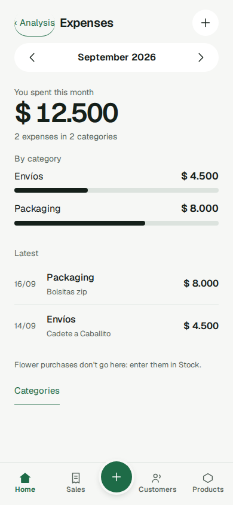

## Jobs

**Cuando** pago algo que no es una Purchase de Stock (envases, un envío o un viaje, insumos de cultivo, cualquier otra cosa), **quiero** anotarlo desde el teléfono con su fecha, Expense category, monto y un detalle corto, y corregirlo o eliminarlo si me equivoqué, **para** ver cuánta plata se me va cada mes y en qué, y que mi Profit y mi Cash lo cuenten.

**Cuando** llevo mi negocio desde el teléfono, **quiero** mantener mis Expenses al día desde el teléfono, **para** dejar de llevarlas en la planilla y tener datos reales en su lugar cuando lleguen las ventas.

**Cuando** llevo mi negocio desde el teléfono entre pedidos o en medio de un chat con un cliente, varias veces por día, **quiero** que la app esté ordenada según lo que hago de verdad y con qué frecuencia, con las Expenses a mano para la mirada semanal o mensual y cada configuración en un solo lugar, **para** volver al cliente en vez de buscar entre menús. (El job de navegación, navigation.md: acá lo sirven la tarjeta Expenses de Analysis con "Record expense" y "See expenses", una forma de registrar desde la misma Expenses, Expenses como la única vista mensual, y las Expense categories en Settings.)

**Cuando** necesito registrar una Expense, sacar Stock, ver cómo va el negocio o cambiar una configuración desde el celular, **quiero** encontrarlo donde ya vive ese contexto (Analysis en Home, "Take from stock" en la vista de stock de Products, Settings en el encabezado), **para** terminar en pocos toques sin pasar por un menú que lo junta todo. (GH-651, el retiro de More, navigation.md: acá lo sirve la tarjeta Expenses de Analysis.)

**Cuando** mi negocio trabaja en un idioma que no es el inglés, **quiero** que un negocio abierto en ese idioma arranque con sus Expense categories ya en él, **para** no tener nada que volver a tipear, mientras nada cambia para un negocio en inglés. (Compartido con stored-language.md y catalog.md: acá lo sirven las Expense categories por defecto, que siguen el Stored language al abrirse.)

**Cuando** registro una Expense o guardo un Customer desde el teléfono, **quiero** elegir su Expense category o su Customer type igual que elijo un Product o un Withdrawal reason (un campo con etiqueta que abre su propia lista, con búsqueda cuando la lista es larga), **para** terminar el formulario en pocos toques y que volver nunca tire lo que ya tipeé. (Parte 6 de GH-581, compartido con customers.md y selector.md: acá lo sirven el campo "Category" del formulario de la Expense y la edición en el lugar como su propia entrada del historial.)

**Cuando** estoy en el teléfono mirando en Analysis cómo fue el período y me acuerdo de plata que gasté, **quiero** registrar esa Expense o revisar las que ya registré desde ahí mismo, **para** que el Profit y el Cash que estoy leyendo cuenten lo que de verdad gasté. (Parte 1 de GH-725: acá lo sirven las acciones "Record expense" y "See expenses" de la tarjeta Expenses de Analysis, que ya no se leen igual que el "Add expense" propio de Expenses.)

**Cuando** estoy en medio de registrar una venta en el teléfono y tengo que anotar una Expense, **quiero** registrarla ahí mismo y volver a la misma venta intacta, **para** terminar las dos sin volver a tipear nada ni salir del flujo. (Parte 3 de GH-725, compartido con sales.md: acá lo sirven la fila "Other things to record" de New sale con su tile "Expense", el formulario de la Expense abierto como Sheet sobre la venta y la tira "Sale in progress".)

**Cuando** entro a Expenses desde Analysis o desde una venta en el teléfono, **quiero** que su encabezado me ofrezca solo el camino de vuelta y la acción de registrar una Expense, **para** registrar o revisar una Expense y volver adonde estaba sin una entrada a Settings que no vine a buscar. (Decisión del dueño en #724, 2026-11-14: acá lo sirve el encabezado de Expenses en el teléfono, sin el avatar "Settings", como los dibujos `Gastos` y `GastosOscuro`.)

En la práctica, estos jobs se juntan así. El vendedor paga algo que no es una Purchase de Stock entre pedidos, o se sienta a mirar en qué se fue la plata de la semana o del mes. Carga la Expense desde Analysis, a 2 toques desde Home y a 3 desde los demás Tab roots del teléfono, o desde New sale en medio de una venta, sin salir de ella. Encuentra las Expenses de cualquier mes, con el total y lo que se llevó cada Expense category, en un solo lugar evidente, y vuelve adonde estaba sin distracciones en el encabezado. La computadora es el mismo job en una pantalla más grande.

Línea de base de la parte 3 de GH-725: antes, el vendedor que tenía que anotar una Expense en medio de una venta terminaba o abandonaba la venta y después iba a Expenses por separado (Home → Analysis → Expenses en el teléfono, la barra lateral en la computadora), y a veces se olvidaba de la Expense. Supuesto: el olvido pasa lo bastante seguido como para justificar el atajo.

Criterios de éxito:

1. Una Expense se registra desde el teléfono en menos de un minuto. En el teléfono su formulario abre en 2 toques desde Home, Sales, Customers, Products y Analysis ("+ New sale", después "Expense"), también en 2 desde Home por la tarjeta (el segmento "Analysis", después "Record expense"), y en 1 toque desde Expenses ("Add expense"). Esto reemplaza los 3 toques de antes desde Sales, Customers y Products. En una computadora no lleva más toques que en el teléfono. La fecha ya viene en hoy, y la Expense category se elige de la lista del negocio.
2. Para cualquier mes, la vista muestra cada Expense de ese mes y el total del mes. Las desglosa por Expense category, con un subtotal para cada una. Los totales siempre son iguales a la suma de las Expenses que se muestran, también justo después de una edición o una eliminación.
3. Una Purchase de Stock nunca es una Expense. Nada de acá registra gramos ni un producto, y una Purchase nunca aparece en las listas de Expenses. Así, los resultados pueden contar las Expenses y las Purchases por separado sin contar nada dos veces.
4. Todo lo de acá se hace desde el teléfono, sin ninguna llamada a la API a mano.
5. **Las Expense categories se administran en un solo lugar.** Expenses no agrega, renombra ni elimina Expense categories; solo tiene un link a Settings → Expense categories. La única excepción es crear una Expense category dentro del formulario de la Expense.
6. **Se ve como en el diseño.** La tarjeta Expenses de Analysis y Expenses, en teléfono y computadora, coinciden con `docs/product/design-system/pantallas/`, juzgados a ojo.
7. **Valores por defecto en el idioma del negocio.** Un negocio nuevo abierto en un idioma que no es el inglés arranca con sus cuatro Expense categories por defecto en ese idioma. En inglés son idénticas byte a byte a la línea de base, y un cambio de idioma posterior nunca las reescribe.
8. **La Expense category se elige con el Selector** (parte 6 de GH-581). Con 12 o más Expense categories, el vendedor encuentra una buscando y la elige; el formulario no tiene ningún otro tipo de selector para ese campo (ni select nativo, ni chips, ni radios, ni botones presionados).
9. **Volver nunca tira el formulario.** En el teléfono, volver con la lista abierta cierra solo la lista; volver con el formulario sin tocar vuelve a la pantalla madre; volver con algo tipeado pregunta antes de descartar. Vale para la Expense nueva desde Expenses, la Expense nueva desde la tarjeta Expenses de Analysis y la edición en el lugar dentro de Expenses. Para la Expense nueva desde New sale vale lo de la lista y lo del formulario sin tocar; la pregunta con algo tipeado está planeada en #769 (criterio 12). En la computadora, Escape cierra solo el desplegable.
10. **Sin categorías, el vendedor sabe dónde crearlas**: la lista muestra "No categories yet. Add them in Settings → Expense categories.", y nunca mientras las Expense categories se están cargando o después de una carga fallida. Nada de lo que el formulario hacía antes se pierde.
11. **La tarjeta se distingue de la acción** (parte 1 de GH-725).
    - En Analysis del teléfono, la tarjeta Expenses muestra exactamente "Record expense" y "See expenses". "Add expense" y "See the expenses" no aparecen en ningún lugar de la tarjeta.
    - Cada link abre lo mismo que antes: el formulario de la Expense, y Expenses con "‹ Analysis". Cada uno mide al menos 44×44 CSS px.
    - Nada más cambia para el vendedor: el "Add expense" de Expenses, el título del formulario de la Expense y el nombre del diálogo de la Sheet conservan su texto.
    - Cada uso e2e de las etiquetas viejas de la tarjeta pasa, en la misma tarea, al grupo "Expenses" de la tarjeta, y la etiqueta vieja nunca se vuelve a poner, ni visible ni oculta (D-69509906).
12. **Un encabezado sin Settings en el teléfono** (decisión del dueño en #724). En el teléfono, Expenses no muestra ningún elemento llamado "Settings" o "Ajustes y cuenta", en ningún estado de la pantalla, y se entra y se sale por "‹ Analysis" y el gesto de volver del teléfono. Home, Sales, Customers, Products y Analysis conservan el avatar, así que Settings sigue a 1 toque de cada Tab root. Las filas de teléfono de Expenses del Mobile check pasan a 320, 360 y 390 px y con el texto al 130 %, en claro y en oscuro, sin que crezca ninguna lista de infractores.
13. **Una Expense desde New sale, sin perder la venta** (parte 3 de GH-725).
    - **La venta en curso vuelve exactamente como estaba**: líneas, gramos, Customer, Gifts, Special prices, Shipping charged, Note y totales no cambian después de "Close", el "Back" de la tira, el gesto de volver del teléfono o un guardado. Es el criterio que más importa.
    - **El vendedor siempre sabe que hay una venta esperando**: mientras al menos una línea tiene un Product elegido, la tira muestra cuántos productos y el mismo total que la fila Total de New sale, y un toque vuelve a la venta.
    - **El aviso nombra lo correcto**: después de guardar, el aviso dice "Expense recorded" cuando hay una venta esperando y "Expense saved" si no. Salir de New sale con la venta tocada sigue preguntando "Discard the sale?", también justo después de guardar.
    - **Nada tipeado se pierde sin preguntar** (planeado en #769, todavía no está): salir de una Expense con algo tipeado preguntará "Discard the expense?" y descartarla conservará la venta; salir de New sale con la venta tocada preguntará "Discard the sale?" también con la Expense tipeada encima. Hasta entonces, la Expense tipeada se cierra sin preguntar, y la funcionalidad no está completa.

# Expenses

La plata que un negocio paga por cualquier cosa que no sea una Purchase de Stock, archivada bajo sus propias Expense categories y vista solo por ese negocio (ADR-0004). Lo que se compra para el Stock es una Purchase, nunca una Expense. Resultados (#7) lee las Expenses y las Purchases por separado. A Expenses se llega en el teléfono desde la tarjeta Expenses de Analysis ("See expenses") y en una computadora desde la barra lateral; las Expense categories se administran en Settings → Expense categories (navigation.md). En el teléfono, el formulario de la Expense también se abre desde New sale, con el tile "Expense", sin perder la venta en curso.

## Comportamiento

### Expense category

- Los nombres de Expense category siguen la regla del nombre de un Product:
  - sin espacios al principio ni al final, los espacios internos reducidos a uno, hasta 60 caracteres;
  - únicos dentro de un negocio, sin importar mayúsculas ni espacios;
  - dos negocios pueden tener cada uno una Expense category con el mismo nombre.
- **Expense categories por defecto**: cuatro, en el Stored language del negocio al abrirse (stored-language.md).
  - En inglés: "Growing supplies", "Packaging", "Shipping and transport" y "Other", idénticas byte a byte a la línea de base `en.baseline.json`.
  - Un negocio nuevo abre con ellas, guardadas como sus propias Expense categories. Un Stored language nunca es el Test locale, así que nunca se escriben en `en-XA`.
  - Un cambio de idioma posterior nunca las renombra: son datos propios del vendedor y nunca se traducen.
  - Un negocio abierto antes de que existieran las Expenses las recibió una vez, cuando se actualizó la app. Los negocios que existían antes de que los valores por defecto siguieran el idioma conservan exactamente lo que tienen (los nombres en español incluidos), sin completar nada hacia atrás.
  - Cada negocio recibe los valores por defecto exactamente una vez. Uno que el negocio elimina nunca se vuelve a crear.
- **Agregar**: un nombre repetido se rechaza, con la razón.
- **Renombrar**: las Expenses de la Expense category quedan bajo el nombre nuevo. Renombrarla a un nombre que ya tiene otra Expense category del negocio se rechaza.
- **Eliminar**: es para siempre; no hay archivo ni restauración. Se rechaza mientras haya alguna Expense, de cualquier mes, archivada bajo la Expense category.
  - El rechazo dice solo que todavía tiene Expenses y sugiere renombrarla: "It can't be deleted: it still has expenses. You can rename it." No se muestra ningún desglose de dónde se usa.
  - Una vez que sus Expenses se eliminan o pasan a otra Expense category, se puede eliminar.
- No hay mínimo: un negocio puede eliminar cada Expense category sin Expenses, las de por defecto incluidas.
- La lista de Expense categories muestra cada una del negocio, ordenadas por nombre.
- **Agregar una Expense category dentro del formulario de la Expense**: el User puede crear una mientras registra una Expense, sin salir del formulario ni perder lo que ya tipeó. Es el link "Create a new category" y su campo de nombre, debajo del campo "Category" (nunca una fila de la lista), y está disponible en todo estado del campo, también cuando el negocio no tiene ninguna Expense category.
  - La Expense category nueva queda elegida para esa Expense en el acto, sin volver a abrir la lista, y el error de la Expense category se borra.
  - Un nombre repetido se rechaza con la razón, y se conserva la Expense que se está tipeando.

### Expense

- **Fecha**: por defecto, hoy en hora argentina. Se puede cambiar a cualquier día anterior; una fecha futura se rechaza.
- **Expense category**: obligatoria, sin valor por defecto; se elige cada vez. Tiene que ser una de las Expense categories propias del negocio. Cualquier otro id de Expense category responde 404.
- **Monto**: obligatorio, en pesos enteros, mayor que cero.
- **Detalle**: obligatorio, sin espacios al principio ni al final, no en blanco, hasta 200 caracteres.
- Una Expense no tiene gramos, ni producto, ni estado pendiente, de borrador o de aprobación.
- **Una Expense registrada desde New sale es una Expense común**: su propia fecha, su propia Expense category de la lista del negocio, y baja el Profit y el Cash como cualquier otra. No queda atada a la venta y no cambia ninguna de sus cifras. El Shipping charged sigue siendo lo que paga el Customer, mientras que un costo de envío es una Expense; el costo de una venta sale de los Lots como Cost of goods sold, nunca de una Expense; y lo que se compra para el Stock es una Purchase (una Stock entry), que nunca pasa por este formulario.
- **Editar**: los cuatro campos se pueden editar en el lugar, con la misma validación que al registrar. No se guarda historial de ediciones.
- **Eliminar**: borra la Expense para siempre.
- Tanto una edición como una eliminación se ven de inmediato en los totales del mes.

### Vista mensual

- Una vista por mes, que abre en el mes en curso en hora argentina.
- Muestra el total del mes y después cada Expense category que tiene Expenses ese mes. Cada una muestra su subtotal y sus Expenses.
- Las Expense categories sin Expenses ese mes se dejan afuera. Se ordenan por nombre.
- Dentro de una Expense category, las Expenses van de la fecha más reciente a la más antigua; en la misma fecha, va primero la registrada más recientemente.
- Un mes sin Expenses muestra un total de $0 y ninguna Expense category. La línea fija que recuerda que una Purchase se registra en Stock, nunca como Expense (su texto en pantalla está en `web/src/copy/expenses.ts`), y la forma de registrar una Expense se siguen mostrando. La redacción de ese texto en la app queda pendiente bajo #330.
- Esta vista es como un User encuentra una Expense equivocada para corregirla o eliminarla.

### En pantalla

- **La tarjeta Expenses de Analysis** (solo en el teléfono, debajo del corte de 900 px; GH-651, etiquetas desde la parte 1 de GH-725): en Analysis, debajo del segmento Home | Analysis y antes de las cifras, una tarjeta titulada "Expenses", expuesta como un grupo con nombre accesible "Expenses", con dos acciones cuya caja mide al menos 44×44 CSS px:
  - "Record expense", la acción principal, con el ícono de agregar, que abre el formulario de la Expense con la fecha de hoy;
  - "See expenses", un link de texto, sin conteo, que abre Expenses.

  Sus palabras son de la tarjeta y nunca repiten la acción propia de Expenses: la tarjeta no muestra "Add expense" ni "See the expenses". "Record …" es el verbo que el producto ya usa para una entrada que abre un formulario (Record payment). La tarjeta no espera a que respondan las cifras de Analysis: las dos acciones están en los estados cargando, error, vacío y con datos. En una computadora la tarjeta no se dibuja, porque a Expenses se llega desde la barra lateral. Reemplaza al "+ Add expense" que estaba en More, que ya no existe.
- **La fila "Other things to record" de New sale** (solo en el teléfono, debajo del corte de 900 px; parte 3 de GH-725):
  - New sale tiene, debajo del pie con el Total y "Save sale", una fila titulada "Other things to record" (un `nav` con ese nombre accesible), ubicada como la dibuja `NuevaVenta.dc.html`, con un solo tile, "Expense", con el ícono de comprobante, en la primera columna de una grilla de cuatro. Se ofrece siempre, sea cual sea el estado de la venta; solo queda inerte mientras se está guardando la venta. La fila no se compromete con ningún otro tile; cualquier otro registro sería una decisión propia.
  - Tocar el tile abre el formulario de la Expense existente en el lugar, como una Sheet sobre un New sale que sigue montado e inerte debajo (dibujos `VentaEnCurso` y `VentaVuelve`), en su propia entrada del historial. El formulario usa las Expense categories del negocio y no agrega ningún texto sobre la venta aparte de la tira. Abrirlo no abre ninguna otra Sheet de New sale.
  - **La tira "Sale in progress"** va arriba del formulario, en un lugar opcional para un aviso que no ocupa espacio cuando está vacío, solo cuando al menos una línea tiene un Product elegido. Es un solo botón de al menos 44 px que dice "Sale in progress · N products · $total · Back":
    - N cuenta las líneas con un Product elegido, tengan los gramos que tengan: las líneas en blanco y las que tienen gramos sin Product quedan afuera, las de Gift y las de Special price cuentan. Con una sola, "1 product".
    - $total es la misma cifra que la fila Total de New sale, en el Money format del negocio. Un total de $0 se muestra, nunca se oculta.
    - Mientras los precios se vuelven a calcular, el lugar del monto muestra el indicador de carga de la fila Total, sin símbolo de moneda, y el nombre accesible deja afuera el monto ("Sale in progress, 1 product. Back"). Si no, el nombre accesible se lee como "Sale in progress, 2 products, $ 11.000. Back". La tira sigue tocable mientras se vuelve a cotizar.
  - Tocar la tira, "Close" y el gesto de volver del teléfono son la misma acción: cierran el formulario y vuelven a la venta intacta, sin preguntar. Con la lista de Category abierta, volver cierra solo la lista y el formulario sigue abierto.
  - **Salir**: por ahora, cerrar el formulario de la Expense quedándose en New sale nunca pregunta, tenga o no algo tipeado: lo tipeado en la Expense se pierde y la venta queda intacta. Salir de New sale con la venta tocada sigue preguntando "Discard the sale?", con la guarda de New sale de siempre. Planeado en #769 (todavía no está): una sola pregunta de salida por vez, que pregunta "Discard the expense?" al cerrar una Expense tipeada (descartarla conserva la venta); "Discard the sale?" al salir de New sale con la venta tocada, tenga o no algo tipeado la Expense ("No, keep entering" conserva las dos; descartar sale sin una segunda pregunta; no hay una pregunta que nombre a las dos); y "Discard the expense?" al salir de New sale con la venta sin tocar y la Expense tipeada.
  - **Guardar**: registra la Expense, actualiza la lista de Expenses y muestra "Expense recorded" cuando al menos una línea tiene un Product elegido, o "Expense saved" si no. El aviso sigue la regla de toasts de toda la app: si el vendedor abre otra Sheet enseguida, se va antes, sin excepción para New sale. El formulario se cierra y el vendedor se queda en New sale, haya o no una venta en curso, en profundidad 0; a diferencia de Analysis o Expenses, no se vuelve por el historial a otra pantalla. Un "Back" después llega a la pantalla anterior exactamente una vez; si la venta está tocada, salir de New sale sigue preguntando "Discard the sale?", también justo después de guardar.
  - El foco vuelve al tile "Expense" cada vez que el formulario se cierra: después de "Close", "Back" o un guardado.
  - Pasar a ancho de computadora con el formulario abierto lo cierra: lo tipeado en la Expense se pierde y la venta queda intacta.
  - En una computadora la fila no se dibuja: `NuevaVentaCompu`, la barra lateral, More, `/more` y `/mas` no cambian.
- **Expenses** (`Expenses`, ruta `/expenses`; la vieja `/gastos` redirige ahí de forma permanente) es la única pantalla cuyo tipo depende del ancho (navigation.md, el ADR de GH-651):
  - en el teléfono, un detalle con "‹ Analysis" (su pantalla madre), la barra con Home marcada como activa y sin "+ New sale". Su encabezado es el título y la acción "Add expense", sin el avatar "Settings" ni ningún elemento llamado "Settings" o "Ajustes y cuenta", en ningún estado de la pantalla (cargando, vacía, con error, sin conexión o con datos) ni en claro ni en oscuro, como los dibujos `Gastos` y `GastosOscuro` (decisión del dueño en #724, 2026-11-14). Se sale por "‹ Analysis" o el gesto de volver del teléfono. A Settings se llega desde el avatar de Home, Sales, Customers, Products y Analysis, a 1 toque de cada Tab root (navigation.md); Expenses en el teléfono es un detalle, no un Tab root, así que no tiene una cifra de toques hasta Settings. El texto del encabezado no cambia: "Gastos" y "+ Anotar gasto" son las etiquetas del dibujo, no las palabras de la app (Product language);
  - en una computadora, una Tab root con la barra lateral, Expenses activa y "+ New sale", a la que se llega desde la barra lateral, debajo del separador. No tiene avatar en el encabezado: Settings se abre desde la fila del Business de la barra lateral, a 1 toque.

  Tiene:
  - la navegación por mes;
  - una línea fija recuerda que una Purchase se registra en Stock, nunca como Expense (su texto en pantalla está en `web/src/copy/expenses.ts`);
  - un link que abre Settings → Expense categories. Expenses nunca agrega, renombra ni elimina una Expense category por sí misma;
  - su propia forma de registrar una Expense nueva, "Add expense", que abre el formulario de la Expense con la fecha de hoy en 1 toque:
    - en el teléfono, la acción al final de la fila del título, nunca un segundo "+" flotante;
    - en una computadora, el botón "Add expense" en la cabecera de la página.

    Su aspecto exacto lo decide diseño.
- **El formulario de la Expense** es un formulario (navigation.md), una Sheet en el teléfono: sin barra y sin "+ New sale", y se cierra con "Close". Su título y el nombre del diálogo de la Sheet son "Add expense", lo abra la tarjeta, Expenses o New sale.
  - "Category", "Amount" y "Details" se marcan como obligatorios.
  - El envío se bloquea mientras el detalle está en blanco o no hay Expense category elegida.
  - La fecha viene completada con hoy.
  - Abierto desde Analysis o Expenses, "Close", el gesto de volver y un guardado exitoso vuelven por el historial a la pantalla que lo abrió (Analysis, desde su tarjeta Expenses, o Expenses). Abierto desde New sale, cierran la Sheet y dejan al vendedor en New sale (arriba).
  - Sin historial (un link directo), vuelve a Expenses en el mes en curso.
  - Un guardado exitoso muestra "Expense saved" en la pantalla a la que vuelve, sin saltar a otro lado ("Expense recorded" desde New sale con una venta esperando). Después de guardar desde Expenses, Expenses se queda en el mes que mostraba y se actualiza.
  - Abierto desde Analysis o Expenses, salir con algo tipeado pregunta antes de descartar ("Discard the expense?"); un formulario sin tocar se cierra de inmediato. Abierto desde New sale, por ahora se cierra sin preguntar; su pregunta está planeada en #769 (arriba).
- **La edición en el lugar dentro de Expenses** (desde la parte 6 de GH-581) es, en el teléfono, su propia entrada del historial sobre Expenses, como cualquier formulario o Sheet: volver y "Close" son la misma acción.
  - Sin tocar, volver cierra la edición y deja Expenses en el mes que mostraba.
  - Con algo tipeado, volver o "Close" preguntan una sola vez antes de descartar: seguir editando se queda en la edición; descartar vuelve a Expenses en ese mes.
  - Guardar o eliminar desde la edición la cierran sin preguntar: guardar vuelve a Expenses con "Expense saved", y eliminar abre la confirmación de eliminación sobre el mes.
  - Pasar de teléfono a computadora, o al revés, con la edición abierta la mantiene abierta con lo tipeado.
  - Volver nunca saca de Expenses ni tira lo tipeado sin preguntar.
  - No cambian las rutas de Expenses, la navegación por mes ni cómo se abre o se ve la edición. En la computadora, nada cambia (la edición conserva su propia confirmación de descarte), salvo que Escape con el desplegable de Category abierto cierra solo el desplegable.
- **El campo "Category"** (desde la parte 6 de GH-581) es un Selector obligatorio (selector.md) con la etiqueta "Category" y el texto "Pick a category" mientras no hay elección, sobre las Expense categories del negocio, en el orden en que las da el negocio:
  - mientras las Expense categories se están cargando, el formulario muestra solo su cabecera con "Close", así que el vendedor siempre puede salir; el Selector recibe igual `loading` mientras la carga está pendiente o falló, así que nunca muestra un texto de conjunto vacío antes de una carga exitosa;
  - si la carga falla, el formulario muestra debajo de su cabecera, en lugar de los campos, la línea de falla que ya tiene la app ("No connection" sin red, el reintento genérico ante un error del servidor; accounts.md), sin texto nuevo. Las Expense categories se vuelven a pedir al cerrar el formulario y volver a abrirlo;
  - en el teléfono abre su lista en una Sheet, como su propia entrada del historial sobre el formulario; con más de 8 Expense categories, la lista tiene búsqueda. En la computadora es un desplegable con teclado, y Escape cierra solo el desplegable;
  - volver o "Close" con la lista abierta cierra solo la lista, nunca el formulario. Esto vale al registrar desde Expenses, al registrar desde la tarjeta Expenses de Analysis, al registrar desde New sale y al editar en el lugar dentro de Expenses;
  - sin ninguna Expense category, la lista muestra "No categories yet. Add them in Settings → Expense categories." (`emptyStates:selectorNoCategories`), y crear una dentro del formulario sigue disponible debajo del campo;
  - elegir una Expense category borra el error del campo;
  - enviar sin Expense category muestra el error de campo obligatorio, como antes, asociado al campo como su descripción.
- **Una Expense category que desaparece con el formulario de la Expense abierto** (un socio la eliminó):
  - guardar deja el formulario abierto con todo lo tipeado;
  - la lista de Expense categories se actualiza (una creada dentro del formulario que ya no existe deja de ofrecerse) y "Category" queda vacío, sin la marca "no longer available";
  - el campo muestra "That category is gone. Pick another.", asociado al campo como su descripción.
- **Eliminar una Expense**, desde la Expense a la que se llega en la vista mensual:
  - se confirma con "Before deleting", nombrando la fecha, la Expense category y el monto, p. ej. "Delete the $ 4.500 expense in Packaging from 28/09?";
  - no hay deshacer;
  - el total y el subtotal se actualizan de inmediato, y una Expense category que queda sin Expenses ese mes desaparece.
- **Las Expense categories** se administran en Settings → Expense categories, y en ningún otro lado: agregar, renombrar y "Delete". Una eliminación bloqueada muestra el rechazo fijo de arriba. Crear una dentro del formulario de la Expense sigue como se describe.
- **Una Expense o una Expense category que ya no está** al guardarla, eliminarla o abrirla sigue la regla de la app en `accounts.md`: "That is gone." Abrir una ofrece "Back to Expenses" en el mes en curso.
- **Toasts**: "Expense saved", "Expense recorded" (solo desde New sale con una venta esperando), "Expense deleted", "Category saved" y "Category deleted", sin montos.
- **Los rechazos** se muestran en línea y conservan lo tipeado.
- **Respuesta ante fallas**: la pérdida de red muestra "No connection", y un error del servidor muestra un reintento genérico (accounts.md).
- **Diseño**: el formulario de la Expense muestra el campo "Category" cerrado como Selector, con "Create a new category" debajo, en `GastoNuevo`, `GastoNuevoOscuro` y `GastoNuevoCompu` de `docs/product/design-system/pantallas/`. El encabezado de Expenses en el teléfono sigue a `Gastos` y `GastosOscuro`: "‹ Analysis", el título y la acción de registrar, sin avatar. La fila de New sale y la tira se dibujan en `NuevaVenta`, `VentaEnCurso` y `VentaVuelve`; donde esos dibujos muestran la Sheet sobre Home, cuatro tiles o un aviso con el monto, gana esta definición.

### Restricciones

- Las Expense categories y las Expenses llevan `business_id`, y sus rutas entran en el barrido de aislamiento (ADR-0004).
- Ningún monto ni detalle se escribe en los logs, la consola del navegador ni el almacenamiento del navegador.
- Un link de Expenses a Settings → Expense categories aparece solo una vez que ese grupo existe. Ningún link puede apuntar a una pantalla que no existe, y ningún vendedor puede perder la administración de las Expense categories.
- El dominio de expenses no guarda ningún nombre por defecto ni importa ninguna biblioteca de traducción. La apertura del negocio nuevo toma los valores por defecto a través del puerto `BusinessDefaults` (`for_language(language)`), con el Stored language, nunca con el Shown language.
- Las palabras de la tarjeta Expenses salen del Copy module: "Expenses", "Record expense" (`common:recordExpense`) y "See expenses" (`common:seeExpenses`). `common:addExpense` ("Add expense") es solo de la acción propia de Expenses, el título del formulario de la Expense y el nombre del diálogo de la Sheet; la tarjeta nunca lo usa.
- Las palabras de la fila de New sale y de la tira salen del Copy module, en `en` y `en-XA`: "Other things to record", "Expense", "Sale in progress", "1 product" / "{n} products", "Back", "Expense recorded" y la función del nombre accesible de la tira. Sus estilos salen solo de los tokens de diseño.
- La suite e2e encuentra las acciones de la tarjeta acotadas a su grupo "Expenses" (`getByRole('group', { name: 'Expenses' })`). Ninguna etiqueta vieja se repone, ni visible ni oculta, para satisfacer un localizador (D-69509906).
- Las Expense categories son un Growable set: nunca se declaran en `fixedSets.ts` ni se eligen con chips (selector.md).
- El formulario monta un `SheetStackProvider` en `ExpenseNewRoute` y en la edición en el lugar de `Gastos`, para que la lista del Selector sea su propia entrada del historial, en el nivel de arriba del formulario. Desde New sale, el formulario se dibuja en el nivel 1 de las Sheets de New sale, sin su propia confirmación de descarte: `ExpenseNewSheet` dibuja su confirmación solo cuando quien lo abre le pasa una guarda, y New sale no le pasa ninguna.
- La edición en el lugar del teléfono protege su volver con cambios sin guardar mediante el piso de Sheet de la guarda de salida (ADR-0078).
- Un formulario abierto en el lugar sobre otro formulario conserva la única guarda de salida de la pantalla, y apunta su marca de cambios y su piso al formulario de arriba ([ADR 20261114](../adr/20261114-a-form-opened-over-a-form-keeps-the-screens-one-leave-guard-and-points-its-dirty-flag-and-floor-at-the-form-on-top.md), que extiende ADR-0078). Esa guarda se construye en #769; hasta entonces New sale conserva su guarda de siempre, que solo mira la venta. No hay borrador: la venta en curso vive solo mientras New sale está montado.
- El encabezado de Expenses en el teléfono no monta `SettingsAvatar`; el componente y su montaje en Home, Sales, Customers, Products y Analysis no cambian. Si un helper o una spec del e2e usaba el avatar en Expenses como referencia, se migra a otro elemento de la pantalla ("‹ Analysis" o la acción de registrar); el avatar nunca se vuelve a poner en Expenses, visible ni oculto, para satisfacer un localizador (D-69509906). El recorrido de toques del e2e (`tapBudget.spec.ts`) afirma 0 avatares "Settings" en Expenses del teléfono y no le mide ninguna cifra hasta Settings; en una computadora, Settings desde Expenses es 1 toque, por la barra lateral.

## Métricas

Se leen de los datos y de las pruebas; no hay telemetría.

- **M1, registrada en el momento (criterio 1)**: la proporción de Expenses cuya fecha es igual al día argentino en que se registraron. Meta: una mayoría una vez que el front esté en uso. A través del front, registrar una Expense desde el teléfono lleva menos de 60 s.
- **M2, los totales cierran (criterio 2)**: los totales que difieren de la suma de las Expenses que se muestran tienen que ser 0. Lo controlan pruebas después de crear, editar y eliminar, en la API y en pantalla. Un mes sin Expenses muestra $0 y ninguna Expense category.
- **M3, "en qué" (criterio 2)**: la proporción de la plata de cada mes archivada bajo "Other". Si se mantiene alta, las Expense categories no le están sirviendo al User para ver adónde se va la plata.
- **M4, uso**: negocios con al menos una Expense en un mes, sobre los negocios activos.
- **M5, las Purchases quedan afuera (criterio 3)**: las Purchases que aparecen en las listas de Expenses tienen que ser 0, por construcción. Una Expense no tiene ningún campo que pueda guardar gramos ni un producto.
- **M6, sin curl (criterio 4)**: la corrida de punta a punta del front:
  - registra una Expense desde la tarjeta Expenses de Analysis ("Record expense") y una desde Expenses ("Add expense");
  - edita y elimina una;
  - se mueve entre meses;
  - agrega, renombra y elimina una Expense category en Settings, un rechazo de eliminación incluido.
- **M7, toques (criterios 1 y 12)**: la corrida de punta a punta (`tapBudget.spec.ts`) cuenta los toques para abrir el formulario de la Expense, en ventanas de teléfono y de computadora:
  - en el teléfono, 2 desde Home, Sales, Customers, Products y Analysis ("+ New sale", después "Expense"), terminando en el diálogo "Add expense" sobre New sale; la app ya lo cumple, pero la corrida recién lo afirma con #757;
  - desde Home por Analysis → "Record expense", también 2;
  - desde Expenses, 1;
  - en una computadora, nunca más que en el teléfono.

  Meta: 100% dentro del límite.
- **M8, el marco de Expenses (criterios 1, 5, 12)**: las pruebas del front muestran:
  - en el teléfono, "‹ Analysis", la barra, ningún "+ New sale" y ningún avatar "Settings"; en una computadora, la barra lateral con "+ New sale" y sin flecha de regreso;
  - la navegación por mes y la línea fija que recuerda que una Purchase se registra en Stock, nunca como Expense (`web/src/copy/expenses.ts`);
  - la acción de registrar: secundaria en el teléfono (sin un segundo "+" flotante), el botón de la cabecera en una computadora.
- **M9, las Expense categories salieron de Expenses (criterio 5)**: las pruebas del front muestran:
  - que Expenses no agrega, renombra ni elimina Expense categories;
  - un link que abre Settings → Expense categories;
  - la creación en línea en el formulario de la Expense, que sigue funcionando.
- **M10, vuelta del formulario**: las pruebas del front cubren:
  - "Close" y un guardado exitoso que vuelven por el historial a Analysis (abierto desde su tarjeta) o a Expenses;
  - "Expense saved";
  - la confirmación de descarte y el cierre de un formulario sin tocar;
  - la vuelta sin historial a Expenses en el mes en curso.
- **M11, redirecciones**: `/gastos` → `/expenses` responde una redirección permanente, con su prueba. `/mas` ya no se redirige (navigation.md).
- **M12, se ve como en el diseño (criterio 6)**: comparaciones de antes y después de `scripts/design/compare.sh`, en teléfono y computadora, adjuntas al PR y juzgadas a ojo. Una pantalla que la herramienta no puede capturar se informa como "not compared".
- **M13, los valores por defecto siguen el idioma (criterio 7)**: un negocio abierto en `en` recibe las cuatro Expense categories idénticas byte a byte a `en.baseline.json`; uno abierto en un `de` de prueba recibe las cuatro de `de`; después de que cualquiera de los dos negocios cambie de idioma, sus Expense categories no cambian; filas cambiadas en negocios existentes: 0; negocios abiertos bajo el `en-XA` forzado con Expense categories en `en-XA`: 0. Bajo el `en-XA` forzado, los valores por defecto generados desde su fuente no dejan ninguna letra después de sacar los segmentos `⟦…⟧`. 100% de aprobación.
- **M14, la Expense category con el Selector (criterio 8)**: con 12 o más Expense categories sembradas, las pruebas del front muestran el Selector en el formulario, ningún `<select>`, grupo de radios ni botón `aria-pressed` para ese campo, y que tipear parte de un nombre en la búsqueda de la lista encuentra la Expense category y tocarla la elige. 100% de aprobación.
- **M15, volver nunca tira el formulario (criterio 9)**: para cada punto de entrada (`ExpenseNewRoute` desde Expenses y desde la tarjeta Expenses de Analysis, y la edición en el lugar de `Gastos`), las pruebas del front muestran: formulario sin tocar, volver va a la pantalla madre; formulario con algo tipeado, volver pide confirmar el descarte; con la lista abierta, volver cierra solo la lista; en la computadora, Escape cierra solo el desplegable. Para la edición en el lugar, volver sin tocar deja Expenses en el mes que mostraba, un descarte confirmado vuelve a ese mes sin preguntar de nuevo, y pasar de teléfono a computadora conserva lo tipeado. 100% de aprobación.
- **M16, conjunto vacío y carga (criterio 10)**: las pruebas del front muestran "No categories yet. Add them in Settings → Expense categories." con el conjunto vacío, y ningún texto de conjunto vacío mientras la consulta está pendiente o falló; con la carga fallida, la línea de falla existente en el formulario. El chequeo `mobile` recorre el estado `expense/category-selector-empty` y las entradas `combobox:Category` obsoletas de `autocomplete.json` ya no están, sin ningún infractor nuevo.
- **M17, nada se pierde (criterio 10)**: las pruebas del front muestran que la Expense category creada dentro del formulario queda elegida y el error se borra, también con el conjunto vacío; que el rechazo por una Expense category que desapareció deja el campo vacío con "That category is gone. Pick another." y conserva lo tipeado; y que el error de campo obligatorio sigue apareciendo.
- **M18, la tarjeta Expenses (GH-651)**: pruebas de Testing Library a través del router real, en ancho de teléfono: "Record expense" de la tarjeta abre el formulario de la Expense y "See expenses" abre Expenses; en ancho de computadora la tarjeta no está. 100% de aprobación.
- **M19, la tarjeta se distingue de la acción (criterio 11)**:
  - en ancho de teléfono, el grupo "Expenses" de Analysis tiene exactamente los links "Record expense" y "See expenses";
  - links de la tarjeta llamados "Add expense" o "See the expenses": 0, con un caso de `Analisis.entryPoints.test.tsx` que falla si aparece cualquiera de los dos;
  - cada caja mide al menos 44×44 CSS px y el Mobile check pasa sin infractores nuevos;
  - `common:addExpense` no cambia y `expenseSheet.spec.ts` pasa sin editarse;
  - localizadores e2e de la tarjeta no acotados a su grupo "Expenses": 0; etiquetas viejas repuestas, visibles u ocultas: 0.

  100% de aprobación.
- **M20, Expenses sin Settings en el teléfono (criterio 12, #724)**: pruebas de Testing Library a través del router real (`SettingsAvatar.test.tsx`), en ancho de teléfono, encuentran 0 elementos llamados "Settings" o "Ajustes y cuenta" en Expenses en cada uno de sus estados (cargando, vacía, con error del servidor, sin conexión y con datos), con prueba de que cada estado se alcanzó, y siguen encontrando "‹ Analysis" y la acción de registrar; en Home, Sales, Customers, Products y Analysis encuentran exactamente un link "Settings" que lleva a `/settings`; en ancho de computadora no hay avatar en el encabezado de Home, Analysis ni Expenses. El proyecto e2e `mobile` pasa en las filas de Expenses a 320, 360 y 390 px y con el texto al 130 %, en claro y en oscuro, con 0 infractores agregados, sin ninguna entrada obsoleta que quede en las listas, y ningún helper ni spec del e2e usa el avatar en Expenses. 100% de aprobación.
- **M21, la venta vuelve intacta (criterio 13)**: pruebas de Testing Library a través del router real, con `fetch` simulado y el historial leído de `router.state.location`, en ancho de teléfono (`NuevaVenta.expense.test.tsx`): el tile abre el formulario; "Close", el "Back" de la tira y el volver del sistema vuelven a New sale en profundidad 0 con la venta intacta (líneas, gramos, Customer, Shipping charged, Note, total); después de guardar, New sale queda en profundidad 0, la lista de Expenses se invalida y un "Back" llega a la pantalla anterior exactamente una vez; con la lista de Category abierta, un volver cierra solo la lista; abrir la Expense no abre la Sheet del Customer; pasar a 1000 px con el formulario abierto deja profundidad 0 y la venta intacta; con un guardado de la venta en curso, tocar el tile no abre nada; foco en el tile después de "Close", "Back" o un guardado. Ventas cambiadas por abrir, cerrar o guardar una Expense: 0. 100% de aprobación. Que descartar una Expense tipeada conserve la venta se agrega con #769.
- **M22, la tira dice que hay una venta esperando (criterio 13)**: las pruebas del front muestran la tira con un Product elegido y su ausencia sin ninguno (también con gramos sin Product); los casos unitarios de `productCount` y de la tira muestran que un Gift y un Special price cuentan, que una línea en blanco o con gramos sin Product no, que mientras se vuelve a cotizar no aparece ningún símbolo de moneda ni monto en el nombre accesible, y el singular "1 product"; el monto de la tira es igual al de la fila Total, $0 incluido. 100% de aprobación.
- **M23, la pregunta y el aviso correctos (criterio 13)**: las pruebas del front muestran que, con la venta tocada, un "Back" después de guardar pregunta "Discard the sale?" exactamente una vez; que el aviso dice "Expense recorded" con una venta esperando y "Expense saved" si no (se prueba el texto, no cuánto dura); que en ancho de computadora no hay fila; y que no hay ningún `console.warn`. 100% de aprobación. Con #769 se agregan: una Expense tipeada pregunta "Discard the expense?" al volver a la venta; con la venta sin tocar y la Expense tipeada, navegar a `/sales` pregunta por la Expense; con la venta tocada, navegar a `/sales` pregunta "Discard the sale?", con la Expense sin tocar y con la Expense tipeada.

## Fuera de alcance

- El Profit, el Cash y cualquier total que cruce ventas, Purchases y Expenses: es la capacidad de resultados.
- Cargar con el Spreadsheet import la pestaña Gastos de la planilla. Las Expenses viejas se tipean con sus fechas reales.
- Expenses recurrentes, adjuntos y comprobantes.
- El historial de ediciones de una Expense.
- Una lista de Expenses de todos los tiempos por Expense category.
- Una lista cronológica de Expenses.
- Archivar una Expense category.
- Administrar las Expense categories desde Expenses.
- Construir Settings o sus grupos: navigation.md y sus propios issues.
- Traducir o renombrar las Expense categories guardadas de un negocio cuando cambia su idioma, o completar hacia atrás valores por defecto en otro idioma para negocios existentes.
- Un conteo de Expenses en "See expenses" y la pantalla Expenses rediseñada completa: los construye su propio issue de rediseño.
- Cambiar el texto del conjunto vacío para que mencione la creación dentro del formulario.
- Cambiar las rutas de Expenses, su navegación por mes o cómo se abre y se ve la edición en el lugar.
- Un reintento con un toque para la carga fallida de las Expense categories dentro del formulario.
- Cualquier otro cambio en el encabezado de Expenses (su texto, el control de vuelta y la disposición en una sola fila del dibujo incluidos), en el componente `SettingsAvatar` o en los encabezados de Home, Sales, Customers, Products y Analysis; cualquier cambio en la disposición de computadora de Expenses; un aviso o nota de versión por el retiro del avatar.
- Cambiar el "Add expense" de Expenses, el título del formulario de la Expense o el nombre del diálogo de la Sheet, y cualquier nota de versión o aviso en la app sobre el cambio de etiquetas de la tarjeta (parte 1 de GH-725).
- Atar una Expense a una venta, o usarla como Shipping charged o como costo de la venta (parte 3 de GH-725).
- Conservar la venta en curso ante una recarga, un navegador cerrado por el teléfono o una pestaña cerrada con el formulario de la Expense abierto: no hay borrador, igual que al salir de New sale.
- Conservar la Expense tipeada al pasar a ancho de computadora con el formulario abierto desde New sale.
- Cualquier tile de "Other things to record" que no sea "Expense", y explicar en el formulario que la Expense no cambia la venta.
- Una pregunta de salida que nombre a la vez la venta y la Expense, o mantener el aviso "Expense recorded" en pantalla cuando se abre otra Sheet.
- Registrar una Purchase desde New sale: lo que se compra para el Stock es una Stock entry.
- Cambiar `NuevaVentaCompu`, la barra lateral, More, `/more` o `/mas`.
- En esta parte: la guarda de salida con la Expense de arriba y sus preguntas (#769), y los estados recorridos por el Mobile check, las filas del registro de pantallas y la afirmación e2e de los 2 toques desde New sale (#757).
