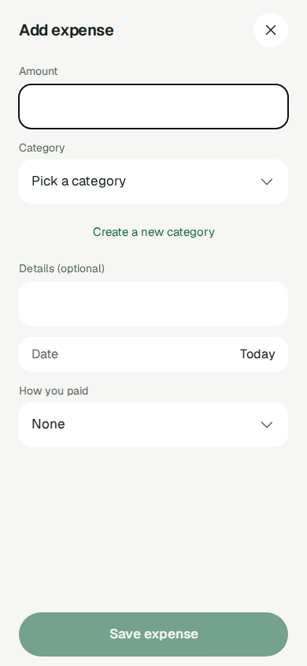

## Jobs

**Cuando** pago algo que no es una Purchase de Stock (envases, un envío o un viaje, insumos de cultivo, cualquier otra cosa), **quiero** anotarlo desde el teléfono con su fecha, Expense category, monto y un detalle corto, y corregirlo o eliminarlo si me equivoqué, **para** ver cuánta plata se me va cada mes y en qué, y que mi Profit y mi Cash lo cuenten.

**Cuando** llevo mi negocio desde el teléfono, **quiero** mantener mis Expenses al día desde el teléfono, **para** dejar de llevarlas en la planilla y tener datos reales en su lugar cuando lleguen las ventas.

**Cuando** llevo mi negocio desde el teléfono entre pedidos o en medio de un chat con un cliente, varias veces por día, **quiero** que la app esté ordenada según lo que hago de verdad y con qué frecuencia, con las Expenses a mano para la mirada semanal o mensual y cada configuración en un solo lugar, **para** volver al cliente en vez de buscar entre menús. (El job de navegación, navigation.md: acá lo sirven la tarjeta Expenses de Analysis con "Record expense" y "See expenses", una forma de registrar desde la misma Expenses, Expenses como la única vista mensual, y las Expense categories en Settings.)

**Cuando** necesito registrar una Expense, sacar Stock, ver cómo va el negocio o cambiar una configuración desde el celular, **quiero** encontrarlo donde ya vive ese contexto (Analysis en Home, "Take from stock" en la vista de stock de Products, Settings en el encabezado), **para** terminar en pocos toques sin pasar por un menú que lo junta todo. (GH-651, el retiro de More, navigation.md: acá lo sirve la tarjeta Expenses de Analysis.)

**Cuando** mi negocio trabaja en un idioma que no es el inglés, **quiero** que un negocio abierto en ese idioma arranque con sus Expense categories ya en él, **para** no tener nada que volver a tipear, mientras nada cambia para un negocio en inglés. (Compartido con stored-language.md y catalog.md: acá lo sirven las Expense categories por defecto, que siguen el Stored language al abrirse.)

**Cuando** registro una Expense o guardo un Customer desde el teléfono, **quiero** elegir su Expense category o su Customer type igual que elijo un Product o un Withdrawal reason (un campo con etiqueta que abre su propia lista, con búsqueda cuando la lista es larga), **para** terminar el formulario en pocos toques y que volver nunca tire lo que ya tipeé. (Parte 6 de GH-581, compartido con customers.md y selector.md: acá lo sirven el campo "Category" del formulario de la Expense y la edición en el lugar como su propia entrada del historial.)

**Cuando** estoy en el teléfono mirando en Analysis cómo fue el período y me acuerdo de plata que gasté, **quiero** registrar esa Expense o revisar las que ya registré desde ahí mismo, **para** que el Profit y el Cash que estoy leyendo cuenten lo que de verdad gasté. (Parte 1 de GH-725: acá lo sirven las acciones "Record expense" y "See expenses" de la tarjeta Expenses de Analysis, que ya no se leen igual que el "Add expense" propio de Expenses.)

**Cuando** estoy en medio de registrar una venta en el teléfono y tengo que anotar una Expense, **quiero** registrarla ahí mismo y volver a la misma venta intacta, **para** terminar las dos sin volver a tipear nada ni salir del flujo. (Parte 3 de GH-725, compartido con sales.md: acá lo sirven la fila "Other things to record" de New sale con su tile "Expense", el formulario de la Expense abierto como Sheet sobre la venta y la tira "Sale in progress".)

**Cuando** estoy en medio de una venta en el teléfono, paro a anotar una Expense y después la cierro o vuelvo, **quiero** que la app me pregunte solo si perdería algo que tipeé, **para** no volver a tipear nunca una venta ni una Expense, y que nunca me demore una pregunta sobre algo que no toqué. (Parte 2 de GH-769, compartido con sales.md: acá lo sirve la única pregunta de salida de New sale, que mira la Expense de arriba y pregunta "Discard the expense?" o "Discard the sale?" según lo que está en juego.)

**Cuando** entro a Expenses desde Analysis o desde una venta en el teléfono, **quiero** que su encabezado me ofrezca solo el camino de vuelta y la acción de registrar una Expense, **para** registrar o revisar una Expense y volver adonde estaba sin una entrada a Settings que no vine a buscar. (Decisión del dueño en #724, 2026-11-14: acá lo sirve el encabezado de Expenses en el teléfono, sin el avatar "Settings".)

**Cuando** abro Expenses en el teléfono para anotar o revisar lo que gasté, **quiero** tener la vuelta, el nombre de la pantalla y Add expense juntos en una sola fila arriba, **para** anotar una Expense o volver a Analysis con un toque, con el mes y la lista empezando más arriba en la pantalla. (Parte 5 de GH-1053, decisión del dueño del 2026-11-25 y D-8ecb8c1d: acá lo sirve la fila del título de Expenses en el teléfono, con la vuelta redonda, el título entero y Add expense al final.)

**Cuando** pago algo que no es Stock, **quiero** registrar con cuál de mis propios Payment methods lo pagué, sin tener que escribir una descripción, **para** ver después cómo salió del negocio cada Expense y registrarla en pocos toques desde el teléfono. (GH-837, compartido con payment-methods.md. La parte 2 entrega la mitad de la API: una Expense lleva un Payment method opcional por id, y el Detalle es opcional. La mitad de "pocos toques" llega con el formulario Add expense, en la parte 2 de GH-839.)

**Cuando** registro plata que gasté en algo que no es Stock, **quiero** anotar de cuál de mis Payment methods salió, **para** saber después de dónde salió de verdad la plata. (Parte 2 de GH-1010, solo por la API: acá lo sirven la escritura con guarda de `payment_method_id`, el medio con su nombre actual en la lectura de una Expense y en la vista mensual, y el Detalle opcional. Ninguna pantalla cambia.)

**Cuando** repaso las Expenses de este mes en el teléfono, **quiero** ver cómo se pagó cada una al lado de para qué fue, **para** saber qué plata pagó qué (el efectivo en mano o una transferencia, por ejemplo) sin abrir cada Expense. (Parte 4 de GH-520: acá lo sirve el nombre actual del Payment method en la línea de abajo de cada fila de la vista mensual, y el título por Expense category de una Expense sin Detalle.)

**Cuando** acabo de pagar algo que el negocio necesita, **quiero** registrarlo desde el teléfono en pocos toques (monto, Expense category y, si quiero, cómo pagué), **para** que mis Expenses estén completas y después saber de cuál de mis propios Payment methods salió la plata. (Parte 2 de GH-839, el formulario Add expense, compartido con payment-methods.md: acá lo sirven el campo "How you paid", el Detalle opcional, la fila de fecha compartida y "Save expense · {monto}". Los motivos del monto debajo del campo y que el monto deshabilite "Save" los entregó #1164, por la decisión 1 del humano.)

**Cuando** registro una Expense desde el teléfono y "Save" queda deshabilitado, **quiero** leer justo debajo del monto qué regla rompe mi número (más decimales de los que usa mi Business, o no mayor que cero), **para** corregirlo de una vez y guardar sin adivinar, y que la Expense cuente en mi Profit y mi Cash. (#1164, separada de la parte 2 de GH-839 por la decisión 1 del humano: acá lo sirven las reglas del monto en "Save" y los dos motivos debajo del campo Amount. La computadora recibe las mismas frases, sin pulido propio.)

En la práctica, estos jobs se juntan así. El vendedor paga algo que no es una Purchase de Stock entre pedidos, o se sienta a mirar en qué se fue la plata de la semana o del mes. Carga la Expense desde Analysis, a 2 toques desde Home y a 3 desde los demás Tab roots del teléfono (el presupuesto de toques vive en navigation.md, criterio 1), o desde New sale en medio de una venta, sin salir de ella y sin perder lo que tipeó en ninguna de las dos. En el formulario solo el monto y la Expense category son obligatorios; el Detalle y cómo pagó son opcionales, y el botón le muestra el monto antes de guardar. Si el monto está mal, "Save" no se habilita y debajo del campo lee qué regla rompe, así que lo corrige de una vez. Encuentra las Expenses de cualquier mes, con el total y lo que se llevó cada Expense category, en un solo lugar evidente, ve en cada fila cómo se pagó, y vuelve adonde estaba sin distracciones en el encabezado. La computadora es el mismo job en una pantalla más grande.

Línea de base de la parte 3 de GH-725: antes, el vendedor que tenía que anotar una Expense en medio de una venta terminaba o abandonaba la venta y después iba a Expenses por separado (Home → Analysis → Expenses en el teléfono, la barra lateral en la computadora), y a veces se olvidaba de la Expense. Supuesto: el olvido pasa lo bastante seguido como para justificar el atajo.

Línea de base de la parte 2 de GH-769: antes, en el teléfono, cerrar una Expense tipeada sobre New sale la tiraba sin preguntar, y lo mismo pasaba al salir de New sale con la venta sin tocar y la Expense tipeada; el vendedor tenía que volver a tipearla. La venta ya estaba protegida por "Discard the sale?" cuando estaba tocada.

Línea de base de GH-837: el medio con que se pagó una Expense vive como texto libre en el Detalle ("pagado por transferencia") o no se registra; por eso el Detalle era obligatorio. El éxito es que el medio sale del texto libre y pasa a la lista propia del Business.

Línea de base de la parte 2 de GH-1010: las Expenses que ya existen no tienen medio. Nada lo deduce del Detalle ni de la Expense category ni lo completa hacia atrás, y su Detalle queda tal como se escribió; un vendedor que quiera un medio en una Expense vieja la edita.

Línea de base de la parte 4 de GH-520: la API ya trae el medio de cada Expense de la vista mensual, pero la fila no lo muestra, así que para saber cómo se pagó una Expense el vendedor tiene que abrirla.

Línea de base de la parte 2 de GH-839: el formulario de la Expense pide el Detalle como obligatorio y no tiene dónde decir cómo se pagó. Un vendedor sin un detalle que dar tipea texto de relleno o posterga registrar la Expense.

Línea de base de #1164: un monto inválido no deshabilitaba "Save" y nada lo explicaba antes de tocarlo. Con demasiados decimales, el motivo aparecía debajo del campo recién después de tocar "Save"; con 0 o un valor que no se lee, el formulario mostraba el rechazo genérico al pie, lejos del campo. El vendedor adivinaba: volvía a tipear, probaba otro formato o abandonaba, y la Expense nunca se registraba. Supuesto: no hay forma de medir hoy los formularios abandonados, así que la primera medida es indirecta (M40).

Línea de base de la parte 5 de GH-1053: en el teléfono, el shell dibuja "‹ Analysis" en una línea propia arriba de la tarjeta, y el título y "+ Add expense" van en una segunda fila, donde la píldora compite con el título en los teléfonos angostos. Esa línea de más empuja el mes y la lista hacia abajo. Además, con el texto al 130 % en un teléfono angosto, el total del mes podía desbordar el ancho y hacer scroll de costado.

Criterios de éxito:

1. Una Expense se registra desde el teléfono en menos de un minuto. En el teléfono su formulario abre en 2 toques desde Home, Sales, Customers, Products y Analysis (el + de la barra, después "Expense"), también en 2 desde Home por la tarjeta (el segmento "Analysis", después "Record expense"), y en 1 toque desde Expenses ("Add expense"). Esto reemplaza los 3 toques de antes desde Sales, Customers y Products. El presupuesto de toques vive en navigation.md, criterio 1. En una computadora no lleva más toques que en el teléfono. La fecha ya viene en hoy, y la Expense category se elige de la lista del negocio.
2. Para cualquier mes, la vista muestra cada Expense de ese mes y el total del mes. Las desglosa por Expense category, con un subtotal para cada una. Los totales siempre son iguales a la suma de las Expenses que se muestran, también justo después de una edición o una eliminación.
3. Una Purchase de Stock nunca es una Expense. Nada de acá registra gramos ni un producto, y una Purchase nunca aparece en las listas de Expenses. Así, los resultados pueden contar las Expenses y las Purchases por separado sin contar nada dos veces.
4. Todo lo de acá se hace desde el teléfono, sin ninguna llamada a la API a mano.
5. **Las Expense categories se administran en un solo lugar.** Expenses no agrega, renombra ni elimina Expense categories; solo tiene un link a Settings → Expense categories. La única excepción es crear una Expense category dentro del formulario de la Expense.
6. **Se ve como en el diseño.** La tarjeta Expenses de Analysis y Expenses, en teléfono y computadora, coinciden con `docs/product/design-system/pantallas/`, juzgados a ojo; donde el dueño aceptó una diferencia (criterio 22), gana esta definición.
7. **Valores por defecto en el idioma del negocio.** Un negocio nuevo abierto en un idioma que no es el inglés arranca con sus cuatro Expense categories por defecto en ese idioma. En inglés son idénticas byte a byte a la línea de base, y un cambio de idioma posterior nunca las reescribe.
8. **La Expense category se elige con el Selector** (parte 6 de GH-581). Con 12 o más Expense categories, el vendedor encuentra una buscando y la elige; el formulario no tiene ningún otro tipo de selector para ese campo (ni select nativo, ni chips, ni radios, ni botones presionados).
9. **Volver nunca tira el formulario.** En el teléfono, volver con una lista abierta (la de Category o, desde la parte 2 de GH-839, la de How you paid) cierra solo la lista; volver con el formulario sin tocar vuelve a la pantalla madre; volver con algo tipeado pregunta antes de descartar. Vale para la Expense nueva desde Expenses, la Expense nueva desde la tarjeta Expenses de Analysis, la Expense nueva desde New sale (criterio 14) y la edición en el lugar dentro de Expenses. En la computadora, Escape cierra solo el desplegable.
10. **Sin categorías, el vendedor sabe dónde crearlas**: la lista muestra "No categories yet. Add them in Settings → Expense categories.", y nunca mientras las Expense categories se están cargando o después de una carga fallida. Nada de lo que el formulario hacía antes se pierde.
11. **La tarjeta se distingue de la acción** (parte 1 de GH-725).
    - En Analysis del teléfono, la tarjeta Expenses muestra exactamente "Record expense" y "See expenses". "Add expense" y "See the expenses" no aparecen en ningún lugar de la tarjeta.
    - Cada link abre lo mismo que antes: el formulario de la Expense, y Expenses con su vuelta a Analysis. Cada uno mide al menos 44×44 CSS px.
    - Nada más cambia para el vendedor: el "Add expense" de Expenses, el título del formulario de la Expense y el nombre del diálogo de la Sheet conservan su texto.
    - Cada uso e2e de las etiquetas viejas de la tarjeta pasa, en la misma tarea, al grupo "Expenses" de la tarjeta, y la etiqueta vieja nunca se vuelve a poner, ni visible ni oculta (D-69509906).
12. **Un encabezado sin Settings en el teléfono** (decisión del dueño en #724). En el teléfono, Expenses no muestra ningún elemento llamado "Settings" o "Ajustes y cuenta", en ningún estado de la pantalla, y se entra y se sale por la vuelta a Analysis (su nombre accesible nombra Analysis) y el gesto de volver del teléfono. Home, Sales, Customers, Products y Analysis conservan el avatar, así que Settings sigue a 1 toque de cada Tab root. Las filas de teléfono de Expenses del Mobile check pasan a 320, 360 y 390 px y con el texto al 130 %, en claro y en oscuro, sin que crezca ninguna lista de infractores.
13. **Una Expense desde New sale, sin perder la venta** (parte 3 de GH-725).
    - **La venta en curso vuelve exactamente como estaba**: líneas, gramos, Customer, Gifts, Special prices, Shipping charged, Note y totales no cambian después de "Close", el "Back" de la tira, el gesto de volver del teléfono, un descarte confirmado de la Expense o un guardado. Es el criterio que más importa.
    - **El vendedor siempre sabe que hay una venta esperando**: mientras al menos una línea tiene un Product elegido, la tira muestra cuántos productos y el mismo total que la fila Total de New sale, y un toque vuelve a la venta.
    - **El aviso nombra lo correcto**: después de guardar, el aviso dice "Expense recorded" cuando hay una venta esperando y "Expense saved" si no. Salir de New sale con la venta tocada sigue preguntando "Discard the sale?", también justo después de guardar.
    - **Nada tipeado se pierde sin preguntar** (desde la parte 2 de GH-769; criterio 14).
14. **Preguntar solo cuando se perdería algo** (parte 2 de GH-769, solo en el teléfono, debajo de 900 px).
    - "Close", el "Back" de la tira o el volver del sistema desde una Expense con algún campo distinto de como se abrió la Sheet (el Payment method incluido, desde la parte 2 de GH-839) preguntan primero "Discard the expense?". "No" deja cada campo de la Expense, la venta en curso y el foco exactamente como estaban.
    - "Yes" cierra solo la Expense: el vendedor vuelve a la misma venta, sin cambios, con el foco en el tile "Expense". Mientras se ve la tira, la pregunta dice con palabras que la venta queda como está ("Your sale in progress stays as it is.").
    - No se pregunta nada cuando no se perdería nada: una Expense sin tocar, un cambio deshecho, una Expense guardada con éxito, o salir de New sale sin la venta ni la Expense cambiadas. Un guardado rechazado sigue contando como cambio y pregunta.
    - Nunca hay más de una pregunta en pantalla, y nombra lo que está en juego: con la venta tocada, salir de New sale pregunta "Discard the sale?"; con la venta sin tocar y la Expense cambiada, pregunta "Discard the expense?".
15. **Una Expense sin Detalle** (parte 2 de GH-837): por la API, una Expense se registra solo con monto y Expense category. Un Detalle en blanco o solo con espacios se guarda como texto vacío y nunca se rechaza; más de 200 caracteres se sigue rechazando. Desde la parte 2 de GH-839, el formulario tampoco lo pide.
16. **Solo un medio propio y ofrecido** (parte 2 de GH-837): una Expense puede llevar solo un Payment method que su propio Business ofrece ahora (del mismo Business, sin archivar). Responden el mismo 404 `payment_method.unavailable`, con cuerpos idénticos byte a byte: un id inexistente, uno de otro Business, uno archivado, uno eliminado, y 0 o uno negativo. Así nada revela que existe otro Business.
17. **La historia no se rompe** (parte 2 de GH-837): archivar o renombrar un medio nunca rompe ni reescribe una Expense vieja, y las lecturas muestran el nombre actual del medio, los archivados incluidos (ADR-20261111-payment-methods-by-id).
18. **Editar conservando un medio archivado** (parte 2 de GH-837): editar una Expense y conservar el medio que ya tiene funciona aunque ese medio se haya archivado después. Solo se rechaza *elegir* un medio archivado.
19. **La exportación nombra el medio** (parte 2 de GH-837): el Business export nombra el medio de cada Expense, y la Business removal sigue funcionando con los conteos coincidentes.
20. **El medio no cambia ningún total** (parte 2 de GH-1010): con las mismas Expenses, con medio o sin él, el Cash, el Profit, el Money in y cada cifra de Panel y de Analysis quedan iguales al peso.
21. **El medio en la fila** (parte 4 de GH-520).
    - Desde la lista sola, sin ningún toque más, el vendedor sabe cómo se pagó cualquier Expense que tiene un medio registrado.
    - Una Expense sin medio se ve igual que antes: sin guion, sin "Unknown" y sin hueco.
    - La fila muestra siempre el nombre actual del medio: el nuevo después de un renombre, y el último que tuvo después de archivarse (ADR-20261111-payment-methods-by-id).
    - Una Expense sin Detalle se sigue reconociendo en la lista, porque su Expense category es el título.
22. **Una sola fila del título en el teléfono** (parte 5 de GH-1053, decisión del dueño del 2026-11-25, D-8ecb8c1d).
    - A 320 px con el texto al 100 % y al 130 %, a 246 CSS px, a 375 px y a 430 px, la fila queda en una línea, sin scroll horizontal, con el título "Expenses" entero y cada objetivo (la vuelta, Add expense) de al menos 44 px. La fila del mes va siempre en su propia línea debajo.
    - La página entera tampoco tiene scroll horizontal en esos anchos: con el texto al 130 %, el total del mes entra en el ancho desde 320 px, aunque tenga que partirse en dos renglones (Decisión 2 del humano). Con el texto al 100 %, Expenses se ve exactamente como antes a 320, 375 y 430 px.
    - La vuelta va a Analysis y Add expense siempre abre el mismo formulario; los dos conservan su nombre accesible cuando quedan como ícono (el de la vuelta, que nombra Analysis, y "Add expense"). Nunca hay una segunda vuelta en pantalla.
    - La disposición de computadora y la vuelta de cualquier otra pantalla no cambian.
23. **El formulario Add expense** (parte 2 de GH-839).
    - **Solo lo necesario**: una Expense se registra desde el teléfono en menos de un minuto, y solo el monto (legible en el Money format del Business y mayor que 0) y la Expense category son obligatorios.
    - **Cómo pagó nunca frena ni se pierde**: "How you paid" es opcional y nunca bloquea un guardado. Una edición manda el medio guardado hasta que el vendedor elija otro o lo borre, aunque la lista de medios no haya cargado o haya fallado. Si el medio ya no está disponible, el campo lo dice, se conserva todo lo tipeado, y se guarda después de elegir otro medio o None.
    - **El monto antes de guardar**: el botón muestra el monto que se va a registrar ("Save expense · {monto}") antes de tocarlo.
    - **El motivo correcto** (#1164, decisión 1 del humano en la parte 2 de GH-839): "Save" queda deshabilitado mientras el monto está vacío, no se lee, no es mayor que cero, tiene más decimales que los del Money format o es demasiado grande para leerlo con seguridad. Todo motivo que se muestra debajo del campo, con "Save" deshabilitado o no, nombra la regla que el valor de verdad rompe (demasiados decimales, o no mayor que cero), y una frase nunca se reusa para otra regla.
    - **Nunca una queja antes de tiempo, nunca un "Save" mudo** (#1164): demasiados decimales se muestra en vivo mientras se tipea; no mayor que cero, recién al salir del campo o al tocar el "Save" deshabilitado; los dos se van en cuanto el valor es válido. Un valor que todavía se está tipeando ("1," con el foco) y un campo vacío no muestran nada.
    - **Las frases siguen el Money format** (#1164): los decimales y el símbolo de las dos frases salen del Money format del Business (`tooManyDecimalsMessage(money.format)` y el cero formateado `money.money(0)`), nunca de un "$" ni de 0 decimales fijos (Assume nothing).

# Expenses

La plata que un negocio paga por cualquier cosa que no sea una Purchase de Stock, archivada bajo sus propias Expense categories y vista solo por ese negocio (ADR-0004). Lo que se compra para el Stock es una Purchase, nunca una Expense. Resultados (#7) lee las Expenses y las Purchases por separado. A Expenses se llega en el teléfono desde la tarjeta Expenses de Analysis ("See expenses") y en una computadora desde la barra lateral; las Expense categories se administran en Settings → Expense categories (navigation.md). En el teléfono, el formulario de la Expense también se abre desde New sale, con el tile "Expense", sin perder la venta en curso.

## Comportamiento

### Expense category

- Los nombres de Expense category siguen la regla del nombre de un Product:
  - sin espacios al principio ni al final, los espacios internos reducidos a uno, hasta 60 caracteres;
  - únicos dentro de un negocio, sin importar mayúsculas ni espacios;
  - dos negocios pueden tener cada uno una Expense category con el mismo nombre.
- **Expense categories por defecto**: cuatro, en el Stored language del negocio al abrirse (stored-language.md).
  - En inglés: "Growing supplies", "Packaging", "Shipping and transport" y "Other", idénticas byte a byte a la línea de base `en.baseline.json`.
  - Un negocio nuevo abre con ellas, guardadas como sus propias Expense categories. Un Stored language nunca es el Test locale, así que nunca se escriben en `en-XA`.
  - Un cambio de idioma posterior nunca las renombra: son datos propios del vendedor y nunca se traducen.
  - Un negocio abierto antes de que existieran las Expenses las recibió una vez, cuando se actualizó la app. Los negocios que existían antes de que los valores por defecto siguieran el idioma conservan exactamente lo que tienen (los nombres en español incluidos), sin completar nada hacia atrás.
  - Cada negocio recibe los valores por defecto exactamente una vez. Uno que el negocio elimina nunca se vuelve a crear.
- **Agregar**: un nombre repetido se rechaza, con la razón.
- **Renombrar**: las Expenses de la Expense category quedan bajo el nombre nuevo. Renombrarla a un nombre que ya tiene otra Expense category del negocio se rechaza.
- **Eliminar**: es para siempre; no hay archivo ni restauración. Se rechaza mientras haya alguna Expense, de cualquier mes, archivada bajo la Expense category.
  - El rechazo dice solo que todavía tiene Expenses y sugiere renombrarla: "It can't be deleted: it still has expenses. You can rename it." No se muestra ningún desglose de dónde se usa.
  - Una vez que sus Expenses se eliminan o pasan a otra Expense category, se puede eliminar.
- No hay mínimo: un negocio puede eliminar cada Expense category sin Expenses, las de por defecto incluidas.
- La lista de Expense categories muestra cada una del negocio, ordenadas por nombre.
- **Agregar una Expense category dentro del formulario de la Expense**: el User puede crear una mientras registra una Expense, sin salir del formulario ni perder lo que ya tipeó. Es el link "Create a new category" y su campo de nombre, debajo del campo "Category" (nunca una fila de la lista), y está disponible en todo estado del campo, también cuando el negocio no tiene ninguna Expense category.
  - La Expense category nueva queda elegida para esa Expense en el acto, sin volver a abrir la lista, y el error de la Expense category se borra.
  - Un nombre repetido se rechaza con la razón, y se conserva la Expense que se está tipeando.

### Expense

- **Fecha**: por defecto, hoy en hora argentina. Se puede cambiar a cualquier día anterior; una fecha futura se rechaza.
- **Expense category**: obligatoria, sin valor por defecto; se elige cada vez. Tiene que ser una de las Expense categories propias del negocio. Cualquier otro id de Expense category responde 404.
- **Monto**: obligatorio, mayor que cero, con hasta los decimales del Money format del Business (pesos enteros con los 0 decimales por defecto).
- **Detalle**: opcional desde la parte 2 de GH-837 en la API y desde la parte 2 de GH-839 en el formulario. Se recorta, así que uno en blanco o solo con espacios se guarda como texto vacío, nunca se rechaza. Hasta 200 caracteres; más se rechaza con `expense.detail_invalid`.
- **Payment method** (parte 2 de GH-837; en el formulario desde la parte 2 de GH-839): opcional, en toda Expense, nueva o vieja, al registrar, al editar y en la importación. Es uno de los Payment methods propios del Business, guardado por id (`payment_method_id`), así que la Expense muestra siempre el nombre actual del medio, aunque se renombre o se archive después (ADR-20261111-payment-methods-by-id).
  - Elegir un medio exige que el Business lo ofrezca ahora: del mismo Business y sin archivar.
  - Conservar al editar el medio que la Expense ya tiene se permite aunque se haya archivado después.
  - Nada obliga a una Expense a llevar un medio (Assume nothing), y una Expense nueva arranca siempre sin medio: la app nunca recuerda el último usado.
  - El medio de una Expense no cambia ningún total: el Cash, el Profit, el Money in y cada cifra de Panel y de Analysis siguen igual al peso. El Money in cuenta solo Payments, así que el medio de una Expense nunca entra ahí.
  - Un medio al que apunta alguna Expense solo se puede archivar, nunca eliminar, igual que uno con Payments (payment-methods.md).
  - Las Expenses que existían antes no tienen medio: nunca se deduce del Detalle ni de la Expense category ni se completa hacia atrás, y su Detalle queda tal como se escribió (parte 2 de GH-1010).
- Una Expense no tiene gramos, ni producto, ni estado pendiente, de borrador o de aprobación.
- **Una Expense registrada desde New sale es una Expense común**: su propia fecha, su propia Expense category de la lista del negocio, y baja el Profit y el Cash como cualquier otra. No queda atada a la venta y no cambia ninguna de sus cifras. El Shipping charged sigue siendo lo que paga el Customer, mientras que un costo de envío es una Expense; el costo de una venta sale de los Lots como Cost of goods sold, nunca de una Expense; y lo que se compra para el Stock es una Purchase (una Stock entry), que nunca pasa por este formulario.
- **Editar**: en pantalla, los cinco campos del formulario (monto, Expense category, Detalle, fecha y Payment method) se pueden editar en el lugar, con la misma validación que al registrar. No se guarda historial de ediciones.
- **Eliminar**: borra la Expense para siempre.
- Tanto una edición como una eliminación se ven de inmediato en los totales del mes.

### Datos y API

- `POST /api/expenses` y `PUT /api/expenses/{id}` reciben `{date, category_id, amount, detail, payment_method_id}`:
  - `detail` es opcional: si falta la clave, queda en blanco; `null` responde 422.
  - `payment_method_id` es opcional: puede faltar o ser `null`, y en los dos casos la Expense queda sin medio.
- `PUT` es un reemplazo completo, sin caso especial. Un cliente que edita una Expense tiene que mandar su `payment_method_id` actual en cada `PUT`, o el medio se borra. El formulario lo cumple desde la parte 2 de GH-839: cada `POST` y cada `PUT` llevan `payment_method_id`, el guardado de la Expense hasta que el vendedor elija otro o lo borre, nunca `null` porque la lista de medios no cargó o falló.
- Al escribir, un medio que no se puede elegir responde 404 `payment_method.unavailable`, con el mismo cuerpo byte a byte en todos los casos: archivado, eliminado, inexistente, de otro Business, 0 o negativo. Se controla dentro de la misma escritura (`INSERT … SELECT` al registrar, `UPDATE` con su condición al editar), así que no se escribe nada y no se revela nada. Una Expense de otro Business responde `expense.not_found`.
- El router arma `PaymentMethodId` igual que `app/payments/adapters/router.py`, así que un id de 0 o menos responde el mismo 404 en Payments y en Expenses.
- Orden de los rechazos, gana el primero:
  - antes que todo, al leer el pedido: un `payment_method_id` de 0 o negativo responde el 404 `payment_method.unavailable`, igual que en Payments, aunque el pedido tenga otra falla (por ejemplo, un Detalle de 201 caracteres, cuyo 422 entonces no se informa). Ningún id así es de ningún Business, así que la respuesta no revela nada, y ninguna pantalla lo manda;
  - al editar, para todo id de 1 o más o sin medio: decimales del monto (422), Expense (404), Expense category (404), reglas del dominio (422), y después la escritura con guarda (404 `payment_method.unavailable`);
  - al registrar: el mismo orden, sin el 404 de la Expense. Así, un Detalle de 201 caracteres con un medio de id 1 o más que no se puede elegir responde 422 `expense.detail_invalid`.
- Las lecturas (la Expense sola y las filas de la vista mensual) traen `payment_method: {id, name, icon}` o `null`, con el nombre actual del medio, archivado o no. El tipo de Expense del front lleva ese mismo campo, como `PaymentMethodLabel | null` (parte 4 de GH-520), y el tipo de entrada `ExpenseInput` lleva `payment_method_id: number | null` (parte 2 de GH-839).
- El Business export nombra el medio de cada Expense con su nombre actual, y la Business removal la borra con los conteos coincidentes.
- El Spreadsheet import nunca le pone un medio a una Expense y sigue rechazando un Detalle que queda en blanco después de recortar (`InvalidDetail`), así que las filas de la planilla no se aflojan.
- `expense.payment_method_id` apunta a `payment_method` con la FK de la migración 0034. El dominio rechaza una etiqueta de medio sin id o con otro id (`expense.payment_method_mismatch`, que ninguna ruta mapea).
- Contar las Expenses en el `in_use` de un Payment method está hecho (parte 3 de GH-1010): un medio que usa algún Payment o alguna Expense solo se archiva, y borrarlo responde 409 `payment_method.in_use` ([ADR](../adr/20261124-a-payment-method-is-in-use-when-any-payment-or-expense-points-at-it.md)). En la app, ese 409 sigue mostrando el rechazo genérico (`refusals:generic`); la parte 2 de GH-839 no lo cambia.

### Vista mensual

- Una vista por mes, que abre en el mes en curso en hora argentina.
- Muestra el total del mes y después cada Expense category que tiene Expenses ese mes. Cada una muestra su subtotal y sus Expenses.
- **El total del mes con el texto agrandado** (Decisión 2 del humano en la parte 5 de GH-1053): con el texto al 130 % en un teléfono angosto, desde 320 px, el total del mes entra siempre en el ancho de la pantalla y nunca hace scroll de costado; si no entra en un renglón, se parte en dos, incluso en medio de la cifra, y sigue siendo legible. Con el texto al 100 % se ve exactamente como antes a 320, 375 y 430 px.
- Las Expense categories sin Expenses ese mes se dejan afuera. Se ordenan por nombre.
- Dentro de una Expense category, las Expenses van de la fecha más reciente a la más antigua; en la misma fecha, va primero la registrada más recientemente.
- **Una Expense sin Detalle** (parte 2 de GH-837, construida en pantalla en la parte 4 de GH-520): su fila se titula con su Expense category y no tiene línea de Detalle. No lleva texto de reemplazo ("No details", un guion ni nada parecido) ni Attention icon: que falte una descripción no es una falla ni algo que el vendedor tenga que resolver. Vale para Expenses y para la vista mensual. El dibujo `Gastos` titula cada fila con el Detalle, sobre "categoría · fecha · medio", mientras que la fila construida pone la Expense category como título sobre el Detalle; esa diferencia de disposición es anterior a la parte 4 de GH-520 y la decide el dueño.
- **El Payment method en la fila** (parte 4 de GH-520): la fila conserva su disposición (la fecha a la izquierda, la Expense category sobre el Detalle en el medio, el monto a la derecha) y muestra el nombre actual del medio, solo como texto corto en el estilo apagado de la línea de abajo, sin ícono, después del Detalle ("{detalle} · {medio}", con el "·" que la app ya usa, oculto para la tecnología de asistencia, y sin ninguna clave de copy nueva). El nombre sale de `payment_method.name` de la misma fila de la respuesta: nunca se busca en la lista de medios ni se filtra por archivado, y un medio archivado se ve igual que uno activo, sin marca. La línea nunca salta de renglón, así que la fila conserva su altura a 320 px y con el texto al 130 %. Se achica primero el Detalle, con el truncado ("…") que la fila ya tiene; el nombre del medio ocupa como máximo un tope de la línea (una parte mayoritaria, fijada en el estilo y no en el copy), así que un nombre que entra en ese tope nunca se corta, uno más largo se corta con "…" en el tope, y el Detalle siempre conserva una parte visible: nunca queda reducido a un "…" suelto. Sin Detalle, la Expense category es el título y nunca se repite: con medio, la línea de abajo es solo su nombre, sin "·" adelante, que puede usar la línea entera y se corta solo si no entra en ella; sin medio, no hay línea de abajo, así que la fila es de un solo renglón, sin hueco. Una Expense sin medio no muestra nada por él: ni guion, ni "Unknown", ni Attention icon, ni hueco. La fila es un botón nombrado por su texto visible, así que su nombre accesible suma el nombre completo del medio solo cuando hay uno, aunque en pantalla se vea cortado. Tocar la fila sigue abriendo la Expense en el formulario, que es donde se ve completo un texto cortado o se le pone un medio. El dibujo `Gastos` sí dibuja el medio, como último elemento de la línea apagada después de un "·" y sin ícono, y la fila lo pone en el mismo lugar; lo que lo rodea difiere (ver el punto anterior), así que la Design capture compara la fila contra ese dibujo.
- Un mes sin Expenses muestra un total de $0 y ninguna Expense category. La línea fija que recuerda que una Purchase se registra en Stock, nunca como Expense (su texto en pantalla está en `web/src/copy/expenses.ts`), y la forma de registrar una Expense se siguen mostrando. La redacción de ese texto en la app queda pendiente bajo #330.
- Esta vista es como un User encuentra una Expense equivocada para corregirla o eliminarla.

### En pantalla

La imagen es anterior a la parte 5 de GH-1053 y todavía muestra la vuelta en una línea propia arriba de la tarjeta; donde difiere, gana este texto.

- **La tarjeta Expenses de Analysis** (solo en el teléfono, debajo del corte de 900 px; GH-651, etiquetas desde la parte 1 de GH-725): en Analysis, debajo del segmento Home | Analysis y antes de las cifras, una tarjeta titulada "Expenses", expuesta como un grupo con nombre accesible "Expenses", con dos acciones cuya caja mide al menos 44×44 CSS px:
  - "Record expense", la acción principal, con el ícono de agregar, que abre el formulario de la Expense con la fecha de hoy;
  - "See expenses", un link de texto, sin conteo, que abre Expenses.

  Sus palabras son de la tarjeta y nunca repiten la acción propia de Expenses: la tarjeta no muestra "Add expense" ni "See the expenses". "Record …" es el verbo que el producto ya usa para una entrada que abre un formulario (Record payment). La tarjeta no espera a que respondan las cifras de Analysis: las dos acciones están en los estados cargando, error, vacío y con datos. En una computadora la tarjeta no se dibuja, porque a Expenses se llega desde la barra lateral. Reemplaza al "+ Add expense" que estaba en More, que ya no existe.
- **La fila "Other things to record" de New sale** (solo en el teléfono, debajo del corte de 900 px; parte 3 de GH-725):
  - New sale tiene, debajo del pie con el Total y "Save sale", una fila titulada "Other things to record" (un `nav` con ese nombre accesible), ubicada como la dibuja `NuevaVenta.dc.html`, con un solo tile, "Expense", con el ícono de comprobante, en la primera columna de una grilla de cuatro. Se ofrece siempre, sea cual sea el estado de la venta; solo queda inerte mientras se está guardando la venta. La fila no se compromete con ningún otro tile; cualquier otro registro sería una decisión propia.
  - Tocar el tile abre el formulario de la Expense existente en el lugar, como una Sheet sobre un New sale que sigue montado e inerte debajo (dibujos `VentaEnCurso` y `VentaVuelve`), en su propia entrada del historial, y siempre sin cambios. El formulario usa las Expense categories del negocio y no agrega ningún texto sobre la venta aparte de la tira y de la frase de la pregunta de descarte (abajo). Abrirlo no abre ninguna otra Sheet de New sale.
  - **La tira "Sale in progress"** va arriba del formulario, en un lugar opcional para un aviso que no ocupa espacio cuando está vacío, solo cuando al menos una línea tiene un Product elegido. Es un solo botón de al menos 44 px que dice "Sale in progress · N products · $total · Back":
    - N cuenta las líneas con un Product elegido, tengan los gramos que tengan: las líneas en blanco y las que tienen gramos sin Product quedan afuera, las de Gift y las de Special price cuentan. Con una sola, "1 product".
    - $total es la misma cifra que la fila Total de New sale, en el Money format del negocio. Un total de $0 se muestra, nunca se oculta.
    - Mientras los precios se vuelven a calcular, el lugar del monto muestra el indicador de carga de la fila Total, sin símbolo de moneda, y el nombre accesible deja afuera el monto ("Sale in progress, 1 product. Back"). Si no, el nombre accesible se lee como "Sale in progress, 2 products, $ 11.000. Back". La tira sigue tocable mientras se vuelve a cotizar.
  - Tocar la tira, "Close" y el gesto de volver del teléfono son la misma acción: con la Expense sin cambios, cierran el formulario y vuelven a la venta intacta, sin preguntar; con la Expense cambiada, preguntan primero (abajo). Con la lista de Category o la de How you paid abierta, volver cierra solo la lista y el formulario sigue abierto.
  - **Cuándo la Expense está cambiada** (parte 2 de GH-769): solo mientras algún campo difiere de como se abrió la Sheet (la propia comparación del formulario, `!sameForm(form, initial)`, que desde la parte 2 de GH-839 compara también `payment_method_id`, así que cambiar solo el medio cuenta como cambio; abrir y cerrar la lista sin elegir no). Deshacer el cambio la deja sin cambios otra vez, y una Expense sin cambios no agrega ninguna pregunta.
  - **Salir** (parte 2 de GH-769; una sola guarda de salida para la pantalla, ADR 20261114):
    - **Cerrar la Expense cambiada** ("Close", el "Back" de la tira o el volver del sistema) pregunta "Discard the expense?", con los botones de la confirmación de descarte de la Expense que ya existe ("No, keep entering" / "Yes, discard it"). El detalle es "Your sale in progress stays as it is." mientras se ve la tira (al menos una línea con un Product elegido), y si no el texto común de "pierde lo que ingresaste" (`common:losesWhatYouEntered`).
      - "No" conserva todo: cada campo de la Expense, la venta y el foco.
      - "Yes" cierra la Expense y vuelve a la venta intacta, en profundidad 0, con el foco en el tile "Expense".
      - Escape sin teclas modificadoras cuenta como "No": la Expense queda, la profundidad sigue en 1 y no se consume ninguna entrada del historial. Solo "Yes" sigue adelante.
    - **Salir de New sale** (por ejemplo, navegar a Sales):
      - con la venta tocada, pregunta "Discard the sale?", tenga o no cambios la Expense. "No, keep entering" conserva las dos; "Yes, discard it" sale sin una segunda pregunta por la Expense. No hay una pregunta que nombre a las dos;
      - con la venta sin tocar y la Expense cambiada, pregunta "Discard the expense?", con el detalle común (elegir un Product siempre toca la venta, así que acá nunca se ve la tira);
      - sin ninguna de las dos cambiada, sale sin preguntar.
    - **Una pregunta por vez**: nunca hay más de una pregunta en pantalla ni dos `alertdialog` a la vez; el aviso propio de New sale se dibuja solo mientras la Expense no está abierta. El texto de la pregunta queda fijo desde que aparece. Un segundo volver mientras se ve la pregunta la reinicia como un "No": la pregunta se va sin haber cambiado su texto, la Sheet queda en profundidad 1 y cada campo se conserva, así que el vendedor puede volver a cerrar. Un doble volver a la misma entrada la reinicia una sola vez y la Sheet queda en profundidad 1; una pregunta que se muestra sin un segundo volver sigue en pantalla, sin vencimiento.
    - **Un 401 al guardar** conserva el comportamiento de hoy: el formulario muestra su error, no se navega a ningún lado, la Sheet queda en profundidad 1, no aparece ninguna pregunta ni un segundo diálogo, y "Close" después pregunta "Discard the expense?". Nada se pierde sin aviso.
  - **Guardar**: registra la Expense, deja la Expense sin cambios, actualiza la lista de Expenses y muestra "Expense recorded" cuando al menos una línea tiene un Product elegido, o "Expense saved" si no. Un guardado hecho mientras se ve la pregunta no deja ninguna pregunta en pantalla y muestra el aviso según la misma regla. Un guardado rechazado deja el formulario abierto con lo tipeado y la Expense cambiada, así que cerrarla pregunta. El aviso sigue la regla de toasts de toda la app: si el vendedor abre otra Sheet enseguida, se va antes, sin excepción para New sale. El formulario se cierra y el vendedor se queda en New sale, haya o no una venta en curso, en profundidad 0; a diferencia de Analysis o Expenses, no se vuelve por el historial a otra pantalla. Un "Back" después llega a la pantalla anterior exactamente una vez, sin preguntar si la venta está sin tocar; si la venta está tocada, salir de New sale sigue preguntando "Discard the sale?", también justo después de guardar.
  - El foco vuelve al tile "Expense" cada vez que el formulario se cierra: después de "Close", "Back", un "Yes" a "Discard the expense?" o un guardado.
  - Pasar a ancho de computadora con el formulario abierto lo cierra sin preguntar: lo tipeado en la Expense se pierde y la venta queda intacta. Al volver al teléfono y abrirla de nuevo, la Expense arranca sin cambios.
  - En una computadora la fila no se dibuja: `NuevaVentaCompu`, la barra lateral, More, `/more` y `/mas` no cambian. A 900 px o más, la guarda no agrega ninguna pregunta por la Expense, y la guarda "Discard the sale?" de siempre no cambia en ningún ancho.
- **Expenses** (`Expenses`, ruta `/expenses`; la vieja `/gastos` responde como una dirección desconocida (navigation.md, Direcciones retiradas)) es la única pantalla cuyo tipo depende del ancho (navigation.md, el ADR de GH-651):
  - en el teléfono, un detalle cuya pantalla madre es Analysis, con la barra con Home marcada como activa y con el + de la barra. Su encabezado es **una sola fila del título** (parte 5 de GH-1053, decisión del dueño del 2026-11-25, D-8ecb8c1d), sin el avatar "Settings" ni ningún elemento llamado "Settings" o "Ajustes y cuenta", en ningún estado de la pantalla (cargando, vacía, con error, sin conexión o con datos) ni en claro ni en oscuro (decisión del dueño en #724, 2026-11-14):
    - **orden**: la vuelta redonda al principio, el título "Expenses" al lado, entero y nunca cortado ni con "…", y Add expense al final. La fila nunca salta de renglón ni tiene scroll horizontal, de 246 CSS px a 430 px; la fila del mes va siempre en su propia línea debajo, y ningún otro elemento se suma a la fila;
    - **la vuelta**: un botón redondo, dibujado por la propia tarjeta primero en su fila del título. Con la fila de 19em o más muestra "‹ Analysis"; por debajo de 19em es un "‹" redondo solo, y el texto queda oculto solo a la vista, así que su nombre accesible es el mismo en todo ancho y nombra Analysis. Va a Analysis, su pantalla madre; la regla de la pantalla de entrada de la vuelta (`enteredFrom`) no cambia. El shell no dibuja su propia vuelta arriba de la tarjeta, así que nunca hay una segunda vuelta en pantalla;
    - **Add expense**: con la fila de 24em o más es la píldora con etiqueta "+ Add expense"; por debajo de 24em es un botón redondo de 44×44 con el mismo "+" y el nombre accesible "Add expense". Abre el mismo formulario en 1 toque. Está en la fila, no flota, y se distingue del + de la barra (New sale) por su lugar y su nombre;
    - **orden de achique**: primero la píldora pasa a ícono (debajo de 24em), después la vuelta pasa a "‹" (debajo de 19em); el título nunca se achica. Solo esos dos umbrales pueden moverse; el orden y lo que hace cada paso no;
    - **detrás de la Sheet**: con el formulario de la Expense abierto en una dirección directa, la misma fila se dibuja en el fondo inerte, así que el título queda en el mismo lugar debajo de la Sheet.

    Se sale por la vuelta o el gesto de volver del teléfono. A Settings se llega desde el avatar de Home, Sales, Customers, Products y Analysis, a 1 toque de cada Tab root (navigation.md); Expenses en el teléfono es un detalle, no un Tab root, así que no tiene una cifra de toques hasta Settings. El texto del encabezado no cambia: "Gastos" y "+ Anotar gasto" son las etiquetas del dibujo, no las palabras de la app (Product language);
  - en una computadora, una Tab root con la barra lateral, Expenses activa y "+ New sale", a la que se llega desde la barra lateral, debajo del separador, sin flecha de regreso. No tiene avatar en el encabezado: Settings se abre desde la barra lateral, a 1 toque. Su disposición no cambia con la parte 5 de GH-1053.

  Tiene:
  - la navegación por mes;
  - una línea fija recuerda que una Purchase se registra en Stock, nunca como Expense (su texto en pantalla está en `web/src/copy/expenses.ts`);
  - un link que abre Settings → Expense categories. Expenses nunca agrega, renombra ni elimina una Expense category por sí misma;
  - su propia forma de registrar una Expense nueva, "Add expense", que abre el formulario de la Expense con la fecha de hoy en 1 toque:
    - en el teléfono, la acción al final de la fila del título (arriba), nunca un segundo "+" flotante;
    - en una computadora, el botón "Add expense" en la cabecera de la página.
  - en cada fila de la lista del mes, el nombre actual del Payment method de la Expense cuando tiene uno (Vista mensual, parte 4 de GH-520).
- **El formulario de la Expense** es un formulario (navigation.md), una Sheet en el teléfono: sin barra y sin el +, y se cierra con "Close". Su título y el nombre del diálogo de la Sheet son "Add expense", lo abra la tarjeta, Expenses o New sale. Los cuatro lugares que lo dibujan (`ExpenseNewRoute`, `ExpenseNewSheet`, `ExpenseEditSheet` y `SaleExpenseSheet`) usan el mismo formulario (`web/src/screens/expenses/ExpenseForm.tsx`), sin cambios en su estructura.
  - **Orden de los campos** (desde la parte 2 de GH-839): Amount, Category (el Selector con "Create a new category" debajo, sin cambios), Details, Date y How you paid. Los dos obligatorios van primero.
  - **Obligatorios**: solo "Amount" y "Category" se marcan como obligatorios.
  - **Details** se rotula "Details (optional)" (`expenses:form.detailsOptional`), sin marca de obligatorio ni validación de obligatorio; un Detalle vacío se guarda vacío. La clave vieja de Detalle obligatorio se borró.
  - **Date** es la fila de fecha compartida (`DateRow`), que muestra "Today" por defecto; un toque en cualquier parte de la fila abre el selector de fecha propio del teléfono, y un día futuro o mal formado se ignora. Su campo usa los mismos colores de token que los demás campos del formulario, así que pasa el contraste en claro y en oscuro (decisión 2 del humano en la parte 2 de GH-839).
  - **How you paid** (parte 2 de GH-839) es un Selector opcional, siempre visible (selector.md):
    - se rotula "How you paid" (`expenses:form.paymentMethod`), y su elección vacía se lee "None" (`expenses:form.paymentMethodNone`), que es siempre una opción;
    - sus opciones, su estado de carga y la línea de conjunto vacío salen de `usePaymentMethodOptions().selector`, con la línea "No payment methods yet. Add one in Settings." (`expenses:form.paymentMethodEmpty`) cuando el Business no tiene medios; las opciones, el valor, lo elegido y la carga que se le pasan salen de `howYouPaidView`, el único lugar que decide qué pasa con un medio guardado que ya no se ofrece (se muestra con la marca "no longer available" del Selector);
    - no crea medios: se crean en Settings → Payment methods;
    - si la lista de medios falló, tocar el campo la vuelve a pedir una vez (`reload()` a través de `onOpenChange`), y la lista que falla nunca bloquea el guardado;
    - una Expense nueva arranca siempre sin medio (`null`): el formulario nunca recuerda un medio. Una edición arranca con el `payment_method?.id` de la lectura, nunca resuelto a través de la lista de opciones, y lo manda tal cual hasta que el vendedor elija otro o elija None, aunque la lista no haya cargado o haya fallado;
    - en el teléfono abre su lista como su propia entrada del historial sobre el formulario, solo a través del `useSheet` del Selector dentro del `SheetStackProvider` que ya existe; volver con la lista abierta cierra solo la lista, sin pregunta de descarte, en los cuatro lugares que dibujan el formulario, New sale incluido. Una lista abierta sigue abierta cuando llega la lista de medios. Las listas de Category y de How you paid nunca se abren una a la otra.
  - **Un medio que ya no está disponible al guardar** (404 `payment_method.unavailable` o `payment_method.not_found`, los dos llevados al mismo caso antes de la regla de "That is gone."): el formulario nunca se descarta y queda abierto con todo lo tipeado y la marca del campo; la consulta de medios se invalida; el campo muestra "That payment method is no longer available. Choose another one." (`common:paymentMethodUnavailable`, con su texto de siempre, compartido con New sale y Record payment) en un `FieldRefusal` asociado al campo como su descripción, con el Attention icon, nunca el aviso genérico de "That is gone."; y "Save" queda deshabilitado hasta que el vendedor elija otro medio o None. El nombre que se recuerda es la etiqueta guardada de la Expense cuando el id coincide, o si no el nombre del medio recién elegido (`paymentMethodName`), o vacío si no se conoce. Si el pedido rechazado no llevaba medio, se muestra el rechazo genérico del formulario.
  - **El botón de guardar** se habilita cuando hay una Expense category elegida, el monto es válido (no vacío, legible en el Money format del Business, mayor que 0, con hasta sus decimales y dentro de lo que se lee con seguridad), no se está enviando nada y no hay un medio rechazado pendiente. Las reglas del monto llegaron con #1164 (decisión 1 del humano en la parte 2 de GH-839); las demás no cambian. Deshabilitado, se ve con el aspecto apagado de siempre de un botón deshabilitado y se anuncia como deshabilitado a la tecnología de asistencia, pero sigue recibiendo el toque. Mientras está deshabilitado, tocarlo, Enter en Amount o en Details, o un segundo toque mientras se envía nunca mandan un pedido, nunca guardan ni cierran el formulario; si lo deshabilita el monto y el campo tiene un valor que rompe una regla, el toque cuenta como salir del campo, muestra su motivo (abajo) y deja el foco en Amount. Dice "Save expense" (`expenses:form.save`) hasta que el monto es legible y mayor que 0 (también con el monto vacío), y después "Save expense · {monto}" (`expenses:form.saveWithAmount`), con el monto solo a través del Money format del Business (`money.format`), dentro de una cifra (`cifra`) que no se parte. Conserva los colores primarios de cada tema, mide al menos 44 px de alto (la altura de botón del sistema, hoy 56 px), puede pasar a un segundo renglón y nunca se corta.
  - **Los motivos del monto** (#1164), debajo del campo Amount, iguales al registrar y al editar:
    - **Demasiados decimales**: un valor con más decimales que los del Money format del Business muestra `tooManyDecimalsMessage(money.format)` ("Use whole amounts only." con 0 decimales, "Use up to 2 decimals." con 2), en vivo, en cada cambio, sin esperar a que se salga del campo. Con 0 decimales cuenta también la forma del texto, valga lo que valga: una coma seguida de cifras ("1,5", "0,00") o un solo punto seguido de una cantidad de cifras distinta de tres ("1.5", "12.50"). Gana sobre el motivo de no mayor que cero, porque es la regla que el vendedor puede arreglar.
    - **No mayor que cero**: cualquier otro valor no vacío que no es un monto positivo (0, un número negativo o algo que no se lee, como "abc", "1.2.3" o "1," al salir) muestra `expenses:form.amountAboveZero`, "The amount must be more than {{amount}}", con `{{amount}}` = el cero formateado en el Money format del Business (`money.money(0)`, con su símbolo y sus decimales). Aparece al salir del campo o al tocar el "Save" deshabilitado con el campo todavía con el foco (el toque deja el foco en Amount y no cierra nada), y se va en cuanto el valor es válido. Si el teclado tapa la frase, se trae a la vista.
    - **Todavía se está tipeando**: un valor que todavía puede quedar válido no muestra nada mientras el campo tiene el foco ("1," en un Business con decimales) y nadie tocó "Save"; cada cambio del valor vuelve a esperar a que se salga del campo. Un campo vacío no muestra nada, ni antes ni después de salir de él, ni al tocar el "Save" deshabilitado: solo deshabilita "Save". Si un valor se lee o no lo decide la misma lectura del Money format que el formulario ya usa, que coincide con la del servidor; #1164 no agregó ninguna regla de lectura.
    - **Demasiado grande para leerlo con seguridad**: un monto positivo que, llevado a los decimales del Money format, no es un entero seguro (por ejemplo, un número entero de 18 cifras, o 16 cifras más ",00" con 2 decimales) deja "Save" deshabilitado y no muestra ninguna frase, ni al salir del campo ni al tocar "Save": `expenses:form.amountAboveZero` sería falsa para él, y la única frase existente de monto demasiado grande (`refusals:moneyAmountTooLarge`) nombra la regla del cambio de decimales, no esta. Es un estado mudo conocido y aceptado; un número negativo de cualquier tamaño es "no mayor que cero".
    - **El rechazo genérico** del pie del formulario ya no se usa para el monto.
    - **Rechazo del servidor**: si el servidor rechaza el monto, su frase se muestra debajo del campo mientras el campo conserva el texto que se mandó, y en cuanto el valor cambia manda la regla en vivo. La frase debajo del campo sale siempre del valor actual, así que un rechazo viejo nunca queda bajo un valor que ya no describe.
    - **Editar** abre sin ningún motivo: nada se muestra en un campo que el vendedor no tocó, y el motivo de no mayor que cero espera a que se salga del campo o se toque el "Save" deshabilitado.
    - **Una regla, una frase**: todo motivo que se muestra, con "Save" deshabilitado o no, nombra la regla que el valor de verdad rompe, y una frase nunca cubre dos reglas.
    - **Cómo se ve**: un solo elemento de motivo debajo del campo, con el estilo y el lugar del error del monto que ya existía (`campo__error`), como hermano después del rótulo del campo. Sin borde, color ni Attention icon nuevos: un motivo de campo es la respuesta a una regla, no un aviso aparte.
    - **Tecnología de asistencia**: el nombre accesible del campo sigue siendo "Amount"; la frase es su descripción accesible, y el campo se marca inválido (`aria-invalid`) solo mientras se muestra un motivo. Se anuncia cuando aparece (también cuando aparece por un toque en el "Save" deshabilitado) y cuando pasa a la frase de otra regla; una tecla que deja la misma frase no anuncia nada, y que se vaya tampoco.
    - **Siempre entera**: la frase puede partirse en más de un renglón en el ancho del teléfono, también en `en-XA`, y nunca se corta ni pasa a una línea More info. Si el teclado o el "Save" fijo la tapan, se trae a la vista cuando aparece.
  - Abierto desde Analysis o Expenses, "Close", el gesto de volver y un guardado exitoso vuelven por el historial a la pantalla que lo abrió (Analysis, desde su tarjeta Expenses, o Expenses). Abierto desde New sale, cierran la Sheet y dejan al vendedor en New sale (arriba).
  - Sin historial (un link directo), vuelve a Expenses en el mes en curso.
  - Un guardado exitoso muestra "Expense saved" en la pantalla a la que vuelve, sin saltar a otro lado ("Expense recorded" desde New sale con una venta esperando). Después de guardar desde Expenses, Expenses se queda en el mes que mostraba y se actualiza.
  - Salir con algo tipeado (cambiar solo el medio incluido) pregunta antes de descartar ("Discard the expense?"); un formulario sin tocar se cierra de inmediato. Vale abierto desde Analysis, desde Expenses y, desde la parte 2 de GH-769, desde New sale en el teléfono (arriba).
- **La edición en el lugar dentro de Expenses** (desde la parte 6 de GH-581) es, en el teléfono, su propia entrada del historial sobre Expenses, como cualquier formulario o Sheet: volver y "Close" son la misma acción.
  - Sin tocar, volver cierra la edición y deja Expenses en el mes que mostraba.
  - Con algo tipeado, volver o "Close" preguntan una sola vez antes de descartar: seguir editando se queda en la edición; descartar vuelve a Expenses en ese mes.
  - Guardar o eliminar desde la edición la cierran sin preguntar: guardar vuelve a Expenses con "Expense saved", y eliminar abre la confirmación de eliminación sobre el mes.
  - Pasar de teléfono a computadora, o al revés, con la edición abierta la mantiene abierta con lo tipeado.
  - Volver nunca saca de Expenses ni tira lo tipeado sin preguntar.
  - No cambian las rutas de Expenses, la navegación por mes ni cómo se abre o se ve la edición. En la computadora, nada cambia (la edición conserva su propia confirmación de descarte), salvo que Escape con el desplegable de Category o de How you paid abierto cierra solo el desplegable.
- **El campo "Category"** (desde la parte 6 de GH-581) es un Selector obligatorio (selector.md) con la etiqueta "Category" y el texto "Pick a category" mientras no hay elección, sobre las Expense categories del negocio, en el orden en que las da el negocio:
  - mientras las Expense categories se están cargando, el formulario muestra solo su cabecera con "Close", así que el vendedor siempre puede salir; el Selector recibe igual `loading` mientras la carga está pendiente o falló, así que nunca muestra un texto de conjunto vacío antes de una carga exitosa;
  - si la carga falla, el formulario muestra debajo de su cabecera, en lugar de los campos, la línea de falla que ya tiene la app ("No connection" sin red, el reintento genérico ante un error del servidor; accounts.md), sin texto nuevo. Las Expense categories se vuelven a pedir al cerrar el formulario y volver a abrirlo;
  - en el teléfono abre su lista en una Sheet, como su propia entrada del historial sobre el formulario; con más de 8 Expense categories, la lista tiene búsqueda. En la computadora es un desplegable con teclado, y Escape cierra solo el desplegable;
  - volver o "Close" con la lista abierta cierra solo la lista, nunca el formulario. Esto vale al registrar desde Expenses, al registrar desde la tarjeta Expenses de Analysis, al registrar desde New sale y al editar en el lugar dentro de Expenses;
  - sin ninguna Expense category, la lista muestra "No categories yet. Add them in Settings → Expense categories." (`emptyStates:selectorNoCategories`), y crear una dentro del formulario sigue disponible debajo del campo;
  - elegir una Expense category borra el error del campo;
  - enviar sin Expense category no es posible: "Save" queda deshabilitado hasta que hay una elegida.
- **Una Expense category que desaparece con el formulario de la Expense abierto** (un socio la eliminó):
  - guardar deja el formulario abierto con todo lo tipeado;
  - la lista de Expense categories se actualiza (una creada dentro del formulario que ya no existe deja de ofrecerse) y "Category" queda vacío, sin la marca "no longer available";
  - el campo muestra "That category is gone. Pick another.", asociado al campo como su descripción.
- **Eliminar una Expense**, desde la Expense a la que se llega en la vista mensual:
  - se confirma con "Before deleting", nombrando la fecha, la Expense category y el monto, p. ej. "Delete the $ 4.500 expense in Packaging from 28/09?";
  - no hay deshacer;
  - el total y el subtotal se actualizan de inmediato, y una Expense category que queda sin Expenses ese mes desaparece.
- **Las Expense categories** se administran en Settings → Expense categories, y en ningún otro lado: agregar, renombrar y "Delete". Una eliminación bloqueada muestra el rechazo fijo de arriba. Crear una dentro del formulario de la Expense sigue como se describe.
- **Una Expense o una Expense category que ya no está** al guardarla, eliminarla o abrirla sigue la regla de la app en `accounts.md`: "That is gone." Abrir una ofrece "Back to Expenses" en el mes en curso. Un Payment method que ya no está disponible no sigue esta regla: tiene su propio rechazo en el campo (arriba).
- **Toasts**: "Expense saved", "Expense recorded" (solo desde New sale con una venta esperando), "Expense deleted", "Category saved" y "Category deleted", sin montos.
- **Los rechazos** se muestran en línea y conservan lo tipeado.
- **Respuesta ante fallas**: la pérdida de red muestra "No connection", y un error del servidor muestra un reintento genérico (accounts.md).
- **Diseño**: el formulario de la Expense se dibuja en `GastoNuevo`, `GastoNuevoOscuro` y `GastoNuevoCompu` de `docs/product/design-system/pantallas/`. En la parte 2 de GH-839 la Design capture comparó el formulario nuevo y vacío contra `GastoNuevo` y `GastoNuevoOscuro` en el ancho de teléfono del registro, en claro y en oscuro: se lee como el dibujo en los dos temas (marco, jerarquía, tokens). 320 y 430 px quedaron "not compared" porque el registro no tiene filas en esos anchos, y "Save expense · {monto}", la lista abierta, el rechazo 404, la edición y el monto de nueve cifras no se compararon a ojo: los cubren el Mobile check y las pruebas. Diferencias a la vista que decide el dueño, nunca el PR: la fila Date, que el dibujo no tiene; el Selector How you paid con "None" en lugar de los dos chips del dibujo (lo exige la regla del Growable set y el arranque vacío); el Amount como un campo con borde en lugar de la cifra grande sobre una línea del dibujo (anterior a esta parte); "Create a new category" centrado en lugar de alineado a la izquierda y en negrita (anterior, sin tocar); y "Save" sin la barra inferior con borde del dibujo. En #1164 la Design capture comparó la apertura vacía de Add contra `GastoNuevo`, `GastoNuevoOscuro`, `GastoNuevoCompu` y `GastoNuevoCompuOscuro`: se lee como el mismo diseño, con "Save" fijo y apagado ("Save expense") en los dos temas; en oscuro, el texto oscuro sobre el verde atenuado sigue la regla del botón en tema oscuro. Los motivos del monto reusan el estilo y el lugar del error del monto que ya existía (`campo__error`), sin borde, color ni ícono nuevos; ninguna fila de captura los alcanza ni hay dibujo de esos estados, así que nadie los vio todavía en pantalla (ni partidos en `en-XA` ni traídos a la vista sobre el teclado), y si el campo tiene que verse inválido de otra forma lo decide el dueño. El encabezado de Expenses en el teléfono parte de `Gastos` y `GastosOscuro` (el título y la acción de registrar, sin avatar), con tres diferencias aceptadas por el dueño el 2026-11-25 (parte 5 de GH-1053): #1, la vuelta pasa de un link de texto del shell en una línea propia a un botón redondo dentro de la fila del título; #2, Add expense pasa a un "+" redondo solo ícono debajo de 24em; #3, la vuelta pasa a un "‹" redondo solo debajo de 19em, y el encabezado es una sola línea en lugar de dos. En esas diferencias gana esta definición. La vuelta redonda angosta lleva un contorno de token en lugar del relleno suave del dibujo, una diferencia de tono que no cambia nada de lo que el dueño lee o hace. La fila de New sale y la tira se dibujan en `NuevaVenta`, `VentaEnCurso` y `VentaVuelve`; donde esos dibujos muestran la Sheet sobre Home, cuatro tiles o un aviso con el monto, gana esta definición. La pregunta "Discard the expense?" sobre la Sheet no tiene dibujo propio: es la confirmación compartida de la app, sin cambios, con su detalle según la tira. El Payment method en la fila de una Expense sí está dibujado en `Gastos`, al final de la línea apagada después de un "·", sin ícono, y la Design capture compara la fila contra ese dibujo; la disposición distinta del resto de la fila (el Detalle como título en el dibujo) es una diferencia que decide el dueño.

### Restricciones

- Las Expense categories y las Expenses llevan `business_id`, y sus rutas entran en el barrido de aislamiento (ADR-0004). En `tests/test_business_isolation.py`, los dos cuerpos de Expense llevan `payment_method_id` y `seed_expenses` registra con uno de los medios del Business A.
- Ningún monto ni detalle se escribe en los logs, la consola del navegador ni el almacenamiento del navegador.
- **El medio en el formulario** (parte 2 de GH-839, reemplaza la guarda de GH-837 por la que ninguna pantalla mandaba `payment_method_id`): el formulario manda `payment_method_id` en cada `POST` y `PUT`; el de una edición es el id guardado de la Expense hasta que el vendedor elija otro o lo borre, nunca `null` porque la lista de opciones no cargó o falló, y nunca se resuelve a través de esa lista. Desde la parte 4 de GH-520, la fila de la vista mensual muestra el nombre actual del medio, leído de `payment_method` de la respuesta, nunca buscado en la lista de medios ni filtrado por archivado.
- Las opciones, el estado de carga y el texto de conjunto vacío de cualquier Selector de Payment method salen solo de `usePaymentMethodOptions`; ninguna pantalla los arma a mano. La decisión sobre un medio guardado que ya no se ofrece se toma solo en `howYouPaidView`.
- Una lista de Selector sobre un formulario se registra solo a través del `SheetStackProvider`/`useSheet` que ya existe, nunca con un segundo mecanismo de historial.
- Los rechazos `payment_method.unavailable` y `payment_method.not_found` del formulario pasan por `EXPENSE_FORM_OVERRIDES` como `'method-gone'` antes de la regla de "That is gone." (los dos son de tipo `gone` en `contract.json`), así que nunca descartan el formulario.
- El monto del botón de guardar sale solo de `money.format`, dentro de una cifra que no se parte. Un motivo mostrado para un guardado deshabilitado nombra la regla que el valor de verdad rompe; una frase nunca se reusa para otra regla.
- **La validez del monto** (#1164): la regla que clasifica el monto es una función pura, `amountReason(text, format)` en `web/src/format/parse.ts`, junto a `parseMoneyInput`, que da `'tooManyDecimals'`, `'notAboveZero'`, `'outOfRange'` o `null` (vacío o válido). Usa el Money format del Business y la misma lectura que `parseMoneyInput`, así que nunca acepta ni rechaza un valor distinto que el servidor; `parseMoneyInput` y `MoneyParse` no cambiaron. El rechazo del servidor por el monto se sigue manejando en el campo como respaldo, atado al texto exacto que se mandó. La frase debajo del campo se calcula en cada dibujo a partir del valor actual, de si el vendedor ya salió del campo o tocó el "Save" deshabilitado (`blurred`, que cada cambio del valor vuelve a falso) y de un rechazo del servidor pendiente para ese mismo texto; nunca queda guardada aparte del valor. Convivencia conocida: los otros formularios de dinero (Collect, New sale, la Stock entry y los precios) siguen eligiendo su frase a partir de `parseMoneyInput`, así que hasta las partes 1 y 3 de GH-839 dicen "inválido" para "1,5" con 0 decimales, donde este formulario dice demasiados decimales.
- **El "Save" deshabilitado sigue recibiendo el toque** (#1164): el botón usa la prop `ariaDisabled` de `Boton` (`aria-disabled="true"`) en lugar del `disabled` nativo, así que un toque en él puede mostrar el motivo del monto y se sigue anunciando como deshabilitado a la tecnología de asistencia. Un solo booleano, `saveBlocked` (Expense category vacía, envío en curso, medio rechazado pendiente, monto vacío o con algún motivo), decide la prop, la guarda del toque y la primera línea de `onSubmit`, que corta Enter en Amount o en Details, la activación por teclado y un segundo toque mientras se envía. Ese toque nunca manda un pedido ni guarda. `.boton[aria-disabled='true']` comparte la regla de `.boton:disabled` en `app.css` (la misma opacidad, sin token nuevo), y el colector de color del Mobile check ya trata `[aria-disabled="true"]` como deshabilitado, así que ninguna lista de infractores cambió. Las pruebas que miraban "Save" deshabilitado leen `aria-disabled`, y el atributo nativo nunca se vuelve a poner.
- **El anuncio del motivo** (#1164): el único elemento `campo__error` del monto es la descripción del campo (`aria-describedby`), y `aria-invalid` se pone solo mientras hay un motivo. El elemento lleva por clave la regla que muestra, así que el anuncio sale una vez por cada cambio de regla; ningún mecanismo anuncia la frase en cada tecla. Al aparecer una regla nueva se trae a la vista (`scrollIntoView({ block: 'nearest' })`).
- Los textos nuevos del formulario (`expenses:form.detailsOptional`, `expenses:form.paymentMethod`, `expenses:form.paymentMethodNone`, `expenses:form.paymentMethodEmpty`, `expenses:form.save`, `expenses:form.saveWithAmount`) salen del Copy module con los textos del Tech Writer, en `en` y en `en-XA`, con la línea de base al día; la clave vieja de Detalle obligatorio se borró. `expenses:form.amountAboveZero` ("The amount must be more than {{amount}}", sin punto final, con `{{amount}}`, el marcador registrado, igual al cero formateado `money.money(0)`) llegó con #1164, con el texto del Tech Writer dentro de los límites de los Writing standards para un motivo de campo, en `en` y en `en-XA`; la línea de base `en.baseline.json` no lista estas claves de JSON. El motivo de demasiados decimales se reusa tal cual de `tooManyDecimalsMessage(money.format)`, y #1164 no agregó ninguna clave para un monto demasiado grande. El texto de `common:paymentMethodUnavailable` no cambia (lo comparten New sale, Record payment y la Collect Sheet, donde no hay "None"), así que la variante "… or choose None" del Tech Writer no se aplicó. La pregunta de largo de los Writing standards por "Save expense · {monto}" (con "Save · {monto}" como candidata) se nombra en el PR; no se decide ahí.
- La entrada de `DateRow` salió de `web/scripts/docs/front-exclude.json` en la parte 2 de GH-839, que la conecta al formulario (D-62e6dc23).
- La regla "el Business ofrece este medio ahora" tiene una sola escritura en el adaptador, `_offered(business_id, method_id)` en `sql_expenses.py`, y se controla dentro de la misma sentencia que escribe.
- Un link de Expenses a Settings → Expense categories aparece solo una vez que ese grupo existe. Ningún link puede apuntar a una pantalla que no existe, y ningún vendedor puede perder la administración de las Expense categories.
- El dominio de expenses no guarda ningún nombre por defecto ni importa ninguna biblioteca de traducción. La apertura del negocio nuevo toma los valores por defecto a través del puerto `BusinessDefaults` (`for_language(language)`), con el Stored language, nunca con el Shown language.
- Las palabras de la tarjeta Expenses salen del Copy module: "Expenses", "Record expense" (`common:recordExpense`) y "See expenses" (`common:seeExpenses`). `common:addExpense` ("Add expense") es solo de la acción propia de Expenses (también el nombre accesible de su forma solo ícono), el título del formulario de la Expense y el nombre del diálogo de la Sheet; la tarjeta nunca lo usa.
- Las palabras de la fila de New sale y de la tira salen del Copy module, en `en` y `en-XA`: "Other things to record", "Expense", "Sale in progress", "1 product" / "{n} products", "Back", "Expense recorded" y la función del nombre accesible de la tira. Sus estilos salen solo de los tokens de diseño.
- La frase "Your sale in progress stays as it is." (parte 2 de GH-769) vive en el Copy module, en `web/src/copy/expenses.ts`, como `EXPENSES_TEXT.saleStaysAsItIs`, junto a "Discard the expense?", y su fila está en `web/src/copy/en.baseline.json`. Los textos de Expenses siguen en ese módulo y no pasan a los JSON de locale: bajo el Test locale la frase se comporta igual que "Discard the expense?" y el resto de los textos de Expenses. Si algún chequeo de textos guarda una línea de base o un inventario de esas claves, se actualiza en el mismo cambio.
- La regla de la pregunta de salida de New sale es una función pura, `leaveQuestion({ touched, strip, onlySheet })` en `web/src/screens/ventas/leaveQuestion.ts`, que da la pregunta y su detalle: solo la Sheet cambiada, o la venta sin tocar, da "Discard the expense?" con el detalle según la tira; la venta tocada da "Discard the sale?" con `SALES_TEXT.cannotRecover`. Su hook `useLeaveQuestion` calcula la pregunta una sola vez cuando la guarda pasa a bloquear y la deja fija mientras se muestra, la borra cuando la guarda se desbloquea, reinicia una sola vez una guarda vuelta a bloquear por otro objeto, y toma Escape sin teclas modificadoras como "No".
- La suite e2e encuentra las acciones de la tarjeta acotadas a su grupo "Expenses" (`getByRole('group', { name: 'Expenses' })`). Ninguna etiqueta vieja se repone, ni visible ni oculta, para satisfacer un localizador (D-69509906). Desde la parte 2 de GH-839, `expenseSheet`, `expenseLeaveOverSale`, `flow`, `analysis`, `tapBudget` y `helpers/openScreens` (y los pasos de `VentaVuelve` en el registro de pantallas) siguen el orden nuevo de los campos, "Details (optional)" y la etiqueta nueva de "Save"; ningún elemento viejo (la marca de Detalle obligatorio o "Save the expense" incluidos) se vuelve a poner para un localizador (D-69509906). En #1164 ninguna spec ni helper tocaba "Save" con un monto inválido, así que no hubo nada que migrar; si alguno lo hiciera, se migra a leer el motivo debajo del campo, y "Save" nunca se vuelve a habilitar para un localizador (D-69509906).
- Las Expense categories y los Payment methods son Growable sets: nunca se declaran en `fixedSets.ts` ni se eligen con chips (selector.md).
- El formulario monta un `SheetStackProvider` en `ExpenseNewRoute` y en la edición en el lugar de `Gastos`, para que la lista del Selector sea su propia entrada del historial, en el nivel de arriba del formulario. Desde New sale, el formulario se dibuja en el nivel 1 de las Sheets de New sale; `ExpenseNewSheet` dibuja su confirmación solo cuando quien lo abre le pasa una guarda, y desde la parte 2 de GH-769 New sale le pasa, a través de `SaleExpenseSheet` (`onDirtyChange` y `leaveConfirm`), la única confirmación de su guarda mientras la Expense está abierta, y dibuja su propio aviso (`.nueva-venta__aviso`) solo cuando no lo está. `LeaveConfirm` y `ConfirmDialog` no cambian.
- La edición en el lugar del teléfono protege su volver con cambios sin guardar mediante el piso de Sheet de la guarda de salida (ADR-0078).
- Un formulario abierto en el lugar sobre otro formulario conserva la única guarda de salida de la pantalla, y apunta su marca de cambios y su piso al formulario de arriba ([ADR 20261114](../adr/20261114-a-form-opened-over-a-form-keeps-the-screens-one-leave-guard-and-points-its-dirty-flag-and-floor-at-the-form-on-top.md), que extiende ADR-0078). En New sale la guarda mira la venta tocada o la Expense abierta, cambiada y no guardada, con el piso en 1 mientras la Expense está abierta; un guardado exitoso deja la Expense sin cambios aunque el formulario la siga informando como cambiada, y nunca desarma la guarda (parte 2 de GH-769). No hay borrador: la venta en curso vive solo mientras New sale está montado.
- El encabezado de Expenses en el teléfono no monta `SettingsAvatar`; el componente y su montaje en Home, Sales, Customers, Products y Analysis no cambian. Si un helper o una spec del e2e usaba el avatar en Expenses como referencia, se migra a otro elemento de la pantalla (la vuelta a Analysis o la acción de registrar); el avatar nunca se vuelve a poner en Expenses, visible ni oculto, para satisfacer un localizador (D-69509906). El recorrido de toques del e2e (`tapBudget.spec.ts`) afirma 0 avatares "Settings" en Expenses del teléfono y no le mide ninguna cifra hasta Settings; en una computadora, Settings desde Expenses es 1 toque, por la barra lateral.
- **La vuelta en la fila del título** (parte 5 de GH-1053):
  - `routes.ts` tiene un campo explícito `backInTitleRow`, que en esta parte solo pone `expenses`; `chrome.ts` dibuja la flecha de regreso del shell para una tarjeta solo cuando `backInTitleRow` no está. Una tarjeta puede dibujar la vuelta del shell en su propia fila del título ([ADR](../adr/20261125-a-card-may-draw-the-shells-back-in-its-own-title-row.md), parte 5 de GH-1053); ninguna otra tarjeta cambia.
  - `shell/BackArrow.tsx` sigue siendo lo único que dibuja una vuelta (`backGuards`) y gana el aspecto `round` (`.flecha-atras--redonda`): el mismo botón y el mismo nombre, con el texto (`common:backArrow`) en un span que el paso angosto oculta solo a la vista, nunca con `display:none`, y el ícono `atras` oculto para la tecnología de asistencia.
  - `web/src/screens/expenses/ExpensesTitleRow.tsx` dibuja la fila (`.gastos__fila-titulo`: `BackArrow id="expenses" look="round"`, el título y el `InAppLink` de Add expense) y, debajo, la línea del mes. La usan `Gastos.tsx` en el teléfono y `ExpensesBehind.tsx`, el fondo detrás de la Sheet de la Expense nueva en una dirección directa; ahí la vuelta y la acción existen solo dentro del fondo inerte de la Sheet (ADR-0027, ADR-0062), sin `h1` ni ids.
  - El achique se hace con exactamente dos reglas `@container` sobre la fila (contenedor con nombre), en `em`; Add expense solo ícono es un solo `InAppLink`. Solo `useViewport` decide teléfono o computadora, y la computadora dibuja exactamente lo de antes (`gastos__cabecera`).
  - `.flecha-atras--redonda` se agrega en cada lugar donde hoy se nombra `.flecha-atras .boton--enlace` (`closingGuards.ts`, `touch.test.ts`, `pressedBlock.bdc2945.ts`), en esta misma parte. No se agrega ninguna entrada de infractor, y una obsoleta se saca en el mismo cambio.
  - No hay ninguna clave de copy nueva: el nombre accesible de la vuelta y `common:addExpense` ya existen. Cada color sale de un token en los dos temas.
  - Si un helper o una spec del e2e usaba la flecha del shell en Expenses como referencia, se migra en la misma tarea y la flecha nunca se vuelve a poner, ni visible ni oculta (D-69509906).
- **El total del mes con el texto agrandado** (Decisión 2 del humano en la parte 5 de GH-1053): el arreglo es solo de CSS, `.gastos__total .cifra-xl { white-space: normal; overflow-wrap: anywhere }` después del ajuste de tamaño que ya tenía, sin tocar el markup de `MonthBody.tsx`. La afirmación e2e de que la página no tiene scroll horizontal se conserva.
- El medio en la fila (parte 4 de GH-520) no agrega ninguna clave de copy: el nombre del medio y el Detalle son datos del vendedor, y el "·" y el "…" se dibujan sin texto propio de la pantalla. La fila arma su línea de abajo en `ExpenseRow` (`MonthBody.tsx`) con `fila-gasto__detalle`, `fila-gasto__separador` y `fila-gasto__metodo`, cada uno solo cuando corresponde. Sus estilos, el tope del nombre del medio incluido, salen solo de los tokens de diseño y del CSS, y la fixture fijada del Mobile check no cambia. Riesgo aceptado: esa fixture no tiene ninguna fila con medio, así que el chequeo `mobile` no prueba la línea combinada a 320 px con el texto al 130 %; ese caso se revisa a ojo (un Detalle largo con un nombre corto, con un nombre largo, y un Detalle vacío con un nombre largo).
- En Expenses, el teléfono y la computadora dibujan cuerpos de mes separados detrás de un solo selector de mes, y `useViewport` es el único interruptor; un cambio al cuerpo del mes se hace dos veces (GH-1053, todavía no está en el código; [ADR](../adr/20261125-on-expenses-phone-and-computer-render-separate-month-bodies-behind-one-chooser-switched-only-by-useviewport.md)).

## Métricas

Se leen de los datos y de las pruebas; no hay telemetría.

- **M1, registrada en el momento (criterios 1 y 22)**: la proporción de Expenses cuya fecha es igual al día argentino en que se registraron. Meta: una mayoría una vez que el front esté en uso. A través del front, registrar una Expense desde el teléfono lleva menos de 60 s.
- **M2, los totales cierran (criterio 2)**: los totales que difieren de la suma de las Expenses que se muestran tienen que ser 0. Lo controlan pruebas después de crear, editar y eliminar, en la API y en pantalla. Un mes sin Expenses muestra $0 y ninguna Expense category.
- **M3, "en qué" (criterio 2)**: la proporción de la plata de cada mes archivada bajo "Other". Si se mantiene alta, las Expense categories no le están sirviendo al User para ver adónde se va la plata.
- **M4, uso**: negocios con al menos una Expense en un mes, sobre los negocios activos.
- **M5, las Purchases quedan afuera (criterio 3)**: las Purchases que aparecen en las listas de Expenses tienen que ser 0, por construcción. Una Expense no tiene ningún campo que pueda guardar gramos ni un producto.
- **M6, sin curl (criterio 4)**: la corrida de punta a punta del front:
  - registra una Expense desde la tarjeta Expenses de Analysis ("Record expense") y una desde Expenses ("Add expense");
  - edita y elimina una;
  - se mueve entre meses;
  - agrega, renombra y elimina una Expense category en Settings, un rechazo de eliminación incluido.
- **M7, toques (criterios 1 y 12)**: la corrida de punta a punta (`tapBudget.spec.ts`) cuenta los toques para abrir el formulario de la Expense, en ventanas de teléfono y de computadora, salvo el camino por el + de la barra que se explica en el primer punto:
  - en el teléfono, 2 desde Home, Sales, Customers, Products y Analysis (el + de la barra, después "Expense"), terminando en el diálogo "Add expense" sobre New sale; la app ya lo cumple, y #757 no le agrega un conteo de toques por Tab root: lo muestra el + de la barra en cada Tab root (`chrome-at-load`) y el tile "Expense", siempre ofrecido, recorrido en el estado `sale/expense-strip` del Mobile check; `tapBudget.spec.ts` sigue contando el camino por Analysis (navigation.md, criterio 1);
  - desde Home por Analysis → "Record expense", también 2;
  - desde Expenses, 1;
  - en una computadora, nunca más que en el teléfono.

  Meta: 100% dentro del límite.
- **M8, el marco de Expenses (criterios 1, 5, 12)**: las pruebas del front muestran:
  - en el teléfono, la vuelta a Analysis (su nombre accesible nombra Analysis) en la fila del título, la barra con su + y ningún avatar "Settings"; en una computadora, la barra lateral con "+ New sale" y sin flecha de regreso;
  - la navegación por mes y la línea fija que recuerda que una Purchase se registra en Stock, nunca como Expense (`web/src/copy/expenses.ts`);
  - la acción de registrar: en la fila del título en el teléfono (sin un segundo "+" flotante), el botón de la cabecera en una computadora.
- **M9, las Expense categories salieron de Expenses (criterio 5)**: las pruebas del front muestran:
  - que Expenses no agrega, renombra ni elimina Expense categories;
  - un link que abre Settings → Expense categories;
  - la creación en línea en el formulario de la Expense, que sigue funcionando.
- **M10, vuelta del formulario**: las pruebas del front cubren:
  - "Close" y un guardado exitoso que vuelven por el historial a Analysis (abierto desde su tarjeta) o a Expenses;
  - "Expense saved";
  - la confirmación de descarte y el cierre de un formulario sin tocar;
  - la vuelta sin historial a Expenses en el mes en curso.
- **M11, `/gastos` es una dirección retirada**: responde como una dirección desconocida, sin 3xx ni `location` (navigation.md, Direcciones retiradas, criterio 52). `/mas` ya no se redirige (navigation.md).
- **M12, se ve como en el diseño (criterio 6)**: comparaciones de antes y después de `scripts/design/compare.sh`, en teléfono y computadora, adjuntas al PR y juzgadas a ojo. Una pantalla que la herramienta no puede capturar se informa como "not compared".
- **M13, los valores por defecto siguen el idioma (criterio 7)**: un negocio abierto en `en` recibe las cuatro Expense categories idénticas byte a byte a `en.baseline.json`; uno abierto en un `de` de prueba recibe las cuatro de `de`; después de que cualquiera de los dos negocios cambie de idioma, sus Expense categories no cambian; filas cambiadas en negocios existentes: 0; negocios abiertos bajo el `en-XA` forzado con Expense categories en `en-XA`: 0. Bajo el `en-XA` forzado, los valores por defecto generados desde su fuente no dejan ninguna letra después de sacar los segmentos `⟦…⟧`. 100% de aprobación.
- **M14, la Expense category con el Selector (criterio 8)**: con 12 o más Expense categories sembradas, las pruebas del front muestran el Selector en el formulario, ningún `<select>`, grupo de radios ni botón `aria-pressed` para ese campo, y que tipear parte de un nombre en la búsqueda de la lista encuentra la Expense category y tocarla la elige. 100% de aprobación.
- **M15, volver nunca tira el formulario (criterio 9)**: para cada punto de entrada (`ExpenseNewRoute` desde Expenses y desde la tarjeta Expenses de Analysis, la Expense desde New sale en el teléfono y la edición en el lugar de `Gastos`), las pruebas del front muestran: formulario sin tocar, volver va a la pantalla madre (a New sale en profundidad 0, desde New sale); formulario con algo tipeado, volver pide confirmar el descarte; con la lista abierta, volver cierra solo la lista; en la computadora, Escape cierra solo el desplegable. Para la edición en el lugar, volver sin tocar deja Expenses en el mes que mostraba, un descarte confirmado vuelve a ese mes sin preguntar de nuevo, y pasar de teléfono a computadora conserva lo tipeado. 100% de aprobación.
- **M16, conjunto vacío y carga (criterio 10)**: las pruebas del front muestran "No categories yet. Add them in Settings → Expense categories." con el conjunto vacío, y ningún texto de conjunto vacío mientras la consulta está pendiente o falló; con la carga fallida, la línea de falla existente en el formulario. El chequeo `mobile` recorre el estado `expense/category-selector-empty` y las entradas `combobox:Category` obsoletas de `autocomplete.json` ya no están, sin ningún infractor nuevo.
- **M17, nada se pierde (criterio 10)**: las pruebas del front muestran que la Expense category creada dentro del formulario queda elegida y el error se borra, también con el conjunto vacío; y que el rechazo por una Expense category que desapareció deja el campo vacío con "That category is gone. Pick another." y conserva lo tipeado.
- **M18, la tarjeta Expenses (GH-651)**: pruebas de Testing Library a través del router real, en ancho de teléfono: "Record expense" de la tarjeta abre el formulario de la Expense y "See expenses" abre Expenses; en ancho de computadora la tarjeta no está. 100% de aprobación.
- **M19, la tarjeta se distingue de la acción (criterio 11)**:
  - en ancho de teléfono, el grupo "Expenses" de Analysis tiene exactamente los links "Record expense" y "See expenses";
  - links de la tarjeta llamados "Add expense" o "See the expenses": 0, con un caso de `Analisis.entryPoints.test.tsx` que falla si aparece cualquiera de los dos;
  - cada caja mide al menos 44×44 CSS px y el Mobile check pasa sin infractores nuevos;
  - `common:addExpense` no cambia;
  - localizadores e2e de la tarjeta no acotados a su grupo "Expenses": 0; etiquetas viejas repuestas, visibles u ocultas: 0.

  100% de aprobación.
- **M20, Expenses sin Settings en el teléfono (criterio 12, #724)**: pruebas de Testing Library a través del router real (`SettingsAvatar.test.tsx`), en ancho de teléfono, encuentran 0 elementos llamados "Settings" o "Ajustes y cuenta" en Expenses en cada uno de sus estados (cargando, vacía, con error del servidor, sin conexión y con datos), con prueba de que cada estado se alcanzó, y siguen encontrando la vuelta a Analysis y la acción de registrar; en Home, Sales, Customers, Products y Analysis encuentran exactamente un link "Settings" que lleva a `/settings`; en ancho de computadora no hay avatar en el encabezado de Home, Analysis ni Expenses. El proyecto e2e `mobile` pasa en las filas de Expenses a 320, 360 y 390 px y con el texto al 130 %, en claro y en oscuro, con 0 infractores agregados, sin ninguna entrada obsoleta que quede en las listas, y ningún helper ni spec del e2e usa el avatar en Expenses. 100% de aprobación.
- **M21, la venta vuelve intacta (criterio 13)**: pruebas de Testing Library a través del router real, con `fetch` simulado y el historial leído de `router.state.location`, en ancho de teléfono (`NuevaVenta.expense.test.tsx` y `NuevaVenta.expenseLeave.test.tsx`): el tile abre el formulario; "Close", el "Back" de la tira y el volver del sistema vuelven a New sale en profundidad 0 con la venta intacta (líneas, gramos, Customer, Shipping charged, Note, total); después de guardar, New sale queda en profundidad 0, la lista de Expenses se invalida y un "Back" llega a la pantalla anterior exactamente una vez; con la lista de Category abierta, un volver cierra solo la lista; abrir la Expense no abre la Sheet del Customer; pasar a 1000 px con el formulario abierto deja profundidad 0 y la venta intacta; con un guardado de la venta en curso, tocar el tile no abre nada; foco en el tile después de "Close", "Back", un "Yes" a "Discard the expense?" o un guardado. Ventas cambiadas por abrir, cerrar, descartar o guardar una Expense: 0. El mismo recorrido, con "Close", el "Back" de la tira y el volver del sistema, se repite en un navegador real de teléfono en `expenseLeaveOverSale.spec.ts` (M25). 100% de aprobación.
- **M22, la tira dice que hay una venta esperando (criterio 13)**: las pruebas del front muestran la tira con un Product elegido y su ausencia sin ninguno (también con gramos sin Product); los casos unitarios de `productCount` y de la tira muestran que un Gift y un Special price cuentan, que una línea en blanco o con gramos sin Product no, que mientras se vuelve a cotizar no aparece ningún símbolo de moneda ni monto en el nombre accesible, y el singular "1 product"; el monto de la tira es igual al de la fila Total, $0 incluido. 100% de aprobación.
- **M23, la pregunta y el aviso correctos (criterios 13 y 14)**: las pruebas del front muestran que, con la venta tocada, un "Back" después de guardar pregunta "Discard the sale?" exactamente una vez; que el aviso dice "Expense recorded" con una venta esperando y "Expense saved" si no (se prueba el texto, no cuánto dura); que en ancho de computadora no hay fila; y que no hay ningún `console.warn`. Desde la parte 2 de GH-769: una Expense cambiada pregunta "Discard the expense?" al volver a la venta; con la venta sin tocar y la Expense cambiada, navegar a `/sales` pregunta por la Expense; con la venta tocada, navegar a `/sales` pregunta "Discard the sale?", con la Expense sin tocar y con la Expense cambiada ("No" conserva las dos, "Yes" sale sin una segunda pregunta); sin ninguna de las dos cambiada, sale sin preguntar. Salir de New sale con la venta tocada, con su propio "Close" y con el Back del navegador, también se prueba en un navegador real (M25); salir con la Expense abierta y cambiada solo se prueba a nivel del router, porque en un navegador real la Sheet a pantalla completa tapa todo y el primer volver la cierra. 100% de aprobación.
- **M24, preguntar solo cuando se perdería algo (criterio 14, parte 2 de GH-769)**: una prueba de tabla de la regla pura de la pregunta (`leaveQuestion.test.ts`: venta tocada o no, tira visible o no, solo la Sheet cambiada o no) y pruebas a través del router real en ancho de teléfono (`NuevaVenta.expenseLeave.test.tsx`) muestran:
  - cada salida ("Close", el "Back" de la tira, el volver del sistema) con la Expense cambiada pregunta "Discard the expense?", con el detalle "Your sale in progress stays as it is." mientras se ve la tira y el texto común si no;
  - campos de la Expense, venta o foco cambiados después de "No": 0; Escape cuenta como "No", sin consumir ninguna entrada del historial;
  - preguntas mostradas con una Expense sin tocar sobre una venta tocada, con un cambio deshecho, después de un guardado exitoso (y al salir después con la venta sin tocar): 0; un guardado rechazado pregunta;
  - un guardado con la pregunta en pantalla no deja ninguna pregunta y muestra "Expense recorded" con un Product elegido, "Expense saved" sin ninguno;
  - un volver durante la pregunta la reinicia una vez sin que su texto cambie en ningún momento, y la Sheet queda en profundidad 1; un doble volver a la misma entrada la reinicia una vez y la Sheet queda en profundidad 1; una pregunta sin segundo volver sigue en pantalla;
  - un 401 al guardar muestra el error del formulario, no navega, no agrega ningún diálogo y "Close" después pregunta;
  - pasar a ancho de computadora con una Expense tipeada y volver: la Sheet está cerrada, no hay pregunta, y al abrirla de nuevo arranca vacía y "Close" no pregunta nada;
  - veces con dos `alertdialog` a la vez: 0, el 401 incluido; `console.warn`: 0.

  El chequeo `mobile` recorre además el estado `sale/expense-discard` (una Expense tipeada sobre New sale sin Product elegido, "Close", la pregunta "Discard the expense?" en pantalla), sin ningún infractor nuevo. La versión con la tira es el estado `DescartarGastoEnVenta` (M25).

  100% de aprobación.

- **M25, la guarda en un navegador real (criterios 13 y 14, parte 3 de GH-769)**: el estado recorrido `DescartarGastoEnVenta` (Sir Jack en la línea 1, 5 g, el tile "Expense", el Amount tipeado, el "Back" de la tira, la pregunta "Discard the expense?" en pantalla; el "Back" de la tira y no "Close", porque el "Close" de la venta es también un botón bajo la Sheet y un paso no puede distinguirlos) junto a `sale/expense-discard`, y la spec e2e `expenseLeaveOverSale.spec.ts` en 390×844 contra el backend real, con estos casos:
  - una Expense sin tocar se cierra con "Close" sin preguntar y la línea queda intacta;
  - "Close", el "Back" de la tira y el volver del sistema (`page.goBack()`), con el Amount tipeado, preguntan "Discard the expense?"; "No" conserva la Sheet, el Amount y la venta; la salida siguiente vuelve a preguntar; "Yes" cierra solo la Expense y la venta queda con su Product, sus gramos y su total;
  - un doble volver del sistema real muestra exactamente un `alertdialog` y "No" conserva la Sheet, el Amount y la venta;
  - salir de New sale con la venta tocada, con el "Close" de la propia pantalla (New sale no dibuja barra de pestañas en el teléfono) y con el Back del navegador, pregunta "Discard the sale?" exactamente una vez; "No" conserva la venta; "Yes" sale sin una segunda pregunta. Ningún caso afirma que la venta sobrevive a ese "Yes";
  - desde la parte 2 de GH-839, la lista de How you paid es su propia entrada del historial: volver la cierra sola, sin pregunta, y la venta queda intacta.

  Ningún caso llega a "Expense abierta y cambiada al salir" con `page.goto`, una recarga o un historial armado a mano; ese caso queda en M23. El chequeo `mobile` lista, con #78, una sola celda nueva de `DescartarGastoEnVenta`: `figure-split` en 320×568, sobre la cifra de la tira; ninguna celda es de la frase "Your sale in progress stays as it is.". 100% de aprobación.

- **M26, el medio sale del texto libre (job de GH-837 y criterio 23)**: desde la parte 2 de GH-839, la proporción de Expenses nuevas registradas con un Payment method (`expense.payment_method_id` no nulo), leída de los datos. Debería crecer una vez que el formulario esté en uso.
- **M27, sin Detalle (job de GH-837 y criterio 23)**: desde la parte 2 de GH-839, la proporción de Expenses nuevas registradas con el Detalle vacío. Si crece, el vendedor dejó de tipear relleno.
- **M28, Detalle opcional (criterio 15)**: pruebas de la API y del dominio muestran que sin la clave `detail` se responde 201 con `""`, que un detalle en blanco se guarda como `""`, que 201 caracteres se rechazan con 422 `expense.detail_invalid` (también con un medio de id 1 o más que no se puede elegir), y que la importación sigue rechazando un Detalle solo con espacios sin escribir nada. 100% de aprobación.
- **M29, solo un medio propio y ofrecido (criterio 16)**: un `POST` con un id archivado, eliminado, inexistente, de otro Business o 0 responde 404 `payment_method.unavailable` y la lista no cambia; un id 0 junto con un Detalle de 201 caracteres también responde ese 404; un `PUT` a otro medio archivado responde 404 y la Expense no cambia; el Business B nombrando un medio de A y nombrando 999999 recibe cuerpos idénticos byte a byte; el `PUT` de B sobre una Expense de A responde `expense.not_found`. 100% de aprobación.
- **M30, historia intacta y edición conservando el medio (criterios 17 y 18)**: en la lectura de una Expense y en la vista mensual, un medio archivado se sigue mostrando y un renombre muestra el nombre nuevo; un `PUT` que conserva un medio archivado después responde 200 con el medio conservado; `null` o la clave ausente lo borra. 100% de aprobación.
- **M31, exportación y borrado (criterio 19)**: en `tests/business_removal/`, una Expense con un medio archivado y después renombrado se exporta con su nombre actual, y la Business removal termina con los conteos coincidentes. 100% de aprobación.
- **M32, el medio no cambia ningún total (criterio 20, parte 2 de GH-1010)**: una prueba registra las mismas Expenses con medio y sin medio y compara el Cash, el Profit y las cifras de Panel de Week y Month. Diferencias: 0. 100% de aprobación.
- **M33, el medio en la fila (criterio 21, parte 4 de GH-520)**: pruebas de Testing Library con `fetch` simulado (`Gastos.method.test.tsx`) muestran que una fila con medio muestra su nombre; que una sin medio no muestra ningún reemplazo (guion, "Unknown" ni Attention icon); que un Detalle vacío pone la Expense category como título; que un Detalle vacío con medio deja en la línea de abajo solo el nombre del medio y la Expense category una sola vez; que el nombre de un medio archivado se sigue mostrando sin ningún pedido a la lista de medios; que el nombre accesible de la fila incluye el nombre completo del medio solo cuando hay uno, con el separador oculto para la tecnología de asistencia; y que un nombre de medio largo junto a un Detalle largo deja los dos enteros en el DOM, mientras el corte real en su tope, con una parte del Detalle visible, se revisa a ojo. Filas sin medio con un reemplazo: 0; filas con la Expense category repetida: 0; filas con Detalle reducido a un "…" suelto: 0. El Mobile check sobre Expenses pasa sin infractores nuevos. 100% de aprobación.
- **M34, una sola fila del título (criterio 22, parte 5 de GH-1053)**:
  - `chrome.test.ts` muestra que el shell no dibuja su flecha de regreso para una tarjeta con `backInTitleRow` y sí para cualquier otra; las pruebas de `BackArrow` muestran el aspecto `round` con el mismo nombre accesible que el aspecto de siempre (el texto de `common:backArrow`, que nombra Analysis);
  - una prueba de CSS (`ExpensesTitleRow.css.test.ts`) muestra que la fila es un contenedor con nombre y tiene exactamente dos reglas `@container` en `em`;
  - una afirmación e2e (`expensesTitleRow.spec.ts`) a 320 px (texto al 100 % y al 130 %), 246 CSS px, 375 px y 430 px muestra la fila en una línea, el ancho de scroll igual al visible en la fila y en la página (el total del mes incluido), cada objetivo de al menos 44 px y el título sin cortar; Add expense solo ícono conserva el nombre "Add expense" y la vuelta solo "‹" conserva el nombre que nombra Analysis; un toque en la vuelta llega a `/analysis` y Add expense abre el formulario;
  - vueltas en pantalla en Expenses del teléfono: exactamente 1; cambios en la disposición de computadora y en la vuelta de otras pantallas: 0;
  - el Mobile check pasa sin infractores nuevos.

  100% de aprobación.

- **M35, el medio nunca se pierde (criterio 23, parte 2 de GH-839)**: pruebas de Testing Library con `fetch` simulado (`ExpenseHowYouPaid.test.tsx`) muestran que editar una Expense con medio mientras la lista de medios falla, cambiando solo el monto, manda en el `PUT` el mismo id; que None manda `null`; que una Expense nueva sin elección manda `null` y con elección manda el id elegido; que un 404 `payment_method.unavailable` no descarta el formulario, conserva los valores tipeados y la marca del campo, asocia el rechazo con `describedBy`, deja "Save" deshabilitado (`aria-disabled`), y después None y guardar manda `null`; que `payment_method.not_found` tampoco descarta el formulario; que un medio recién elegido y rechazado conserva el nombre que mostraba la lista; y que un toque en el campo con la lista fallida la vuelve a pedir una sola vez. Con la consulta de medios retenida, una lista abierta sigue abierta cuando llega la lista, y la fila guardada pasa a marcada si la lista la deja afuera. `PUT` de edición sin el `payment_method_id` guardado: 0. 100% de aprobación.
- **M36, el monto antes de guardar (criterio 23)**: pruebas de Testing Library muestran que la etiqueta del botón dice "Save expense" antes (también con el monto vacío) y pasa a "Save expense · {monto}" en cuanto el monto es válido, con el monto del Money format dentro de una cifra que no se parte. Desde #1164, `ExpenseTooManyDecimals.test.tsx` conserva el respaldo del servidor (un monto válido en el cliente, "1000", que el servidor rechaza con 422 `money.too_many_decimals` muestra la frase debajo del campo sin el `detail` del servidor, y la frase se va cuando cambia el valor) y suma el caso en vivo: "1,5" con 0 decimales muestra el motivo sin tocar "Save", y "Save" está deshabilitado (`aria-disabled`). 100% de aprobación.
- **M37, historial y guarda con How you paid (criterios 9, 14 y 23)**: pruebas de Testing Library muestran, en `ExpenseNewRoute`, `ExpenseNewSheet` sobre Analysis y `ExpenseEditSheet`, que con la lista de How you paid abierta volver cierra solo la lista, sin pregunta de descarte, y en New sale lo prueba la spec e2e `expenseLeaveOverSale.spec.ts` (M25); que las listas de Category y de How you paid nunca se abren una a la otra; y que sobre New sale cambiar solo el medio dispara la guarda de salida y abrir y cerrar la lista sin elegir no. 100% de aprobación.
- **M38, teléfono, e2e y dibujo (criterio 23)**: el chequeo `mobile` recorre los WalkStates `expense/method-selector-open` (la lista de How you paid abierta sobre el formulario) y `expense/amount-nine-digits` ("Save expense · $ 123.456.789") de `statesRecords.ts`, sin ningún infractor nuevo (se arregla, nunca se lista: así se arreglaron el contraste del campo Date y el estado de la lista abierta inalcanzable, por la decisión 2 del humano); el comentario de Detalle obligatorio de `statesSales.ts` está corregido. Las specs e2e `expenseSheet`, `expenseLeaveOverSale`, `flow`, `analysis`, `tapBudget` y `helpers/openScreens` pasan con el orden nuevo y el Detalle opcional, con 0 elementos viejos repuestos (D-69509906). El PR adjunta la Design capture contra `GastoNuevo` y `GastoNuevoOscuro`, en claro y en oscuro, con cada ancho sin captura (hoy 320 y 430 px) informado como "not compared", y nombra la pregunta de largo de los Writing standards por "Save expense · {monto}".
- **M39, el motivo correcto del monto (criterio 23, #1164)**: una prueba de tabla de `amountReason` en `parse.test.ts` (0, 1 y 2 decimales: válidos, demasiados decimales, no mayor que cero y fuera de rango) y pruebas de Testing Library en `ExpenseAmountReason.test.tsx`, en Add y en Edit, con 0 decimales y con 2 decimales y el símbolo `US$`, muestran:
  - "Save" deshabilitado (`aria-disabled="true"`) con el monto vacío, "0", "-5", "abc" y "1,5" con 0 decimales, y habilitado otra vez en cuanto el valor es válido y hay una Expense category; pedidos mandados mientras está deshabilitado (un toque, Enter en Amount, Enter en Details): 0; con el primer `POST` retenido, un segundo toque no manda otro;
  - "0" y salir del campo muestra `expenses:form.amountAboveZero` con el cero formateado del Money format; "-5" y "abc" al salir también;
  - "0" con el campo todavía con el foco y un toque en el "Save" deshabilitado muestra `amountAboveZero`, deja el foco en Amount y no manda ningún pedido; con el campo vacío, el mismo toque no muestra nada;
  - "1,5" con 0 decimales muestra "Use whole amounts only." en vivo, sin salir del campo, y "1,555" con 2 decimales muestra "Use up to 2 decimals."; gana sobre el de no mayor que cero;
  - "1," con el foco y un campo vacío (antes y después de salir) no muestran nada; "11.5" con 2 decimales, al salir, queda "11,50" sin motivo;
  - la vida del motivo: después de "0" y salir se muestra, volver al campo sin cambiar nada lo deja, tipear hasta "1," lo esconde mientras hay foco, y un valor válido lo borra;
  - un número entero de 18 cifras deja "Save" deshabilitado y ni al salir ni al tocar muestra `amountAboveZero` ni ningún elemento de motivo, sin mandar ningún pedido;
  - un rechazo del servidor por el monto se va cuando el valor cambia;
  - la descripción accesible del campo coincide con la frase en pantalla, y `aria-invalid` está solo mientras hay un motivo;
  - Edit abre sin ningún motivo y con "Save" habilitado, con 0 y con 2 decimales.

  Frases reusadas para otra regla: 0; frases con un "$" o con 0 decimales fijos en lugar del Money format: 0; motivos mostrados para un valor que todavía se está tipeando o un campo vacío: 0; toques en el "Save" deshabilitado con un monto que no es positivo y ningún motivo a la vista: 0; usos del rechazo genérico del pie para el monto: 0. El Mobile check sobre las filas de teléfono del formulario pasa sin infractores nuevos. 100% de aprobación.
- **M40, Expenses que llegan a guardarse (job de #1164)**: la cantidad y el total de Expenses registradas por semana, leídas de los datos que ya alimentan el Profit y el Cash, comparando las semanas de antes y de después de la entrega. El job se cumple si se registran Expenses que antes se abandonaban. Supuesto: no hay forma de medir hoy los formularios abandonados, así que es una medida indirecta.

## Fuera de alcance

- El Profit, el Cash y cualquier total que cruce ventas, Purchases y Expenses: es la capacidad de resultados.
- Cargar con el Spreadsheet import la pestaña Gastos de la planilla. Las Expenses viejas se tipean con sus fechas reales.
- Expenses recurrentes, adjuntos y comprobantes.
- El historial de ediciones de una Expense.
- Una lista de Expenses de todos los tiempos por Expense category.
- Una lista cronológica de Expenses.
- Archivar una Expense category.
- Administrar las Expense categories desde Expenses.
- Construir Settings o sus grupos: navigation.md y sus propios issues.
- Traducir o renombrar las Expense categories guardadas de un negocio cuando cambia su idioma, o completar hacia atrás valores por defecto en otro idioma para negocios existentes.
- Un conteo de Expenses en "See expenses" y la pantalla Expenses rediseñada completa: los construye su propio issue de rediseño.
- Cambiar el texto del conjunto vacío para que mencione la creación dentro del formulario.
- Cambiar las rutas de Expenses, su navegación por mes o cómo se abre y se ve la edición en el lugar.
- Un reintento con un toque para la carga fallida de las Expense categories dentro del formulario.
- En #724: cualquier otro cambio en el encabezado de Expenses además de sacar el avatar (la vuelta y la fila del título los hizo después la parte 5 de GH-1053), en el componente `SettingsAvatar` o en los encabezados de Home, Sales, Customers, Products y Analysis; un aviso o nota de versión por el retiro del avatar.
- En la parte 5 de GH-1053: la disposición de computadora de Expenses; la fila del título de cualquier otra tarjeta (cada una sería su propio trabajo); un texto nuevo o cambiado en el encabezado; un glifo distinto del "+" para Add expense solo ícono; el formulario, la navegación por mes y las rutas; cambiar el markup de `MonthBody.tsx`; y cambiar adónde lleva la vuelta cuando Expenses se abrió desde otra pantalla que Analysis.
- Cambiar el "Add expense" de Expenses, el título del formulario de la Expense o el nombre del diálogo de la Sheet, y cualquier nota de versión o aviso en la app sobre el cambio de etiquetas de la tarjeta (parte 1 de GH-725).
- Atar una Expense a una venta, o usarla como Shipping charged o como costo de la venta (parte 3 de GH-725).
- Conservar la venta en curso ante una recarga, un navegador cerrado por el teléfono o una pestaña cerrada con el formulario de la Expense abierto: no hay borrador, igual que al salir de New sale. Recargar o cerrar la pestaña no pasa por la pregunta de la app (no hay ningún aviso propio del navegador), y lo tipeado en la Expense y la venta se pierde.
- Conservar la Expense tipeada al pasar a ancho de computadora con el formulario abierto desde New sale.
- Cualquier tile de "Other things to record" que no sea "Expense", y explicar en el formulario que la Expense no cambia la venta.
- Una pregunta de salida que nombre a la vez la venta y la Expense, o mantener el aviso "Expense recorded" en pantalla cuando se abre otra Sheet.
- Registrar una Purchase desde New sale: lo que se compra para el Stock es una Stock entry.
- Cambiar `NuevaVentaCompu`, la barra lateral, More, `/more` o `/mas`.
- Para la pregunta de salida de la parte 2 de GH-769: cualquier cambio en lo que ve un vendedor cuando se le cierra la sesión (401); cualquier cambio a 900 px o más; cualquier cambio en el texto o las reglas de la guarda "Discard the sale?" de siempre; cambiar `LeaveConfirm` o `ConfirmDialog`; pasar los textos de Expenses de `web/src/copy/expenses.ts` a los JSON de locale (le toca al trabajo del segundo idioma, #317).
- En esta parte: otros estados recorridos por el Mobile check sobre la Expense desde New sale además de `sale/expense-discard` y `DescartarGastoEnVenta`, las filas del registro de pantallas y la prueba de los 2 toques desde New sale, que #757 cubre con los estados recorridos del Mobile check y no con un conteo de toques por Tab root (navigation.md, criterio 1).
- En la parte 2 de GH-837: cualquier pantalla; dónde va el medio en la fila de una Expense y si lleva ícono; un desglose del gasto por medio; hacer obligatorio el medio; y cualquier cambio en la importación además del chequeo del Detalle.
- En la parte 2 de GH-1010: filtrar Expenses por medio; totales de gasto por medio y cualquier cifra de Cash o de Money in por medio; cualquier cambio en el Cash o el Profit; deducir o completar hacia atrás el medio de las Expenses existentes; y cualquier pantalla.
- En la parte 4 de GH-520: el ícono del medio en la fila (sería una tarea de pulido aparte); rehacer la fila como título sobre una línea apagada, como la dibuja `Gastos` (lo decide el dueño); mostrar el nombre completo de un medio largo en otro lugar de la fila (un tooltip o un segundo renglón); filtrar, agrupar o totalizar Expenses por medio; cambiar la fixture fijada del Mobile check; y cualquier clave de copy nueva.
- En la parte 2 de GH-839: los motivos del monto debajo del campo mientras se tipea (`expenses:form.amountAboveZero`, el motivo de demasiados decimales en vivo y que el monto deshabilite "Save"), que pasaron a #1164 por la decisión 1 del humano; crear un Payment method desde el formulario (se crean en Settings → Payment methods); recordar el último medio usado o proponer uno por defecto; reportes, filtros o totales por medio; cambiar algún total; cambiar el rechazo de `payment_method.in_use` (sigue en `refusals:generic`, y el PR lo dice); cambiar el texto de `common:paymentMethodUnavailable`; cambiar la estructura de los cuatro lugares que dibujan el formulario; cambiar la fila de la vista mensual; decidir la pregunta de largo de los Writing standards por "Save expense · {monto}" (solo se nombra); y resolver en el PR una diferencia contra `GastoNuevo` / `GastoNuevoOscuro` que el vendedor leería o haría distinto (la decide el dueño).
- En #1164: los demás campos del formulario y los demás formularios de dinero (partes 1 y 3 de GH-839), que hasta entonces conservan su propia frase para un monto inválido; cambiar `parseMoneyInput` o `MoneyParse`; cambiar las otras reglas de "Save" (Expense category, envío, medio rechazado) o su etiqueta; que el toque en el "Save" deshabilitado muestre el motivo de la Expense category o del medio; una marca nueva de campo inválido (borde, color o ícono), que decide el dueño; un Attention icon en el motivo; una línea More info para el motivo; una regla nueva para leer un monto; una frase o una clave de copy nueva para un monto demasiado grande para leerlo con seguridad (queda mudo, por la decisión del PM de la ronda 1); que un toque en el "Save" deshabilitado cierre el teclado o muestre un motivo para un campo vacío; y cualquier medida de formularios abandonados.
