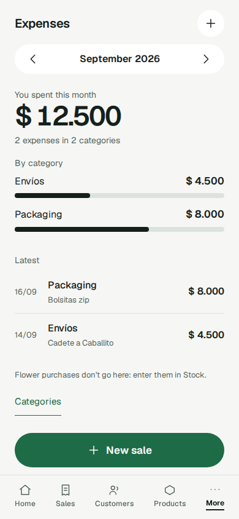

## Jobs

**Cuando** pago algo que no es flor (envases, un envío o un viaje, insumos de cultivo, cualquier otra cosa), **quiero** anotarlo desde el teléfono con su fecha, Expense category, monto y un detalle corto, y corregirlo o eliminarlo si me equivoqué, **para** ver cuánta plata se me va cada mes y en qué, y que mi Profit y mi Cash lo cuenten.

**Cuando** llevo mi negocio desde el teléfono, **quiero** mantener mis Expenses al día desde el teléfono, **para** dejar de llevarlas en la planilla y tener datos reales en su lugar cuando lleguen las ventas.

**Cuando** llevo mi negocio desde el teléfono entre pedidos o en medio de un chat con un cliente, varias veces por día, **quiero** que la app esté ordenada según lo que hago de verdad y con qué frecuencia, con las Expenses a mano para la mirada semanal o mensual y cada configuración en un solo lugar, **para** volver al cliente en vez de buscar entre menús. (El job de navegación, navigation.md: acá lo sirven la tarjeta Expenses de Analysis con "Add expense" y "See the expenses", una forma de registrar desde la misma Expenses, Expenses como la única vista mensual, y las Expense categories en Settings.)

**Cuando** necesito registrar una Expense, sacar flor del stock, ver cómo va el negocio o cambiar una configuración desde el celular, **quiero** encontrarlo donde ya vive ese contexto (Analysis en Home, "Take from stock" en la vista de stock de Products, Settings en el encabezado), **para** terminar en pocos toques sin pasar por un menú que lo junta todo. (GH-651, el retiro de More, navigation.md: acá lo sirve la tarjeta Expenses de Analysis.)

**Cuando** mi negocio trabaja en un idioma que no es el inglés, **quiero** que un negocio abierto en ese idioma arranque con sus Expense categories ya en él, **para** no tener nada que volver a tipear, mientras nada cambia para un negocio en inglés. (Compartido con stored-language.md y catalog.md: acá lo sirven las Expense categories por defecto, que siguen el Stored language al abrirse.)

**Cuando** registro una Expense o guardo un Customer desde el teléfono, **quiero** elegir su Expense category o su Customer type igual que elijo un Product o un Withdrawal reason (un campo con etiqueta que abre su propia lista, con búsqueda cuando la lista es larga), **para** terminar el formulario en pocos toques y que volver nunca tire lo que ya tipeé. (Parte 6 de GH-581, compartido con customers.md y selector.md: acá lo sirven el campo "Category" del formulario de la Expense y la edición en el lugar como su propia entrada del historial.)

En la práctica, estos jobs se juntan así. El vendedor paga algo que no es flor entre pedidos, o se sienta a mirar en qué se fue la plata de la semana o del mes. Carga la Expense desde Analysis, a 2 toques desde Home y a 3 desde los demás Tab roots del teléfono. Encuentra las Expenses de cualquier mes, con el total y lo que se llevó cada Expense category, en un solo lugar evidente. La computadora es el mismo job en una pantalla más grande.

Criterios de éxito:

1. Una Expense se registra desde el teléfono en menos de un minuto. En el teléfono su formulario abre en 2 toques desde Home (el segmento "Analysis", después "Add expense" en la tarjeta Expenses), en 3 desde Sales, Customers y Products, y en 1 toque desde Expenses. En una computadora no lleva más toques que en el teléfono. La fecha ya viene en hoy, y la Expense category se elige de la lista del negocio.
2. Para cualquier mes, la vista muestra cada Expense de ese mes y el total del mes. Las desglosa por Expense category, con un subtotal para cada una. Los totales siempre son iguales a la suma de las Expenses que se muestran, también justo después de una edición o una eliminación.
3. La flor nunca es una Expense. Nada de acá registra gramos ni un producto, y una Purchase nunca aparece en las listas de Expenses. Así, los resultados pueden contar las Expenses y las Purchases por separado sin contar nada dos veces.
4. Todo lo de acá se hace desde el teléfono, sin ninguna llamada a la API a mano.
5. **Las Expense categories se administran en un solo lugar.** Expenses no agrega, renombra ni elimina Expense categories; solo tiene un link a Settings → Expense categories. La única excepción es crear una Expense category dentro del formulario de la Expense.
6. **Se ve como en el diseño.** La tarjeta Expenses de Analysis y Expenses, en teléfono y computadora, coinciden con `docs/product/design-system/pantallas/`, juzgados a ojo.
7. **Valores por defecto en el idioma del negocio.** Un negocio nuevo abierto en un idioma que no es el inglés arranca con sus cuatro Expense categories por defecto en ese idioma. En inglés son idénticas byte a byte a la línea de base, y un cambio de idioma posterior nunca las reescribe.
8. **La Expense category se elige con el Selector** (parte 6 de GH-581). Con 12 o más Expense categories, el vendedor encuentra una buscando y la elige; el formulario no tiene ningún otro tipo de selector para ese campo (ni select nativo, ni chips, ni radios, ni botones presionados).
9. **Volver nunca tira el formulario.** En el teléfono, volver con la lista abierta cierra solo la lista; volver con el formulario sin tocar vuelve a la pantalla madre; volver con algo tipeado pregunta antes de descartar. Vale para la Expense nueva desde Expenses, la Expense nueva desde la tarjeta Expenses de Analysis y la edición en el lugar dentro de Expenses. En la computadora, Escape cierra solo el desplegable.
10. **Sin categorías, el vendedor sabe dónde crearlas**: la lista muestra "No categories yet. Add them in Settings → Expense categories.", y nunca mientras las Expense categories se están cargando o después de una carga fallida. Nada de lo que el formulario hacía antes se pierde.

# Expenses

La plata que un negocio paga por cualquier cosa que no sea flor, archivada bajo sus propias Expense categories y vista solo por ese negocio (ADR-0004). La flor que se compra es una Purchase (stock), nunca una Expense. Resultados (#7) lee las Expenses y las Purchases por separado. A Expenses se llega en el teléfono desde la tarjeta Expenses de Analysis ("See the expenses") y en una computadora desde la barra lateral; las Expense categories se administran en Settings → Expense categories (navigation.md).

## Comportamiento

### Expense category

- Los nombres de Expense category siguen la regla del nombre de un Product:
  - sin espacios al principio ni al final, los espacios internos reducidos a uno, hasta 60 caracteres;
  - únicos dentro de un negocio, sin importar mayúsculas ni espacios;
  - dos negocios pueden tener cada uno una Expense category con el mismo nombre.
- **Expense categories por defecto**: cuatro, en el Stored language del negocio al abrirse (stored-language.md).
  - En inglés: "Growing supplies", "Packaging", "Shipping and transport" y "Other", idénticas byte a byte a la línea de base `en.baseline.json`.
  - Un negocio nuevo abre con ellas, guardadas como sus propias Expense categories. Un Stored language nunca es el Test locale, así que nunca se escriben en `en-XA`.
  - Un cambio de idioma posterior nunca las renombra: son datos propios del vendedor y nunca se traducen.
  - Un negocio abierto antes de que existieran las Expenses las recibió una vez, cuando se actualizó la app. Los negocios que existían antes de que los valores por defecto siguieran el idioma conservan exactamente lo que tienen (los nombres en español incluidos), sin completar nada hacia atrás.
  - Cada negocio recibe los valores por defecto exactamente una vez. Uno que el negocio elimina nunca se vuelve a crear.
- **Agregar**: un nombre repetido se rechaza, con la razón.
- **Renombrar**: las Expenses de la Expense category quedan bajo el nombre nuevo. Renombrarla a un nombre que ya tiene otra Expense category del negocio se rechaza.
- **Eliminar**: es para siempre; no hay archivo ni restauración. Se rechaza mientras haya alguna Expense, de cualquier mes, archivada bajo la Expense category.
  - El rechazo dice solo que todavía tiene Expenses y sugiere renombrarla: "It can't be deleted: it still has expenses. You can rename it." No se muestra ningún desglose de dónde se usa.
  - Una vez que sus Expenses se eliminan o pasan a otra Expense category, se puede eliminar.
- No hay mínimo: un negocio puede eliminar cada Expense category sin Expenses, las de por defecto incluidas.
- La lista de Expense categories muestra cada una del negocio, ordenadas por nombre.
- **Agregar una Expense category dentro del formulario de la Expense**: el User puede crear una mientras registra una Expense, sin salir del formulario ni perder lo que ya tipeó. Es el link "Create a new category" y su campo de nombre, debajo del campo "Category" (nunca una fila de la lista), y está disponible en todo estado del campo, también cuando el negocio no tiene ninguna Expense category.
  - La Expense category nueva queda elegida para esa Expense en el acto, sin volver a abrir la lista, y el error de la Expense category se borra.
  - Un nombre repetido se rechaza con la razón, y se conserva la Expense que se está tipeando.

### Expense

- **Fecha**: por defecto, hoy en hora argentina. Se puede cambiar a cualquier día anterior; una fecha futura se rechaza.
- **Expense category**: obligatoria, sin valor por defecto; se elige cada vez. Tiene que ser una de las Expense categories propias del negocio. Cualquier otro id de Expense category responde 404.
- **Monto**: obligatorio, en pesos enteros, mayor que cero.
- **Detalle**: obligatorio, sin espacios al principio ni al final, no en blanco, hasta 200 caracteres.
- Una Expense no tiene gramos, ni producto, ni estado pendiente, de borrador o de aprobación.
- **Editar**: los cuatro campos se pueden editar en el lugar, con la misma validación que al registrar. No se guarda historial de ediciones.
- **Eliminar**: borra la Expense para siempre.
- Tanto una edición como una eliminación se ven de inmediato en los totales del mes.

### Vista mensual

- Una vista por mes, que abre en el mes en curso en hora argentina.
- Muestra el total del mes y después cada Expense category que tiene Expenses ese mes. Cada una muestra su subtotal y sus Expenses.
- Las Expense categories sin Expenses ese mes se dejan afuera. Se ordenan por nombre.
- Dentro de una Expense category, las Expenses van de la fecha más reciente a la más antigua; en la misma fecha, va primero la registrada más recientemente.
- Un mes sin Expenses muestra un total de $0 y ninguna Expense category. La línea de la flor y la forma de registrar una Expense se siguen mostrando.
- Esta vista es como un User encuentra una Expense equivocada para corregirla o eliminarla.

### En pantalla

- **La tarjeta Expenses de Analysis** (solo en el teléfono, debajo del corte de 900 px; GH-651): en Analysis, debajo del segmento Home | Analysis y antes de las cifras, una tarjeta titulada "Expenses" con dos acciones de al menos 44 px:
  - "Add expense", un botón con el ícono de agregar, que abre el formulario de la Expense con la fecha de hoy;
  - "See the expenses", un link de texto, sin conteo, que abre Expenses.

  No espera a que respondan las cifras de Analysis: las dos acciones están en los estados cargando, error, vacío y con datos. En una computadora la tarjeta no se dibuja, porque a Expenses se llega desde la barra lateral. Reemplaza al "+ Add expense" que estaba en More, que ya no existe.
- **Expenses** (`Expenses`, ruta `/expenses`; la vieja `/gastos` redirige ahí de forma permanente) es la única pantalla cuyo tipo depende del ancho (navigation.md, el ADR de GH-651):
  - en el teléfono, un detalle con "‹ Analysis" (su pantalla madre), la barra con Home marcada como activa, sin "+ New sale", y el avatar "Settings" al final de la fila del título;
  - en una computadora, una Tab root con la barra lateral, Expenses activa y "+ New sale", a la que se llega desde la barra lateral, debajo del separador.

  Tiene:
  - la navegación por mes;
  - la línea fija "Flower purchases don't go here: enter them in Stock.";
  - un link que abre Settings → Expense categories. Expenses nunca agrega, renombra ni elimina una Expense category por sí misma;
  - su propia forma de registrar una Expense nueva, "Add expense", que abre el formulario de la Expense con la fecha de hoy en 1 toque:
    - en el teléfono, una acción secundaria debajo del título, nunca un segundo "+" flotante;
    - en una computadora, el botón "Add expense" en la cabecera de la página.

    Su aspecto exacto lo decide diseño.
- **El formulario de la Expense** es un formulario (navigation.md), una Sheet en el teléfono: sin barra y sin "+ New sale", y se cierra con "Close".
  - "Category", "Amount" y "Details" se marcan como obligatorios.
  - El envío se bloquea mientras el detalle está en blanco o no hay Expense category elegida.
  - La fecha viene completada con hoy.
  - "Close", el gesto de volver y un guardado exitoso vuelven por el historial a la pantalla que lo abrió (Analysis, desde su tarjeta Expenses, o Expenses).
  - Sin historial (un link directo), vuelve a Expenses en el mes en curso.
  - Un guardado exitoso muestra "Expense saved" en la pantalla a la que vuelve, sin saltar a otro lado. Después de guardar desde Expenses, Expenses se queda en el mes que mostraba y se actualiza.
  - Salir con algo tipeado pregunta antes de descartar ("Discard the expense?"); un formulario sin tocar se cierra de inmediato.
- **La edición en el lugar dentro de Expenses** (desde la parte 6 de GH-581) es, en el teléfono, su propia entrada del historial sobre Expenses, como cualquier formulario o Sheet: volver y "Close" son la misma acción.
  - Sin tocar, volver cierra la edición y deja Expenses en el mes que mostraba.
  - Con algo tipeado, volver o "Close" preguntan una sola vez antes de descartar: seguir editando se queda en la edición; descartar vuelve a Expenses en ese mes.
  - Guardar o eliminar desde la edición la cierran sin preguntar: guardar vuelve a Expenses con "Expense saved", y eliminar abre la confirmación de eliminación sobre el mes.
  - Pasar de teléfono a computadora, o al revés, con la edición abierta la mantiene abierta con lo tipeado.
  - Volver nunca saca de Expenses ni tira lo tipeado sin preguntar.
  - No cambian las rutas de Expenses, la navegación por mes ni cómo se abre o se ve la edición. En la computadora, nada cambia (la edición conserva su propia confirmación de descarte), salvo que Escape con el desplegable de Category abierto cierra solo el desplegable.
- **El campo "Category"** (desde la parte 6 de GH-581) es un Selector obligatorio (selector.md) con la etiqueta "Category" y el texto "Pick a category" mientras no hay elección, sobre las Expense categories del negocio, en el orden en que las da el negocio:
  - mientras las Expense categories se están cargando, el formulario muestra solo su cabecera con "Close", así que el vendedor siempre puede salir; el Selector recibe igual `loading` mientras la carga está pendiente o falló, así que nunca muestra un texto de conjunto vacío antes de una carga exitosa;
  - si la carga falla, el formulario muestra debajo de su cabecera, en lugar de los campos, la línea de falla que ya tiene la app ("No connection" sin red, el reintento genérico ante un error del servidor; accounts.md), sin texto nuevo. Las Expense categories se vuelven a pedir al cerrar el formulario y volver a abrirlo;
  - en el teléfono abre su lista en una Sheet, como su propia entrada del historial sobre el formulario; con más de 8 Expense categories, la lista tiene búsqueda. En la computadora es un desplegable con teclado, y Escape cierra solo el desplegable;
  - volver o "Close" con la lista abierta cierra solo la lista, nunca el formulario. Esto vale al registrar desde Expenses, al registrar desde la tarjeta Expenses de Analysis y al editar en el lugar dentro de Expenses;
  - sin ninguna Expense category, la lista muestra "No categories yet. Add them in Settings → Expense categories." (`emptyStates:selectorNoCategories`), y crear una dentro del formulario sigue disponible debajo del campo;
  - elegir una Expense category borra el error del campo;
  - enviar sin Expense category muestra el error de campo obligatorio, como antes, asociado al campo como su descripción.
- **Una Expense category que desaparece con el formulario de la Expense abierto** (un socio la eliminó):
  - guardar deja el formulario abierto con todo lo tipeado;
  - la lista de Expense categories se actualiza (una creada dentro del formulario que ya no existe deja de ofrecerse) y "Category" queda vacío, sin la marca "no longer available";
  - el campo muestra "That category is gone. Pick another.", asociado al campo como su descripción.
- **Eliminar una Expense**, desde la Expense a la que se llega en la vista mensual:
  - se confirma con "Before deleting", nombrando la fecha, la Expense category y el monto, p. ej. "Delete the $ 4.500 expense in Packaging from 28/09?";
  - no hay deshacer;
  - el total y el subtotal se actualizan de inmediato, y una Expense category que queda sin Expenses ese mes desaparece.
- **Las Expense categories** se administran en Settings → Expense categories, y en ningún otro lado: agregar, renombrar y "Delete". Una eliminación bloqueada muestra el rechazo fijo de arriba. Crear una dentro del formulario de la Expense sigue como se describe.
- **Una Expense o una Expense category que ya no está** al guardarla, eliminarla o abrirla sigue la regla de la app en `accounts.md`: "That is gone." Abrir una ofrece "Back to Expenses" en el mes en curso.
- **Toasts**: "Expense saved", "Expense deleted", "Category saved" y "Category deleted", sin montos.
- **Los rechazos** se muestran en línea y conservan lo tipeado.
- **Respuesta ante fallas**: la pérdida de red muestra "No connection", y un error del servidor muestra un reintento genérico (accounts.md).
- **Diseño**: el formulario de la Expense muestra el campo "Category" cerrado como Selector, con "Create a new category" debajo, en `GastoNuevo`, `GastoNuevoOscuro` y `GastoNuevoCompu` de `docs/product/design-system/pantallas/`.

### Restricciones

- Las Expense categories y las Expenses llevan `business_id`, y sus rutas entran en el barrido de aislamiento (ADR-0004).
- Ningún monto ni detalle se escribe en los logs, la consola del navegador ni el almacenamiento del navegador.
- Un link de Expenses a Settings → Expense categories aparece solo una vez que ese grupo existe. Ningún link puede apuntar a una pantalla que no existe, y ningún vendedor puede perder la administración de las Expense categories.
- El dominio de expenses no guarda ningún nombre por defecto ni importa ninguna biblioteca de traducción. La apertura del negocio nuevo toma los valores por defecto a través del puerto `BusinessDefaults` (`for_language(language)`), con el Stored language, nunca con el Shown language.
- Las palabras de la tarjeta Expenses ("Expenses", "Add expense", "See the expenses") salen del Copy module.
- Las Expense categories son un Growable set: nunca se declaran en `fixedSets.ts` ni se eligen con chips (selector.md).
- El formulario monta un `SheetStackProvider` en `ExpenseNewRoute` y en la edición en el lugar de `Gastos`, para que la lista del Selector sea su propia entrada del historial, en el nivel de arriba del formulario.
- La edición en el lugar del teléfono protege su volver con cambios sin guardar mediante el piso de Sheet de la guarda de salida (ADR-0078).

## Métricas

Se leen de los datos y de las pruebas; no hay telemetría.

- **M1, registrada en el momento (criterio 1)**: la proporción de Expenses cuya fecha es igual al día argentino en que se registraron. Meta: una mayoría una vez que el front esté en uso. A través del front, registrar una Expense desde el teléfono lleva menos de 60 s.
- **M2, los totales cierran (criterio 2)**: los totales que difieren de la suma de las Expenses que se muestran tienen que ser 0. Lo controlan pruebas después de crear, editar y eliminar, en la API y en pantalla. Un mes sin Expenses muestra $0 y ninguna Expense category.
- **M3, "en qué" (criterio 2)**: la proporción de la plata de cada mes archivada bajo "Other". Si se mantiene alta, las Expense categories no le están sirviendo al User para ver adónde se va la plata.
- **M4, uso**: negocios con al menos una Expense en un mes, sobre los negocios activos.
- **M5, la flor queda afuera (criterio 3)**: las Purchases que aparecen en las listas de Expenses tienen que ser 0, por construcción. Una Expense no tiene ningún campo que pueda guardar gramos ni un producto.
- **M6, sin curl (criterio 4)**: la corrida de punta a punta del front:
  - registra una Expense desde la tarjeta Expenses de Analysis ("Add expense") y una desde Expenses;
  - edita y elimina una;
  - se mueve entre meses;
  - agrega, renombra y elimina una Expense category en Settings, un rechazo de eliminación incluido.
- **M7, toques (criterio 1)**: la corrida de punta a punta cuenta los toques para abrir el formulario de la Expense, en ventanas de teléfono y de computadora:
  - en el teléfono, 2 desde Home y 3 desde Sales, Customers y Products;
  - desde Expenses, 1;
  - en una computadora, nunca más que en el teléfono.

  Meta: 100% dentro del límite.
- **M8, el marco de Expenses (criterios 1, 5)**: las pruebas del front muestran:
  - en el teléfono, "‹ Analysis", la barra y ningún "+ New sale"; en una computadora, la barra lateral con "+ New sale" y sin flecha de regreso;
  - la navegación por mes y la línea fija de la flor;
  - la acción de registrar: secundaria en el teléfono (sin un segundo "+" flotante), el botón de la cabecera en una computadora.
- **M9, las Expense categories salieron de Expenses (criterio 5)**: las pruebas del front muestran:
  - que Expenses no agrega, renombra ni elimina Expense categories;
  - un link que abre Settings → Expense categories;
  - la creación en línea en el formulario de la Expense, que sigue funcionando.
- **M10, vuelta del formulario**: las pruebas del front cubren:
  - "Close" y un guardado exitoso que vuelven por el historial a Analysis (abierto desde su tarjeta) o a Expenses;
  - "Expense saved";
  - la confirmación de descarte y el cierre de un formulario sin tocar;
  - la vuelta sin historial a Expenses en el mes en curso.
- **M11, redirecciones**: `/gastos` → `/expenses` responde una redirección permanente, con su prueba. `/mas` ya no se redirige (navigation.md).
- **M12, se ve como en el diseño (criterio 6)**: comparaciones de antes y después de `scripts/design/compare.sh`, en teléfono y computadora, adjuntas al PR y juzgadas a ojo. Una pantalla que la herramienta no puede capturar se informa como "not compared".
- **M13, los valores por defecto siguen el idioma (criterio 7)**: un negocio abierto en `en` recibe las cuatro Expense categories idénticas byte a byte a `en.baseline.json`; uno abierto en un `de` de prueba recibe las cuatro de `de`; después de que cualquiera de los dos negocios cambie de idioma, sus Expense categories no cambian; filas cambiadas en negocios existentes: 0; negocios abiertos bajo el `en-XA` forzado con Expense categories en `en-XA`: 0. Bajo el `en-XA` forzado, los valores por defecto generados desde su fuente no dejan ninguna letra después de sacar los segmentos `⟦…⟧`. 100% de aprobación.
- **M14, la Expense category con el Selector (criterio 8)**: con 12 o más Expense categories sembradas, las pruebas del front muestran el Selector en el formulario, ningún `<select>`, grupo de radios ni botón `aria-pressed` para ese campo, y que tipear parte de un nombre en la búsqueda de la lista encuentra la Expense category y tocarla la elige. 100% de aprobación.
- **M15, volver nunca tira el formulario (criterio 9)**: para cada punto de entrada (`ExpenseNewRoute` desde Expenses y desde la tarjeta Expenses de Analysis, y la edición en el lugar de `Gastos`), las pruebas del front muestran: formulario sin tocar, volver va a la pantalla madre; formulario con algo tipeado, volver pide confirmar el descarte; con la lista abierta, volver cierra solo la lista; en la computadora, Escape cierra solo el desplegable. Para la edición en el lugar, volver sin tocar deja Expenses en el mes que mostraba, un descarte confirmado vuelve a ese mes sin preguntar de nuevo, y pasar de teléfono a computadora conserva lo tipeado. 100% de aprobación.
- **M16, conjunto vacío y carga (criterio 10)**: las pruebas del front muestran "No categories yet. Add them in Settings → Expense categories." con el conjunto vacío, y ningún texto de conjunto vacío mientras la consulta está pendiente o falló; con la carga fallida, la línea de falla existente en el formulario. El chequeo `mobile` recorre el estado `expense/category-selector-empty` y las entradas `combobox:Category` obsoletas de `autocomplete.json` ya no están, sin ningún infractor nuevo.
- **M17, nada se pierde (criterio 10)**: las pruebas del front muestran que la Expense category creada dentro del formulario queda elegida y el error se borra, también con el conjunto vacío; que el rechazo por una Expense category que desapareció deja el campo vacío con "That category is gone. Pick another." y conserva lo tipeado; y que el error de campo obligatorio sigue apareciendo.
- **M18, la tarjeta Expenses (GH-651)**: pruebas de Testing Library a través del router real, en ancho de teléfono: "Add expense" de la tarjeta abre el formulario de la Expense y "See the expenses" abre Expenses; en ancho de computadora la tarjeta no está. 100% de aprobación.

## Fuera de alcance

- El Profit, el Cash y cualquier total que cruce ventas, Purchases y Expenses: es la capacidad de resultados.
- Cargar con el Spreadsheet import la pestaña Gastos de la planilla. Las Expenses viejas se tipean con sus fechas reales.
- Expenses recurrentes, adjuntos y comprobantes.
- El historial de ediciones de una Expense.
- Una lista de Expenses de todos los tiempos por Expense category.
- Una lista cronológica de Expenses.
- Archivar una Expense category.
- Administrar las Expense categories desde Expenses.
- Construir Settings o sus grupos: navigation.md y sus propios issues.
- Traducir o renombrar las Expense categories guardadas de un negocio cuando cambia su idioma, o completar hacia atrás valores por defecto en otro idioma para negocios existentes.
- Un conteo de Expenses en "See the expenses" y la pantalla Expenses rediseñada completa: los construye su propio issue de rediseño.
- Cambiar el texto del conjunto vacío para que mencione la creación dentro del formulario.
- Cambiar las rutas de Expenses, su navegación por mes o cómo se abre y se ve la edición en el lugar.
- Un reintento con un toque para la carga fallida de las Expense categories dentro del formulario.
