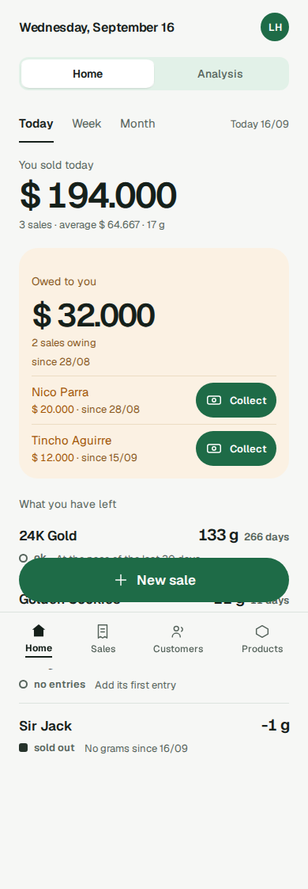
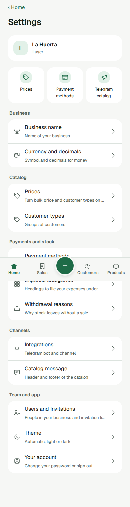

## Jobs

**Cuando** manejo mi negocio desde el celular entre pedidos o en medio de un chat con un cliente, varias veces al día, **quiero** la app organizada según lo que de verdad hago y cada cuánto: registrar una venta, ver quién debe y cobrar, mandar el Catalog, registrar el stock que entra. Cada cosa tiene que estar a uno o dos toques. Todo lo de un producto tiene que estar en un solo lugar, cada configuración del negocio en otro lugar único, y las Expenses y el análisis a mano para la mirada semanal o mensual. **para poder** volver con el cliente en vez de buscar entre menús, sin preguntarme nunca cuál de varias pantallas tiene lo que necesito.

Este es el job de navegación que está debajo del job propio "desde mi celular" de cada capacidad (ventas, pagos, stock, Catalog, Expenses). No reemplaza a ninguno. La computadora es el mismo job en una pantalla más grande. El protagonista es quien vende; las herramientas del **Operator** quedan fuera de la app (accounts.md).

**Cuando** abro la app entre pedidos o al final del día, **quiero** ver qué vendí hoy, quién me debe y qué se está terminando, y actuar en el acto (cobrarle a un deudor, abrir un producto que está bajo, arreglar lo que me dice un aviso), **para poder** volver con el cliente sin recorrer Customers y Products uno por uno ni hacer cuentas.

Esto afina el job de navegación y el job del **Panel** de results.md para Home (GH-45); no es un job nuevo. Lo sirven acá "Collect" en las filas de deudores de Home y el aviso de **Out of date** del Pinned catalog, cada uno llevando a su arreglo. Home no muestra ningún elemento de primer uso (results.md).

**Cuando** un cliente me pregunta qué tengo o cuánto sale algo, o entra Stock, se termina o cambia de precio, **quiero** abrir un producto y encontrar todo lo suyo en su propia página, que la lista me diga de un vistazo qué tengo, qué se está terminando y qué no puedo vender, y el Catalog de hoy a un toque de esa lista, listo para compartir desde el celular, **para poder** contestarle al cliente, registrar lo que entró y mandar un Catalog al día sin moverme entre pantallas, y que mis clientes nunca reciban un precio viejo ni un producto que no puedo vender.

Esto afina el job de navegación para productos, stock y el Catalog (varieties.md); no es un job nuevo.

**Cuando** un producto que cargué por error, o uno con el que ya no trabajo, sigue apareciendo en mis listas y selectores, **quiero** sacarlo desde el celular en pocos toques, eliminándolo si nunca se movió y archivándolo si tiene historial, **para que** mis listas muestren solo lo que todavía vendo, no cambie ninguna cifra pasada de venta, stock, costo o Profit, y pueda traerlo de vuelta exactamente como estaba si vuelvo a venderlo.

Esto afina el job de productos y navegación para el fin de la vida de un producto (varieties.md); no es un job nuevo. Lo sirven acá la tarjeta Archived y la página del **Archived product**.

**Cuando** necesito cambiar cómo está configurado mi negocio (renombrarlo, sumar un socio, conectar o cambiar el bot de Telegram, editar el **Catalog header and footer**, manejar mis **Expense category**s y mis **Payment method**s, pasar a oscuro, cambiar mi contraseña o cerrar sesión), **quiero** cada configuración de todo el negocio en un solo lugar, cada una en su propia pantalla corta, **para poder** cambiarla en pocos toques desde el celular y volver con el cliente, sin preguntarme qué pantalla la tiene.

**Settings** es poco frecuente y deliberado; los jobs diarios nunca lo necesitan. Afina el "cada configuración del negocio en otro lugar único" del job de navegación. Las configuraciones que son de un solo producto viven en su página y no son parte de este job.

**Cuando** un cliente me paga, en la venta o más tarde, **quiero** registrar cómo me pagó con los medios que mi negocio de verdad acepta, nombrados a mi manera, **para** que cada pago me diga después cómo me llegó la plata, sin que la app decida por mí que la plata es efectivo o transferencia. (Parte 24 de GH-318: la lista vive en payment-methods.md; acá la sirve el grupo Payments and expenses de Settings, a 3 toques desde cualquier pantalla principal.)

**Cuando** me muevo entre pantallas entre pedidos o en medio de un chat con un cliente (Products y la página de un producto, sus precios y sus Stock entries, una **Stock entry**, la ficha de un cliente, Record payment), **quiero** que cada pantalla me dé la misma forma de salir y volver, y que cada dirección actual de la app abra la pantalla correcta, **para poder** volver con el cliente sin buscar, sin perder mi lugar ni tocar atrás dos veces.

Esto afina el job de navegación y el criterio 5; no es un job nuevo. Su protagonista es quien vende, en el celular o en una computadora. Antes, el formulario de Stock entry decía "Back" donde cualquier otro formulario decía "Close", un registro que ya no existía dejaba dos veces a su pantalla madre en el historial, así que volver llevaba dos toques, y Products y los paths viejos se comportaban distinto del resto de la app al recargar y al redirigir. Quien vendía tocaba atrás de nuevo o usaba la barra. Desde la parte 1 de GH-780 los paths viejos son **Retired address**es y ya no abren ninguna pantalla propia (Direcciones retiradas).

GH-480 afina el mismo job para la página en sí: una pantalla a la que llego empieza arriba de todo, y volver me deja donde estaba en la pantalla que dejé, como hace una app de celular. Antes, una pantalla nueva se abría en el offset de la pantalla que quedaba atrás, así que una pestaña o un detalle abiertos desde muy abajo en una lista caían en el medio de la pantalla nueva, y volver dejaba a quien vendía donde el navegador lo pusiera. No es un job nuevo; lo sirven "Scroll al cambiar de pantalla (GH-480)" y los criterios 21–23.

**Cuando** saco gramos de mi propio stock sin venderlos (para compartir en una fiesta y que la gente conozca el negocio, o para consumo propio), **quiero** registrarlos desde el celular en pocos toques (fecha, productos y gramos, el motivo), **para poder** mantener el stock bien y ver en el **Profit** cuánto me costó promocionar el negocio y mi propio consumo, sin registrar una venta que nadie hizo ni un **Adjustment** que se lee como Stock perdido. (Lo sirve acá "Take from stock" en Products, junto a "+ Stock entry", y en la página de un producto, a 2 toques como máximo desde cualquier **Tab root**; definido en stock.md.)

**Cuando** necesito registrar una Expense, sacar Stock, ver cómo va el negocio o cambiar una configuración desde el celular, **quiero** encontrarlo donde ya vive ese contexto (Analysis en Home, "Take from stock" en la vista de stock de Products, Settings en el encabezado), **para** terminar en pocos toques sin pasar por un menú que lo junta todo.

- Afina el job de navegación para el celular (GH-651, parte 2 de GH-560); no es un job nuevo de producto. Su protagonista es quien vende, en el celular, con poco tiempo, cuando algo acaba de pasar (pagó algo, sacó Stock) o quiere ver cómo va. No es navegar por la app, y el flujo diario (New sale, Collect) no cambia.
- El dueño retiró la pantalla More el 2026-11-02 (`docs/design/redesign/registro-unificado.md`). Esta parte lleva a cabo esa decisión: la ubicación de cada entrada sigue los dibujos aprobados aunque otro lugar ahorrara un toque, y una duda de ubicación se juzga con **Drawing as guide**.
- Antes: More era el único camino del celular a Settings, Analysis, Expenses, Add expense y Take from stock; quien vendía abría More, recorría una lista y tocaba.
- Lo sirven "Los destinos que estaban en More (GH-651)" y los criterios 24–26.

**Cuando** estoy en medio de una venta en el celular y me acuerdo de una Expense, **quiero** registrarla desde New sale y volver a mi venta como la dejé, **para** que las cuentas queden bien sin perder el pedido ni hacer esperar al cliente.

- Es el job de sales.md y expenses.md (partes 3 y 4 de GH-725); acá lo sirve que el formulario de Expense quede a 2 toques de cada Tab root del celular (el + de la barra → "Expense", criterio 1) y que, abierto desde New sale, sea una entrada del historial sobre New sale (Marco y camino de vuelta).
- Antes: el formulario de Expense quedaba a 2 toques desde Home y a 3 desde Sales, Customers y Products, siempre por Analysis, y ningún documento lo decía como presupuesto.
- "Como la dejé" vale solo dentro de la misma sesión: la venta en curso vive en memoria y una recarga la pierde (sales.md).

**Cuando** reviso mi negocio en el celular y quiero pasar del Home de hoy al Analysis de mis días, semanas y meses, o volver, **quiero** cambiar con un solo toque del pulgar, **para poder** leer la vista que necesito y que atrás me siga llevando a donde venía, en vez de pasar por cada cambio que hice.

- Afina el job de navegación para el celular (parte 1 de GH-723); no es un job nuevo de producto. Rige solo en el celular: en una computadora Analysis tiene su entrada en la barra lateral y el segmento no muestra nada.
- Antes: cada cambio entre Home y Analysis agregaba una entrada al historial, así que atrás recorría los cambios anteriores en vez de salir del par; el objetivo táctil del segmento no tenía garantizados 44 px; y la opción marcada salía de comparar la dirección, no del registro de pantallas.
- Lo sirven "El segmento Home | Analysis (GH-723)" y los criterios 27–29.

**Cuando** estoy en la pestaña Home del celular y quiero pasar entre la vista en vivo y la vista de historia de mi negocio, **quiero** que las dos opciones se llamen como las vistas que abren, Home y Analysis, **para** saber dónde estoy y adónde me lleva la otra opción sin un "Today" encima de otro.

- Afina el job de navegación para el celular (#733, separado de #731, parte de #495); no es un job nuevo de producto. Es un arreglo de claridad que decidió el dueño: no se reportó ningún error de quien vende, y ningún comportamiento cambia.
- Antes: la primera opción del segmento decía "Today", la misma palabra que la primera pestaña del Panel justo debajo, así que quien vendía tenía que deducir por el contexto si "Today" era este día o la pantalla Home.
- El segmento nunca elige un rango de fechas: eso es de las pestañas Today · Week · Month del Panel, que no cambian.
- Lo sirven la opción "Home" de "El segmento Home | Analysis (GH-723)" y los criterios 30–32.

**Cuando** abro Home en el celular entre pedidos, **quiero** que arriba de la pantalla se vea qué día estoy mirando y poder pasar entre Home y Analysis con un toque, **para poder** ver cómo va el día o el mes. No necesito que la app me diga en qué Business estoy, porque ya lo sé.

- Afina el job de navegación para el celular y el job del Panel de results.md (parte 2 de GH-723); no es un job nuevo de producto. Rige solo en el celular: la computadora no cambia.
- Antes: Home y Analysis armaban cada una su propio encabezado. En el celular, el nombre del Business y la Yerba mark ocupaban arriba de la pantalla para repetir algo que quien vende ya sabe, la fecha a la que pertenecen las cifras no se mostraba, y el segmento Home | Analysis estaba dentro del contenido de cada pantalla, en un lugar distinto en cada una.
- El lugar "Editar" del dibujo queda vacío e inerte: no sirve a ningún job todavía y no promete ninguna función de edición.
- Lo sirven "El encabezado de Home y Analysis (celular, GH-723)" y los criterios 34–37.

**Cuando** estoy en Home o en Analysis en el celular y necesito cambiar algo de mi Business (sumar un Payment method, un **Withdrawal reason** o una Expense category, cambiar Currency and decimals o el Catalog message, configurar o arreglar el bot de Telegram y su **Test send**, invitar a un socio, cambiar mi contraseña o el tema, o cerrar sesión), **quiero** abrir Settings directo desde el encabezado, **para poder** cambiarlo y volver a mis números sin buscarlo.

- Afina el job de Settings y el de navegación para el celular (parte 3 de GH-495); no es un job nuevo de producto. Es poco frecuente, no diario, y puede ser un arreglo o una configuración planeada. Las configuraciones de un solo Product siguen en su página, nunca detrás del avatar.
- Antes: el avatar "Settings" ya estaba en Home y Analysis (es la entrada del celular a Settings desde GH-651), pero era un disco gris de 38 px dibujado con un borde transparente, en lugar del círculo verde de 36 px del dibujo dentro de una caja táctil de 44×44, y no se comparaba con los dibujos `Inicio`, `InicioOscuro`, `Analisis` y `AnalisisOscuro`. Además, en el código de Home quedaban restos de los avisos de primer uso que el dueño ya había sacado.
- Lo sirven el avatar "Settings" de Pestañas y los criterios 38–41.

**Cuando** estoy en cualquier pantalla principal del celular y necesito cambiar cómo está configurado mi negocio, o sacar algo del stock, **quiero** llegar en uno o dos toques desde donde estoy, sin una pantalla que lo junte todo en el medio, **para poder** hacerlo y volver a vender. Nada de lo que alcanzaba por More puede perderse en el camino.

- Afina el job de navegación para el celular y el de Settings (parte 5 de GH-495); no es un job nuevo de producto. Termina en el celular el retiro de More que decidió GH-651. Quien vende busca Settings o Take from stock en medio de una tarea, en la pantalla en la que está y con el celular en una mano, no en un momento aparte de "configuración".
- Antes: la barra del celular conservaba la pestaña More y la pantalla `/more`, por donde Settings y los demás destinos quedaban a un desvío, y los encabezados de Sales, Customers y Products no daban un camino directo a Settings. Un favorito viejo a `/more` o `/mas` era la única dirección que necesitaba una llegada amable (desde la parte 1 de GH-780 son Retired addresses).
- Lo sirven el avatar "Settings" de Pestañas, "Los destinos que estaban en More", las Rutas y los criterios 42–45.

**Cuando** la app deja de admitir una dirección, **quiero** que se borre y responda exactamente como cualquier dirección desconocida, **para poder** confiar en que la única redirección de paths del front que queda es un path actual más una sola barra final, y en que no hay ninguna lista escondida de direcciones viejas que mantener.

- Su protagonista es el dueño, y el sistema agéntico que trabaja para él, manteniendo el producto (parte 1 de GH-780). Aplica la regla del dueño del 2026-11-16 (**Retired address**).
- Situación secundaria: quien vende abre una dirección vieja desde un favorito, un mensaje viejo o el historial del navegador. Recibe lo mismo que una dirección mal tipeada, y el navegador termina en Home: ninguna pantalla especial ni mensaje de "se movió". Pierde un toque, nunca un dato.
- Antes: cada path viejo en español redirigía de forma permanente a su ruta nueva y `/more` y `/mas` a Home, a partir de una segunda lista (`app/legacy_front_paths.json`, más `/more` y `/mas`) que había que mantener al día con las rutas reales, y cada lector de esa lista podía romperse.
- Lo sirven "Direcciones retiradas" y los criterios 51–53.

**Cuando** acabo de abrir mi negocio y todavía está vacío, **quiero** que me guíen por lo que necesita, un paso corto por vez, con los valores por defecto ya completos, **para** registrar mi primera venta el mismo día sin buscar entre Settings, Products y la pantalla del Catalog. (Lo sirve acá el **Onboarding** como el único elemento de primer uso de un **Business** recién creado, abierto al aceptar la **Invitation** y en su propia dirección, `/onboarding`; definido en onboarding.md.)

**Cuando** reviso un cambio en las reglas de primer uso que quedan (la línea de precio faltante del "+ New sale" de la barra lateral y el "Send catalog" deshabilitado) antes de aprobarlo, **quiero** que los tests y el contrato `/first-run` prueben lo que dicen navigation.md y ADR-0046 en cada estado en que pueden estar y en los dos temas, **para poder** aprobar solo con la evidencia, sin confiar en controles parciales ni arrastrar hallazgos abiertos a la próxima tarea.

- Su protagonista es el mantenedor, o quien revisa en su nombre, como en gate.md, design-capture.md y el criterio 6 de onboarding.md. Quien vende se ve afectado solo de forma indirecta: un head que nadie puede aprobar frena el trabajo que espera.
- Afina el criterio 12 y ADR-0046 (su lugar en Home ya no existe: ADR-0081); no es un job de producto nuevo y no agrega comportamiento de producto.
- Su lado de captura (la fila `InicioHoyCompu`) es de design-capture.md.
- Antes (el seguimiento de GH-45): el test de concordancia llegaba a `/first-run` solo donde se muestra la checklist, la forma de `checklist` fuera del tipo checklist estaba sin decidir, solo el test de la checklist corría en los dos temas, y la captura de Today mostraba una diferencia por construcción.
- Desde la parte 3 de GH-727, la línea de precio faltante es solo la del "+ New sale" de la barra lateral de la computadora; el celular ya no tiene ninguna.

**Cuando** estoy en medio de atender a un cliente con el celular en la mano, **quiero** que la app se comporte como una app de celular (las pestañas y la entrada a New sale a mano, un formulario que llena la pantalla con su acción principal bajo el pulgar, y nada de lo que necesito escondido detrás del teclado o fuera del borde de la pantalla), **para poder** registrar una venta, un pago o stock sin pelearme con la pantalla ni perder lo que tipeé.

- Es un piso de calidad sobre el job de navegación y los jobs de celular del BRIEF (registrar una venta, cobrar un pago, registrar stock, mirar Home), solo por debajo de 900 px (GH-319). No es un job nuevo. La computadora conserva cada capacidad y no recibe nada de esto (**Phone first**).
- Antes: la barra se iba con el scroll de la página, "+ New sale" estaba en el flujo de la página, los formularios eran ventanas superpuestas o páginas con ruta cuya acción podía quedar debajo del pliegue o detrás del teclado, algunos objetivos táctiles y etiquetas eran demasiado chicos, y algunas pantallas se desplazaban de costado. Quien vendía volvía a subir, hacía zoom con los dedos o repetía toques.
- Lo sirven "Disposición en el celular (GH-319)" más abajo y los criterios 19 y 20. El contenido de Analysis (sus tres tablas y su selector de mes) es la parte 2 de GH-319; su marco se cubre acá.

**Cuando** un cliente me hace un pedido mientras estoy mirando otra cosa de la app en el celular (Home, Sales, la ficha de un cliente, la página de un producto), **quiero** que empezar una venta esté siempre en el mismo lugar, bajo el pulgar, **para poder** registrarla en el acto sin buscar el botón y sin que nada me tape lo que estoy leyendo.

- Es el job 1 del BRIEF ("registrar un pedido en pocos toques… en menos de un minuto") aplicado a dónde vive la entrada a New sale (parte 3 de GH-727); no es un job nuevo de producto. Cambia la Navigation y cómo se dibuja la barra del celular; no cambia lo que hace New sale, cómo pone precio ni lo que pide.
- Antes: quien vendía tocaba un "+ New sale" flotante, solo en los Tab roots, que se apoyaba sobre el contenido y traía una línea de precio faltante arriba de la barra.
- Lo sirven "La barra del celular y su + (parte 3 de GH-727)" y los criterios 46–50.

**Cuando** estoy en la computadora haciendo las cuentas (mirar un día, cargar una tanda de ventas o de stock, ajustar una configuración), **quiero** llegar a cualquier lugar de la app desde una sola barra lateral fija, con Settings a un clic, **para poder** pasar de una tarea a otra sin buscar dónde vive cada cosa.

- Afina el job de navegación para la computadora (parte 7 de GH-495); no es un job nuevo de producto. La computadora conserva cada capacidad y no recibe pulido dedicado (**Phone first**): esta parte construye la barra lateral como la dibujan `InicioCompu` e `InicioCompuOscuro`, nada más.
- Antes: abajo de la barra lateral había una fila del Business (avatar y nombre) que abría Settings y que los dibujos no muestran, y la entrada a New sale no estaba como la dibujan (etiqueta visible, sin `aria-haspopup`).
- Lo sirven "Barra lateral (computadora)" y los criterios 54–57.

Elegir qué reglas de precio usa el Business (pricing-settings.md) también es de Settings, como el grupo Prices.

Antes de esta estructura: la barra era Home · Sales · Customers · Stock · More; un producto estaba repartido entre Stock, Products y Catalog; cobrar una deuda llevaba cuatro toques desde Customers; las configuraciones estaban repartidas entre Business, Catalog y Expenses → Expense categories, y el bot se configuraba dentro de Catalog. No se conserva nada de eso salvo, hasta que existan Integrations y Catalog message de Settings, el lugar provisorio para el bot y el Catalog header and footer al que se llega desde la pantalla del Catalog (catalog.md); las redirecciones desde sus paths se borraron en la parte 1 de GH-780 y esos paths son Retired addresses. Después, la barra fue Home · Sales · Customers · Products · More hasta que GH-651 retiró More y la parte 5 de GH-495 sacó del celular la pestaña y la pantalla `/more`; desde la parte 3 de GH-727 es Home · Sales · + · Customers · Products, con el + en el lugar del "+ New sale" flotante.

# Navigation

La **Navigation** es la única estructura de la app para un Business: las pestañas en el celular, la barra lateral en una computadora, el avatar "Settings" del encabezado del celular, el encabezado compartido de Home y Analysis con su segmento Home | Analysis, Settings, la única regla que le da a cada pantalla su marco y su camino de vuelta, qué lugar queda marcado, las rutas con su única redirección (un path actual más una sola barra final) y las direcciones retiradas, la disposición en el celular (barra fija con su +, formularios como **Sheet**s), dónde empieza una pantalla y adónde vuelve atrás en la página, y el primer uso (el Onboarding para un Business recién creado; Home no muestra ningún elemento de primer uso). Dice desde dónde se llega a cada capacidad. Lo que hace cada capacidad queda en su propio archivo; nada de acá cambia una regla de precios, **Settlement**, **Stock**, el **Catalog**, el aislamiento o los mensajes de respuesta. Lo ve solo el Business de la **Session** (ADR-0004). No hay pantalla ni pestaña More (GH-651, parte 5 de GH-495).

Criterios de éxito:

1. **Los jobs diarios, por frecuencia.** Desde cualquier Tab root en el celular:
   - una **Sale** se abre en 1 toque (el + de la barra, desde la parte 3 de GH-727 también desde cada tarjeta y detalle con barra; criterio 46);
   - la Sheet de **Payment** con el **Customer** ya elegido se abre en 2 toques como máximo (Customers → "Collect", o "Collect" directo en Home);
   - la pantalla del Catalog se abre en 2 toques como máximo (Products → "Send catalog");
   - una Stock entry se abre en 2 toques como máximo (Products → "+ Stock entry");
   - un **Stock withdrawal** se abre en 2 toques como máximo (Products → "Take from stock");
   - el formulario de **Expense** se abre en 2 toques desde cada Tab root del celular (Home, Sales, Customers, Products y Analysis) con el + de la barra → "Expense" (la fila "Other things to record" de New sale, que se ofrece también sin líneas; sales.md), y desde Home también en 2 con el segmento "Analysis" → "Record expense" de la tarjeta Expenses. Cuentan solo los toques hasta que el formulario está abierto; sus campos no. Este archivo es el único lugar de este presupuesto; otro documento que lo nombre remite acá. La ubicación sigue los dibujos aprobados; no se rediseña para bajar la cuenta.

   En una computadora, cada uno no lleva más toques que en el celular (la Sale, con el "+ New sale" de la barra lateral).
2. **Cada configuración de todo el Business en un solo lugar.** El nombre, los **User**s y los links para sumarse, las reglas de precio (Bulk price y VIP customers), los **Payment method**s, el bot de Telegram, el Catalog header and footer, las Expense categories, la apariencia y tu cuenta (contraseña, cerrar sesión) están todos en Settings y en ningún otro lado. Se llega a Settings en 1 toque desde cualquier Tab root: con el avatar "Settings" del encabezado (un link) en el celular, y con el link "Settings" de engranaje de la barra lateral en una computadora (desde la parte 7 de GH-495; antes, la fila del Business). Los Payment methods se abren en 3 toques desde cualquier pantalla principal (avatar → Payments and expenses → Payment methods; decisión 21 del humano), y las Expense categories también en 3 (avatar → Payments and expenses → Expense categories; eran 2 cuando tenían su propio grupo, y el cambio se aceptó porque sigue dentro del máximo de 3). Las configuraciones que son de un solo **Product** viven en el Product, y en ningún otro lado. La única excepción provisoria es el bot y el Catalog header and footer, a los que se llega desde la pantalla del Catalog hasta que existan sus grupos de Settings. Los pasos del Onboarding guardan estas mismas configuraciones a través de sus dueños y no son un segundo lugar para ellas (onboarding.md).
3. **Un Product, una página.** El Stock de un Product y sus movimientos (Stock entries y Stock withdrawals), sus precios, su aviso de Stock bajo y sus **Catalog attributes** se ven y se editan desde su página. Ningún dato se edita en dos lugares con dos nombres.
4. **Nada perdido, nada inventado.** Todo lo que quien vende podía hacer antes sigue a su alcance. Las únicas excepciones deliberadas son el canal del Customer, que se quita, y la pantalla More, que el dueño retiró el 2026-11-02: cada uno de sus cinco destinos tiene su propia entrada. No existe ninguna opción de Navigation ni pantalla para algo que todavía no está construido: ningún "coming soon", ni promociones, automatizaciones o idiomas. Ningún link apunta a una pantalla que no existe.
5. **Una sola regla para el marco y la vuelta.** Cada pantalla es de uno de tres tipos: Tab root, tarjeta o detalle, formulario o Sheet. Cada tipo recibe su marco por la regla. Atrás sigue el historial, y la pantalla madre es la alternativa.
6. **Legible y accesible.** Las etiquetas de las pestañas se ven en todo ancho donde la barra les da a la vez su etiqueta y su caja de 44 px; por debajo de 258 px la barra muestra solo íconos y cada pestaña conserva su nombre accesible (decisión 3 del humano en GH-789). La pestaña activa y cada estado se marcan por forma o palabra, nunca solo por color. La barra, con sus cinco lugares desde la parte 3 de GH-727, entra a 320 px con el texto al 130 % y las etiquetas a la vista, medido en un navegador real.
7. **Una estructura, dicha una vez.** Los docs del producto, CONTEXT.md, el diseño (`docs/product/design-system/pantallas/`, celular y computadora) y `scripts/design/screens.json` dicen la misma estructura y las mismas rutas.
8. **Settings, grupo por grupo.** Cada grupo es su propia subpantalla con "Close"; salir con cambios sin guardar pregunta primero, y un grupo sin tocar se cierra de inmediato. Renombrar, "Invite a partner", los interruptores de precio, los Payment methods (agregar, editar, ordenar, archivar, restaurar y eliminar), el bot (token, chats, Test it), el Catalog header and footer, las categorías (agregar, renombrar, quitar, incluido el rechazo al quitar), Appearance, cambiar la contraseña y cerrar sesión funcionan todos desde el celular, y la corrida de punta a punta del front pasa por cada grupo.
9. **Marco por tipo, en todas partes.** Cada pantalla, incluidas las de Products (la lista de dos paneles, la página de un Product, sus listas "See all" de precios y de Stock entries, New price, New product, "All entries" y el formulario de Stock entry), es exactamente de un tipo y tiene una pantalla madre. La única excepción con nombre es Expenses, que es un detalle en el celular y un Tab root en una computadora (Marco y camino de vuelta). El formulario de Stock entry dice "Close", nunca "Back".
10. **Un solo movimiento atrás.** Atrás o "Close" deja una pantalla en un toque y nunca cae dos veces en la misma pantalla del historial, incluidas las salidas de "That is gone." y Record payment. Sin historial, atrás va a la pantalla a la que pertenece el formulario, la Sheet o la tarjeta.
11. **Cada dirección actual abre su pantalla.** Recargar cualquier ruta de Products, incluidas las que llevan parámetros, abre la pantalla y nunca la respuesta de la API. Un path actual con una sola barra final responde una redirección permanente al mismo path sin ella, con su cadena de consulta; es la única redirección de un path del front. Cada path viejo en español, incluidos `/variedades/{id}` y `/mi-stock/entradas/{id}`, y `/mas` y `/more`, los paths viejos de More, son Retired addresses y responden exactamente como cualquier dirección desconocida (parte 1 de GH-780).
12. **Primer uso, fuera de Home.** Home no muestra ningún elemento de primer uso. El Onboarding se abre solo al aceptar la Invitation de un Business nuevo o en la dirección `/onboarding`.

Criterios de éxito, revisión del primer uso (seguimiento de GH-45):

13. **Aprobado solo con la evidencia.** Una revisión del head que se integra no levanta ningún hallazgo importante sobre el test de concordancia del primer uso, la forma de `checklist`, su cobertura de temas o la captura de Today, y ninguno se arrastra a otra tarea.
14. **Una respuesta rota hace fallar un test.** En cualquier estado alcanzable (sin Product; con precio sin Stock; con Stock sin precio; agotado; que califica; checklist ida), un test falla si el `nothing_qualifies` de `/first-run` no es exactamente "el tipo es la checklist y `GET /catalog` no tiene texto", o si sus pasos de checklist no concuerdan con los datos.
15. **Una sola forma para `checklist`.** Su forma fuera del tipo checklist se escribe una vez, acá. La API, `contract.json` y el front concuerdan en ella, y un test la fija.
16. **Los dos temas.** Cada test de las reglas laterales de primer uso (el Shell y Products) corre en claro y en oscuro.
17. **La captura dice la verdad.** `InicioHoyCompu` se compara contra su propia sección nombrada (design-capture.md).
18. **Nada de lo que ve quien vende cambia, y ningún test se afloja.** Este archivo, results.md y cada pantalla se leen y se comportan como antes; cada suite pasa; los tests editados conservan cada aserción que tenían; los cambios del registro quedan dentro de sus costuras declaradas.

Criterios de éxito, la disposición en el celular (GH-319). Se verifican a 320, 360 y 390 px. El contenido de Analysis los cumple en la parte 2 de GH-319; su marco los cumple acá. La velocidad es el criterio 1 junto con la medida del BRIEF: la cantidad de toques hasta una Sale guardada no cambia, y una Sale se sigue registrando desde el celular en menos de un minuto.

19. **Nada de lo necesario queda fuera de alcance en el celular.**
    - En los Tab roots, las tarjetas y los detalles, la barra con su + queda a la vista en cualquier posición de scroll (desde la parte 3 de GH-727; antes, las tarjetas y los detalles mostraban solo la barra). En formularios y Sheets no se muestra ni la barra ni el +.
    - Mientras hay un teclado de texto abierto, la barra y su + se ocultan y no se pueden tocar, y nada se corre cuando vuelven.
    - La acción principal de una Sheet, y cualquier error sobre ella, queda fija y visible abajo. Los tres formularios que conservan la ventana superpuesta vieja (abajo) son una excepción con nombre.
    - Ninguna página es más ancha que la pantalla, hasta 246 px, con datos extremos.
    - Los nombres largos se cortan con puntos suspensivos. Una cifra nunca se parte, y "$" nunca queda solo en una línea. Las etiquetas de las pestañas de la barra nunca se cortan (criterio 48).
    - Cada objetivo táctil mide al menos 44×44, y ningún texto está por debajo de 12 px.
20. **Nada de lo tipeado o encontrado se pierde, y la computadora no se toca.**
    - Girar el celular o cambiar el tamaño cruzando 900 px conserva lo tipeado. La excepción con nombre es la Sheet de Expense abierta sobre New sale, que solo existe en el celular: al cruzar 900 px se cierra, lo tipeado en el gasto se pierde y la venta se conserva (sales.md).
    - Cerrar una Sheet abierta desde una lista desplazada vuelve a la misma posición de scroll.
    - Tocar fuera de una Sheet nunca descarta trabajo y nunca agrega una confirmación. Donde hay un área visible fuera de ella, un toque ahí la cierra solo cuando no se cambió nada. Una Sheet de celular a pantalla completa no tiene afuera: la franja de área segura junto a la barra de estado nunca cuenta como afuera.
    - Las disposiciones de computadora salen con capturas sin cambios, incluido el diálogo modal de precio de ADR-0044.

Criterios de éxito, scroll al cambiar de pantalla (GH-480). Se verifican a 320, 375 y 430 px y en una computadora.

21. **Una pantalla nueva empieza arriba.** Cada movimiento hacia adelante a otra pantalla (una pestaña de la barra o de la barra lateral, el avatar "Settings", el segmento Home | Analysis, una acción de la tarjeta Expenses, el + de la barra o el "+ New sale" de la barra lateral, un link, una fila de lista hacia su tarjeta o detalle, una redirección) muestra esa pantalla desde arriba, sea cual sea el offset de la pantalla que quedó atrás.
22. **Atrás devuelve al lugar.** El atrás del celular o del navegador, "‹ <parent>" cuando pasa por el historial, y "Close" de un formulario o Sheet abierto desde dentro de la app vuelven todos a la pantalla anterior en el offset que tenía cuando se la dejó. Esto incluye New sale abierta desde el + de la barra (o el "+ New sale" de la barra lateral) y Record payment abierto desde "Collect" o "Record payment". Sin historial, la pantalla madre alternativa se abre arriba.
23. **Una Sheet o una ventana superpuesta no mueve la página.** Abrir y cerrar cualquier Sheet, con ruta o dentro de la página, cualquier confirmación o ventana superpuesta, y cualquier toast deja la pantalla de abajo en el mismo offset. El offset se juzga en la pantalla real una vez que la Sheet o el diálogo se cierra, por Close, atrás o un guardado. Una imagen inerte de la pantalla dibujada detrás de un diálogo de computadora (`InicioFondo` de Home detrás de Record payment) no tiene que respetar ese offset mientras el diálogo está abierto.

Criterios de éxito, el retiro de More (GH-651). Se verifican en el celular; la computadora no cambia.

24. **Cada destino, alcanzable sin More.** Desde el celular se llega a Settings, Analysis, Expenses, Record expense y Take from stock sin More, y cada uno tiene un test de Testing Library escrito en su punto de entrada.
25. **Cada entrada donde la ponen los dibujos aprobados.** Settings es el avatar del encabezado del celular, un link con nombre accesible "Settings"; Analysis es el segmento Home | Analysis de Home; Expenses y Record expense son la tarjeta Expenses de Analysis, con "Record expense" y "See expenses"; Take from stock está junto a la acción de entrada en la vista de stock de Products. Cada botón o link nuevo cumple el estándar del celular (44 px y las demás reglas) y sus palabras salen de las palabras In-the-app del glosario, en inglés, en el **Copy module**.
26. **Nada alcanzable se pierde.** Un destino sin lugar en los dibujos aprobados se lista en el PR, nunca se pierde en silencio. La barra lateral de la computadora no cambió en GH-651 (Phone first); la rehízo después la parte 7 de GH-495 (criterios 54–57).

Criterios de éxito, el segmento Home | Analysis (parte 1 de GH-723). Se verifican en el celular; la computadora no cambia.

27. **Fácil de tocar.** Cada opción del segmento tiene una caja de al menos 44×44 px a 320, 360 y 390 px de ancho y con el texto al 130 %. Ninguna lista de infractores crece.
28. **Cambiar no toca el historial.** Cualquier cantidad de cambios entre Home y Analysis deja el historial como estaba, y el próximo gesto de atrás va a la pantalla desde la que vino quien vende. Cada cambio a la otra vista la abre arriba. La pestaña Home de la barra sigue agregando una entrada al historial, porque es un movimiento deliberado.
29. **La marca siempre es la correcta, y el control es el del dibujo.** La opción marcada siempre corresponde a la pantalla que se ve, y la barra mantiene Home marcada en las dos pantallas. El control coincide con los dibujos Inicio e InicioOscuro, en claro y en oscuro (Analisis y AnalisisOscuro no se comparan para el segmento, por decisión del dueño; sí se comparan a ojo para el avatar, criterio 40); la diferencia de etiquetas ("Hoy"/"Análisis" en los dibujos, "Home"/"Analysis" en la app desde #733) no cuenta: el nombre "Home" es una decisión del dueño, y el resto se juzga por **Drawing as guide**. La comparación es la **Design capture**: el dibujo y la app lado a lado, adjuntos al PR y juzgados a ojo, sin ningún número de AE, porque `scripts/design/ae.mjs` solo compara dos corridas de captura y nunca una construcción con un dibujo. Si una etiqueta de `section` no es única en su dibujo, el trabajo se frena y va al dueño con los números; nunca se agranda una tolerancia ni se lista un infractor.

Criterios de éxito, el nombre de la opción Home (#733). Se verifican en el celular; la computadora no cambia.

30. **Ninguna opción del segmento dice "Today".** Ni en pantalla ni en su nombre accesible. Las pestañas Today · Week · Month del Panel quedan exactamente como están.
31. **Las opciones son "Home" y "Analysis".** Un toque lleva de cualquiera de las dos vistas a la otra; el gesto de atrás se comporta como ahora (las opciones reemplazan la entrada del historial y no agregan una); Analysis sigue marcando Home como activa.
32. **Nada más cambia para quien vende.** Las mismas pantallas, en los mismos lugares, con el mismo comportamiento.

Criterios de éxito, el encabezado de Home y Analysis (parte 2 de GH-723). Se verifican en el celular salvo el 37.

34. **Un toque para cambiar, sin rebote.** Un toque cambia entre Home y Analysis, sin agregar una entrada al historial, así que atrás sale de Home en vez de rebotar entre las dos vistas (criterio 28, que esta parte conserva).
35. **El mismo encabezado en las dos pantallas.** Home y Analysis muestran el mismo encabezado en el mismo lugar: la línea de fecha larga de hoy (día de la semana, día y mes, sin año, en el idioma de la pantalla), el segmento y el avatar. Nada más de esa fila se puede tocar. El encabezado se va con el scroll (no es fijo). Cada pantalla tiene exactamente un h1, y nada visible lo repite.
36. **Entra en celulares chicos y con zoom.** A 320, 360 y 390 px y con el texto al 130 %, en claro y en oscuro: la línea de fecha nunca se parte (a 320 px y 100 % se ve entera; al 130 % puede terminar en puntos suspensivos), la página nunca se desplaza de costado, cada objetivo táctil mide al menos 44×44 y el Mobile check pasa sin que crezca ninguna lista de infractores.
37. **La computadora se ve igual.** En Home el nombre del Business está arriba del título visible; en Analysis solo se ve el título. Expenses no se toca.

Criterios de éxito, el avatar "Settings" de Home y Analysis (parte 3 de GH-495). Se verifican en el celular; la computadora no cambia.

38. **Settings a un toque.** En el celular, Settings se abre en 1 toque desde Home y desde Analysis. El avatar muestra las iniciales del Business, un lector de pantalla dice "Settings" y se alcanza con el teclado.
39. **Fácil de tocar, solo en el celular.** La caja táctil del avatar mide 44×44 y el Mobile check pasa `touch-target` sin que crezca ninguna lista de infractores. A 900 px y más no aparece, porque la barra lateral ya lleva a Settings (con el link "Settings" de engranaje desde la parte 7 de GH-495; antes, con la fila del Business).
40. **Como el dibujo.** El avatar se juzga a ojo contra los dibujos `Inicio`, `InicioOscuro`, `Analisis` y `AnalisisOscuro`, lado a lado con `scripts/design/comparisons.mjs` (decisión 1 del humano, la misma vía de GH-723); no hay filas de recorte con AE 0, porque `ae.mjs` solo compara dos corridas. Las capturas de antes y después prueban que nada fuera del avatar cambia en Home, Analysis, Sales, Customers, Products y Expenses. La línea de fecha queda como está (el dibujo la traerá #748) y "Editar" sigue siendo un lugar vacío e inerte hasta que #327 construya lo que abre. Cualquier otra diferencia visible con el dibujo va al dueño como pregunta; ningún rol la acepta. Nunca se agranda una tolerancia ni se lista un infractor.
41. **Home sin primer uso, también en el código.** Ninguna clase de cuenta (`pre_onboarding`, `imported`, `onboarding`) ve un aviso de primer uso en Home, y nada que quede en Home abre algo que todavía no está construido. Las reglas laterales de "+ New sale" y "Send catalog" siguen exactamente como están (desde la parte 3 de GH-727, la de "+ New sale" vive solo en la barra lateral de la computadora).

Criterios de éxito, el fin de More en el celular (parte 5 de GH-495). Se verifican en el celular salvo el 45, que también rige en la computadora.

42. **Settings a un toque desde cada pantalla con avatar.** En el celular, Settings se abre en 1 toque desde Home, Sales, Customers, Products y Analysis, con el avatar "Settings" de su encabezado. Atrás desde la lista de Settings vuelve a la pantalla desde la que se abrió; sin historial, a Home.
43. **Take from stock a dos toques como máximo.** El formulario de Stock withdrawal se abre en 2 toques como máximo desde cualquier Tab root (Products → "Take from stock"), y "Take from stock" sigue en Products y en la página de un Product (stock.md).
44. **Los links viejos responden como desconocidos, y More no se ve.** `/more` y `/mas` responden exactamente como cualquier dirección desconocida, así que en el navegador terminan en Home (desde la parte 1 de GH-780; antes redirigían a Home). Nada en la app muestra ni nombra More: la barra del celular no tiene pestaña More y `/more` no es una pantalla.
45. **Cada destino conserva su entrada.** Cada destino que estaba detrás de More conserva su propia entrada, en el celular y en la computadora: Settings y sus grupos por el avatar (en la computadora, el link "Settings" de engranaje de la barra lateral desde la parte 7 de GH-495; antes, la fila del Business), Take from stock en Products y en la página de un Product, Analysis por el segmento, y Expenses por Analysis (la barra lateral en la computadora). Ninguno queda sin salida ni desaparece. En la parte 5 de GH-495, la barra lateral de la computadora perdió solo el lugar More del registro.

Criterios de éxito, la barra del celular y su + (parte 3 de GH-727). Se verifican en el celular salvo el 49, que rige en la computadora.

46. **Un toque desde cada pantalla con barra.** En los Tab roots, Analysis, Expenses, las tarjetas y los detalles, un toque en el + abre una New sale en blanco, y una Sale entera se sigue registrando desde el celular en menos de un minuto. En los formularios, las Sheets y las pantallas de entrada no hay barra ni +, y mientras hay un teclado de texto abierto la barra y su + se ocultan.
47. **Nada de la barra tapa contenido.** El "New sale to <name>" de la ficha de un Customer y el toast quedan enteros a la vista arriba del +, a 246, 320, 375 y 430 px, en claro y en oscuro, sin scroll horizontal.
48. **Las etiquetas y las cajas se sostienen.** Las cuatro etiquetas de las pestañas (Home, Sales, Customers, Products), cuando se ven, quedan enteras a 12 px: sin puntos suspensivos, sin cortes y sin cambio de nombre. Por debajo de 258 px, donde ninguna disposición les da a la vez la etiqueta visible y los 44 px, la barra muestra solo íconos y cada etiqueta queda oculta a la vista pero en el DOM, como nombre accesible (decisión 3 del humano en GH-789). Cada caja de pestaña mide al menos 44×44 en todo ancho y tiene el mismo ancho esté activa o no; a anchos normales (360 px o más) las cuatro miden lo mismo. El + mide 52×52, no se sale sobre sus vecinas y no tiene texto visible: "Vender" es solo su nombre accesible.
49. **La computadora no cambia.** En la parte 3 de GH-727, la barra lateral, su "+ New sale" y su línea de precio faltante quedaron exactamente como estaban, en claro y en oscuro. Desde la parte 7 de GH-495 la barra lateral es la de `InicioCompu` (criterios 54–57), y la línea de precio faltante sigue igual.
50. **Del botón flotante no queda nada.** Ningún rastro del "+ New sale" flotante ni de su línea bajo `web/src` y `web/e2e`; cada uso en el e2e se migra al + y nada se vuelve a poner, visible ni oculto, para satisfacer un localizador (D-69509906).

Criterios de éxito, las direcciones retiradas (parte 1 de GH-780). Rigen en el servidor, para cualquier pedido.

51. **Una sola redirección.** Ningún path del front responde 308 salvo un path actual más una sola barra final.
52. **Una dirección retirada es una dirección desconocida.** Cada path viejo en español de la muestra, `/more` y `/mas` responden byte por byte igual que `/asdf` con el mismo sufijo, método y Accept: el mismo estado, el mismo cuerpo, sin `location` y sin ningún 3xx. Se juzga solo por esa igualdad, nunca por un estado o un texto del shell fijados en el test, así que sigue valiendo si cambia la respuesta a una dirección desconocida.
53. **Ninguna lista escondida.** Ningún código ni test lee una lista de paths viejos, y ningún e2e navega a una Retired address.

Criterios de éxito, la barra lateral como la dibuja `InicioCompu` (parte 7 de GH-495). Rigen a 900 px y más; el celular no cambia.

54. **Settings a un clic, con el engranaje.** Desde cualquier pantalla con barra lateral, un clic en el link "Settings" de engranaje abre Settings. Su nombre accesible es "Settings", del Copy module, nunca el nombre del Business; es un link, no un botón, y su caja mide al menos 44×44. Reemplaza la fila del Business: la barra lateral no muestra el nombre del Business ni su avatar, y la computadora no tiene avatar en el encabezado. Home conserva en la computadora el nombre del Business arriba de su h1 (criterio 37).
55. **Como el dibujo, con AE 0.** El recorte de la barra lateral da AE 0 exacto contra `InicioCompu` y contra `InicioCompuOscuro`. Un elemento que el dibujo muestra para algo que todavía no está construido se deja afuera (decisión 4 del humano) y se lista en el PR; cualquier otra diferencia va al dueño antes de construir, y ningún rol la acepta. Ninguna tolerancia de captura o de control se agranda y ninguna lista de infractores crece.
56. **La marca sale del registro.** La entrada marcada de la barra lateral, también en Settings y sus pantallas, sale solo de `placeOf` en `routes.ts`, nunca de una dirección, un estado ni el historial.
57. **Nada se pierde en la computadora.** Desde la barra lateral siguen a un clic New sale (con su línea de precio faltante exactamente como está), Home, Sales, Customers, Products, Expenses, Analysis y Settings. Ningún link ni botón abre algo que todavía no está construido.

## Comportamiento

### Pestañas (celular)

- **La barra**: cinco lugares, en este orden: Home · Sales · el + · Customers · Products (parte 3 de GH-727, como la dibujan `Inicio` e `InicioOscuro`). Las pestañas son objetos, elegidos según cuánto se usan; el + está en el centro y no es una pestaña. Está fija abajo de la pantalla (Disposición en el celular). La pestaña Products dice "Products" (`common:varieties`) y sus paths siguen siendo `/varieties/*`. No hay pestaña More: desde la parte 5 de GH-495, `more` no es un lugar de la barra (`BarPlace`) ni de la barra lateral (`RailPlace`).
- **El +** abre directamente una New sale en blanco (sales.md). No es una pestaña. Su definición está en "La barra del celular y su +". Reemplaza al "+ New sale" flotante y a su línea, que ya no existen.
- **Etiquetas**: de al menos 12 px, y se ven en todo ancho de 258 px o más. Nunca se achican por debajo de 12 px, se cortan, llevan puntos suspensivos ni se renombran para entrar. Por debajo de 258 px (246 px es el caso medido), cuatro etiquetas a 12 px con peso 600, el + de 52 px y 44 px para cada pestaña no entran juntos: gana el mínimo de 44 px y la barra muestra solo íconos. Cada etiqueta sigue en el DOM, oculta a la vista, así que cada pestaña conserva su nombre accesible (Home, Sales, Customers, Products; decisión 3 del humano en GH-789). El + no tiene etiqueta visible.
- **La pestaña activa** se marca con algo más que color: en `--acento`, con peso 600 y el ícono relleno, sin subrayado, y `aria-current` en el elemento. El + nunca queda marcado. Analysis marca Home como activa; Settings y cada pantalla de Settings también marcan Home, porque su pantalla madre en el celular es Home (parte 5 de GH-495). La marca se ve donde se muestra la barra (la lista de Settings y la lista de Payment methods); los grupos son formularios y no la muestran.
- **Entra**: la barra, con sus cinco lugares, entra a 320 px de ancho de viewport con el texto al 130 % y las etiquetas a la vista, medido en un navegador real, y a 246 px en el modo de solo íconos, con cada pestaña de al menos 44 px (criterio 48).
- **El avatar "Settings"**: un link de avatar en el encabezado del celular de Home, Sales, Customers, Products y Analysis, que abre Settings en 1 toque y se alcanza con el teclado. Reemplaza al avatar del Business que tenía Home, así que cada pantalla tiene una sola entrada a Settings. En Home y Analysis va al final de la fila de fecha del encabezado compartido (El encabezado de Home y Analysis). No hace que ningún encabezado se desborde a 320 px.
  - **Nombre**: su nombre accesible es "Settings", del Copy module, nunca el nombre del Business. Es un link, porque abrir Settings es navegar, no actuar sobre datos.
  - **Iniciales**: muestra las iniciales del nombre del Business de la Session, calculadas solo por `initialsOf` (`web/src/format/initials.ts`). Ningún componente las calcula por su cuenta, y no agrega ninguna ruta de API.
  - **Mientras el nombre no se conoce**: sigue visible y tocable, se llama "Settings" y el círculo no muestra letras, ni texto de marcador, ni "?". Quien vende nunca pierde la entrada a Settings porque un pedido tarda, y el encabezado no salta cuando llega el nombre.
  - **Caja y círculo** (parte 3 de GH-495): la caja táctil es el link, de 44×44 con márgenes negativos, sin relleno ni borde. El círculo verde dibujado de 36 px es un hijo dentro de ella: relleno `--boton`, con las iniciales en `--boton-texto`, a 13 px y peso 600, en claro y en oscuro solo con tokens.
  - **Al tocarlo y con el teclado**: la marca de presión (el anillo `--papel` de los botones) cae sobre el círculo, no sobre la caja; el anillo de foco, de 2 px en `--acento`, se dibuja alrededor del círculo, y el link no dibuja el suyo.
  - **Qué queda marcado** sale solo de `placeOf` en `routes.ts`: Settings y sus pantallas marcan Home, y ningún componente compara una dirección, un estado ni el historial.
  - **Un solo componente** (`SettingsAvatar`), que reutilizan los encabezados de las demás pantallas. La caja y el círculo son del componente, así que Sales, Customers y Products también muestran el círculo verde de 36 px. Expenses en el celular no lleva el avatar: ningún dibujo `Gastos` lo trae y el dueño lo decidió el 2026-11-14 en #724. Es una pantalla de detalle y su encabezado es "‹ Analysis" con la acción de anotar un gasto.
  - **En Sales, Customers y Products** (parte 5 de GH-495): se monta en el encabezado que ya tienen, y nada más de esos encabezados cambia (decisión 1 del humano). Si no entra sin superponerse a otro elemento o sin romper el área segura, la construcción se frena y el caso va al dueño con el encabezado y la pantalla donde falla; no hay ninguna posición alternativa.
  - A 900 px y más no dibuja nada.
- **El segmento Home | Analysis**: un control de navegación en el encabezado compartido de Home y Analysis, con la opción actual marcada por forma o palabra y no solo por color. "Analysis" abre `/analysis`; "Home" vuelve a Home. Home siempre abre en su vista Home y no recuerda nada. Las pestañas Today · Week · Month del **Panel** no cambian. Cómo se comporta está en "El segmento Home | Analysis (GH-723)".

### La barra del celular y su + (parte 3 de GH-727)

Solo por debajo de 900 px. Reemplaza al "+ New sale" flotante y a su línea de precio faltante, como lo dibujan `Inicio` e `InicioOscuro`. Las decisiones están en el ADR [20261118-the-phone-bar-s-round-plus-is-the-third-slot-of-its-own-nav-and-bottom-space-is-one-token](../adr/20261118-the-phone-bar-s-round-plus-is-the-third-slot-of-its-own-nav-and-bottom-space-is-one-token.md) (delta sobre ADR-0045; ADR-0027, ADR-0028 y ADR-0045 no cambian).

- **Dónde se ve**: en cada pantalla que no es un formulario: los Tab roots, Analysis, Expenses, las tarjetas y los detalles (incluidas la lista de grupos de Settings y la lista de Payment methods). En los formularios, las Sheets y las pantallas de entrada (Sign in, la aceptación de una Invitation, el reseteo de contraseña) no hay ni barra ni +. Mientras hay un teclado de texto abierto, la barra y su + se ocultan juntos (Disposición en el celular).
- **El + es un link** a New sale (`SALE_NEW`), nunca un botón ni una pestaña:
  - abre siempre una New sale en blanco. El "New sale to <name>" de la ficha de un Customer sigue siendo una acción aparte, que abre New sale con ese Customer elegido, y queda arriba del +;
  - su nombre accesible es "Vender", bajo la única clave `common:newSaleFabName` del Copy module. Es la única excepción al **Product language** en inglés, decisión 3 del humano en GH-727, que no se reabre (product-language.md). Ninguna otra palabra en español aparece en la barra;
  - lleva `aria-haspopup="dialog"`, porque New sale se abre como formulario a pantalla completa;
  - su descripción accesible es el texto que arma `describeNewSale(OTHER_RECORDS)`, a partir de la misma lista que dibuja la fila "Other things to record" de New sale (sales.md), en un elemento oculto a la vista y apuntado con `aria-describedby`; cuando esa función da `null`, el + no lleva descripción;
  - muestra un ícono + y ningún texto visible.
- **Cómo se dibuja el +**: un círculo `--acento` de 52 px con un anillo `--papel` de 4 px y una sombra suave, los dos como `box-shadow`, elevado sobre la barra como lo dibujan `Inicio` e `InicioOscuro`, solo con tokens, en claro y en oscuro. El ícono va en `--boton-texto`: blanco en claro y oscuro en oscuro. Su caja mide 52×52, no se encoge y no se sale sobre las pestañas vecinas. Lleva `touch-action: manipulation`, sin selección de texto, sin resaltado de toque y con un estado `:active`.
- **Las pestañas**: cada caja mide al menos 44×44 y tiene el mismo ancho esté activa o no; el ancho lo reserva un medidor por CSS sobre el atributo `data-label` (un `::after` con `content: attr(data-label) / ""`, peso 600, alto 0 y oculto), que no agrega ningún nodo de texto al DOM. A anchos normales las cuatro pestañas se reparten en partes iguales lo que deja el +, como lo dibujan `Inicio` e `InicioOscuro`. Donde cuatro partes iguales ya no le dan a cada etiqueta su ancho a 12 px con peso 600, una pestaña toma el ancho que pide su propia etiqueta y las demás se reparten en partes iguales lo que queda (decisión 2 del humano en GH-789); solo entonces son distintas. Por debajo de 258 px, solo íconos (Pestañas, Etiquetas). Inactiva, una pestaña va en tinta apagada, con peso 500 y el ícono de trazo. Los íconos de trazo son los de #726. La barra no tiene más relleno lateral que los márgenes del dispositivo, ni hueco entre lugares, y el espacio entre ícono y etiqueta es menor que antes; ningún espacio sin significado ocupa ancho.
- **Qué queda marcado** sale solo de `placeOf` en `routes.ts`; ningún componente compara una dirección, un estado ni el historial. El + nunca se marca.
- **Precio faltante**: el celular no tiene línea de precio faltante ni ningún otro lugar nuevo para ese aviso. New sale sigue diciendo lo que ya dice cuando no hay nada para vender, evaluado solo sobre una respuesta exitosa de Products para la fecha mostrada, nunca sobre un marcador de carga (sales.md). Ningún código de la barra del celular lee `/first-run`.
- **Si no entra**: el ajuste de la barra se midió a 246 px, en claro y en oscuro, antes de cualquier migración (`web/e2e/barFit.spec.ts`: el ancho de cada lugar y el de cada etiqueta con peso 600). Cuatro pestañas iguales no entraban, y el dueño decidió dos veces: anchos según la etiqueta solo donde hace falta (decisión 2 del humano en GH-789) y, por debajo de 258 px, solo íconos con 44 px por pestaña (decisión 3). Si un cambio posterior hace que la barra se desborde, o falla la prueba de 320 px con el texto al 130 % del criterio 6, el trabajo se frena y va a una persona con esas cifras. Nunca se achica una etiqueta por debajo de 12 px, se corta, se le ponen puntos suspensivos ni se renombra, y el mínimo de 44 px nunca se levanta.

  **Anchos medidos** (`web/e2e/barFit.spec.ts`, corrida real en un navegador, commit `88cb8a689dcae68329a8fcb42b6eb8b0367d21e6`; la salida cruda de la corrida es la tabla que el spec imprime). A 246 px, en claro y en oscuro, la barra está en modo de solo íconos:

  | label | slot width | label width at 600 | slack | viewport | theme | mode |
  |---|---|---|---|---|---|---|
  | Home | 48.50 | 34.00 | 14.50 | 246 | light | icon only |
  | Sales | 48.50 | 33.00 | 15.50 | 246 | light | icon only |
  | + | 52.00 | - | - | 246 | light | - |
  | Customers | 48.50 | 65.00 | -16.50 | 246 | light | icon only |
  | Products | 48.50 | 53.00 | -4.50 | 246 | light | icon only |
  | Home | 48.50 | 34.00 | 14.50 | 246 | dark | icon only |
  | Sales | 48.50 | 33.00 | 15.50 | 246 | dark | icon only |
  | + | 52.00 | - | - | 246 | dark | - |
  | Customers | 48.50 | 65.00 | -16.50 | 246 | dark | icon only |
  | Products | 48.50 | 53.00 | -4.50 | 246 | dark | icon only |

  A 320 px, con el texto al 130 %, el spec no imprime anchos: afirma que cada etiqueta entra entera (criterio 6) y pasa en esa misma corrida. Por eso este documento no cita cifras a 320 px.
- **Computadora**: esta parte no tocó la barra lateral, su "+ New sale" ni su línea de precio faltante. La barra lateral la rehízo después la parte 7 de GH-495 (Barra lateral), y la línea de precio faltante sigue exactamente como está.

### El segmento Home | Analysis (celular, GH-723)

- **Dónde**: en el encabezado compartido de Home y Analysis, debajo de la fila de fecha y arriba del h1 oculto (El encabezado de Home y Analysis, parte 2 de GH-723). El lugar "Editar" de la fila de fecha queda vacío e inerte: ningún link, botón, rol, texto ni elemento enfocable. En una computadora no muestra nada.
- **Dos opciones, Home y Analysis.** La opción que vuelve a Home se llama "Home" (#733; antes decía "Today", la misma palabra que la primera pestaña del Panel). Ninguna opción del segmento dice "Today", ni en pantalla ni en su nombre accesible. El nombre accesible del grupo sigue siendo "Home view". Cada palabra y nombre accesible sale del Copy module, en inglés (`common:homeSegmentHome`).
- **Cada opción es un link que reemplaza la entrada actual del historial**, nunca una pestaña (`role="tab"`). La opción actual se marca como la página actual (`aria-current="page"`), por forma o peso, nunca solo por color.
- **Qué opción se marca** sale solo del registro de pantallas: el valor `segment` del lugar de la pantalla actual en `routes.ts` (`home` en Home, `analysis` en Analysis), con la pantalla actual obtenida igual que la usa la barra. Ningún componente compara una dirección, un estado ni el historial. Expenses no tiene `segment`. Los valores salen del Fixed set `HOME_VIEWS`, cuyo motivo es "Home and Analysis are the two views of the phone's Home tab; the app ships both and no setting adds another."
- **Tocar la otra opción** abre esa vista arriba, como una pantalla nueva. No pasa nada de una a otra: Home abre en la pestaña Today del Panel y Analysis en su mes por defecto.
- **Tocar la opción ya marcada no cambia nada**: no salta arriba, no agrega una entrada al historial y no reinicia la pestaña del Panel ni el mes elegido. No es un cambio de pantalla, porque el path no cambia (Scroll al cambiar de pantalla). Sigue siendo un link con su caja de 44 px y su marca.
- **Atrás** sale del par Home/Analysis hacia la pantalla desde la que vino quien vende, sin importar cuántas veces cambió. Nunca pasa a la otra vista.
- **Marco**: Analysis sigue siendo un Tab root con la barra marcando Home, conserva su entrada en la barra lateral y no tiene flecha de regreso propia. Expenses, abierta desde Analysis en el celular, conserva su "‹ Analysis" y no tiene segmento.
- **Objetivo táctil**: cada opción es una caja de link de al menos 44×44, con `touch-action: manipulation`, sin selección de texto, sin resaltado de toque y con un estado `:active`; la píldora dibujada de 36 px es un hijo ubicado con márgenes negativos.
- **Las rutas no cambian** por el segmento; `/more` y `/mas` son Retired addresses y responden como cualquier dirección desconocida (Direcciones retiradas).

### El encabezado de Home y Analysis (celular, GH-723)

- **Uno solo, compartido**: Home y Analysis comparten un encabezado que dibuja un solo layout de ruta (`HomeLayout`), arriba del contenido de la pantalla y fuera de toda área de contenido. Expenses nunca lo lleva: conserva su propio encabezado, con "‹ Analysis" y sin el avatar "Settings" (decisión del dueño en #724).
- **No es fijo**: es un `div` (`.inicio-cabecera`), no un elemento `<header>`, y no es fijo ni pegajoso, así que se va con el scroll de la página. El encabezado de marco que mira el Mobile check es el `<header>`; sin él, pasa como hoy.
- **En el celular, en este orden**:
  1. Una fila con la línea de fecha, un lugar vacío y el avatar "Settings".
     - La línea de fecha es el hoy del Business (hora de Argentina) en forma larga ("Jueves 29 de octubre", "Thursday, October 29"), tomado del `me.today` de la Session con `formatTodayLong`. Los nombres del día y del mes salen de `Intl` en el idioma de la pantalla, así que no suman nada al Copy module. Es la única fecha que no es dd/mm (ADR-0049, GH-748). Nunca se parte en dos líneas y toma el ancho libre de la fila.
     - El lugar vacío ocupa el lugar que el dibujo le da a "Editar". No tiene link, botón, rol, texto ni elemento enfocable, y no promete ninguna función de edición.
     - El avatar "Settings" es el de Pestañas: un link con las iniciales del Business, su caja de 44×44 y el círculo de 36 px adentro (parte 3 de GH-495).
  2. El segmento Home | Analysis, como lo define su sección.
  3. El único h1 de la pantalla, con su título de siempre, oculto a la vista en el celular: solo lo leen los lectores de pantalla, y nada visible lo repite.
- **El celular no muestra** el nombre del Business, la Yerba mark ni un título visible (decisión del dueño): quien vende ya sabe en qué Business está.
- **Nada más se toca**: fuera de las dos opciones del segmento y el avatar, ningún elemento del encabezado es interactivo.
- **La misma fecha en las dos pantallas**: Analysis también muestra el hoy del Business, nunca el período que se lee; ese período lo nombran los controles propios de Analysis, que esta parte no toca.
- **Medianoche**: la línea cambia solo cuando se vuelve a cargar `me.today`, igual que cualquier otro "hoy" de la app. No hay temporizador propio ni regla nueva; si la línea y las cifras alguna vez no coinciden después de medianoche, es un hallazgo aparte sobre cómo se refresca "hoy".
- **Cambiar de vista**: la vista elegida abre arriba, con el encabezado y el segmento a la vista (criterio 28). Volver de un detalle, como Expenses, o de una Sheet sigue la regla de Scroll al cambiar de pantalla, sin cambios.
- **Mientras carga o falla**: el encabezado, el segmento y el avatar se muestran y funcionan siempre, cualquiera sea el estado de la vista de abajo (cargando, error o Business vacío), así que quien vende siempre puede volver a Today o abrir Settings. Solo el área de contenido muestra la carga o el error, y conserva su `aria-busy`. La línea de fecha, y el nombre del Business en la computadora, salen de los datos de la Session, cargados antes de cualquier pantalla: nunca esperan los datos del Panel ni de Analysis y nunca muestran un marcador de lugar. Si el nombre del Business todavía no llegó, el avatar sigue ahí, sin letras (Pestañas).
- **Computadora**: Home muestra el nombre del Business arriba de un h1 visible, con las clases de siempre; Analysis muestra solo el h1. No hay línea de fecha, segmento ni avatar, y nada más se agrega: se ve igual que antes.

### Barra lateral (computadora)

A 900 px y más, en `web/src/shell/Shell.tsx`, como la dibujan `InicioCompu` e `InicioCompuOscuro` (parte 7 de GH-495).

- **Qué tiene**, en el lugar que le dan los dibujos: el **Wordmark**; la entrada a New sale ("+ New sale"), con su etiqueta visible y sin `aria-haspopup`; Home, Sales, Customers, Products; Expenses y Analysis; y un link "Settings" con ícono de engranaje.
- **El link "Settings"**: abre Settings en 1 clic desde cualquier pantalla con barra lateral.
  - Su nombre accesible es "Settings", del Copy module, en inglés, nunca el nombre del Business. Es un link, no un botón, porque abrir Settings es navegar.
  - Su caja mide al menos 44×44; el engranaje dibujado más chico es un hijo ubicado con márgenes negativos.
  - Reemplaza la fila del Business (avatar y nombre), que ya no existe: la barra lateral no muestra el nombre del Business ni su avatar. Home sigue mostrando el nombre del Business arriba de su h1 en la computadora (El encabezado de Home y Analysis); eso no es de la barra lateral y no cambia. La clave `common:settingsFor` se borra si nada más la lee.
- **Sin avatar en el encabezado de la computadora**: ningún dibujo lo muestra. El avatar "Settings" es solo del celular.
- **Qué queda marcado** sale solo de `placeOf` en `routes.ts`, también en Settings y sus pantallas; ningún componente compara una dirección, un estado ni el historial.
- **Nada para lo que no está construido**: un elemento que el dibujo muestra para una función que todavía no existe se deja afuera (decisión 4 del humano) y se lista en el PR; ningún link ni botón abre algo no construido. Cualquier otra diferencia con el dibujo va al dueño antes de construir.
- **El "+ New sale" de la barra lateral y su línea de precio faltante**: la línea sigue exactamente como está, en claro y en oscuro. Desde la parte 3 de GH-727 esa línea es la única regla lateral de primer uso del Shell, y solo se pide en la computadora, donde se dibuja la barra lateral (`useNuevaVentaMissing`, habilitado solo ahí; su renombre a `useRailMissingPrice` es de #806). El Business de muestra de los dibujos tiene precios, así que la línea no aparece en el recorte.
- **Antes** (hasta la parte 7 de GH-495): desde arriba, "+ New sale"; Home, Sales, Customers, Products; un divisor; Expenses, Analysis; y abajo el nombre del Business con su avatar, que abría Settings. GH-651, GH-723, #733, la parte 3 de GH-495 y la parte 3 de GH-727 no la tocaron, y la parte 5 de GH-495 solo sacó `more` de los lugares del registro (`RailPlace`).
- No hay segmento Home | Analysis en una computadora: Settings, Expenses y Analysis se abren desde la barra lateral. Al formulario de Stock withdrawal se llega desde el "Take from stock" secundario de Products y desde la página de un Product.
- **Dos paneles**: Customers y Products muestran la lista a la izquierda y la ficha del Customer o la página del Product elegidos a la derecha. Products abierto sin nada elegido elige el primer Product sin archivar por nombre (varieties.md); eso cuenta como ningún toque. Archived usa los mismos dos paneles y elige el primer Archived product por nombre. Customers no elige nada por su cuenta.
- **Dos paneles e historial**: en una computadora, elegir una fila del panel izquierdo reemplaza la entrada actual del historial, y lo mismo hace la selección automática del primer Product de Products. Atrás desde cualquiera de las dos pantallas la deja en un paso, nunca uno por fila mirada. En el celular, abrir un Product o un Customer agrega una entrada al historial, y atrás vuelve a la lista.

### Los destinos que estaban en More (celular, GH-651)

El dueño retiró la pantalla More el 2026-11-02 (`docs/design/redesign/registro-unificado.md`). Cada uno de sus cinco destinos tiene su propia entrada, en el lugar que le dan los dibujos aprobados, y abre la pantalla que ya está construida. Las pantallas rediseñadas completas las construyen sus propios issues. Desde la parte 5 de GH-495 el celular tampoco tiene la pestaña More ni la pantalla `/more`.

- **Settings**: el avatar "Settings" del encabezado de Home, Sales, Customers, Products y Analysis (Pestañas), a 1 toque desde cada una. Su pantalla madre en el celular es Home. Atrás sigue el historial y vuelve a la pantalla desde la que se tocó el avatar; sin historial va a "‹ Home".
- **Analysis**: el segmento Home | Analysis de Home. En el celular, Analysis es un Tab root con la barra y su + que marca Home como activa y muestra el mismo encabezado compartido, con "Analysis" elegido en el segmento.
- **Expenses y Record expense**: la tarjeta Expenses de Analysis, con "Record expense" (abre el formulario de Expense con la fecha de hoy, expenses.md) y "See expenses" (abre Expenses). En el celular, Expenses es un detalle con "‹ Analysis" y la barra con su + (desde la parte 3 de GH-727; antes, sin "+ New sale"). El formulario de Expense es una Sheet: "Close" vuelve a donde se abrió (la tarjeta de Analysis, Expenses o New sale), y sin historial a Expenses. Desde las partes 3 y 4 de GH-725 el formulario de Expense también se abre desde New sale en el celular, con el tile "Expense" de la fila "Other things to record" (sales.md), a 2 toques de cada Tab root (criterio 1).
- **Take from stock**: el "Take from stock" de Products, junto a "+ Stock entry" (abre el formulario de Stock withdrawal con la fecha de hoy y sin Product elegido, stock.md), a 2 toques como máximo desde cualquier Tab root. La página de un Product conserva el suyo.
- Nada más: no hay pantalla ni menú que reúna estos destinos, y un destino sin lugar en los dibujos aprobados se lista en el PR. No hay ninguna opción para el Onboarding.

### Settings

- **Una pantalla que reúne cada configuración de todo el Business, en grupos, y nada más.** Los grupos, en este orden (el comportamiento de cada grupo es de su dueño):
  - **Business**: el nombre del Business. Toast "Saved".
  - **Users**: los socios por email, ordenados por email, el que inició sesión marcado "you", e "Invite a partner", que crea un link nuevo para sumarse por toque, para copiar o compartir (accounts.md). Sin lista de Invitations, sin revocar, sin roles.
  - **Prices** (pricing-settings.md), en `/settings/prices`:
    - los dos interruptores, Bulk price y VIP customers;
    - "Save the prices", y el toast "Prices saved";
    - la línea fija de que las Sales pasadas conservan su precio y que desactivar no borra nada, y la línea fija de ayuda bajo el interruptor VIP.
  - **Payments and expenses** (payment-methods.md), en `/settings/payments`, como el dibujo `ConfiguracionCobros` (decisión 21 del humano; no está dentro de Business):
    - dos filas, en este orden: "Payment methods", cuyo subtítulo son los nombres de los medios ofrecidos en su orden, unidos por ", " y cortados con puntos suspensivos, y "Expense categories" (expenses.md), sin subtítulo;
    - la fila abre la lista de Payment methods (`/settings/payments/methods`), una tarjeta con flecha de regreso "‹ Payments and expenses": cada medio ofrecido con su ícono y su nombre, Move up / Move down, Delete o Archive según tenga Payments, "Add method" y la entrada "Archived";
    - agregar y editar un medio es una Sheet; Archived (`/settings/payments/methods/archived`) es un formulario con "Restore" por fila;
    - son 3 toques desde cualquier pantalla principal: avatar → Payments and expenses → Payment methods, y avatar → Payments and expenses → Expense categories.
  - **Integrations**: el bot de Telegram (pinned-catalog.md):
    - el token, el chat del canal, el chat propio, y Test it, la única forma en que se guardan;
    - después de un cambio de token o de canal, "The previous pinned message stays as it is; unpin it yourself in Telegram.";
    - un link simple a la pantalla del Catalog, para publicar, sin ningún estado. Publish y el estado del fijado están solo en la pantalla del Catalog.
  - **Catalog message**: el Catalog header and footer (catalog.md). Toast "Catalog saved".
  - **Expense categories** (expenses.md), en `/settings/expense-categories`, la segunda fila de Payments and expenses y ya no un grupo propio: agregar, renombrar y quitar, incluido el rechazo al quitar. La pantalla no cambia; su "Close" sin historial va al grupo.
  - **Appearance**: el tema, Light o Dark, bajo la regla de tema de accounts.md (Dark pone `data-tema="oscuro"`, Light lo quita).
    - Un toque aplica y recuerda la elección en el dispositivo de inmediato: sin guardar, sin toast, sin aviso de cambios sin guardar.
    - La elección actual se marca por palabra o forma y `aria-checked`, nunca solo por color.
    - Language no tiene opción hasta que exista.
  - **Your account**: "Change password" arriba de "Sign out" (accounts.md). Nada nuevo.
- **Desde dónde se llega**: en el celular, el avatar "Settings" (un link) del encabezado de Home, Sales, Customers, Products y Analysis, a 1 toque desde cada una; en una computadora, el link "Settings" de engranaje de la barra lateral (desde la parte 7 de GH-495; antes, la fila del Business). En el celular, la pantalla madre de `/settings` es Home, así que `/settings` y cada pantalla de Settings marcan Home como activa (parte 5 de GH-495); lo decide solo `placeOf` en `routes.ts`, igual que la entrada marcada de la barra lateral en la computadora.
- **La lista de grupos** es una tarjeta: la barra con su + (en el celular, desde la parte 3 de GH-727) o la barra lateral, y una flecha de regreso. Atrás sigue el historial y vuelve a la pantalla desde la que se abrió (en el celular, la pantalla cuyo avatar se tocó: Home, Sales, Customers, Products o Analysis); sin historial, va a "‹ Home" en el celular y en una computadora.
- **Cada grupo** es su propia subpantalla, un formulario: "Close", sin barra ni +; los cambios sin guardar preguntan antes de descartar, y un grupo sin tocar se cierra de inmediato. "Close" o atrás desde un grupo vuelve un paso por el historial; sin historial, va a la lista de grupos de Settings. Appearance nunca tiene cambios sin guardar, así que siempre se cierra de inmediato. Sin historial, "Close" va a la pantalla madre que la lista de rutas declara para esa pantalla, no siempre a la lista de grupos: Expense categories y Payment methods van a Payments and expenses, y Customer types a Prices. Dentro de Payments and expenses, la lista de Payment methods es una tarjeta cuya pantalla madre es el grupo.
- **Business vacío**: cada grupo funciona. Users lista al menos al User que inició sesión; Prices muestra los dos interruptores como están (apagados para un Business nuevo); Payments and expenses muestra los medios con que arrancó el Business ("Cash" y "Transfer" para uno nuevo), nunca una lista vacía; Expense categories sin ninguna muestra una lista vacía y la acción de agregar; Integrations sin nada guardado muestra campos vacíos y ninguna línea "Saved".
- **Nunca acá**: las configuraciones propias de un Product (Catalog attributes, **Low-stock threshold**, sus precios, incluido su VIP price) o su archivado, que viven solo en su página y en Archived (varieties.md); nada para el Operator (ADR-0002); un grupo o marcador de lugar para algo no construido; una opción para volver a correr el Onboarding.
- **En ningún otro lado**: la vieja pantalla Business ya no existe; la pantalla del Catalog no edita el Catalog header and footer (su "Edit header and footer" abre Catalog message); Expenses no tiene opción de categorías, salvo crear una dentro del formulario de Expense (expenses.md); a los interruptores de precio no se llega desde ninguna página de Product, formulario de precio ni formulario de Customer; New sale y Record payment eligen un Payment method pero nunca editan la lista. Los pasos del Onboarding guardan las mismas configuraciones a través de sus dueños, nunca una copia (onboarding.md).
- **Excepción provisoria, hasta que existan Integrations y Catalog message**: los **Bot settings** y el Catalog header and footer siguen editables, exactamente como antes, en un lugar provisorio al que se llega solo desde la pantalla del Catalog ("Edit header and footer" y el link "unavailable" de Publish). Es un formulario ("Close" vuelve por el historial, si no a la pantalla del Catalog; confirmación al salir con cambios sin guardar), sin pestaña, entrada propia, grupo de Settings ni marca de "coming soon", y sin estado del fijado ni Publish. La pantalla del Catalog en sí sigue sin editar nada; manda afuera con un link. El issue propio de Settings reapunta los dos links y quita el lugar provisorio.

### Marco y camino de vuelta: una sola regla

Cada pantalla es exactamente de uno de tres tipos, tiene una sola pantalla madre y recibe su marco solo de su tipo. La única excepción con nombre es Expenses, cuyo tipo depende del ancho porque la barra lateral de la computadora tiene su propia entrada a Expenses (el ADR de GH-651).

- **Tab root**: Home, Sales, Customers, Products y Analysis; en una computadora, también Expenses. Muestra la barra con su + en el celular, o la barra lateral con su "+ New sale" en una computadora. En el celular, a Analysis se llega con el segmento Home | Analysis de Home y marca Home como activa; en una computadora, Expenses y Analysis se abren desde la barra lateral.
- **Tarjeta o detalle**: la ficha de un Customer, la página de un Product, la página de un Archived product ("‹ Archived"), la tarjeta Archived ("‹ Products"), el detalle de una Sale, una Expense, en el celular la pantalla Expenses ("‹ Analysis"), el detalle de un Stock withdrawal, la pantalla del Catalog, "All entries", cada lista "See all" de la página de un Product (sus Stock entries y Stock withdrawals, y sus precios), la lista de grupos de Settings y la lista de Payment methods ("‹ Payments and expenses").
  - Muestra la barra con su + en el celular (desde la parte 3 de GH-727) o la barra lateral en una computadora, y una flecha de regreso "‹ <parent>" que nombra la pantalla a la que vuelve. El detalle de un Stock withdrawal vuelve a la pantalla desde la que se abrió, y a Products sin historial.
  - La ficha de un Customer lleva además su "New sale to <name>", fijo arriba del + de la barra, que abre New sale con ese Customer elegido; el + abre una New sale en blanco.
- **Formulario o Sheet**: New sale y Pick a customer, Record payment, el formulario de Customer (nuevo, `/customers/new`, y edición, `/customers/{id}/edit`), el formulario de Stock entry (nuevo o edición, `/varieties/entries/{id}`), el formulario de Stock withdrawal ("Take from stock", nuevo o edición), el formulario de **Price entry**, el formulario de Expense (también abierto sobre New sale en el celular), agregar y renombrar un Product, el formulario del aviso de Stock bajo y el formulario de Catalog attributes de un Product, cada grupo de Settings, agregar y editar un Payment method, los Payment methods archivados, cada paso del Onboarding y su pantalla de cierre "Done", y el lugar provisorio para el bot y el Catalog header and footer mientras exista.
  - No muestra ni la barra ni su +. Se cierra con "Close", nunca con otra palabra como "Back".
  - Salir con cambios sin guardar pregunta antes de descartar. New sale conserva su propio "Discard the sale?" (sales.md); cada otro formulario o Sheet pregunta de la misma manera con su propio texto fijo.
  - Un formulario o Sheet sin tocar se cierra de inmediato.
  - En el celular, los formularios listados en "Disposición en el celular" los dibuja como Sheets el único `Sheet` compartido.
  - El "Close" del Onboarding cae en Home y conserva su punto de retomar; New sale abierta desde "Done" vuelve a Home, nunca a "Done" ni al Onboarding (onboarding.md).
- **Abierto desde dentro de la app, un formulario o Sheet es una entrada en el historial de la app.** Eso cubre cada forma de entrar: el + de la barra y el "+ New sale" de la barra lateral, "New sale to <name>", "Collect" y "Record payment", "Record expense" de la tarjeta Expenses, el tile "Expense" de New sale en el celular, y cada acción "+" y de edición. Su "Close" y atrás son entonces un paso atrás hasta la pantalla desde la que se abrió, nunca un salto a su pantalla madre fija. La pantalla madre fija es solo la alternativa para un formulario abierto con un link directo.
- **El formulario de Expense abierto desde New sale** (celular, partes 3 y 4 de GH-725) es una entrada del historial sobre New sale, que sigue montada debajo con todo lo cargado. Su "Close", el Back de la franja "Sale in progress" y el gesto de atrás del celular son la misma acción: un paso atrás, de vuelta a New sale, sin preguntar "Discard the sale?" por la venta. Guardar el gasto también vuelve a New sale. No tiene ruta propia ni alternativa sin historial: existe solo sobre una New sale abierta (sales.md; la regla de la hoja sobre un formulario está en la ADR 20261114).
- **Atrás** sigue el historial de la app y sale en un movimiento; nunca cae dos veces en la misma pantalla. Con historial, la lista de grupos de Settings abierta con el avatar vuelve a la pantalla cuyo avatar se tocó. Sin historial (un link abierto directamente), va a la pantalla madre nombrada por "‹", o para un formulario o Sheet a la pantalla a la que pertenece:

| Pantalla | Atrás sin historial va a |
|---|---|
| New sale | Sales |
| New product | Products |
| New price | la página de ese Product |
| Formulario de Stock entry, nuevo | Products |
| Formulario de Stock entry, edición | "All entries" |
| Formulario de Customer, nuevo | Customers |
| Formulario de Customer, edición | la ficha de ese Customer |
| Record payment | Customers |
| Formulario de Expense, nuevo | Expenses |
| Expenses (celular) | Analysis |
| La lista de grupos de Settings | Home (`/`) |
| Un grupo de Settings | la lista de grupos de Settings |
| La lista de Payment methods (tarjeta "‹ Payments and expenses") | el grupo Payments and expenses |
| El "See all" de precios o de Stock entries de un Product | la página del Product |
| "All entries" | Products |
| Formulario de Stock withdrawal, nuevo | Products |
| Formulario de Stock withdrawal, edición | el detalle de ese Stock withdrawal |
| El detalle de un Stock withdrawal | Products |
| Archived | Products |
| La página de un Archived product | Archived |
| Los Payment methods archivados | la lista de Payment methods |
| Un paso del Onboarding o "Done" | Home |

- **Salir porque el registro ya no existe es el mismo movimiento que "Close".** Cuando guardar, eliminar o deshacer en el formulario de Stock entry, el formulario de Customer o Record payment da con un registro que ya no existe, la pantalla vuelve un paso en el historial cuando se abrió desde dentro de la app, o a su pantalla madre cuando se abrió con un link directo. La lista se actualiza y se muestra "That is gone. The list is up to date.", como lo define accounts.md. Nunca se duplica una entrada del historial.
- **"Collect from <name>"** en una fila de deudor (Customers o Home) abre Record payment con ese Customer elegido, como una entrada en el historial de la app; atrás o "Close" lo cierra en un movimiento, de vuelta a la pantalla de la que vino.
- **El segmento Home | Analysis reemplaza, nunca agrega.** Pasar de Home a Analysis o de Analysis a Home con el segmento reemplaza la entrada actual del historial, así que el par ocupa una sola entrada y atrás sale de él en un movimiento (El segmento Home | Analysis). La pestaña Home de la barra sigue agregando una entrada.

### Disposición en el celular (GH-319)

Solo por debajo de 900 px. Cada regla de acá rige bajo ese corte. Las disposiciones de computadora, incluido el diálogo modal de precio de ADR-0044, quedan exactamente como están. El contenido de Analysis (sus tres tablas y su selector de mes) es la parte 2 de GH-319; por ahora solo su marco sigue esta sección.

- **Barra fija**: la barra, con su +, está fija abajo de la pantalla en los Tab roots, en tarjetas y en detalles, respetando los márgenes del dispositivo. Los formularios y las Sheets no la muestran (La barra del celular y su +).
- **Ningún botón flotante**: desde la parte 3 de GH-727 no hay "+ New sale" flotante ni línea de "qué falta" arriba de la barra; la entrada a New sale es el + de la barra.
- **Espacio de abajo**: el contenido nunca termina debajo de la barra ni de su +, y la última fila se ve entera arriba de ellos. Un solo valor de espacio de abajo, `--bottom-chrome-height` (el alto de la barra, más lo que sobresale el +, derivado de las variables de la barra como su elevación más su anillo, más el alto de las acciones fijas, más `--inset-abajo`), maneja el relleno del contenido, la posición del toast y la del "New sale to <name>" de la ficha de un Customer (`.ficha-cliente__pie`). Todo elemento fijo dibujado arriba de la barra toma su borde inferior de ese valor, y ninguna regla repite el alto de la barra ni del +.
- **Teclado**:
  - Siempre que hay un teclado de texto abierto, en cualquier Tab root o tarjeta con un campo de texto (la búsqueda de Customers, la búsqueda o los filtros de Sales, y el resto), la barra y su + se ocultan y no se pueden tocar. Nunca se empujan arriba del teclado.
  - El relleno no cambia, así que nada se corre. Cerrar el teclado los trae de vuelta con el texto tipeado y la posición de scroll sin cambios.
  - El zoom con los dedos nunca cuenta como teclado abierto. Tampoco un control de fecha, hora, select, checkbox, radio, rango, color, archivo o botón: esos dejan la barra en su lugar.
  - Funciona en iOS, en Android y sin la API de visual viewport. Solo `useVisualViewport` lo decide, mediante una sola función pura (ADR-0028 tal como se enmendó). New sale conserva su comportamiento de formulario fijo.
- **Toasts**: solo cambia su posición, nunca su duración ni cómo se descartan.
  - Se ubican arriba de la barra y de su + en cada pantalla que muestra la barra, y arriba de la acción fija en una Sheet. Un toast nunca tapa una acción principal ni el +.
  - Después de que un guardado cierra una Sheet, el toast se muestra en su lugar en la pantalla a la que vuelve quien vende. Así se muestra "Expense recorded" (o "Expense saved" sin ninguna línea con producto) de vuelta en New sale (sales.md).
- **Sheets**:
  - Un solo `Sheet` compartido dibuja cada formulario de celular listado abajo. Es un diálogo modal a pantalla completa con "Close" arriba, y el fondo no se desplaza.
  - El foco va al primer campo habilitado (incluida la primera opción de un grupo de opciones), o a un campo que el formulario nombre.
  - La acción principal está en un contenedor de acciones fijo abajo del formulario, dentro del formulario. Los errores y las acciones destructivas van arriba de la acción principal, y nada se dibuja debajo de ella.
  - La altura de la Sheet sigue el viewport visible, así que el teclado no tapa la acción.
  - El árbol de elementos del formulario es el mismo en celular y computadora, así que un cambio de tamaño cruzando 900 px o un giro conserva lo tipeado. La excepción con nombre es la Sheet de Expense sobre New sale, que existe solo en el celular (criterio 20).
- **Atrás y Close en una Sheet**: el gesto de atrás del celular es la misma acción que "Close".
  - Sin nada cambiado, la Sheet se cierra y quien vende vuelve a donde la abrió, en la misma posición de scroll.
  - Con algo tipeado, aparece la confirmación de salida que ya tiene el formulario, exactamente como antes.
  - Las ediciones en línea de la página de un Product cierran primero su Sheet y nunca saltan por encima de la página.
- **Tocar afuera**:
  - En el celular una Sheet llena la pantalla y no tiene afuera. La franja de área segura junto a la barra de estado no cuenta como afuera: un toque ahí no hace nada, esté la Sheet tocada o no. No se agrega ningún hueco ni fondo visible para crear un afuera. "Close" y atrás son las únicas salidas de una Sheet de celular.
  - Donde sí hay un área visible fuera de un diálogo (los diálogos que ya existen en la computadora), un toque ahí cierra un diálogo sin tocar y no hace nada en uno tocado. Esos marcos de computadora conservan su comportamiento de fondo exactamente como hoy; esta parte no los edita.
  - En cualquier lado, tocar afuera nunca descarta trabajo, nunca abre un diálogo, y ningún formulario gana una confirmación nueva.
- **Qué hay detrás de una Sheet**:
  - Abierto desde dentro de la app, la pantalla de atrás es aquella desde la que se abrió el formulario. Una Sheet dentro de la página (las ediciones en línea de un Product, editar una Expense, el formulario de Expense sobre New sale) tiene su propia pantalla detrás.
  - Abierto con una dirección directa, un formulario con ruta muestra su Sheet sobre la pantalla madre de la tabla de atrás sin historial. Esa pantalla madre es inerte y queda oculta para la tecnología de asistencia, sin marco, sin título y sin ids, y no muestra nada mientras sus datos cargan o faltan.
  - Las rutas, los tipos y las pantallas madre no cambian.
- **Formularios dibujados como Sheets**:
  - Record payment;
  - el formulario de Price entry (solo en el celular; su diálogo modal de computadora es el de ADR-0044);
  - el formulario de Customer, nuevo y edición;
  - el formulario de Expense, nuevo y edición, también abierto sobre New sale;
  - el formulario de Stock entry, nuevo y edición;
  - el formulario de Stock withdrawal, nuevo y edición;
  - New product;
  - el renombrar, el formulario del aviso de Stock bajo y el formulario de Catalog attributes de un Product;
  - agregar y editar un Payment method.
- **Excepción conocida**: Change password, el editor de Expense categories y la ventana superpuesta de Customer nuevo de New sale conservan la ventana superpuesta vieja en el celular, sin acción fija. El ADR del `Sheet` (ADR-0062) los nombra. Es una excepción a la acción fija del criterio 19, no una falla de él.
- **El foco de Record payment**: en el celular, abrirlo pone el foco en su primer campo, no en su título; su diálogo modal de computadora sigue enfocando el título. Cerrar sigue devolviendo el foco al "Collect" o "Record payment" que se tocó (payments.md).
- **La elección de pago de New sale**:
  - La elección Paid · Owing sigue visible arriba de la franja inferior del formulario de Sale; bajo Paid, el campo "Payment method" ofrece los medios propios del Business (sales.md, payment-methods.md).
  - Save nunca se deshabilita. No parece listo hasta que se hace una elección: hasta entonces se dibuja como botón secundario y después como botón principal.
  - Un toque en Save antes de la elección hace lo que hacía antes: la línea nombra lo que falta. La cantidad de toques hasta una Sale guardada no cambia.
- **Entra**: ninguna página es más ancha que el viewport a 320 y 246 px con datos extremos. Los nombres largos se cortan con puntos suspensivos, una cifra nunca se parte, y "$" nunca queda solo en una línea. Las etiquetas de las pestañas de la barra nunca se cortan; por debajo de 258 px se ocultan a la vista y la barra muestra solo íconos (La barra del celular y su +). La regla de orden por mes de Expenses rige solo para Expenses.
- **Objetivos táctiles y texto**: cada objetivo táctil mide al menos 44×44 y ningún texto está por debajo de 12 px. Esto incluye:
  - New product;
  - el Skip y el Skip the rest del Onboarding;
  - Categories, Integrations y Edit header and footer;
  - Owed to you;
  - las flechas de mes;
  - el interruptor de Stock bajo;
  - el Move up y el Move down de cada Payment method;
  - el avatar "Settings" (su caja de link de 44×44 con el círculo de 36 px como hijo, parte 3 de GH-495, también en Sales, Customers y Products desde la parte 5), el segmento Home | Analysis (cada opción, como caja de link, GH-723) y las dos acciones de la tarjeta Expenses (GH-651);
  - cada pestaña de la barra (al menos 44×44 en todo ancho, también en el modo de solo íconos por debajo de 258 px; el mismo ancho activa o no) y el + (52×52), desde la parte 3 de GH-727.
- **Ayuda del teclado**:
  - El login sugiere el usuario y la contraseña actual.
  - Change password y la página de reseteo sugieren la contraseña nueva y la actual.
  - La búsqueda de Customers es un campo de búsqueda con una tecla de buscar en el teclado.

### Scroll al cambiar de pantalla (GH-480)

En el celular y en una computadora por igual. Una pantalla es el path de su ruta. Un cambio de profundidad de una Sheet (ADR-0027), o una Sheet con ruta que se abre sobre la pantalla desde la que se abrió, no es un cambio de pantalla. Tampoco lo es elegir una fila en los dos paneles de una computadora, ni tocar en el segmento Home | Analysis la opción ya marcada.

- **Llegar empieza arriba.** Cada movimiento hacia adelante a otra pantalla la muestra desde arriba, sea cual sea el offset de la pantalla que quedó atrás. Un movimiento hacia adelante es una pestaña de la barra o de la barra lateral, el segmento Home | Analysis (que reemplaza la entrada del historial en vez de agregar una), una acción de la tarjeta Expenses, el + de la barra o el "+ New sale" de la barra lateral, un link, una fila de lista hacia su tarjeta o detalle, una redirección, o el avatar "Settings" (o el link "Settings" de engranaje de la barra lateral) hacia Settings.
- **Volver devuelve al lugar.** Todos estos son un movimiento atrás, y cada uno vuelve a la pantalla anterior en el offset que tenía cuando se la dejó:
  - el gesto de atrás del celular o el atrás del navegador;
  - "‹ <parent>" cuando pasa por el historial;
  - "Close" de un formulario o Sheet abierto desde dentro de la app (Marco y camino de vuelta).

  El offset se aplica una vez que cargó el contenido de la pantalla, nunca antes sobre una pantalla que está cargando. Cuando el contenido ahora es más corto, la pantalla cae lo más abajo que llega. El adelante del navegador hace lo mismo para la pantalla a la que vuelve.
- **Una alternativa es una llegada.** Sin historial (un link abierto directamente), atrás, "‹" o "Close" va a la pantalla madre nombrada en la tabla de atrás sin historial, y esa pantalla madre empieza arriba.
- **New sale y Record payment no son una excepción.**
  - "Close" o atrás desde New sale abierta con el + de la barra (o el "+ New sale" de la barra lateral) vuelve a la pantalla desde la que se abrió, en su offset. "Discard the sale?" sigue preguntando primero cuando se tipeó algo (sales.md).
  - "Close" o atrás desde Record payment sin guardar vuelve a la pantalla de abajo en su offset. Su guardado conserva ese lugar por la regla propia de payments.md ("Volver donde estabas").
  - Un Record payment abierto y cerrado sin guardar no deja nada atrás que cambie dónde cae la próxima apertura o cierre.
- **Las Sheets y las ventanas superpuestas no mueven la página.** Ninguna de estas mueve nunca la pantalla de abajo, y cerrar vuelve al mismo offset (criterio 20):
  - abrir o cerrar una Sheet, con ruta o dentro de la página;
  - una confirmación;
  - las ventanas superpuestas viejas (Change password, el editor de Expense categories, la ventana superpuesta de Customer nuevo de New sale);
  - un toast.

  Lo que cuenta es la pantalla real una vez que la Sheet o el diálogo se cierra, por Close, atrás o un guardado. En una computadora, un diálogo con ruta puede dibujar una imagen inerte de la pantalla de atrás, como `InicioFondo` de Home detrás de Record payment. Esa imagen no tiene que respetar el offset de la pantalla mientras el diálogo está abierto, y no se vuelve a dibujar para que coincida: todo lo que quien vende lee y hace está en el diálogo (**Drawing as guide**), y la computadora no recibe pulido dedicado (Phone first).
- **Dos paneles son una sola pantalla.** En una computadora, elegir una fila en los dos paneles de Customers o de Products, o la selección automática del primer Product de Products, nunca mueve la lista que quien vende está mirando.
- **El scroll propio de una pantalla sigue siendo suyo.** Un scroll deliberado que una pantalla ya hace (el propio de Home, la vuelta de Record payment después de un guardado) no lo cambia esta sección.
- **Solo en memoria.** Los offsets se recuerdan solo mientras la app está abierta en esa pestaña. Nunca se escriben en el almacenamiento del navegador (ADR-0026) y nunca se guardan junto con datos de ningún Business. Una recarga los olvida, y una pantalla a la que se llega con atrás después de una recarga empieza arriba.

### Rutas

- La ruta de cada pantalla está en inglés: `/sales`, `/customers`, `/varieties`, `/expenses`, `/analysis`, `/settings`, `/settings/prices`, `/settings/payments`, y lo mismo para cada otra pantalla. El formulario de Stock withdrawal es `/withdrawals/new` (y `/withdrawals/{id}/edit`), el detalle de un Stock withdrawal `/withdrawals/{id}`. La lista de Payment methods es `/settings/payments/methods` y sus archivados `/settings/payments/methods/archived`. Cada pantalla se registra una vez, con su tipo y su pantalla madre, en `scripts/design/screens.json`, que fija su path exacto; se incluyen cada grupo de Settings, cada paso del Onboarding y "Done", y también `/customers/new`, `/customers/{id}/edit` y `/varieties/entries/{id}`. Las filas `Mas` y `MasOscuro` salen del registro junto con la pantalla More (GH-651). Las filas `InicioHoy` e `InicioOscuro` llevan una sección `section` exacta para el segmento Home | Analysis (GH-723), y para el segmento `Analisis` y `AnalisisOscuro` no se comparan. El avatar de la parte 3 de GH-495 no agrega filas de recorte al registro: se juzga a ojo con `comparisons.mjs` contra los cuatro dibujos (criterio 40). La parte 3 de GH-727 no agregó filas al registro; las seis filas de recorte de la barra (320, 375 y 430 px, en claro y en oscuro), juzgadas con AE 0 corrida contra corrida y nunca contra el dibujo, las agrega #806. La parte 7 de GH-495 agrega las filas de recorte de la barra lateral contra `InicioCompu` e `InicioCompuOscuro`, con AE 0 exacto (criterio 55).
- **La venta en curso y la vuelta no tienen ruta** (parte 4 de GH-725): el formulario de Expense sobre New sale vive dentro de New sale. Las filas de teléfono `VentaEnCurso`, `VentaEnCursoOscuro`, `VentaVuelve` y `VentaVuelveOscuro` se alcanzan con los pasos del recorrido del Mobile check (sales.md, "Chequeo en el teléfono"), nunca con un path; ninguna sugiere una ruta que no existe (los paths inventados `/sales/in-progress` y `/sales/resumed` salieron de ellas), y no hay ruta nueva. Las filas `*Compu` de esas pantallas quedan como están hasta una limpieza posterior.
- En `routes.ts`, el lugar de Home y el de Analysis llevan un `segment` (`home`, `analysis`); los dos son Tab roots con la barra en Home, Analysis conserva su entrada en la barra lateral y ninguna flecha de regreso, y ningún otro lugar, Expenses incluido, lleva `segment`. En el router, Home y Analysis (y solo ellas) cuelgan del layout compartido `HomeLayout`, que les pasa el contexto de outlet que recibe; Expenses nunca. Desde la parte 5 de GH-495, `more` no es un valor de `BarPlace` ni de `RailPlace`, y el lugar de Settings y de sus pantallas tiene la barra en Home, con Home como pantalla madre en el celular.
- **Products** y sus pantallas: `/varieties`, `/varieties/{id}`, `/varieties/catalog` (la pantalla del Catalog), `/varieties/entries` ("All entries"), `/varieties/entries/new`, `/varieties/entries/{id}` (editar una Stock entry), `/varieties/{id}/entries` (las Stock entries de un Product, la misma lista filtrada a él, con los Stock withdrawals que lo tocan, "‹ <product>"), `/varieties/{id}/prices`, `/varieties/{id}/prices/new`, `/varieties/new` y `/varieties/archived` (la tarjeta Archived). La página de un Product es de solo lectura cuando el Product está archivado. `{id}` es el id propio del Product o de la Stock entry. Recargar cualquiera de ellas abre la pantalla, nunca la respuesta de la API, y las llamadas propias del front a la API siguen llegando a la API.
- **Campos personalizados** (dibujados en `docs/design/campos-personalizados/`, construidos por #394 y #395; todavía no construidos, así que sus filas en `scripts/design/screens.json` tienen `route: null`): los campos personalizados de una categoría viven bajo esa categoría, junto a Categories en `/settings/products/categories`. En `screens.json` los ids son números concretos de ejemplo (`1` para la categoría y para el campo); acá `:category` es un id de categoría y `:field` un id de campo. La lista es `/settings/products/categories/:category/fields`; su Sheet de campo nuevo es `.../fields/new`; la Sheet de un campo numérico es `.../fields/:field`; sus valores de lista son `.../fields/:field/values` y archivar un valor es `.../fields/:field/values/archive`; copiar un campo a las hojas hermanas es `.../fields/apply-to-siblings`; copiar los campos de otra categoría es `.../fields/copy`. Cada gemelo oscuro tiene el path de su pantalla clara, y las dos pantallas de computadora tienen el path de su pantalla de celular.
- **Una sola redirección**: un path actual con una sola barra final (`/sales/`) responde una redirección permanente al mismo path sin ella, conservando la cadena de consulta. Es la única redirección de un path del front, la hace el servidor, y el front no tiene redirecciones propias. Dos o más barras finales no se redirigen.
- **Los paths viejos son Retired addresses** (parte 1 de GH-780): los paths viejos en español (`/ventas`, `/clientes`, `/clientes/{id}`, `/mi-stock`, `/mi-stock/nueva-entrada`, `/mi-stock/entradas/{id}`, `/variedades`, `/variedades/{id}`, `/catalogo`, `/gastos`, `/gastos/categorias`, `/negocio`, el path de la vieja pantalla Owed to you y cada otro), y `/more` y `/mas`, ya no redirigen a ninguna ruta: responden exactamente como cualquier dirección desconocida (Direcciones retiradas). Antes, cada path viejo en español redirigía de forma permanente a su ruta nueva y `/more` y `/mas` a Home, según `app/legacy_front_paths.json` y el ADR `20261116-more-and-mas-redirect-to-home-and-settings-marks-home`; la regla del dueño del 2026-11-16 deja atrás esa decisión, y la enmienda del ADR es una tarea aparte.
- El Catalog viejo no tenía paths aparte para el bot ni para el header y el footer, así que nada redirige a Integrations ni a Catalog message. Prices y Payments and expenses son nuevos, así que nada redirige a ellos.
- Una dirección desconocida o mal tipeada va a Home (`/`), como siempre. Un path del Onboarding abierto para un Business cuyo Onboarding terminó, o que nunca tuvo uno, también va a Home. Un path que la app deja de admitir es una Retired address y se responde como desconocido, sin redirección (Direcciones retiradas).
- Ninguna ruta lleva un Business (ADR-0004); se permite el id propio de un registro en un path. `/invitation/{token}` y `/reset/{token}` quedan como están (accounts.md).
- El texto de pantalla sigue en español rioplatense; solo cambian las rutas.

### Direcciones retiradas

Regla del dueño del 2026-11-16 (**Retired address**), llevada a cabo en la parte 1 de GH-780.

- **Una dirección que la app deja de admitir se borra.** Nunca redirige, ni a su pantalla nueva ni a Home, y responde exactamente como cualquier dirección desconocida: el mismo estado, el mismo cuerpo, sin `location` y sin ningún 3xx, para cualquier método, Accept, barra final y cadena de consulta.
- **Quien vende** que abre una dirección vieja desde un favorito, un mensaje viejo o el historial del navegador recibe lo mismo que con una dirección mal tipeada, y el navegador termina en Home. No hay pantalla especial ni mensaje de "se movió", ni aviso previo a los primeros Businesses.
- **No hay lista de direcciones viejas.** Ningún archivo, constante ni test del servidor, del front, del e2e o de la configuración guarda o lee los paths retirados; solo existen las rutas actuales.
- **Una sola prueba que los nombra**: `tests/test_static_spa.py` compara una muestra de paths retirados, escritos como literales (`/ventas`, `/gastos`, `/clientes`, `/negocio`, `/catalogo`, `/clientes/7`, `/variedades/7`, `/mi-stock/entradas/7`, `/more` y `/mas`), con `/asdf` en cada combinación de método (GET, HEAD, POST), Accept (`text/html`, `application/json`, `*/*`), barra final (ninguna o una) y cadena de consulta (ninguna o `?month=2026-01&x=%C3%B1`). Nunca fija un estado ni el texto del shell. Es la única excepción para `/more` en Python del escaneo `retiredMore.test.ts`.
- **En el e2e**, "an unknown address goes to Inicio" usa `/ventas` y `/clientes/7` como direcciones desconocidas: primero pide cada una sin seguir redirecciones y comprueba que no hay 3xx ni `location`, y después navega y cae en Home. Ningún e2e escribe `/more` ni `/mas`.

### Rutas para pantallas que todavía se van a rehacer

Esto cubre Settings y sus grupos, la pantalla del Catalog y la página de un Product, cuyas pantallas rehacen sus propios issues.

- Una ruta muestra la pantalla o el contenido existente que hoy tiene esa función, dentro del marco nuevo. Por ejemplo, `/settings/users` muestra la lista de Users de hoy e "Invite a partner".
- Una ruta sin nada existente detrás no se registra. La agrega el issue que construye esa pantalla.
- Ninguna ruta dibuja una página vacía, un marcador de lugar ni "coming soon".
- Cada función a la que llega quien vende hoy sigue siendo alcanzable desde alguna ruta registrada. Si una función fuera a perder su única forma de entrar, su ruta se registra con el contenido de hoy.

### Primer uso

- **Home no muestra ningún elemento de primer uso**: ni el aviso del Onboarding, ni una checklist, ni "Start with your products", ni un aviso posterior a la **Spreadsheet import**. Home no lee `/first-run` ni `/onboarding-progress`, y es el Panel de results.md para un Business en cualquier estado de su configuración (ADR-0081). Desde la parte 3 de GH-495 tampoco quedan restos en el código de Home: ni la checklist, ni el aviso posterior a la Spreadsheet import, ni el aviso "Go on to the setup", ni la lectura propia de primer uso de Home, ni sus ramas en `inicioNotices.ts`. Un test de arquitectura (`homeFirstRun`) lo cuida: Home y sus archivos no importan `api/firstRun` ni `api/onboarding`, y los únicos lectores permitidos de `api/firstRun` son el Shell y Products.
- **El Onboarding** es el único elemento de primer uso, para un Business abierto con una Invitation de Business nuevo después de que salió (onboarding.md). Una vez que la Spreadsheet import carga un Business, su Onboarding terminó.
- No hay tour ni pantalla de bienvenida más allá de él.
- **El estado de primer uso es del Business.** Cada User de él comparte el mismo estado: un User que se sumó con una Invitation para sumarse comparte el del Business al que se sumó, o ninguno. Una Invitation para sumarse nunca abre un Business, así que nunca arranca un primer uso propio.
- **Qué se guarda**: el estado propio del Onboarding (ADR-0036) nunca se copia. Además de él, se guardan solo tres hechos del Business:
  1. que el Business lo cargó la Spreadsheet import, y cuándo. Solo la Spreadsheet import lo escribe, dentro de su único commit, y nunca se borra ni se mueve (import.md). Termina el Onboarding del Business. Un Business importado antes de que existiera este hecho no tiene ninguno, y no se completa hacia atrás;
  2. que la checklist se fue para siempre;
  3. que se descartó el aviso posterior a la Spreadsheet import. Ya no lo lee ninguna pantalla; quitarlo es una decisión aparte (ADR-0081).

  Ninguno guarda datos personales. Ningún paso de la checklist se guarda nunca como tildado.
- **Las reglas laterales** siguen, sin ninguna pantalla que las anuncie. Rigen para un Business que existía antes de que saliera el Onboarding y que todavía no cumplió los dos pasos obligatorios, y valen para cada User de él:
  - los pasos, calculados a partir de los datos del Business en el momento, nunca de una marca guardada: (1) un Product con **Current price** hoy (obligatorio); (2) cualquier Stock entry (obligatorio); (3) el **Pinned catalog** publicado al menos una vez y (4) un segundo User en el Business, ambos opcionales y que nunca las retienen;
  - se van para siempre la primera vez que los pasos 1 y 2 están cumplidos los dos, y nunca vuelven, aunque la condición de un paso obligatorio después vuelva a ser falsa (por ejemplo, se elimina la única Price entry);
  - mientras rigen, en una computadora el "+ New sale" de la barra lateral sigue visible y, sin ningún Product con precio hoy, dice en palabras qué falta. En el celular, desde la parte 3 de GH-727, el + de la barra no lleva ninguna línea: New sale misma dice lo que falta (sales.md);
  - mientras rigen y nada califica para el Catalog, "Send catalog" está deshabilitado con su motivo en palabras (p. ej. "Add a product with a price and its stock"). Es la única vez que se deshabilita (catalog.md). El link de Integrations a la pantalla del Catalog nunca se deshabilita;
  - un Business recién creado y un Business importado no las tienen: el primero tiene el Onboarding, el segundo llega con precios y Stock.
- Qué regla rige, y cada paso, lo responde el servidor para el Business de la Session.

### Qué responde `/first-run`, y cómo se prueba (seguimiento de GH-45)

- **Quién lo lee**: solo el Shell (la línea de precio faltante del "+ New sale" de la barra lateral, y solo en la computadora, desde la parte 3 de GH-727) y Products ("Send catalog" deshabilitado). Home no lo lee, y ningún código de la barra del celular tampoco. El endpoint conserva su respuesta tal como está (ADR-0046); `POST /first-run/import-notice/dismissal` y el indicador `import_notice` no tienen lector, y quitarlos es una decisión aparte (ADR-0081). Como las reglas laterales son lo único que queda leyéndolo, recortar la respuesta a lo que leen el Shell y Products es una limpieza posterior, que bloquea solo la última parte de GH-495 (D-61b9b2a6); hasta entonces el tipo `checklist`, `nothing_qualifies` y la línea de precio faltante siguen con sus nombres de código.
- **La forma de `checklist`**: fuera del tipo checklist (el aviso del Onboarding, "Start with your products", ninguno), `checklist` es una lista vacía `[]`, nunca `null`. El indicador `import_notice` es independiente y nunca la cambia. Esta es la única declaración de la forma: el plan, el esquema de la API y el front la leen, y el verificador del contrato no cambia. El front lee la regla lateral solo cuando el tipo dice checklist, nunca porque la lista tenga elementos.
- **`nothing_qualifies`** es verdadero exactamente cuando el tipo es la checklist y el Catalog no tiene texto para enviar; en cualquier otro tipo es falso, tenga lo que tenga el Catalog. Lo lee solo la regla que deshabilita "Send catalog", y fuera de la checklist no significa nada. Nunca se amplía para responder por cada tipo.
- **El test de concordancia** compara `/first-run` con sus fuentes en ocho estados: sin Product; con precio sin Stock; con Stock sin precio; agotado; que califica; checklist ida; un Onboarding abierto; y un Business importado, mientras tiene el indicador `import_notice` y una vez que terminó. En cada estado:
  - el tipo y el indicador son iguales a lo que dicen sus fuentes: `/onboarding-progress`, el hecho de la Spreadsheet import y el hecho de la publicación;
  - se lee el propio `GET /catalog` (no solo el puerto por el que lo lee el servidor), y `nothing_qualifies` es igual a "el tipo es la checklist y `GET /catalog` no tiene texto".

  Cada tipo que el endpoint responde aparece en al menos un estado. Solo agrega controles; no cambia ninguna regla ni matriz de acá.
- **Los dos temas**: los tests del front de la línea de precio faltante del "+ New sale" de la barra lateral y del "Send catalog" deshabilitado corren cada uno en claro y en oscuro, conservando cada aserción que tenían. Las cifras de Home quedan fuera de este alcance.

### El Onboarding (primer uso de un Business recién creado)

- **Entrada**: aceptar una Invitation de Business nuevo cae en el Onboarding en lugar de Home. Es la única vez que se abre solo. Después, se vuelve a él solo abriendo la dirección `/onboarding`: ninguna pantalla enlaza a él, ni Home ni Settings.
- **Home no lo anuncia**: ni un aviso, ni una marca, ni un recordatorio. Home es el Panel, sea cual sea el estado de la configuración.
- **Abrir `/onboarding`**:
  - mientras no terminó, lleva al paso donde se retoma;
  - con cada paso hecho o pasado y sin "Done" alcanzado, manda `advance` una sola vez por montaje, muestra "Done" (reemplazando su entrada del historial) y con eso termina el Onboarding (ADR-0081). Una segunda apertura lleva a Home;
  - para un Business cuyo Onboarding terminó (por "Done" o por la Spreadsheet import) y para uno que nunca tuvo uno, lleva a Home.
- **No agrega ninguna regla lateral**: el + de la barra, el "+ New sale" de la barra lateral y "Send catalog" se comportan como para cualquier Business. Lo que falta lo dicen la propia línea de falta de precio de New sale antes de guardar y el estado vacío de la pantalla del Catalog.
- **Una vez que terminó** ("Done" alcanzado, o la Spreadsheet import cargó el Business), no vuelve; los faltantes que siguen los dicen los avisos permanentes.
- Sus pasos, pases, retomar y pantalla de cierre están en onboarding.md.

### Restricciones

- Nada de acá agrega una ruta que responda datos del Business más allá de lo que necesitan el Panel de Home y el estado de primer uso; cada pantalla lee las rutas de su dueño, que ya están en el barrido de aislamiento y en el test de rutas protegidas. Las rutas propias del Onboarding, y cualquier ruta del estado de primer uso (el hecho de la Spreadsheet import, el fin de la checklist), se suman a los dos, y ese estado lleva `business_id` y lo exporta y lo borra la **Business removal** (ADR-0015). Las rutas de los Payment methods (`/api/payment-methods*`) son de payment-methods.md y están en los dos.
- Servir un path del front a una navegación del navegador nunca amplía lo que la API responde a un pedido JSON, y no agrega ninguna ruta de la API (ADR-0024).
- Lo que deciden el Onboarding y las reglas laterales lo responde el servidor solo para el Business de la Session. Abrir `/onboarding` puede terminar solo el Onboarding del Business de la Session, y solo en `finish`; el pedido no nombra ningún Business (ADR-0081).
- Ningún id de Business en una URL; ningún dato personal ni dinero en la consola o el almacenamiento del navegador (accounts.md). La **Theme choice** es lo único que se guarda en el dispositivo (ADR-0026); los hechos de primer uso se guardan en el servidor, nunca en el navegador. Los offsets de scroll (GH-480) viven solo en la memoria de la app en marcha, nunca en `sessionStorage`, `localStorage` ni ningún otro almacenamiento del navegador. El segmento Home | Analysis no recuerda nada: Home siempre abre en su vista Home. La venta en curso de New sale tampoco se guarda en ningún lado: vive en la memoria de la app y una recarga la pierde (sales.md).
- Los mensajes de respuesta siguen accounts.md, en Settings, el Onboarding y Home como en todas partes:
  - sin red se muestra "No connection";
  - un error del servidor muestra un reintento genérico;
  - un registro que ya no existe sigue la regla de "That is gone.".
- **Disposición en el celular (GH-319)**:
  - Cada Sheet de celular la dibuja el único `Sheet` compartido (ADR-0062). Ningún formulario define su propio fondo, ubicación de Close, disposición de acción fija ni bloqueo de scroll.
  - Donde una Sheet tiene afuera, su toque afuera y su Close leen el mismo valor `touched`: el `dirty` que el host ya le pasa a `useLeaveGuard`. En la Sheet a pantalla completa del celular nada fuera de ella la cierra.
  - "Teclado abierto" lo decide solo `useVisualViewport` (ADR-0028 tal como se enmendó).
  - Las reglas del celular nunca editan la rama de diálogo `PriceFrame` de ADR-0044 ni la rama de computadora de `CobroFrame`.
  - Cada paso deja el **Mobile check** en verde, borra de las listas cada infractor que pone en verde, conserva las claves del registro y no agrega ningún infractor fuera de las reglas de canje o de fila nueva de gate.md.
- **El retiro de More (GH-651)**: ningún dibujo de `docs/product/design-system/pantallas/` se edita; las filas `Mas` y `MasOscuro` de `screens.json` y sus infractores salen en el mismo diff que quita la pantalla, y `PAUSED_CEILING` y `PAUSED` no crecen.
- **El segmento Home | Analysis (GH-723)**:
  - La opción marcada sale solo de `placeOf(...).segment` en `routes.ts`; ningún componente compara un path, un estado o el historial.
  - Cada opción es un link de react-router con `replace` y `aria-current="page"`, nunca `role="tab"`. Un test que afirma que no se agregó una entrada al historial mira `router.state.historyAction === 'REPLACE'` y un `historyIndex` sin cambios, nunca `window.history.length`.
  - Las clases `ajustes-tema*` de Settings no se tocan; el segmento tiene su propio CSS.
  - Antes de construir, la sección del segmento en `InicioHoy` e `InicioOscuro` se ancla con una etiqueta `section` que aparece exactamente una vez en su dibujo (`Analisis` y `AnalisisOscuro` no se comparan para el segmento, pero sí para el avatar, criterio 40); una etiqueta que no es única frena el trabajo y va al dueño con los números. Las dos filas se capturan lado a lado con `scripts/design/comparisons.mjs --only` y se juzgan a ojo; no se pide ningún número de AE contra el dibujo. Ninguna tolerancia se agranda y ningún infractor se lista.
- **El encabezado de Home y Analysis (parte 2 de GH-723)**:
  - Cada cuerpo (Home y Analysis) conserva su propia área de contenido como `main`, su estado de carga y su `ref`, así que `aria-busy`, `useReturnToPlace` y ScrollSync no cambian.
  - Ninguna palabra ni nombre accesible nuevo en el Copy module y ningún formateador de fecha nuevo: la línea de fecha es una cifra.
  - Se borró el código que perdió su último uso: #736 sacó la variante de la Yerba mark sola de `BrandMark`, `clipRoot`, el CSS `.inicio__cabecera-marca`, `.brand-mark--mark` y las reglas muertas de `.inicio__cabecera`, y el token `--marca-tamano`. `brandBox` se fue antes, con #732.
  - Ninguna lista de infractores crece y ninguna tolerancia se agranda; una falla se arregla en el código, nunca en una lista.
- **El nombre de la opción Home (#733)**: el valor del segmento en `HOME_VIEWS`, `copy/readers/homeViews.ts` y el tipo `Segment` del registro es `home`, nunca `today`; la palabra sale de `common:homeSegmentHome`, y en-XA se regenera con `web/scripts/i18n/pseudo.ts`. El ADR `20261109-more-is-retired-…` y los docs generados no se editan por la etiqueta vieja.
- **El avatar "Settings" de Home y Analysis (parte 3 de GH-495)**:
  - Su nombre accesible sale del Copy module, en inglés, sin ningún literal en un componente; las iniciales salen solo de `initialsOf`; no agrega ninguna ruta de API.
  - Es un link, no un botón: los tests afirman su nombre, sus iniciales y que lleva a Settings, nunca un rol de botón. Lo que queda marcado sale solo de `placeOf`.
  - La caja y el círculo son del componente compartido, así que el cambio se ve en las cinco pantallas que lo montan, aunque esta parte lo juzga contra los dibujos solo en Home y Analysis. Sales, Customers y Products conservan su montaje, porque sus encabezados son de la parte 5; el cambio ahí queda dentro del dibujo y sus capturas no empeoran. Expenses en el celular no monta el avatar: ningún dibujo `Gastos` lo lleva y el dueño lo decidió el 2026-11-14 en #724.
  - Lo que ya se cumplía (el link, su nombre, las iniciales, la caja de al menos 44×44) se conserva y no se rehace.
  - El avatar se juzga a ojo contra los cuatro dibujos, lado a lado con `comparisons.mjs` (decisión 1 del humano); no se pide ningún número de AE contra el dibujo. Las capturas de antes y después, comparadas con `ae.mjs --box`, prueban que nada fuera del avatar cambia (las filas de la computadora, en 0 exacto; el contenido bajo la fila del teléfono sube lo que mide el cambio de alto de la fila, de 44 a 36 px como mucho). Nunca se agranda una tolerancia ni se lista un infractor.
  - Quitar los restos de primer uso de Home borra solo lo que alimenta un aviso de Home. La lectura de `/first-run` del Shell y las reglas laterales de "+ New sale" y "Send catalog" se quedan, fijadas por un test (desde la parte 3 de GH-727, la del Shell es solo la de la barra lateral de la computadora).
  - Si un elemento borrado es una referencia del e2e (una clase o un localizador en `web/e2e/helpers/` o en varias specs), la misma tarea migra cada uso en el e2e; el elemento nunca se vuelve a poner, visible ni oculto, para satisfacer un localizador (D-69509906).
- **Una Expense desde New sale (parte 4 de GH-725)**: el registro y los documentos se ponen al día sin tocar `docs/architecture/generated`, `docs/api` ni `decisiones.md`; ninguna lista de infractores crece y ninguna tolerancia se agranda.
- **El fin de More en el celular (parte 5 de GH-495)**:
  - El registro (`web/src/routes.ts`, `web/src/shell/chrome.ts`) es lo único que decide qué entrada queda marcada (`placeOf`), nunca un path, un estado ni el historial. `more` sale de `BarPlace` y de `RailPlace`; la pantalla madre de Settings en el celular es Home, y sin historial atrás desde la lista de Settings va a `/`.
  - Desde la parte 1 de GH-780, `/more` y `/mas` no se redirigen: responden como cualquier dirección desconocida (Direcciones retiradas). El front no agrega ninguna redirección.
  - El escaneo de arquitectura que mantiene retirado More (ningún archivo bajo `web/src`, `web/e2e` ni `tests` nombra More ni `/more`) admite una sola excepción: el caso de `tests/test_static_spa.py` que prueba que `/more` y `/mas` responden como desconocidos. `EXEMPTIONS` no cambia. "More info" sigue pasando, como antes.
  - El avatar que se monta en Sales, Customers y Products es el mismo `SettingsAvatar`, sin cambios; ninguna otra cosa de esos encabezados cambia (decisión 1 del humano), y si no entra sin superponerse o sin romper el área segura, la construcción se frena y va al dueño.
  - `Shell.test.tsx` y cada spec del e2e que nombra More o `/more` (la lista sale de una búsqueda al empezar) se migran: se quitan solo las aserciones sobre More y se conserva el resto; una aserción que deja de cumplirse se informa, nunca se borra. More nunca se vuelve a poner, visible ni oculto, para satisfacer un localizador (D-69509906).
  - Toda palabra y nombre accesible sale del Copy module, en inglés, sin ningún literal en un componente; ningún link ni botón abre algo que todavía no está construido (decisión 4 del humano).
  - El Mobile check sigue en verde; ninguna lista de infractores crece y ninguna tolerancia de captura o de control se agranda.
- **La barra del celular y su + (parte 3 de GH-727)**:
  - Toda palabra y nombre accesible nuevo sale del Copy module (`web/src/copy/`), en inglés, sin ningún literal en un componente. La única excepción es el nombre accesible "Vender" del +, bajo su propia clave `common:newSaleFabName` (decisión 3 del humano). `en.baseline.json` se regenera cuando cambia. Si un guard de copy rechaza "Vender", se registra en los datos de excepción tipados de ese guard citando la decisión 3 del humano, nunca con un comentario de bypass; cuando salió, ninguno la rechazó.
  - Qué entrada de la barra, la barra lateral, el avatar o el segmento queda marcada sale solo de `placeOf` en `routes.ts`, nunca de un path, un estado ni el historial.
  - La barra se arma de una lista ordenada `BAR_SLOTS` (`tab` | `newSale`). En `web/src/shell/chrome.ts`, `barNuevaVenta` desaparece y la barra se muestra en toda pantalla que no es un formulario. En el estándar móvil (`web/src/mobile-standard/chrome.ts`), una tarjeta espera el elemento `newSale` (`card.newSale = 'expected'`), que es el + de la barra.
  - Ningún código de la barra del celular lee `firstRunQuery`; en el Shell, `/first-run` lo lee solo la línea de precio faltante de la barra lateral de la computadora (`useNuevaVentaMissing`, habilitado solo en la computadora; su renombre a `useRailMissingPrice` es de #806).
  - Todo elemento fijo dibujado arriba de la barra toma su borde inferior de `--bottom-chrome-height`; ninguna regla repite el alto de la barra ni del +. `--group-height`, `--missing-line-height`, la regla `html:has(.nueva-venta-flotante…)` y la línea flotante de la regla del teclado desaparecen.
  - El ancho de una pestaña es el mismo activa o no, y su medidor de ancho no agrega ningún nodo de texto al DOM. Las pestañas solo tienen anchos distintos donde cuatro partes iguales no entran (decisión 2 del humano en GH-789), y el modo de solo íconos por debajo de 258 px oculta las etiquetas a la vista sin sacarlas del DOM (decisión 3).
  - `nothingSellable` se evalúa solo sobre una respuesta exitosa, no de marcador, de Products para la fecha mostrada.
  - La descripción del + la arma `describeNewSale` a partir de `OTHER_RECORDS`, la misma lista que dibuja la fila "Other things to record" de New sale.
  - Los helpers de `web/e2e/helpers/` cambian de cuerpo (`newSaleEntry` pasa a ser el + por su rol y su nombre), y `Shell.cards.test.tsx` y cada spec que afirma la barra vieja o el botón flotante se migran conservando cada aserción que sigue valiendo; una que deja de cumplirse se informa, nunca se borra. La guarda de referencias del e2e (`web/src/architecture/e2eChromeLandmarks.ts`) ya no lista `nueva-venta-flotante` ni `nueva-venta__falta`, y conserva `bar-inferior` y `boton-nueva-venta`. Nada se vuelve a poner, visible ni oculto, para satisfacer un localizador (D-69509906).
  - Ninguna lista de infractores crece y ninguna tolerancia de captura o de control se agranda: el Mobile check no queda peor que en master, y un infractor nuevo se escala, nunca se lista. Quitar las entradas cuya celda ahora pasa, las seis filas de recorte de la barra en `scripts/design/screens.json` (AE 0 corrida contra corrida; cualquier otra diferencia se escala) y la fila del WalkState de una tarjeta con la barra y su + son de #806 (decisión 1 del humano en GH-789).
  - `CODING_STANDARDS.md` §10 "Phone", ítem 1, y su gemelo "En el celular" del README de diseño todavía dicen que una tarjeta no tiene +; pasarlos a "un Tab root, una tarjeta o un detalle tienen la barra con su +, y un formulario o una pantalla de entrada no tienen ninguno de los dos" es de #806. Hasta entonces, lo que vale es este archivo y el estándar móvil del código.
  - Ningún link ni botón abre algo que todavía no está construido.
  - No se edita nada bajo `docs/architecture/generated/**`, `docs/api/**` ni `docs/architecture/decisiones.md`.
- **Las direcciones retiradas (parte 1 de GH-780)**:
  - El servidor (`app/static_spa.py`) conserva una sola redirección, la de una barra final, que siempre conserva la cadena de consulta; no queda ninguna rama, constante ni archivo de paths viejos, y `app/legacy_front_paths.json` no existe.
  - Ningún código ni test (`app`, `tests`, `web`, `scripts`, `.agentic/stack.yaml`) lee una lista de paths viejos; la búsqueda de cierre de la tarea no encuentra ningún resto.
  - Ningún comentario ni documento cita un ADR nuevo para esta regla mientras no exista; cita la regla de Direcciones retiradas o el término **Retired address**.
  - Los docs generados no se tocan.
  - Si quitar una referencia del e2e deja sin uso un localizador compartido, la misma tarea migra cada uso; nada se vuelve a poner para satisfacerlo (D-69509906).
- **La barra lateral como `InicioCompu` (parte 7 de GH-495)**:
  - Toda palabra y nombre accesible nuevo sale del Copy module (`web/src/copy/`), en inglés, sin ningún literal en un componente; el nombre accesible del link de engranaje es "Settings". `common:settingsFor` se borra solo si una búsqueda no encuentra otro lector.
  - La entrada marcada de la barra lateral sale solo de `placeOf` en `routes.ts`, nunca de un path, un estado ni el historial.
  - Cada botón o link nuevo tiene una caja de al menos 44×44; una forma dibujada más chica (el engranaje) es un hijo ubicado con márgenes negativos.
  - El recorte de la barra lateral da AE 0 exacto contra `InicioCompu` e `InicioCompuOscuro`, con sus filas en `scripts/design/screens.json`. Si la herramienta no puede medir AE entre la construcción y el dibujo, el trabajo se frena y va al dueño; nunca se reemplaza por un juicio a ojo. Ninguna tolerancia de captura o de control se agranda y ninguna lista de infractores crece.
  - Un elemento del dibujo para algo no construido se deja afuera (decisión 4 del humano); cualquier otra diferencia va al dueño antes de construir. El PR dice "built as drawn; the business row is gone".
  - `Shell.language.test.tsx` y el e2e de la barra lateral pasan al nombre nuevo, y cada uso en el e2e de la fila del Business como referencia se migra en la misma tarea; la fila nunca se vuelve a poner, visible ni oculta, para satisfacer un localizador (D-69509906).
  - `/more` y `/mas` siguen respondiendo como cualquier dirección desconocida (Direcciones retiradas); esta parte no agrega ninguna redirección.
  - Ningún link ni botón abre algo que todavía no está construido. No se edita nada bajo `docs/architecture/generated/**`, `docs/api/**` ni `docs/architecture/decisiones.md`.

## Métricas

- **Presupuesto de toques (criterio 1)**: a través del front, desde cada Tab root, en viewports de celular y de computadora, la corrida de punta a punta cuenta los toques para abrir: el formulario de Sale (1), Record payment con el Customer elegido desde Customers y desde Home (≤2), la pantalla del Catalog (≤2), el formulario de Stock entry (≤2), el formulario de Stock withdrawal (≤2, por Products → "Take from stock") y el formulario de Expense por Analysis (en el celular, 2 desde Home y 3 desde Sales, Customers y Products; en una computadora, ≤2). 100% dentro del presupuesto. El camino de 2 toques el + → "Expense" desde cada Tab root del celular no lleva un conteo propio por Tab root: lo sostienen el + de la barra en cada Tab root (este criterio, 1 toque, y los criterios 19 y 46) y el tile "Expense" siempre ofrecido en New sale, incluso sin líneas, que el recorrido del Mobile check toca en el estado de la franja (sales.md, criterio 40).
- **Settings en un solo lugar (criterio 2)**: cada configuración de todo el Business nombrada en los docs del producto está en exactamente un grupo de Settings y en ninguna otra pantalla, incluidos los interruptores de precio y los Payment methods; la pantalla del Catalog no edita el Catalog header and footer, Expenses no tiene opción de categorías y la vieja pantalla Business no existe; cada configuración de un solo Product está solo en la página del Product. Settings se abre en 1 toque y Prices en ≤2 desde cada Tab root, en celular y computadora, y la lista de Payment methods en 3. Mientras el lugar provisorio reemplaza a Integrations y Catalog message, se llega a él solo desde la pantalla del Catalog y desde ninguna pestaña, entrada del encabezado ni grupo de Settings. Los pasos del Onboarding escriben a través de las rutas de los dueños, y un valor guardado ahí se lee igual en Settings.
- **Un dato, un lugar (criterio 3)**: ningún precio, Stock entry, Stock withdrawal, umbral ni Catalog attribute se puede editar desde dos pantallas, verificado contra los docs y el diseño. Una Stock entry se edita con su único formulario, `/varieties/entries/{id}`, sea cual sea la lista desde la que se abrió.
- **Nada perdido, nada inventado (criterio 4)**: cada acción que quien vende tenía antes del rediseño, y todo lo alcanzable en master o en #59, corresponde a un lugar de la estructura nueva, salvo el canal del Customer; la barra, la barra lateral, el encabezado del celular, la tarjeta Expenses de Analysis y Settings muestran exactamente las opciones listadas arriba, sin grupo de marcador de lugar ni opción del Onboarding; ningún link apunta a una pantalla que falta. Las especificaciones de punta a punta de #47 y las esperas de tests de #118 pasan sin editarse para que encajen.
- **Marco (criterios 5, 9)**: cada pantalla de los docs y de `scripts/design/screens.json` se clasifica como exactamente un tipo con una pantalla madre (Expenses, con su tipo de celular y de computadora nombrados), incluidos los pasos del Onboarding y "Done", y tests del front verifican su marco: los Tab roots con la barra y su + (o la barra lateral con su "+ New sale"), las tarjetas con "‹ <parent>" y, en el celular, la barra con su + (desde la parte 3 de GH-727), los formularios y las Sheets sin ninguno de los dos, "Close" y una confirmación al salir con cambios sin guardar. El formulario de Stock entry dice "Close", nunca "Back"; el formulario de Customer muestra "Close".
- **Un solo movimiento atrás (criterio 10)**:
  - cada salida por un registro que ya no existe (formulario de Stock entry, formulario de Customer, Record payment), abierta desde su pantalla madre, deja el historial con la pantalla madre una sola vez, y un atrás sale; abierta con un link directo, va a la pantalla madre nombrada;
  - cada fila de la tabla de atrás sin historial se prueba una por una; atrás sin historial desde la lista de Settings va a Home en el celular y en una computadora; desde un grupo de Settings, a la lista de grupos; desde Expenses en el celular, a Analysis; desde el detalle de un Stock withdrawal, a Products; desde la página de un Archived product, a Archived; desde Archived, a Products; desde el Onboarding, a Home;
  - en una computadora, elegir filas en los dos paneles de Products y de Customers, y el primer Product elegido automáticamente de Products, dejan atrás en un paso; en el celular, abrir un registro agrega una entrada al historial;
  - tocar "Collect from <name>" en una fila de Customers y en una fila de Home abre Record payment con el Customer elegido, lleva el estado de historial de la app, y atrás lo cierra en un movimiento;
  - el + de la barra y el "+ New sale" de la barra lateral abren New sale con el estado de historial de la app, y su "Close" sin tocar va un paso atrás hasta la pantalla desde la que se abrió;
  - el formulario de Expense abierto desde New sale en el celular vuelve a New sale en un movimiento, con la venta intacta; el estado de la vuelta del Mobile check lo recorre (sales.md, criterio 40).
- **Barra accesible (criterio 6)**: un test de Playwright a 320 px con el texto al 130 % muestra entera cada etiqueta de pestaña, con la barra de cinco lugares; la pestaña activa lleva `aria-current` y una marca que no es color (el ícono relleno y el peso 600); el + nunca lleva `aria-current`; ningún estado se dice solo por color.
- **Settings (criterio 8)**:
  - tests del front:
    - cada grupo tiene "Close" y no tiene barra;
    - los cambios sin guardar preguntan, y un grupo sin tocar se cierra de inmediato;
    - Appearance no muestra guardar, toast ni aviso;
  - Prices está después de Users y antes de Payments and expenses, en `/settings/prices`; Payments and expenses está antes de Integrations, en `/settings/payments`, con Payment methods y Expense categories en ese orden, y la lista de Settings ya no tiene una fila Expense categories;
  - Integrations muestra el link a la pantalla del Catalog, sin estado del fijado y sin Publish, y la línea "unpin it yourself in Telegram" después de un cambio de token o de canal;
  - una corrida de punta a punta del front desde un viewport de celular:
    - renombra el Business y crea un link para sumarse;
    - cambia y guarda Prices;
    - corre Test it y sigue el link a la pantalla del Catalog;
    - edita el Catalog header and footer;
    - agrega, renombra y quita una categoría, incluido un rechazo al quitar;
    - cambia Appearance, cambia la contraseña y cierra sesión;
  - la corrida de punta a punta de celular `web/e2e/paymentMethods.spec.ts` agrega un Payment method, lo edita y al volver a abrirlo ve lo guardado, y lo archiva, lo restaura y lo elimina.
- **Matriz de primer uso, el Onboarding**: 100% en verde, celular y computadora:
  - un Business recién creado cae en el Onboarding al aceptar su Invitation; Home, abierto después, no muestra ningún aviso del Onboarding;
  - mientras corre, el + de la barra, el "+ New sale" de la barra lateral y "Send catalog" se comportan como para cualquier Business;
  - `/onboarding` retoma en el primer paso ni hecho ni pasado; con cada paso hecho o pasado y sin "Done", muestra "Done" y lo termina, y una segunda apertura lleva a Home;
  - un Business preexistente y un Business importado (incluido uno que cayó en el Onboarding antes de la Spreadsheet import) caen en Home al abrir `/onboarding`; un User que se suma a un Business a mitad del Onboarding comparte su estado.
- **Matriz de primer uso, Home y las reglas laterales (criterio 12)**: 100% en verde, celular y computadora:
  - Home no muestra ningún aviso de primer uso ni "Start with your products", para un Business en Onboarding, uno preexistente, uno importado y uno sin precio hoy, y sigue mostrando "Your Telegram catalog is out of date" mientras aplica; Home no pide `/first-run` ni `/onboarding-progress`;
  - un Business que existía antes del Onboarding y no cumplió los pasos 1 y 2 tiene, en la computadora, la línea de precio faltante del "+ New sale" de la barra lateral, y el "Send catalog" deshabilitado cuando nada califica; en el celular el + no lleva ninguna línea (parte 3 de GH-727);
  - se van la primera vez que los pasos 1 y 2 están cumplidos los dos, sean como sean el 3 y el 4, y eliminar después la única Price entry nunca las trae de vuelta;
  - un Business importado y uno recién creado nunca las tienen;
  - un User que se sumó ve las reglas de su Business, o ninguna.
- **Estado de primer uso aislado**: sus rutas están en el barrido y en el test de rutas protegidas; la Business removal deja 0 filas de él y conteo exportado = conteo borrado.
- **Concordancia de primer uso (criterios 13, 14)**: en los ocho estados, el tipo y el indicador `import_notice` de `/first-run` son iguales a sus fuentes, y `nothing_qualifies` es igual a "el tipo es la checklist y `GET /catalog` no tiene texto": 0 diferencias; cada tipo que el endpoint responde aparece en al menos un estado; un `nothing_qualifies` roto a propósito hace fallar el test, mostrado una vez en el PR y sin commitear. 0 hallazgos de estos tipos en el head que se integra, y 0 arrastrados a otra tarea.
- **Una sola forma (criterio 15)**: un test del backend muestra `checklist == []` para cada tipo que no es la checklist; un test del front muestra que `[]` se lee como sin checklist; el plan, el esquema y el front concuerdan, y el código del verificador del contrato no cambia.
- **Los dos temas (criterio 16)**: cada uno de los tests del front de las reglas laterales (la línea de precio faltante del "+ New sale" de la barra lateral y el "Send catalog" deshabilitado) corre en claro y en oscuro, y ningún test tiene menos aserciones que antes.
- **Nada aflojado (criterio 18)**: cada suite pasa; los únicos tests editados son el test de concordancia, los tests de primer uso que quedan y los dos tests del registro, cada uno conservando sus aserciones; bajo `web/src/` no cambia nada salvo tests, aparte del tipo `/first-run` del front si declaraba `checklist` como anulable.
- **Una sola redirección y direcciones retiradas (criterios 11, 51–53, parte 1 de GH-780)**:
  - Una redirección (51): los tests de barra final de los paths actuales compartidos de `tests/test_serving.py` siguen pasando: un path actual con una sola barra final responde una redirección permanente al path sin ella, con la cadena de consulta. Ningún otro path del front responde 308.
  - Retirada es desconocida (52): en `tests/test_static_spa.py`, con una sola app y un solo `TestClient(follow_redirects=False)`, cada uno de los 10 paths de la muestra (`/ventas`, `/gastos`, `/clientes`, `/negocio`, `/catalogo`, `/clientes/7`, `/variedades/7`, `/mi-stock/entradas/7`, `/more`, `/mas`) en cada una de las 36 combinaciones (GET, HEAD, POST × Accept `text/html`, `application/json`, `*/*` × sin barra o con una barra final × sin cadena de consulta o con `?month=2026-01&x=%C3%B1`) da el mismo estado y los mismos bytes de cuerpo que `/asdf` con el mismo sufijo, sin `location` y sin 3xx: 360 de 360 celdas. El test no fija ningún estado ni el texto del shell. Se escribe primero y se muestra fallando contra el servidor de antes.
  - En el navegador (52): en el e2e, `/ventas` y `/clientes/7` pedidos sin seguir redirecciones con Accept `text/html` no dan 3xx ni `location`, y al navegarlos caen en Home.
  - Ninguna lista (53): la búsqueda `grep -rnE "legacy_front_paths|LEGACY_FRONT_PATHS|RETIRED_FRONT_PATHS|MalformedLegacyFrontPaths|_legacy_target|parse_legacy_front_paths|legacyFor|LEGACY_REDIRECTS|PINNED_LEGACY_ROWS|legacy_pin|legacyPaths" app tests web scripts .agentic/stack.yaml --exclude-dir=node_modules` no devuelve nada; 0 specs del e2e navegan a una Retired address y ninguna escribe `/more` ni `/mas`.
  - Gate: pytest, mypy --strict, ruff, tsc, oxlint, vitest y e2e (con el front construido) en verde bajo `ci-ok`; los docs generados sin cambios.
- **Recargas bajo `/varieties` (criterio 11)**: una navegación del navegador a cada ruta de Products, incluidas las que llevan parámetros (`/varieties/{id}`, `/varieties/{id}/entries`, `/varieties/{id}/prices`, `/varieties/{id}/prices/new`, `/varieties/entries/{id}`) y `/varieties/archived`, abre la pantalla, nunca la respuesta de la API; las llamadas propias del front a la API siguen llegando a la API.
- **Una estructura (criterio 7)**: los docs, CONTEXT.md, `pantallas/` y `screens.json` nombran las mismas pantallas y rutas, incluidos el formulario y el detalle de Stock withdrawal, la tarjeta Archived, la página del Archived product, Prices, Payments and expenses con su lista de Payment methods y sus archivados, las pantallas del Onboarding, Home sin ningún estado de primer uso, y las filas de la venta en curso y de la vuelta (`VentaEnCurso`, `VentaVuelve` y sus oscuras) sin ruta propia; Zeta aprueba el pull request que las enuncia.
- **Diseño**: `scripts/design/compare.sh` corre antes y después para el formulario de Stock entry, el formulario de Customer, New sale y Home (celular y computadora, los dos temas), adjuntado al PR y juzgado a ojo; `NuevaVentaCompu` sale sin cambios; cualquier diferencia con el diseño se lista en el PR.
- **Velocidad en el celular (GH-319, con el criterio 1)**: el e2e de New sale pasa sin editarse, con la misma cantidad de toques hasta una Sale guardada. Una Sale se registra desde un viewport de celular en menos de 60 s.
- **Marco a mano (criterio 19)**:
  - El Mobile check corre a 320, 360 y 390 px, en las posiciones de scroll de arriba, del medio y de abajo. En cada Tab root, incluido el marco de Analysis, y en cada tarjeta y detalle encuentra la barra con su + dentro del viewport con la última fila entera arriba de ellos (desde la parte 3 de GH-727; antes, en las tarjetas, la barra y ningún botón). En formularios y Sheets no encuentra ninguno de los dos.
  - Quedan 0 infractores `chrome-at-load`, `chrome-mid-scroll` o de etiqueta de barra para las pantallas del alcance.
- **Teclado (criterio 19)**:
  - La matriz unitaria de la decisión del teclado pasa al 100%: hueco de iOS, caída de Android, foco al montar, un cambio de la barra de direcciones de menos de 120 px, `scale = 2`, y sin `visualViewport` con foco en texto, fecha y select.
  - En Customers, el e2e oculta la barra y su + con el teclado abierto y los trae de vuelta con el texto de búsqueda y el offset de scroll sin cambios.
  - Un scroll del tamaño de Android mantiene la barra visible.
  - `nuevaVentaTelefono.spec.ts` y los tests existentes del hook pasan sin editarse.
- **Acción fija y foco (criterio 19)**:
  - En cada Sheet, el borde inferior de la acción queda dentro de `--inset-abajo` del borde inferior de la Sheet. Se verifica en renombrar (el formulario más corto) y en un Stock withdrawal con líneas (el más alto).
  - Un test del front por formulario afirma su control con el primer foco, incluido el primer campo de Record payment.
  - Una dirección directa muestra cada Sheet con ruta sobre su pantalla madre, un test por ruta.
- **Entrar, objetivos y texto (criterio 19)**:
  - 0 infractores `h-scroll`, `name-overflow` o `figure-split` a 320 y 246 px con los datos extremos de la semilla, en cada pantalla de celular salvo el contenido de Analysis.
  - 0 infractores `touch-target`, `text-size` o `autocomplete` en las pantallas del alcance.
  - Ningún infractor nombra los estados recorridos de la Sheet de Record payment.
- **Nada perdido (criterio 20)**:
  - Tests de giro del viewport en el formulario de precio y en Record payment conservan el texto tipeado.
  - Close desde una lista desplazada vuelve al mismo offset.
  - Tests unitarios de `Sheet`, donde se dibuja un fondo: tocarlo cierra una Sheet sin tocar y no hace nada en una tocada.
  - Un test unitario de `Sheet` en el celular: un toque en la franja de área segura de arriba deja la Sheet abierta, tocada o sin tocar.
  - Los tests existentes de cambios sin guardar pasan sin editarse.
- **Computadora sin tocar (criterio 20)**: las capturas de computadora de las pantallas tocadas no cambian. La rama de diálogo de `PriceFrame` y la rama de computadora de `CobroFrame` tienen 0 líneas cambiadas.
- **Listas de infractores (GH-319)**: 0 infractores agregados fuera de las reglas de canje o de fila nueva de gate.md. Cada aserción nueva se muestra fallando una vez sobre un caso roto a propósito en el PR, y ese caso no se commitea.
- **Scroll al cambiar de pantalla (criterios 21–23)**: una corrida de punta a punta a 320, 375 y 430 px y a 1280 px, 100% en verde, sin ninguna aserción aflojada:
  - desde una lista desplazada bien por debajo de su primera pantalla, una pestaña, un link y una fila hacia su detalle hacen caer cada uno la pantalla nueva en el offset 0;
  - atrás (el del navegador o el del celular) y "‹" desde un detalle abierto en una lista de Sales desplazada vuelven a Sales en el offset en que se la dejó;
  - New sale abierta con el + de la barra desde una lista de Customers desplazada y cerrada sin tocar vuelve a Customers en su offset;
  - Record payment abierto con "Collect" desde una lista desplazada vuelve a esa lista en su offset, una vez cerrado con "Close" y otra con atrás, sin guardar. Una apertura y un cierre siguientes caen igual. En una computadora, el offset se lee en la pantalla real después de que se cierra el diálogo; no se afirma el offset de una imagen de fondo inerte mientras el diálogo está abierto (`InicioFondo` de Home);
  - un link directo a un formulario, cerrado, abre su pantalla madre alternativa en el offset 0;
  - abrir y cerrar una Sheet deja sin cambios el offset de abajo;
  - en una computadora, elegir una fila en los dos paneles de Customers deja sin cambios el offset de la lista.

  Tests unitarios cubren la decisión de llegada o vuelta y las secuencias abrir → Close y abrir → atrás de Record payment. Después de la corrida, el almacenamiento del navegador no guarda nada salvo la Theme choice. Cada aserción nueva se muestra fallando una vez sobre un caso roto a propósito en el PR, y ese caso no se commitea.
- **El retiro de More (criterios 24–26)**:
  - 0 archivos bajo `web/src`, `web/e2e` y `tests` nombran More o `/more`, salvo el caso de `tests/test_static_spa.py` que prueba que `/more` y `/mas` responden como desconocidos (parte 1 de GH-780).
  - 5 de 5 destinos (Settings, Analysis, Expenses, Record expense, Take from stock) alcanzables desde un viewport de celular, cada uno con un test de Testing Library escrito en su punto de entrada: el avatar "Settings" en el encabezado de cada Tab root del celular, el segmento Home | Analysis en Home, "Record expense" y "See expenses" en la tarjeta Expenses de Analysis, y "Take from stock" junto a "+ Stock entry" en Products.
  - Un test muestra que Analysis en el celular tiene la barra, su + y Home marcada como activa; que Expenses en el celular tiene "‹ Analysis" y la barra con su + (desde la parte 3 de GH-727); que Settings marca Home (parte 5 de GH-495); y que Home abre en su vista Home.
  - 0 infractores `touch-target`, `text-size` o `h-scroll` para los controles nuevos a 320 px; cada palabra nueva está en `web/src/copy/`.
  - En GH-651, la barra lateral de la computadora y sus marcos tuvieron 0 cambios, y sus capturas no cambiaron.
  - vitest, e2e (incluido el proyecto `mobile`) y pytest en verde; ningún dibujo de `pantallas/` editado; `PAUSED_CEILING` y `PAUSED` sin crecer.
- **El segmento Home | Analysis (criterios 27–29, GH-723)**:
  - Fácil de tocar (27): 0 infractores `touch-target`, `touch-action` y `user-select` del segmento en `InicioHoy`, `InicioOscuro`, `Analisis` y `AnalisisOscuro`, a 320, 360 y 390 px y con el texto al 130 %; ningún infractor agregado y ninguno dejado obsoleto.
  - El historial (28): a través del router real en el celular, tocando Analysis y Home tres veces o más, el 100% de los cambios dan `historyAction` REPLACE, un `historyIndex` sin cambios, scroll en 0, `aria-current` en la opción tocada y la barra marcando Home; la pestaña Home de la barra sigue siendo un PUSH, y atrás después de los cambios sale a la pantalla anterior al par. Tocar la opción ya marcada, después de desplazarse y elegir una pestaña del Panel distinta de Today (Home) o retroceder un mes (Analysis), no cambia el `historyIndex`, el offset, la pestaña del Panel ni el mes.
  - La marca y el dibujo (29): datos del registro para Home y Analysis (root, barra en Home, su valor de `segment`; Analysis con su entrada en la barra lateral y sin flecha de regreso) y para Expenses sin `segment`; las dos filas `section` (`InicioHoy` e `InicioOscuro`) capturadas lado a lado con su dibujo y adjuntas al PR, juzgadas a ojo, cada etiqueta encontrada exactamente una vez, sin ninguna tolerancia agrandada; `Analisis` y `AnalisisOscuro` informadas como "not compared" para el segmento. En una computadora el segmento no muestra nada.
- **El encabezado de Home y Analysis (criterios 34–37, parte 2 de GH-723)**:
  - Sin rebote (34): los controles de historial del criterio 28 siguen pasando sin editarse con el segmento dentro del encabezado compartido.
  - Un h1 (35): a través del router real, en `/` y en `/analysis`, exactamente un h1; en el celular con `visualmente-oculto`, en la computadora sin él. Expenses no muestra el grupo "Home view".
  - La fecha (35): con hoy 2026-10-03, la línea de fecha dice `03/10` en Home y en Analysis.
  - Nada más se toca (35): la fila del encabezado no tiene ningún elemento interactivo salvo las dos opciones del segmento y el avatar; el lugar "Editar" no tiene rol, texto ni foco.
  - Nada del Business en el celular (35): en Home y Analysis no hay nombre del Business ni imagen "apostrophe", y el h1 está oculto a la vista.
  - Siempre a mano (35): con la vista cargando y con un error, el encabezado, el segmento y el avatar están presentes y funcionan, y `aria-busy` queda en el área de contenido.
  - Entra (36): el proyecto e2e `mobile` en las cuatro filas de celular (`InicioHoy`, `InicioOscuro`, `Analisis`, `AnalisisOscuro`), a 320, 360 y 390 px y con el texto al 130 %, da 0 infractores `chrome-at-load`, `chrome-mid-scroll`, `h-scroll`, de carga, de contraste, `text-size` y `touch-target`; la línea de fecha ocupa una sola línea; el h1 oculto no se informa; ninguna lista de infractores crece ni se agranda ninguna tolerancia.
  - Computadora (37): las capturas `InicioHoyCompu*` y `AnalisisCompu*` no cambian; en Home el nombre del Business está arriba del h1 visible y en Analysis solo está el h1.
- **El nombre de la opción Home (criterios 30–32, #733)**:
  - Ninguna opción dice "Today" (30): un test de Testing Library a través del router real, en ancho de celular, encuentra en Home y en Analysis el grupo "Home view" con exactamente dos links de nombre accesible "Home" y "Analysis", y las pestañas del Panel siguen siendo exactamente Today · Week · Month. Una búsqueda no encuentra la clave `homeSegmentToday`, ningún valor `'today'` en `HOME_VIEWS` ni en `Segment`, y ningún "Today | Analysis" bajo `web/src`, `web/e2e` ni en los docs del producto. 0 restos.
  - Las mismas opciones, el mismo cambio (31): los tests del historial de GH-723 pasan con "Home" en lugar de "Today", sin ninguna aserción aflojada. 100% de aprobación.
  - Nada más cambia (32): el proyecto e2e `mobile` pasa en `InicioHoy`, `InicioOscuro`, `Analisis` y `AnalisisOscuro` sin ningún infractor agregado; vitest, e2e y pytest en verde; el diff no cambia ninguna otra clave del Copy module ni ninguna ruta.
- **El avatar "Settings" de Home y Analysis (criterios 38–41, parte 3 de GH-495)**:
  - Settings a un toque (38): pruebas de Testing Library a través del router real, en ancho de celular, en `/` y en `/analysis`: exactamente un link de nombre accesible "Settings", que muestra las iniciales que da `initialsOf` para el nombre del Business de la Session y que al tocarlo lleva a `/settings`; se alcanza con el teclado. Con la Session todavía sin nombre del Business, el link está, se llama "Settings" y no muestra letras ni ningún marcador. Ningún test afirma un rol de botón. 100% de aprobación.
  - Solo en el celular (39): en ancho de computadora el avatar no está en Home ni en Analysis, y Settings se abre desde la barra lateral (con el link "Settings" de engranaje desde la parte 7 de GH-495).
  - Fácil de tocar (39): el proyecto e2e `mobile` en `InicioHoy`, `InicioOscuro`, `Analisis` y `AnalisisOscuro`, a 320, 360 y 390 px y con el texto al 130 %, da 0 infractores `touch-target` para el avatar; su caja mide al menos 44×44, el círculo de 36 px es un hijo que queda dentro de ella, el anillo de foco se dibuja en el círculo y no en el link, la caja no se cruza con ninguna opción del segmento, y un toque en el centro o en las esquinas de la caja cae en el link; ninguna lista de infractores crece.
  - Como el dibujo (40): las comparaciones lado a lado de `Inicio`, `InicioOscuro`, `Analisis` y `AnalisisOscuro` se miran a ojo y se adjuntan al PR; las corridas A/A y antes/después con `ae.mjs --box` prueban que nada fuera del avatar cambia. 0 tolerancias agrandadas y 0 infractores listados. Las capturas de Sales, Customers, Products y Expenses no empeoran.
  - Home sin primer uso (41): pruebas del front muestran que Home no dibuja ningún aviso de primer uso para las clases de cuenta `pre_onboarding`, `imported` y `onboarding`, y no pide `/first-run` ni `/onboarding-progress`; el par de tests de arquitectura `homeFirstRun` (sobre un caso de prueba y sobre el árbol real) falla si Home importa `api/firstRun` o `api/onboarding`; las pruebas de las reglas laterales de "+ New sale" (desde la parte 3 de GH-727, la de la barra lateral) y "Send catalog" del Shell siguen pasando en claro y en oscuro sin ninguna aserción aflojada; ninguna referencia del e2e a un aviso borrado queda sin migrar y ningún aviso se vuelve a poner para un localizador.
  - CI: checks, web, vitest, e2e y docs en verde.
- **El fin de More en el celular (criterios 42–45, parte 5 de GH-495)**:
  - Settings a un toque (42): a través del router real, en ancho de celular, en `/`, `/sales`, `/customers`, `/varieties` y `/analysis` hay exactamente un link de nombre accesible "Settings" y un toque lleva a `/settings`: 5 de 5. Abierto desde Sales, Customers y Products, atrás desde la lista de Settings vuelve a esa pantalla; sin historial, va a `/`. En `/settings` y en la lista de Payment methods la barra marca Home, decidido por `placeOf`. 100% de aprobación.
  - Take from stock (43): desde cada Tab root del celular el formulario de Stock withdrawal se abre en ≤2 toques (Products → "Take from stock"), y la página de un Product sigue ofreciendo "Take from stock". 100% dentro del presupuesto.
  - Links viejos y More fuera de la vista (44): `tests/test_static_spa.py` muestra que `/more` y `/mas` responden byte por byte igual que `/asdf` en cada combinación de método, Accept, barra final y cadena de consulta (parte 1 de GH-780). La barra del celular tiene exactamente cuatro pestañas (Home, Sales, Customers, Products) más el + (desde la parte 3 de GH-727), y ninguna dice More; `Shell.test.tsx` y cada spec del e2e migrada pasan sin aserciones sobre More y sin ninguna otra aserción quitada (las que dejaron de cumplirse se informan en el PR).
  - Nada se pierde (45): los tests de punto de entrada de los cinco destinos de More siguen en verde; en una computadora la barra lateral conserva una entrada a Settings (desde la parte 7 de GH-495, el link de engranaje en lugar de la fila del Business) y la entrada Expenses.
  - Avatar en Sales, Customers y Products: el proyecto e2e `mobile` en sus filas de celular, a 320, 360 y 390 px y con el texto al 130 %, da 0 infractores `touch-target` y `h-scroll` para el avatar, la caja no se superpone con ningún otro elemento del encabezado ni con el área segura, y las capturas de antes y después muestran que nada más del encabezado cambió. Si no se cumple, el caso fue al dueño antes de construir.
  - Gate: checks, web, vitest, e2e, pytest y docs en verde; el Mobile check en verde; 0 infractores agregados y 0 tolerancias agrandadas.
- **La barra del celular y su + (criterios 46–50, parte 3 de GH-727)**:
  - Un toque desde cada pantalla con barra (46): tests de componente del + afirman el rol de link, el nombre accesible "Vender", `aria-haspopup="dialog"` y una descripción igual a `describeNewSale(OTHER_RECORDS)` (ninguna cuando da `null`). A través del router real, en ancho de celular, un toque en el + lleva a New sale en blanco desde Home, Sales, Customers, Products, Analysis, Expenses, la ficha de un Customer y la página de un Product: 100%. La barra no está en ningún formulario ni Sheet, y se oculta con el teclado abierto. La barra tiene exactamente cuatro pestañas en Home y en una tarjeta. El e2e de New sale sigue registrando una Sale desde un viewport de celular en menos de 60 s, con la misma cantidad de toques hasta una Sale guardada.
  - Nada tapado (47): por construcción, el "New sale to <name>" de la ficha de un Customer (`.ficha-cliente__pie`) y el toast toman su borde inferior de `--bottom-chrome-height`, que incluye lo que sobresale el + (su elevación más su anillo); el PR de la parte 3 de GH-727 lo verificó a mano a 320, 375 y 430 px, en claro y en oscuro. La aserción automática en `barFit` (a 246, 320, 375 y 430 px, el borde inferior del "New sale to <name>" en el borde superior del + o por arriba, el toast libre de los dos y sin scroll horizontal; 0 fallas, en claro y en oscuro) es de #806.
  - Etiquetas y cajas (48): a 246 px, en claro y en oscuro, `barFit` registra el ancho de cada lugar y de cada etiqueta con peso 600; a ese ancho la barra está en el modo de solo íconos y cada pestaña mide al menos 44 px. La prueba de 320 px con el texto al 130 % pasa con las etiquetas a la vista. 0 infractores `touch-target`, `text-size` y `h-scroll` nuevos en las filas de celular; el Mobile check no queda peor que en master, con el resultado `mobile` y los conteos de infractores adjuntos al PR; ninguna lista de infractores crece. La aserción de que las pestañas tienen el mismo ancho en Home y en Customers es de #806.
  - Computadora sin cambios (49): en la parte 3 de GH-727 las capturas de computadora no cambiaron, y la línea de precio faltante de la barra lateral pasa sus tests en claro y en oscuro sin ninguna aserción aflojada.
  - Ningún rastro (50): una búsqueda bajo `web/src` y `web/e2e` no encuentra el botón flotante, su línea, `barNuevaVenta`, `NEW_SALE_GROUP`, `--group-height`, `--missing-line-height` ni `nueva-venta-flotante`: 0 resultados. Ninguna aserción del e2e se borró; las que dejaron de cumplirse se informan en el PR, con una tabla de las aserciones cambiadas. Las seis filas de recorte de la barra, con AE 0 corrida contra corrida, son de #806.
  - Gate: `checks`, `web`, `vitest` y `e2e` en verde; 0 infractores agregados y 0 tolerancias agrandadas.
- **La barra lateral como `InicioCompu` (criterios 54–57, parte 7 de GH-495)**:
  - Settings a un clic (54): un test de Testing Library a través del router real, en ancho de computadora, encuentra en la barra lateral exactamente un link de nombre accesible "Settings", con su engranaje, y un clic lleva a `/settings`; ningún test afirma un rol de botón. En ancho de computadora la barra lateral no muestra el nombre del Business ni un avatar, y el encabezado no tiene avatar. `Shell.language.test.tsx` afirma el nombre nuevo. La caja del link mide al menos 44×44. 100% de aprobación.
  - Como el dibujo (55): las filas de recorte de la barra lateral en `scripts/design/screens.json` dan AE 0 exacto contra `InicioCompu` y contra `InicioCompuOscuro`: 2 de 2. 0 tolerancias agrandadas y 0 infractores listados. El PR dice "built as drawn; the business row is gone" y lista cada elemento del dibujo dejado afuera por la decisión 4 del humano; ninguna otra diferencia quedó sin ir al dueño.
  - La marca (56): para cada Tab root de la computadora y para `/settings`, la entrada marcada de la barra lateral es la que da `placeOf`; ningún componente de la barra lateral lee la dirección.
  - Nada se pierde (57): en ancho de computadora, desde la barra lateral se abren en 1 clic New sale, Home, Sales, Customers, Products, Expenses, Analysis y Settings: 8 de 8. Los tests de la línea de precio faltante de la barra lateral pasan en claro y en oscuro sin ninguna aserción aflojada. El e2e de la barra lateral pasa con el nombre nuevo, y una búsqueda bajo `web/e2e` no encuentra ningún localizador de la fila del Business: 0 resultados, sin nada vuelto a poner. Las capturas de celular no cambian.
  - Gate: checks, web, vitest, e2e y docs en verde; 0 infractores agregados y 0 tolerancias agrandadas.

## Fuera de alcance

- Los textos de pantalla en inglés (#53); una opción de idioma.
- Rehacer las pantallas de cada área (#45–#49, los grupos de Settings): sus rutas muestran el contenido de hoy hasta entonces.
- Cualquier superficie del Operator o de administración en la app; roles; listar o revocar Invitations.
- Un tour o pantalla de bienvenida más allá del Onboarding.
- Una opción para volver a correr el Onboarding.
- Reglas laterales sobre "+ New sale" o "Send catalog" atadas al Onboarding.
- Un aviso, una marca o un link a `/onboarding` en Home o Settings; quitar o adelgazar `/first-run` (decisión aparte, ADR-0081).
- Una checklist para un Business recién creado; guardar un paso de la checklist como tildado.
- Completar hacia atrás el hecho de la Spreadsheet import para un Business importado antes de que existiera.
- Promociones (como campañas u ofertas), automatizaciones, idiomas, y cualquier opción para ellas antes de que existan. Un Stock withdrawal para promoción es un registro de Stock, no esto.
- El estado del fijado o Publish en Integrations.
- Configuraciones de un solo Product en Settings (#47).
- Una opción Archived en la barra, la barra lateral, el encabezado o Settings: se llega solo desde Products. (Los Payment methods archivados son otra cosa: se ven solo dentro de Payments and expenses → Payment methods.)
- Decisión de PM sobre el hallazgo del dibujo `ConfiguracionCobros`: Expense categories se mudó a Payments and expenses, bajo Payment methods. Withdrawal reasons se queda en Business, con su fila, su ruta y su pantalla sin cambios: el dibujo no la incluye (el grupo dibuja solo dos filas) y un Stock withdrawal no mueve dinero.
- Una diferencia con el dibujo: la fila Expense categories no muestra la lista de categorías como subtítulo, como sí hace Payment methods con sus nombres.
- El encabezado grande "‹ Ajustes", el título de sección con conteo y la tarjeta del dibujo `ConfiguracionCobros` en la página del grupo Payments and expenses.
- Cualquier redirección para una Retired address, `/more` y `/mas` incluidos; cambiar cómo responde una dirección desconocida.
- Marcas o etiquetas "‹ <parent>" que dependan de cómo se llegó a una pantalla.
- Una flecha de regreso que ignore el historial.
- Cambiar el texto de cualquier pregunta existente de cambios sin guardar.
- Actualizaciones en vivo entre socios.
- Una forma de llegar a Prices desde la página de un Product, el formulario de precio o el formulario de Customer.
- Redirecciones en el front; un segundo mecanismo de redirección.
- Elegir automáticamente un Customer en los dos paneles de Customers.
- Cualquier cambio de token, redacción o disposición en una pantalla más allá de lo que le da la regla del marco.
- Una lista de Stock withdrawals de todo el Business.
- Cambiar el verificador del contrato para que pueda declarar un arreglo anulable; una checklist `null`.
- Un `nothing_qualifies` que responda por cada tipo, o una lectura del Catalog agregada a cada lectura de Home para eso.
- La cobertura de temas de las cifras de Today, Week y Month de Home como parte de la revisión del primer uso.
- El contenido de Analysis en el celular (sus tres tablas y su selector de mes): la parte 2 de GH-319.
- Convertir en Sheets Change password, el editor de Expense categories o la ventana superpuesta de Customer nuevo de New sale.
- Cualquier cambio en la disposición de computadora a partir de la disposición en el celular; cambiar la duración o el descarte de los toasts; cambiar la cantidad de toques de New sale o lo que hace Save antes de la elección de pago.
- Deshabilitar Save en New sale; un scroll con resaltado sobre Save.
- Un área de toque afuera en la Sheet a pantalla completa del celular: un hueco, una franja de fondo visible, o la franja de área segura funcionando como objetivo para cerrar.
- Recordar offsets de scroll después de una recarga o en el almacenamiento del navegador; restaurar el scroll dentro de una lista anidada en una pantalla (un panel, un selector) más allá de la regla de los dos paneles; ir arriba cuando quien vende toca la pestaña en la que ya está.
- Hacer coincidir el offset de una imagen de fondo inerte dibujada detrás de un diálogo de computadora (`InicioFondo` de Home detrás de Record payment) mientras el diálogo está abierto, o volver a dibujar ese fondo para lograrlo.
- Del retiro de More (GH-651): las pantallas rediseñadas completas, que construyen sus propios issues; cualquier cambio en la barra lateral de la computadora o en sus marcos; un avatar en el encabezado de la computadora; recordar la última vista de Home; cambiar las pestañas Today · Week · Month del Panel; un destino propio para `/mas` o `/more`; un menú o pantalla que vuelva a reunir los destinos de More.
- Del segmento Home | Analysis (parte 1 de GH-723): moverlo a un layout compartido o cambiar la fila del encabezado; reestructurar el cuerpo de Home o de Analysis (la parte 2 de GH-723); vistas o entradas nuevas; recordar la pestaña del Panel o el mes de Analysis entre un cambio y otro; cualquier cambio de rutas o de ScrollSync; editar el ADR `20261109-more-is-retired-…` por su etiqueta vieja.
- Del nombre de la opción Home (#733): cambiar las pestañas Today · Week · Month del Panel o sus selectores en `panel.spec.ts` y `ventasPhone.spec.ts`; cualquier cambio de comportamiento del segmento (los links con `replace`, la caja de 44 px, el CSS: son de #731); editar los dibujos para que digan "Home"; una nota de versión o un anuncio del cambio de nombre.
- Del encabezado de Home y Analysis (parte 2 de GH-723): cualquier función detrás del lugar "Editar"; mostrar en el encabezado el período que se lee en Analysis; un temporizador o una regla nueva de medianoche; el nombre del Business, la Yerba mark o un título visible en el encabezado del celular; cualquier cambio en la disposición de computadora, en Expenses o en las pestañas Today · Week · Month del Panel; palabras nuevas en el Copy module o un formateador de fecha nuevo; cualquier cambio de listas de infractores o de tolerancias.
- Del avatar "Settings" de Home y Analysis (parte 3 de GH-495): el montaje del avatar en Sales, Customers y Products (sus encabezados son de la parte 5); un avatar en la computadora; letras, un marcador o "?" en el círculo mientras carga el nombre; rutas de API nuevas; filas de recorte con AE 0 en `scripts/design/screens.json`; la fecha dibujada ("Jueves 29 de octubre", #748) y lo que abre "Editar" (#327); configuraciones de un solo Product detrás del avatar; quitar la lectura de `/first-run` del Shell o las reglas laterales de "+ New sale" y "Send catalog" (como son lo único que la lee, es una limpieza posterior que bloquea solo la última parte de GH-495, D-61b9b2a6); volver a poner un aviso borrado, visible u oculto, para un localizador del e2e (D-69509906).
- De una Expense desde New sale (parte 4 de GH-725): un conteo de toques propio por cada Tab root para el + → "Expense"; una ruta propia para la venta en curso o la vuelta; cambiar las filas `*Compu` del registro; la fila "Other things to record" o la franja en una computadora; borradores o conservar la venta en curso después de una recarga.
- Del fin de More en el celular (parte 5 de GH-495): cambiar las cuatro pestañas o el "+ New sale" flotante (lo hizo después la parte 3 de GH-727); cualquier otro cambio en los encabezados de Sales, Customers y Products; una posición alternativa para el avatar si no entra; cualquier cambio en la barra lateral de la computadora más allá de sacar `more` del registro; volver a poner More, visible u oculto, para un localizador del e2e (D-69509906).
- De la barra del celular y su + (parte 3 de GH-727): cualquier cambio en lo que hace New sale, cómo pone precio o lo que pide; un lugar nuevo en el celular para el aviso de precio faltante; cualquier cambio en la barra lateral de la computadora, su "+ New sale" o su línea; achicar una etiqueta por debajo de 12 px, cortarla, ponerle puntos suspensivos o renombrarla para que la barra entre; levantar el mínimo de 44 px en cualquier ancho; una etiqueta visible en el +; cualquier otra palabra en español en la barra; agregar infractores a una lista o agrandar una tolerancia; volver a poner el botón flotante o su línea, visibles u ocultos, para un localizador del e2e (D-69509906); y lo que la decisión 1 del humano en GH-789 pasó a #806: las aserciones extra de `barFit` (anchos iguales, el borde de la ficha a cuatro anchos, el toast, el scroll horizontal), las seis filas de recorte de la barra, la fila del WalkState, la limpieza de las listas de infractores, la regla de `CODING_STANDARDS.md` §10 y del README de diseño, el renombre de `useNuevaVentaMissing` y el comentario viejo de `app.css`.
- De las direcciones retiradas (parte 1 de GH-780): una pantalla especial o un mensaje de "se movió" para una Retired address; un aviso o nota de lanzamiento a los primeros Businesses; citar un ADR nuevo antes de que exista; enmendar el ADR `20261116-more-and-mas-redirect-to-home-and-settings-marks-home` (tarea aparte); editar los docs generados; cambiar `EXEMPTIONS` de `retiredMore.test.ts`.
- De la barra lateral como `InicioCompu` (parte 7 de GH-495): cualquier cambio en lo que hace un destino; cualquier cambio en la barra del celular, su +, el encabezado del celular o el avatar "Settings"; un avatar en el encabezado de la computadora; el nombre del Business en la barra lateral; cambiar el encabezado de Home en la computadora, que conserva el nombre del Business arriba del h1; quitar o mover la línea de precio faltante del "+ New sale" o renombrar `useNuevaVentaMissing` (es de #806); cualquier elemento del dibujo para algo todavía no construido (decisión 4 del humano); cualquier redirección para `/more` o `/mas`; agrandar una tolerancia o agregar un infractor; volver a poner la fila del Business, visible u oculta, para un localizador del e2e (D-69509906).

## Planned in GH-318

Todavía no está construido. Hasta que salga la parte nombrada, las secciones de arriba son lo que hace la app.

Cada pasaje nombra el ADR que lo decide, la parte que lo va a entregar y la oración actual que va a reemplazar. La parte que entrega un pasaje lo quita de acá y edita Comportamiento y Fuera de alcance en el mismo diff.

### Settings

Decidido en docs/adr/0055-configuration-is-stored-per-business-in-hexagons-split-by-reason-to-change-with-frozen-shared-values-read-through-each-reader-s-own-protocol.md y docs/adr/0057-the-business-time-zone-replaces-argentina-days-today-is-worked-out-per-business-and-upkeep-is-due-when-its-last-check-was-not-on-the-business-s-own-today.md y docs/adr/0058-money-crosses-the-wire-in-currency-units-as-decimal-and-is-stored-per-business-at-scale-0-or-2-behind-one-adapter-helper.md y docs/adr/0059-customer-type-prices-are-effective-dated-rows-and-the-vip-mark-and-vip-price-columns-stay-frozen-in-place.md; lo entregan las partes de Settings, cada una para la configuración que construye.

- Cada configuración que fija quien vende va a tener un grupo en Settings, cada uno su propia subpantalla pensada primero para el celular: categorías y subcategorías con sus atributos, Units, Customer types, Withdrawal reasons, Expense categories, la plantilla del Catalog, y el símbolo de moneda y los decimales del dinero. (Los Payment methods ya salieron con la parte 24, y las Expense categories ya están, como segunda fila del grupo Payments and expenses de arriba.)
- **Zona horaria y país del teléfono**: cada Business va a tener una zona horaria, que se cambia en Settings; un cambio solo va a mover qué es "hoy" de ahí en adelante, y las fechas registradas nunca se van a reescribir (ADR-0057). Cada Business va a tener un país de teléfono por defecto; los Phone numbers van a seguir siendo opcionales y en formato internacional.
- **Los decimales del dinero** los va a poder subir en Settings cualquier Business, incluido uno que existía antes, mediante un reescalado único en una sola transacción que va a dejar iguales cada valor y cada cifra derivada (ADR-0058). Solo van a bajar cuando ningún monto registrado tenga más decimales.
- Va a reemplazar: "**Una pantalla que reúne cada configuración de todo el Business, en grupos, y nada más.** Los grupos, en este orden (el comportamiento de cada grupo es de su dueño):" (la lista de grupos va a crecer), "**Prices** (pricing-settings.md), en `/settings/prices`:" (el interruptor VIP va a pasar a ser Customer types) y "**Expense categories**: agregar, renombrar y quitar, incluido el rechazo al quitar (expenses.md)." (va a pasar a ser una de las listas propias del Business).
- Fuera de alcance: "Configuraciones de un solo Product en Settings (#47)." va a seguir afuera; los atributos de una subcategoría van a ser del Business, no de un Product.
