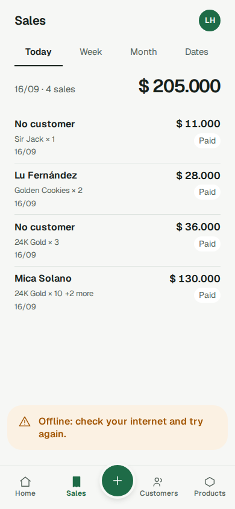

## Jobs

- Cuando estoy trabajando en el teléfono y la app no puede llegar al servidor, sea al abrirla o al guardar algo como una Sale, un Customer o una configuración, quiero que el aviso me diga claramente que estoy sin conexión y que la app necesita conexión, así sé que el problema es mi señal y no la app, y no pienso que algo que guardé se perdió sin enterarme.

## Qué es

El Offline notice es el único aviso que la app muestra cuando una solicitud falla porque se cayó la red. Es un solo componente, `web/src/components/SinConexion.tsx`, y se usa en dos lugares:

- **Banner global**: donde ya estaba el banner, en el shell y en las Tab roots (Home, Sales, Customers, Expenses y las demás), cuando la app abierta pierde la red.
- **Aviso en línea**: dentro de un formulario o una pantalla, en el lugar de avisos que ya tenía, después de una solicitud que falló por falta de red: Settings → Business al guardar, el formulario del Customer, los Products de New sale y Settings → Business → Withdrawal reasons al eliminar un motivo.

En todos los lugares dice exactamente lo mismo. El formulario queda abierto y conserva lo tipeado, así que se puede volver a guardar cuando vuelve la conexión; una solicitud posterior que sale bien saca el aviso, y uno que vuelve a fallar sin red muestra el mismo aviso, sin apilarse.

En Withdrawal reasons, solo el fallo de red muestra el Offline notice; un rechazo o cualquier otro error sigue mostrando su propia fila de texto con `role=alert`.

## Qué dice

- **Título**: "You're offline" (`common:offline`).
- **Detalle**: "apostrophe needs a connection." (`common:offlineDetail`).

"apostrophe" va en minúscula porque es el Wordmark: ninguna configuración ni ningún idioma lo renombra ni lo pone en mayúscula. La constante deprecada `SIN_CONEXION_MENSAJE` de `web/src/copy/common.ts` repite el título, y ningún código en ejecución la lee.

La frase vieja "Offline: check your internet and try again." ya no aparece en ningún lado.

El aviso de Undo cuando no hay red (`common:undoSaleOffline`) es otro mensaje y no es el Offline notice.

## Botones de reintento sin red

Un botón que, tras un fallo de red, vuelve a pedir algo cuando se lo toca no es el Offline notice y no usa el título solo como rótulo, porque "You're offline" no dice que tocarlo reintenta. Lleva su propia clave, `common:offlineRetry`, "You're offline · Try again", que es también su nombre accesible, y no muestra la línea de detalle.

- Hoy es el botón del campo Product del formulario de Stock entry cuando no se pudo leer la lista de Archived products por falta de red; tocarlo la vuelve a leer. Ante otro error, el mismo botón sigue diciendo el reintento genérico.
- Cualquier otro lugar que use el texto sin red como rótulo de una acción sigue la misma regla; un lugar que solo muestra el estado usa el título.

## Cómo se ve

- Es un aviso de atención: se dibuja dentro de `AvisoAmbar`, con el Attention icon, `role=status`, el título en `span.aviso-ambar__titulo` y el detalle debajo en `span.aviso-ambar__detalle`.
- Usa solo tokens y se lee igual en claro y en oscuro: el título en `--deuda`, el detalle en `--deuda2`, sobre `--deuda-fondo`.
- No se puede tocar: no tiene botón, link ni acción.
- En un teléfono angosto, las dos líneas se parten dentro del recuadro y el título nunca se corta.
- En el teléfono cumple el estándar móvil sin ningún infractor nuevo en el Mobile check; un hallazgo sobre la línea de detalle se corrige en los tokens, nunca se agrega a una lista.
- Se juzga contra el estado 'Sin conexión' de `docs/product/design-system/pantallas/Estados.dc.html` según el Drawing as guide. Las capturas del registro de pantallas (`EstadosSinConexion`, `EstadosSinConexionCompu` y sus versiones oscuras) esperan "You're offline".

## Lo que no hace

- No reintenta solo. El dibujo agrega que la app reintenta sola; esa mitad se deja afuera porque la app no reintenta sola, y prometerlo sería falso (decisión del dueño en GH-1073, Dibujo 1). Si algún día la app reintenta sola, devolver esa mitad es un trabajo aparte.
- El aviso no tiene acción de reintentar ni botón; los botones de reintento que ya existían conservan su acción con su propio rótulo (arriba).
- No cambia la única excepción que ya existe: la lista de Products de New sale vuelve a leer sola al reconectar o al volver a la app tras un fallo (`sale-in-progress.md`).
- No depende del service worker ni del origen (accounts.md, Sin red).

## Métricas

- **Mismas dos líneas en todos lados**: en el banner global y en el aviso en línea se leen "You're offline" y "apostrophe needs a connection.", con 0 apariciones de la frase vieja en `web/` y `scripts/design/`.
- **Reintento con nombre**: todo botón de reintento sin red se lee "You're offline · Try again"; ninguno se rotula solo con el título.
- **Aviso de atención en ambos temas**: Attention icon, `role=status` y solo tokens en claro y oscuro; 0 infractores nuevos en el proyecto e2e móvil.
- **Fiel al dibujo**: las Design captures en claro y oscuro de `EstadosSinConexion` y de Settings → Business tras un guardado fallido muestran lo que dice el estado 'Sin conexión', salvo la mitad aceptada como fuera.
