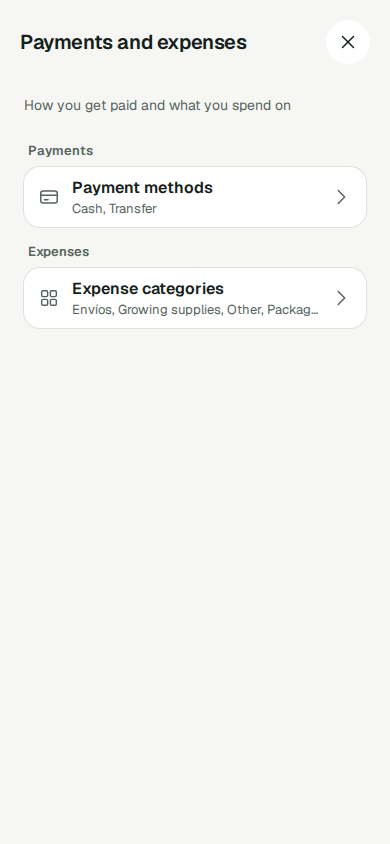

## Jobs

**Cuando** un cliente me paga, en la venta o más tarde, **quiero** registrar cómo me pagó con los medios que mi negocio de verdad acepta, nombrados a mi manera, **para** que cada pago me diga después cómo me llegó la plata, sin que la app decida por mí que la plata es efectivo o transferencia.

**Cuando** un cliente me paga, con una venta o a cuenta de una deuda, **quiero** decir cómo me pagó con el mismo control que uso para cualquier elección que puede crecer, **para** registrar el medio a propósito y nunca por un valor que quedó de antes; y cuando los Payment methods pasen a ser mi propia lista, registrar un pago se tiene que sentir igual. (El job de la parte 5 de GH-581, payments.md y sales.md: esta capacidad cumple su segunda mitad.)

**Cuando** cambian las formas en que me pagan o las cosas en que gasto (empiezo a aceptar un medio nuevo, renombro o retiro uno, cambio su orden, o necesito una Expense category que no tengo), **quiero** encontrar las dos listas en un solo lugar de Settings y cambiarlas en pocos toques desde el teléfono, **para** que la próxima venta o el próximo gasto que registre ya ofrezca el medio y la categoría correctos. (Parte 9 de GH-499.)

**Cuando** pago algo que no es Stock, **quiero** registrar con cuál de mis propios Payment methods lo pagué, sin tener que escribir una descripción, **para** ver después cómo salió del negocio cada Expense y registrarla en pocos toques desde el teléfono. (GH-837, compartido con expenses.md: acá lo sirve que una Expense apunte a un medio por id y que un medio usado por una Expense solo se archive, nunca se elimine.)

**Cuando** ordeno mi lista de Payment methods y quiero sacar uno, **quiero** que la app cuente cada registro que lo usa, mis Expenses además de mis Payments, **para** poder eliminar solo un medio que nada usa y, si no, archivarlo mientras cada Payment y cada Expense pasados siguen mostrando su nombre. (Parte 3 de GH-1010, que cierra GH-837: acá lo sirve que `in_use` salga de una sola regla que junta Payments y Expenses del propio Business.)

**Cuando** ordeno mi lista de Payment methods en Settings, **quiero** que cualquier medio al que apunte un Payment o una Expense se archive y nunca se elimine, **para** acortar la lista sin perder el registro de cómo me pagaron o cómo pagué. (Parte 2 de GH-520: acá lo sirve que un medio usado solo por una Expense responda como en uso, que su eliminación se rechace con `payment_method.in_use` y nunca con un 500, y que el Business export y la Business removal sigan funcionando con Expenses que nombran un medio.)

# Payment methods

La lista propia de cada **Business** de las formas en que le pagan sus **Customers** y en que paga sus **Expenses**. Es un **Growable set**, así que se elige solo con el **Selector** y nunca se declara en `fixedSets.ts` (ADR-0074). Cada **Payment** apunta a un medio por su id (`payment_method_id`); la columna vieja `payment.method` queda congelada con el valor que tenía y ya no se lee ni se escribe (ADR-20261111-payment-methods-by-id). Desde GH-837, una **Expense** puede apuntar también a un medio por id (`expense.payment_method_id`), de forma opcional (expenses.md). La configuración se guarda por Business en su propio hexágono `payment_methods` (ADR-0055). Hasta esta parte los medios eran Cash y Transfer, incorporados en la app; eso fallaba **Assume nothing**, que nombra a los Payment methods como algo que la app no puede fijar en el código. Parte 24 de GH-318.

Supuesto sobre hoy: la vendedora registra efectivo o transferencia y guarda el canal real en la cabeza o, en una venta, en la **Note**; la información se pierde.

Línea de base de la parte 3 de GH-1010: antes, solo los Payments hacían que un medio estuviera en uso, así que un medio usado solo por Expenses se ofrecía para eliminar, en contra de la regla de que uno con Payments o con Expenses solo se archiva.

Línea de base de la parte 2 de GH-520: Settings trataba como sin usar un medio que solo usa una Expense; se ofrecía "Delete" y confirmarlo fallaba con un error del servidor en lugar de un rechazo claro. La RESTRICT de la base igual protegía los datos, así que la Expense nunca perdía su medio.

Criterios de éxito:

1. **Mi lista, sin código**: desde Settings en el teléfono, la vendedora agrega un medio (por ejemplo "Mercado Pago") con nombre e ícono y lo pone en el orden que quiere. Después aparece en New sale y en Record payment en ese orden, sin ningún cambio de código.
2. **Nada de antes cambia**: todo Business existente y todo Business nuevo arranca con "Cash" y "Transfer". Todo Payment ya registrado sigue mostrando el medio con que se registró, y nada registrado antes cambia.
3. **Los mismos toques**: registrar una venta o un pago en el teléfono lleva los mismos pocos toques que antes, y una venta sigue llevando menos de un minuto. Elegir el medio cuesta como máximo un paso (abrir el campo, tocar la opción) y nunca viene puesto.
4. **Dejar de ofrecer sin perder historia**: un medio que la vendedora ya no acepta deja de ofrecerse para Payments y Expenses nuevos, y los Payments y Expenses pasados lo siguen mostrando.
5. **Los Businesses nunca se mezclan**: los medios de un Business nunca se ven ni se usan desde otro (ADR-0004).
6. **Las dos listas en un solo lugar** (parte 9 de GH-499): la página del grupo Payments and expenses se lee como el dibujo `ConfiguracionCobros` / `ConfiguracionCobrosOscuro`, en claro y en oscuro, con los mismos 3 toques desde cualquier pantalla principal hasta cada lista y sin ningún comportamiento nuevo.
7. **Una Expense nunca pierde su medio** (parte 2 de GH-837, cumplido en la parte 3 de GH-1010 y verificado en la parte 2 de GH-520): un medio al que apunta alguna Expense solo se puede archivar, nunca eliminar, por el mismo camino y con la misma respuesta que uno con Payments, nunca un 500. Archivarlo funciona y la Expense sigue mostrando el nombre actual del medio. Vale también para un medio usado por Payments y Expenses a la vez.
8. **Una sola respuesta de uso** (parte 3 de GH-1010): un medio sin Payments ni Expenses se sigue pudiendo eliminar, una Expense sin medio no cuenta para ninguno, y `in_use` es el mismo en Settings → Payment methods y en la API, calculado solo con los registros del propio Business, sin revelar nada de otro.
9. **El export y la baja siguen andando** (parte 2 de GH-520): en un Business cuya Expense nombra un medio, el **Business export** lleva ese medio como referencia por nombre y la **Business removal** termina bien bajo la RESTRICT de la FK.

## Comportamiento

### Payment method

- **Campos**: `business_id`, nombre, ícono y posición, más si está archivado.
- **Nombre**: único en el Business sin importar mayúsculas, minúsculas ni espacios, los archivados incluidos. No puede quedar en blanco después de recortar y tiene hasta 60 caracteres.
- **Renombrar**: se permite en cualquier momento. Los Payments y las Expenses pasados muestran el nombre nuevo, porque apuntan al medio y no a su texto. Es a propósito, a diferencia de una **Price entry**. Quien quiera conservar el nombre viejo como historia agrega un medio nuevo y archiva el viejo.
- **Ícono**: se elige de un conjunto fijo y neutro, nunca texto libre: `banknote`, `coins`, `card`, `bank`, `phone`, `wallet`, `qr`, `other`. Nada en él es propio de un solo tipo de negocio, de un país, de un banco ni de una marca. Un medio nuevo recibe `other` por defecto, así que nunca hay que elegir uno. En Settings el ícono va al lado del nombre y nunca lo reemplaza (**Icon and text rule**); en el Selector de New sale y Record payment cada medio se muestra solo por su nombre, sin ícono.
- **Orden**: la posición la fija la vendedora; New sale y Record payment muestran los medios ofrecidos en ese orden, y el Selector nunca los reordena.

### Los valores por defecto

- Un Business nuevo recibe "Cash" (`banknote`) y "Transfer" (`bank`), en ese orden, en su **Stored language** al abrirse. Un cambio de idioma posterior nunca los renombra, igual que los **Withdrawal reasons** y las **Expense categories**.
- Los Businesses existentes reciben "Cash" y "Transfer" en inglés, porque todos tienen inglés como Stored language. La migración solo agrega la tabla, sus filas y la columna nueva `payment.payment_method_id`, que llena enlazando cada Payment existente (los On-the-spot payments incluidos) con el medio que corresponde a su valor de hoy (`cash` → "Cash", `transfer` → "Transfer"). No cambia el valor de ninguna columna existente, y el comparador M3 compartido lo prueba.
- "Cash" y "Transfer" son medios comunes: se pueden renombrar, reordenar, archivar o eliminar con las mismas reglas que cualquier otro. Ningún código los distingue por su nombre.
- **Spreadsheet import**: las palabras cash/transfer de la planilla se resuelven al nombre por defecto del Business. Si hay un medio ofrecido con ese nombre se reutiliza; si no hay ninguno, se agrega al final con el ícono `other`; si lo tiene un medio archivado, la importación entera se rechaza con `import.payment_method_archived` (import.md). Las Expenses importadas nunca llevan un medio.

### Nunca vacía

- La lista nunca tiene cero medios ofrecidos. Archivar o eliminar el último medio ofrecido se rechaza (`payment_method.last_offered`), y la pantalla dice por qué: "You need at least one payment method. Add another one first."

### En uso

- Un medio está en uso (`in_use`) cuando al menos un Payment o al menos una Expense de su mismo Business apunta a él. Los medios archivados también cuentan.
- Una Expense sin medio no cuenta para ninguno, porque el medio de una Expense es opcional.
- La respuesta sale de una sola regla, que junta los Payments y las Expenses que usan el medio (parte 3 de GH-1010), y es la misma en toda superficie: la lista de Settings toma de ella si ofrece "Delete" o "Archive", y la API la trae como `in_use` y la usa para rechazar la eliminación.
- Cada conteo lee solo los registros del propio Business, y la respuesta no revela nada de ningún otro.
- Es solo verdadero o falso: nunca se muestra cuántos registros usan un medio.

### Eliminar y archivar

- **Sin Payments ni Expenses**: un medio al que no apunta ningún Payment ni ninguna Expense se puede eliminar para siempre, con confirmación previa ("Keep it" para no hacerlo).
- **Con Payments o con Expenses**: solo se puede archivar, con confirmación previa. Eliminarlo se rechaza (`payment_method.in_use`), por el mismo camino y con la misma respuesta tenga Payments, Expenses o los dos, nunca con un 500 por la FK y sin ningún texto nuevo (parte 2 de GH-837, cumplido en la parte 3 de GH-1010, verificado en la parte 2 de GH-520).
  - Archivarlo lo saca de todo Selector para Payments nuevos y deja de poder elegirse para una Expense.
  - Los Payments y las Expenses pasados lo siguen mostrando con su nombre; una Expense que ya lo tiene lo puede conservar al editarse.
  - Conserva reservado su nombre: no se puede crear otro medio con ese nombre; el rechazo manda a restaurarlo desde Archived.
  - Se ve y se restaura solo desde "Archived", dentro de Settings → Payments and expenses → Payment methods. Al restaurarlo vuelve exactamente como estaba: su nombre, su ícono y su propia posición guardada.
- **"Paid later" no es un medio**: que una Sale quede debiendo (Owing) es un estado, nunca un medio. La vendedora no puede agregarlo a la lista ni archivarlo.

### Elegir un medio (New sale y Record payment)

- El campo "Payment method" es un Selector obligatorio, el mismo en New sale (bajo Paid) y en Record payment. Sus opciones son los medios ofrecidos del Business, leídos del servidor (`GET /api/payment-methods`, sin caché vieja), en el orden de la vendedora.
- **Nunca viene puesto**: abre vacío, sin valor por defecto, sin opción "Select…" y sin fila para borrar. En New sale vuelve a quedar vacío cada vez que se vuelve a Paid; Record payment nunca recuerda un medio entre Payments. (payments.md criterio 10, sales.md criterio 34.)
- **Carga**: mientras la lista se carga por primera vez, el campo queda en `loading`: deshabilitado, con su esqueleto, nunca vacío.
- **La lista no carga** (decisión 21 del humano): sin conexión se muestra el aviso "Sin conexión" de Estados; con un error del servidor la lista dice "Could not load the payment methods. Tap to try again." y tocar el campo de nuevo vuelve a leerla. Mientras ese reintento corre, la falla sigue a la vista: el campo no vuelve a `loading` ni se cierra, y el aviso o el texto de la falla quedan hasta que llega la lista (que los reemplaza con los medios ofrecidos en su orden) o hasta que vuelve a fallar. En los dos casos no se pierde nada de lo escrito. Observación: mientras reintenta no hay ninguna señal de que está intentando de nuevo, así que no se distingue un reintento en curso de uno que falló.
- **Conjunto vacío**: no debería verse nunca, porque siempre hay al menos un medio ofrecido. El texto existe en el Copy module (`emptyStates.selectorNoPaymentMethods`: "No payment methods yet. Add one in Settings → Payment methods.") y nombra un camino que no es el real (Settings → Payments and expenses → Payment methods); queda como observación para corregir su redacción.
- **Búsqueda**: con más de 8 medios ofrecidos, la lista tiene búsqueda.
- **Sin medio al guardar**: "Choose how they paid." junto al campo, como hoy. Un medio solo se pide cuando entra plata: Owing nunca lo muestra ni lo pide, y una venta de $0 no lo necesita.
- **Un medio que dejó de ofrecerse con el formulario abierto** (una socia lo archivó o lo eliminó): el guardado se rechaza con 404 `payment_method.unavailable`, el campo muestra el medio elegido con la marca "no longer available" y la frase "That payment method is no longer available. Choose another one.", tanto en New sale como en Record payment, la lista se vuelve a leer y se conserva todo lo escrito. Elegir un medio ofrecido saca la marca.
- **El medio de un Payment nunca cambia** una vez registrado. Un Payment equivocado se elimina y se vuelve a registrar; para un On-the-spot payment, se elimina la Sale y se vuelve a registrar.

### El medio de una Expense (parte 2 de GH-837)

- Es opcional en toda Expense y se manda por la API como `payment_method_id` (expenses.md). Hasta la parte del formulario Add expense, ninguna pantalla lo manda ni lo muestra.
- Elegirlo exige un medio ofrecido del propio Business; cualquier otro responde el mismo 404 `payment_method.unavailable` que en Payments y Sales, controlado dentro de la misma sentencia INSERT o UPDATE que escribe la Expense, sin ningún SELECT previo que lo decida. Conservar al editar el medio archivado que la Expense ya tiene se permite.
- Todo lector del medio de una Expense lo toma de la única `PaymentMethodLabel` armada en el outer join de `SqlExpenses`, sin filtro por `archived_at`.
- A diferencia del de un Payment, el medio de una Expense se puede cambiar o borrar al editarla.
- El medio de una Expense no entra en ningún total: el Cash, el Profit y el Money in no cambian.
- Desde la parte 3 de GH-1010, una Expense con medio hace que ese medio esté en uso (arriba).

### Business export y Business removal (parte 2 de GH-520)

- El **Business export** lleva el medio de cada Expense que tiene uno como referencia por nombre, igual que cualquier otro registro que apunta a otro, porque el export sigue las foreign keys del esquema.
- La **Business removal** termina bien en un Business cuya Expense nombra un medio, bajo la ON DELETE RESTRICT de `expense.payment_method_id`, sin ningún cambio en `app/business_removal`.

### Cómo se muestra el medio

- En la cuenta del Customer, una Sale pagada en el momento dice "Paid · <medio>" (`CUSTOMERS_TEXT.paidWith`), con el `payment_method` que la API trae en la fila de la Sale; reemplaza a "Paid in cash" / "Paid by transfer". Solo una fila sin medio diría "Paid" a secas.
- Un Payment posterior se titula "Payment · <medio>", y la confirmación de eliminarlo nombra el medio ("Delete the payment of $ X (<medio>) from dd/mm?").
- Siempre es el nombre actual del medio, archivado o no: después de renombrarlo, las filas pasadas muestran el nombre nuevo. Lo mismo vale para el `payment_method` que traen las lecturas de una Expense.
- El **Sale bill** informa una Sale pagada en el momento como `paid`, sin nombrar el medio (sale-bill.md).
- **Cash** sigue contando todo Payment como hoy, sea cual sea su medio.

### En pantalla: Settings → Payments and expenses → Payment methods

- Camino (decisión 21 del humano, como el dibujo `ConfiguracionCobros`): Settings → **Payments and expenses** → **Payment methods**, 3 toques desde cualquier pantalla principal (avatar → Payments and expenses → Payment methods). No está dentro de Business. Lo mismo vale para Expense categories (avatar → Payments and expenses → Expense categories).
- **Payments and expenses** es un grupo de Settings (`/settings/payments`, `PaymentsGroup.tsx` sobre el marco compartido `SettingsGroup`), dibujado como `ConfiguracionCobros` / `ConfiguracionCobrosOscuro` desde la parte 9 de GH-499. De arriba hacia abajo, en el teléfono:
  - el título de hoy, "Payments and expenses", con "Close"; Close y el gesto de volver del teléfono son las salidas;
  - una línea debajo del título, "How you get paid and what you spend on" (`paymentMethods:group.lead`), que es solo texto y no un control;
  - el encabezado "Payments" (`paymentMethods:group.paymentsHeading`) sobre una tarjeta propia con la fila "Payment methods" (`/settings/payments/methods`), ícono `tarjeta`, cuyo subtítulo son los nombres de los medios ofrecidos en su orden, unidos por ", " y cortados en una línea con puntos suspensivos;
  - el encabezado "Expenses" (`paymentMethods:group.expensesHeading`) sobre una segunda tarjeta con la fila "Expense categories" (`/settings/expense-categories`), ícono `categorias`, cuyo subtítulo son los nombres de las Expense categories del Business en el orden en que los devuelve el servidor (por nombre; el front nunca los ordena), unidos y cortados igual que el otro.
  - al final, el link "See this month's expenses" (ver abajo).
  - Las dos filas quedan dentro de un solo `<nav>` con el nombre accesible "Payments and expenses". El subtítulo forma parte del nombre accesible de su fila, así que los localizadores la buscan por un nombre que empieza con "Expense categories".
- **El subtítulo de Expense categories** usa la misma lectura de categorías que la lista (`expenseCategoriesQueryOptions()`, `GET /api/expense-categories`), así que no agrega ninguna ruta ni campo, y muestra solo las categorías del Business de la sesión; ningún pedido nombra un Business. No hay subtítulo mientras carga, si la lectura falla (sin texto de error ni Attention icon) o cuando el Business no tiene categorías. En todos esos casos la fila sigue siendo un link que se puede tocar, nunca deshabilitado. El texto de muestra del dibujo ("Alquiler, servicios, sueldos…") no se incluye.
- **Carga**: mientras alguna de las dos lecturas está pendiente, `<main>` lleva `aria-busy`, y se quita cuando las dos terminan, aunque sea con error. Los rótulos, íconos y flechas de las filas se dibujan desde el primer momento.
- En oscuro, la misma estructura con los tokens oscuros; nada se distingue solo por color. La computadora conserva su marco actual, sin pulido dedicado.
- **El link a los gastos del mes** (GH-922): al final de la página, después del `<nav>` y fuera de él, así que el `<nav>` conserva sus dos filas, hay un link de solo texto, "See this month's expenses" (`paymentMethods:group.expensesLink`), un `BotonLink` `variant="link"`. Abre Expenses (`/expenses`, que en el teléfono es el detalle de Analysis) sin mes en la dirección, así que Expenses abre en el mes actual de la sesión (`me.today`) y nunca en el reloj del dispositivo; el link no queda viejo al pasar el fin de mes. Se ve en teléfono y computadora, y también mientras las lecturas están pendientes o fallaron. No lleva flecha: un link es solo texto (ADR-0037), diferencia con el dibujo aceptada por el dueño ("Drawing 1: accept" de GH-922).
- **Diferencias con el dibujo planteadas al dueño, sin decidir**: el encabezado "‹ Ajustes" con título grande del dibujo (la página conserva su título y "Close"), y los conteos ("3", "5") antes de cada flecha, que no se construyen; con el subtítulo cortado, el conteo de categorías no se ve.
- Expense categories se mudó a este grupo como su segunda fila, como lo dibuja la pantalla; Withdrawal reasons se queda en Business, porque el dibujo no la incluye (decisión de PM de GH-707).
- **La lista** muestra los medios ofrecidos en su orden, cada uno con su ícono y su nombre. Cada fila tiene "Move up" y "Move down" (en el teléfono, sin arrastrar; el "Move up" del primero y el "Move down" del último quedan deshabilitados) y, según el medio, "Delete" cuando no tiene Payments ni Expenses o "Archive" cuando tiene alguno (según `in_use`), cada una con su confirmación. Desde la parte 3 de GH-1010, un medio usado solo por Expenses muestra "Archive", sin ningún cambio en la pantalla. Tocar la fila abre su edición. Tiene "Add method" y la entrada "Archived" (`/settings/payments/methods/archived`). Mientras carga muestra la forma de la lista; si falla, "Try again"; sin conexión, el aviso de Estados.
- **Agregar** y **editar** se hacen en un formulario (una **Sheet** en el teléfono, con "Close" arriba y Save fijo abajo) con nombre e ícono, el ícono por defecto ya elegido. Los rechazos del nombre (en blanco, más de 60 caracteres, repetido, reservado por un archivado con "Restore it from Archived.") se muestran junto al campo y conservan lo escrito. La edición avisa "Past payments will show the new name." y, al volver a abrirla después de guardar, muestra lo guardado (decisión 1 del humano). Salir con cambios sin guardar pide confirmación.
- **Archived**: muestra los medios archivados, cada uno con "Restore"; vacío dice "No archived payment methods."
- Todo texto sale del **Copy module**; ningún valor por defecto nuevo lleva una palabra propia de un solo tipo de negocio, y ningún texto en español del dibujo se incluye.

### API y restricciones

- Rutas de gestión, todas con sesión (`/api/payment-methods`):
  - `GET` ofrecidos, en orden de posición, como `[{id, name, icon, position, in_use}]`, donde `in_use` es verdadero cuando algún Payment o alguna Expense del mismo Business apunta al medio; `GET /archived` los archivados.
  - `POST {name, icon?}` agrega el medio al final (201).
  - `PATCH /{id} {name?, icon?}` renombra o cambia el ícono.
  - `POST /{id}/move {direction: "up"|"down"}` intercambia con el vecino ofrecido; en un extremo no cambia nada.
  - `POST /{id}/archive` y `POST /{id}/restore`; un medio restaurado vuelve a su propia posición guardada.
  - `DELETE /{id}` (204).
- Rechazos de gestión: `payment_method.name_required` y `name_too_long` (422); `name_taken`, `name_taken_archived`, `last_offered` e `in_use` (409, este último también para un medio usado solo por Expenses, con el mismo cuerpo byte a byte que con Payments o con los dos, nunca un 500 por la FK); id desconocido o de otro Business, 404 `payment_method.not_found`.
- **Una sola regla de uso** (parte 3 de GH-1010, verificada en la parte 2 de GH-520): el puerto `PaymentMethodUsage` lo implementa `AnyUsage`, una unión chica definida en `app/main.py` que junta el adaptador de uso de payments (`PaymentsUsingAMethod`, sin cambios) y el de expenses (`app/expenses/adapters/method_usage.py`, `ExpensesUsingAMethod`, cuyo `in_use_among(method_ids)` devuelve los ids que usa alguna Expense del Business). Se cablea como `app.state.payment_method_usage`, una fábrica `(session, business_id)`. Cada adaptador filtra por `business_id`, y `app.payments` nunca importa una tabla de expenses. La decisión vive en su propio ADR.
- `tests/architecture/test_payment_method_references.py` falla si algún tipo de registro que apunta a `payment_method` no se cuenta en `in_use`, así que un registro nuevo que apunte a un medio no puede quedar afuera en silencio.
- Payments y Sales llevan `payment_method_id` en lugar de `method`, y el pago de una Sale pasa a ser una unión por `kind` (`{kind: "paid", payment_method_id}` o `{kind: "owing"}`). La cuenta del Customer trae `how_paid` (`paid`, `owing` o `none`) y `payment_method` (`{id, name, icon}` o null). Es un quiebre real de la API: el cuerpo del PR lleva una línea `Breaking-API: <motivo>` (ADR-0066, ADR-20261111-payment-methods-by-id).
- Al escribir un Payment, una Sale o una Expense, todo medio que no se puede elegir (archivado, eliminado, inexistente o de otro Business) responde el mismo 404 `payment_method.unavailable`, controlado dentro de la misma sentencia que escribe, así que no se escribe nada y no se revela nada. Para una Expense, conservar su medio guardado, aunque esté archivado, no se rechaza.
- `payment.payment_method_id` apunta a `payment_method` con una FK compuesta `(business_id, payment_method_id)` ON DELETE RESTRICT; `expense.payment_method_id` apunta a `payment_method` con la FK compuesta de la migración 0034, también ON DELETE RESTRICT.
- `payment_method` lleva `business_id` no nulo y se lee solo mediante un repositorio construido para un Business.
- Los rechazos llevan su código en `contract.json` (ADR-0008), son fijos y nunca repiten el nombre tipeado (ADR-0005).
- Toda ruta nueva entra en el barrido de aislamiento y en el test de rutas con acceso restringido.
- Las migraciones siguen la única cadena lineal, cada una con su `down_revision` en la anterior.
- La página del grupo Payments and expenses no agrega ninguna ruta ni campo: lee `GET /api/payment-methods` y `GET /api/expense-categories`, compartiendo la caché de cada lista.

## Métricas

- **Mi lista (criterio 1)**: una corrida end-to-end en un viewport de teléfono agrega "Mercado Pago" con un ícono, lo sube al primer lugar, y lo ve primero en el campo "Payment method" de New sale y de Record payment; guarda una venta y un Payment con él.
- **Nada de antes cambia (criterio 2)**: el comparador M3 pasa sobre la migración; cada Payment existente queda enlazado al medio que corresponde a su valor de `method`, 0 sin enlazar; un Business nuevo tiene exactamente "Cash" y "Transfer" en su Stored language. En la cuenta, una Sale pagada en el momento dice "Paid · Cash" y, después de renombrar, el nombre nuevo (`accountRows.test.ts`).
- **Los mismos toques (criterio 3)**: una venta pagada se sigue registrando desde un viewport de teléfono en menos de 60 s; el medio suma como máximo un paso; los tests del front de "siempre vacío" y "sin medio no se guarda" pasan sin editar sus aserciones.
- **La lista no carga (decisión 21)**: los tests del front cubren el error del servidor con reintento y el aviso sin conexión; durante el reintento la falla sigue a la vista y desaparece cuando llega la lista. El chequeo `mobile` alcanza los estados `new-sale/method-selector-failed` y `payment/method-selector-failed`, que no figuran en `unreachable.json`.
- **Dejar de ofrecer (criterio 4)**: un test de API archiva un medio con Payments y comprueba que no aparece entre los ofrecidos, que un Payment nuevo con él responde 404 `payment_method.unavailable`, que los Payments pasados siguen mostrando su nombre y que restaurarlo lo devuelve igual; uno sin Payments se elimina; el último ofrecido no se archiva ni se elimina; un nombre archivado no se reutiliza. El spec e2e de teléfono `paymentMethods.spec.ts` cubre agregar, editar y volver a abrir, archivar, restaurar y eliminar.
- **Aislamiento (criterio 5)**: toda ruta de medios está en el barrido y responde 404 o vacío desde otro Business; un Payment, una venta o una Expense con el medio de otro Business responde 404.
- **Una Expense nunca pierde su medio (criterio 7)**: un test de API, con la Expense creada por `POST /api/expenses` con `payment_method_id` sobre una SQLite nueva, comprueba que un medio usado solo por una Expense trae `in_use: true`, que `DELETE` responde 409 `payment_method.in_use` (nunca un 500) y que archivarlo funciona, y que la Expense sigue mostrando el nombre actual del medio; con un Payment y una Expense, el mismo 409 con el cuerpo idéntico byte a byte. 100% de aprobación.
- **Una sola respuesta de uso (criterio 8)**: un test de API comprueba que un medio sin Payments ni Expenses trae `in_use: false` y `DELETE` responde 204, que una Expense sin medio no cambia el `in_use` de ningún medio, y que el `in_use` de un medio del Business A no cambia con los registros del Business B ni revela que B existe. `test_payment_method_references.py` falla si un tipo de registro que apunta a `payment_method` no se cuenta. 100% de aprobación.
- **El export y la baja siguen andando (criterio 9)**: un test sobre un Business cuya Expense nombra un medio comprueba que el Business export lleva el medio de esa Expense como referencia por nombre y que la Business removal termina bien bajo RESTRICT, sin ninguna fila del Business que quede; `app/business_removal` sin cambios. 100% de aprobación.
- **Assume nothing**: ningún literal "cash" o "transfer" decide comportamiento en el código nuevo; ningún medio aparece en `fixedSets.ts`.
- **Las dos listas en un solo lugar (criterio 6)**: las Design captures de `ConfiguracionCobros` y `ConfiguracionCobrosOscuro` a 390 px dan ok (evidencia fijada por la decisión 2 del dueño), y la única diferencia aceptada es la flecha final del link a los gastos del mes, que no lleva (ADR-0037). `PaymentsGroup.test.tsx` comprueba los encabezados y la línea bajo el título, el subtítulo de Expense categories en el orden del servidor, que no hay subtítulo con la lista vacía ni con un 500 (y que la fila igual abre `/settings/expense-categories`), el `aria-busy` de `<main>` mientras las dos lecturas están pendientes y que ningún pedido nombra un Business. Se mantienen los 3 toques hasta cada lista y no se agregó ningún infractor al Mobile check: se quitó la entrada `aria-busy` de `ConfiguracionCobros`.

## Fuera de alcance

- Informes por medio: Cash separado por medio, totales por medio, el gasto por medio y el medio en el Sale bill. Es otro job.
- Editar un Payment registrado, su medio incluido.
- Recordar el último medio usado o proponer uno por defecto.
- Arrastrar para ordenar.
- Íconos subidos o de texto libre.
- El ícono del medio dentro del Selector de New sale y Record payment.
- Pulido dedicado para la computadora de la página Payments and expenses.
- Mostrar o elegir el medio de una Expense en pantalla: es la parte del formulario Add expense de GH-837.
- Mostrar cuántos registros usan un medio (parte 3 de GH-1010).
- Filtrar Expenses por medio y completar hacia atrás el medio de las Expenses existentes.
- Cambiar `app/business_removal` o cómo una Expense controla su medio al escribirse (parte 2 de GH-520).
