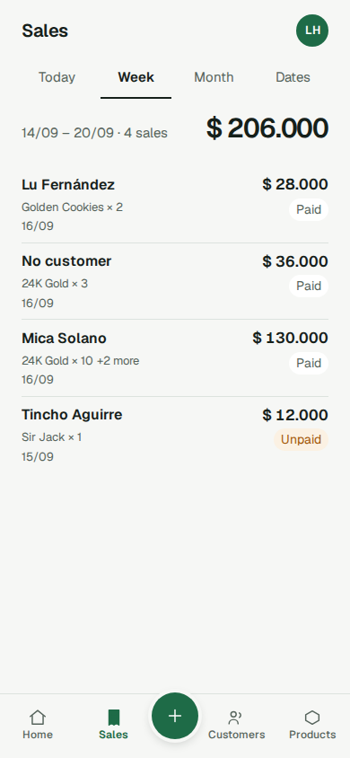

## Jobs

**Cuando** recorro mis ventas (la lista de un día ahora, la historia de un Customer más adelante), **quiero** que cada Sale me diga de entrada si está pagada, pagada en parte y cuánto se debe todavía, o sin pagar, **para** saber qué ventas me quedan por cobrar sin abrir cada una ni sumar Payments de cabeza. (GH-855: sirve al trabajo del Brief "saber quién me debe qué". El "desde cuándo" es del **Owing since** del Customer, no de este chip. #939 construyó el chip, #928 construyó la tarjeta de Sales que lo lleva y #1020 la conectó en la lista de Sales).

**Cuando** miro mis ventas recientes en el teléfono, **quiero** que cada una muestre quién compró, qué, el total y cómo está de pago (pagada, pagada en parte con cuánto falta, o sin pagar), **para** saber de un vistazo cuáles me quedan por cobrar sin abrir cada una. (GH-855, la tarjeta de Sales. La lista de Sales sirve para mirar atrás, no para cobrar: cobrar sigue en Customers, en "Owed to you" y Collect).

**Cuando** busco una venta en el teléfono, **quiero** que cada venta muestre para quién fue, su total y cómo está de pago (pagada, pagada en parte con lo que todavía se debe, o sin pagar), **para** saber cuáles están saldadas sin abrirlas. (#1020, parte 2 de GH-928: la vendedora abre Sales para encontrar una venta puntual, casi siempre reciente o una por la que pregunta un cliente, y abrirla para mirarla, compartir su Sale bill, corregirla o borrarla. "Cuánto me deben en total" ya lo contestan el bloque "Owed to you" de Home y la vista "Owed to you" de Customers).

# Payment state en pantalla

Cómo se muestra el **Payment state** de una Sale:

- un chip, `SalePaymentChip` (`web/src/screens/ventas/SalePaymentChip.tsx`);
- la tarjeta de Sales, `SaleCard` (`web/src/screens/ventas/SaleCard.tsx`), que lleva el chip y repite su oración en su nombre accesible. Desde #1020 es lo que muestra la lista de Sales, una tarjeta por venta, en todo ancho.

La regla que calcula el estado y lo que todavía se debe vive en la API y está definida en sales.md ("Payment state por venta", parte 1 de GH-500). Esta capacidad solo lo muestra y nunca lo vuelve a calcular.

Antes, la vendedora no podía saber desde una Sale si estaba pagada en parte ni cuánto quedaba. La lista de Sales mostraba filas con una marca ámbar "owes you" que no decía si la deuda era parcial ni cuánto faltaba, así que abría la venta o la ficha del Customer y lo sacaba a mano. Supuesto: no hay otro atajo que importe. El Balance, el **Total owed**, las **Sales still owing** y "Owed to you" quedan exactamente como están; el conteo de Sales still owing se sigue viendo en el bloque "Owed to you" de Home.

`web/scripts/docs/front-exclude.json` ya no lista `SalePaymentChip.tsx`, `SaleCard.tsx` ni `salePayment.ts`: #1020 los conectó a una pantalla y sacó sus entradas (D-62e6dc23). Queda `^src/screens/ventas/saleWith\.ts$`, para siempre, porque solo lo importan los tests.

## Comportamiento

### Una sola fuente para la oración del pago

`web/src/screens/ventas/salePayment.ts` es el único lugar que convierte `payment_state` y `still_owed` en lo que se lee:

- `paymentView(state, stillOwed, money)` devuelve la variante (`paid`, `unpaid`, `part_paid` o `unknown`) y, solo para `part_paid`, el monto ya formateado.
- `paymentText(t, view)` devuelve la oración.

El chip dibuja esa oración y la tarjeta la lleva en su nombre accesible, así que lo que se ve y lo que se escucha nunca pueden decir cosas distintas.

### El chip

- **Qué lee**: solo `payment_state` y `still_owed` de la Sale (props `state` y `stillOwed`). El formateador de dinero del Business sale de `useMoney()`. Nunca lee `still_owing`, los Payments ni el Balance del Customer.
- **Estados**:

| Estado | Lo que lee la vendedora | Clase |
|---|---|---|
| `paid` | "Paid" | `.payment-chip--paid` |
| `unpaid` | "Unpaid" | `.payment-chip--unpaid` |
| `part_paid` con `still_owed` mayor que 0 | un círculo lleno a la mitad y "Part-paid · {amount} owed" | `.payment-chip--part-paid` |
| null, un valor desconocido, o `part_paid` con `still_owed` null, no finito, 0 o negativo, o que en el Money format queda en $0 | el **Attention icon** y "Payment can't be shown" | `.payment-chip--unknown` |

- **El monto**: es exactamente `still_owed`, en el **Money format** del Business (su símbolo y sus decimales). Va en su propio elemento con la clase de cifra `.cifra-n` (**Tabular figures**) dentro de la oración. Nunca se saca del total, de los Payments ni del Balance, aunque no coincida con ellos.
- **Nunca un estado adivinado**:
  - Pagada en parte significa que todavía se debe algo. Un `part_paid` cuyo `still_owed` es null, no finito o menor o igual a 0 muestra "Payment can't be shown". Lo mismo pasa si el monto formateado da lo mismo que $0 (por ejemplo, 0,4 en un Business sin decimales). Nunca muestra $0 ni un monto inventado.
  - El `switch` de `paymentView` es exhaustivo, con un `assertNever` propio que no tira error. Su rama por defecto da la variante `unknown`, así que un valor que mande un servidor más nuevo no rompe la pantalla.
  - En la lista, una venta sin estado muestra "Payment can't be shown" solo en su propia tarjeta; las demás tarjetas no se ven afectadas.
- **Nunca solo por color**: cada estado se lee por su palabra, y pagada en parte también por su círculo. Unpaid y Part-paid comparten el tono de deuda y se distinguen por la palabra y el círculo.
- **Nombre accesible**: el círculo y el Attention icon (un `Icono` sin etiqueta) son decorativos, con `aria-hidden`. El texto del chip es su nombre accesible, según la **Icon and text rule**. El chip no se toca y no tiene estado de presión.
- **Teléfono angosto**: el chip (`inline-flex` con `flex-wrap: wrap`) pasa a una segunda línea cuando hace falta. No usa `nowrap`, elipsis ni `overflow: hidden`, así que el monto nunca se corta, se acorta ni se oculta (**Phone first**).
- **Aspecto**: una píldora chica (`border-radius: 999px`, `padding: 2px 8px`) con la letra de `.rotulo` y sin borde, el mismo lenguaje de la píldora de VentaDetalle. El círculo mide 0,8em, así que crece con el texto.
- **Colores**: las reglas `.payment-chip*` de `app.css` usan solo tokens, y solo pares que ya están en la tabla de contraste del README. Cada color está en una regla de una sola clase. No se usa verde (`--positivo`) ni ningún hex.
  - Paid es neutro: `--tinta2` sobre `--superficie`, por decisión del dueño (estilo limpio: solo resalta lo que pide atención). Sobre una tarjeta blanca se lee como texto apagado, sin píldora visible.
  - Unpaid va en el tono de deuda que la app ya usa para lo que se debe: `--deuda` sobre `--deuda-fondo`, por decisión del dueño.
  - Pagada en parte va en `--deuda2` sobre `--deuda-fondo`, con el círculo (`.payment-chip__half`) en `--deuda`: borde de 1px y mitad rellena.
  - La línea desconocida sigue la regla del Attention icon (Icon and text rule y regla Attention del README): `--critico` sobre `--superficie`, y el ícono toma ese color por `currentColor`.
  - Si el chip o la tarjeta necesitaran un par que no está en la tabla de contraste, el trabajo se frena y se informa; nunca se agrega un par.
- **Censo de colores** (`colorCensus.ts`): lleva una entrada por cada selector del chip y de la tarjeta cuya regla usa un color de estado. Cada una nombra la palabra o la forma que lleva su significado y cita su test:
  - `.payment-chip--unpaid`: la palabra "Unpaid".
  - `.payment-chip--part-paid`: la palabra "Part-paid" y el círculo.
  - `.payment-chip--unknown`: el Attention icon y la oración "Payment can't be shown".
  - `.payment-chip__half`: el círculo junto a la palabra "Part-paid".
  - Los selectores `.sale-card*` que usen un color de estado, con su entrada y su test (#1020).

  `.payment-chip--paid` no entra, porque es neutro y el control del censo rechaza una entrada sin color de estado.

### La tarjeta de Sales (`SaleCard`)

- **Qué es**: un solo `InAppLink` con clase `.sale-card` que lleva al detalle de la Sale (`/sales/:id`, armado desde la tabla de rutas con `pathTo(SALE, { id })`). Recibe la Sale (prop `sale`) y usa `useMoney()`. Mide al menos 44 px de alto.
- **Qué lee**: de la Sale, solo `payment_state`, `still_owed`, `total`, `lines`, el nombre del Customer, `id` y `date`. Nunca lee `still_owing`, los Payments, una marca VIP ni el Balance del Customer, y nunca lee el reloj del dispositivo.
- **Contenido, en este orden**:
  1. `.sale-card__name`: el nombre del Customer, o "No customer" en una **Sale without a customer**. Nunca muestra una marca VIP, aunque el Customer la tenga.
  2. `.sale-card__items`: la primera Sale line en el orden guardado, como `{{name}} × {{quantity}}` (`.sale-card__item`), con el formateador de cantidad de siempre y sin palabra de unidad (**Assume nothing**). La × es U+00D7. Cuando hay otras líneas le sigue `.sale-card__more`, "+N more" con la cantidad de líneas restantes. Un **Gift** cuenta como línea.
  3. `.sale-card__total`: el total de la Sale con el **Shipping charged**, en la clase de cifra `cifra-n` (**Tabular figures**).
  4. El chip de pago.
  5. `.sale-card__date`: la fecha propia de la Sale como dd/mm (`formatDateShort(sale.date)`), también para las de hoy.
- **Lo que no muestra**: gramos, la **Note**, el **Sale number**, una marca VIP, un chevrón ni el Balance del Customer. Todo eso, salvo el Balance, sigue en el detalle de la Sale.
- **Nombre accesible**: `sales:card.name`, "{{customer}}, {{items}}, {{payment}}, total {{total}}". Por ejemplo: "Ana Pérez, Blue Dream × 5 +1 more, Paid, total $ 11.000".
  - `{{items}}` es el texto de la primera línea, más un espacio y "+N more" cuando lo hay.
  - `{{payment}}` es la oración del chip, tomada de `salePayment.ts`.
  - El nombre no lleva la fecha.
- **Presión**: `.sale-card` está en el grupo `--superficie` del bloque `/* pressed */` vivo y en `SELECTABLE` de `touch.test.ts`. `.fila-venta` ya no está en ninguno de los dos (#1020); solo queda en la foto congelada `pressedBlock.bdc2945.ts`.
- **Disposición** (`app.css`, solo tokens, #1020):
  - la columna de texto tiene min-width 0;
  - el nombre y la línea de productos se cortan con elipsis, y la línea de productos se achica primero;
  - el total y el chip nunca se achican; el chip igual puede pasar a una segunda línea y su monto nunca se corta.
- **Dibujo**: el dibujo de la tarjeta está en `Pedidos.dc.html` (decisión 2 del humano en GH-928). Ante una diferencia, rige **Drawing as guide**: cuenta solo si el dueño, en el teléfono, leería o haría algo distinto.

### En pantalla: Sales

(La imagen se vuelve a tomar después del merge de #1020; hasta entonces puede mostrar las filas de antes, y gana el texto).

- **La lista**: `Ventas.tsx` dibuja una `SaleCard` por venta dentro de `.sale-card-list`, en todo ancho. Cada tarjeta es un solo link a su venta, así que encontrar y abrir una venta, y llegar a su Sale bill, no lleva más toques que antes.
- **Lo que no cambia**: las pestañas de período, el total y la cantidad del período, el orden, el estado de carga y el estado vacío siguen como los define sales.md.
- **Lo que se fue, para siempre**: las filas `.lista-ventas`/`.fila-venta*`, la marca "owes you" con su total ámbar (`SALES_TEXT.owesYou`, sacado del Copy module y de `en.baseline.json`), la insignia VIP y los gramos de cada venta. Ninguno vuelve, ni visible ni oculto (D-69509906). El conteo de **Sales still owing** ya no se muestra en Sales: se ve solo en el bloque "Owed to you" de Home.
- **En la computadora**: las mismas tarjetas, más anchas, sin pulido dedicado (**Phone first**). `Ventas.dc.html` y `VentasCompu.dc.html` quedan reemplazados para la lista (decisiones 1 y 2 del humano en GH-928).
- **Sin filtro ni orden por estado**: la lista no filtra ni ordena por Payment state.
- **e2e**: los localizadores de la lista son `.sale-card`; `payments.spec.ts` encuentra la tarjeta por `.sale-card__total` y espera que su `.payment-chip` diga `Unpaid`.

### Textos

Viven solo en el **Copy module**, en inglés:

- en `web/src/copy/locales/en/sales.json`, con su `en-XA` generado;
- en `en.baseline.json`, con las filas `sales.ts:SALE_PAYMENT_TEXT.*` y `sales.ts:SALE_CARD_TEXT.*`;
- en `baselineKeys/sales.json`.

Son las palabras exactas de la tabla del Tech Writer que el humano pegó en la decisión 2 de GH-928:

- `sales:card.payment.paid`: "Paid".
- `sales:card.payment.unpaid`: "Unpaid".
- `sales:card.payment.partPaid`: "Part-paid · {{amount}} owed".
- `sales:card.payment.unknown`: "Payment can't be shown". Antes decía "Payment cannot be shown" y la corrigió GH-928 por decisión 2 del humano, que reemplaza la nota anterior de que un aviso no lleva contracciones.
- `sales:card.noCustomer`: "No customer".
- `sales:card.item`: "{{name}} × {{quantity}}".
- `sales:card.more`: "+{{count}} more". Sigue la regla de conteo del repo, con la misma forma para todo conteo (`more_one` y `more_other`).
- `sales:card.name`: "{{customer}}, {{items}}, {{payment}}, total {{total}}".

`SALES_TEXT.owesYou` ("owes you") ya no existe (#1020). Ninguno de estos textos nombra una unidad, una moneda ni un tipo de producto (**Assume nothing**). "Paid · <método>" es del **On-the-spot payment**, no de este chip.

### Ayuda de tests

`saleWith(state, overrides?)` (`web/src/screens/ventas/saleWith.ts`, solo para tests) devuelve una `Sale` tipada con `payment_state` y `still_owed` puestos como par. Los `overrides` se aplican al final. Las pruebas de la tarjeta arman sus ventas solo con `saleWith`, nunca con `still_owing` ni `payment`.

## Criterios de éxito

1. **Se lee sin color**: en el teléfono, el estado se lee por la palabra, y pagada en parte también por el círculo. Nunca se lee solo por el color.
2. **El monto de la venta, tal cual**: lo que se debe de una venta pagada en parte es exactamente su `still_owed`, en el Money format del Business, también cuando no coincide con el total. Evidencia: el test con un `stillOwed` distinto del total.
3. **Nunca un estado adivinado**: el chip muestra "Payment can't be shown" con el Attention icon decorativo en tres casos: cuando los hechos de pago no se concilian (null), cuando llega un valor desconocido y cuando un `part_paid` trae un `still_owed` inservible. Nunca muestra un estado adivinado ni $0, y en la lista no afecta a las demás tarjetas.
4. **Assume nothing**: ningún texto del chip ni de la tarjeta nombra una unidad, una moneda, un Payment method ni un tipo de producto, los montos siguen el Money format del Business, y todos los textos viven solo en `web/src/copy/`.
5. **Nada se corta**: el chip pasa a una segunda línea y el monto nunca queda cortado ni oculto. El Mobile check (sin infractores nuevos) y la **Design capture** de `/sales` contra `Pedidos.dc.html` lo juzgan en el teléfono.
6. **Lo que se ve es lo que se escucha**: el nombre accesible de la tarjeta contiene, para cada estado, exactamente el texto visible de su chip, porque los dos salen de `salePayment.ts`. Evidencia: `SaleCard.test.tsx`.
7. **Solo los hechos de esta venta**: la tarjeta toma la fecha de la propia Sale (dd/mm) y nunca del reloj. Tampoco lee `still_owing`, los Payments ni el Balance del Customer.
8. **Cada venta, sin abrirla** (#1020): en el teléfono, para cada venta de la lista, la vendedora sabe sin abrirla si está Paid, Part-paid (con lo que todavía se debe) o Unpaid.
9. **Sin la marca vieja** (#1020): nada en la lista de Sales usa la marca "owes you" ni su texto; un grep de `fila-venta|lista-ventas|te-debe|owesYou` en `web/` y `scripts/` solo encuentra `pressedBlock.bdc2945.ts`. El conteo de Sales still owing sigue en Home.
10. **Sin toques de más** (#1020): encontrar y abrir una venta, y llegar a su Sale bill, no lleva más toques que con las filas.

## Pendiente

- Confirmar en la pantalla real que Paid, neutro, se sigue leyendo como parte de la misma familia de chips (Design capture de #1020).
- Decidir si "Payment can't be shown" necesita una forma de resolverlo ahí mismo. Hoy la salida es abrir la Sale.
- Volver a tomar `Ventas.webp` después del merge de #1020.
