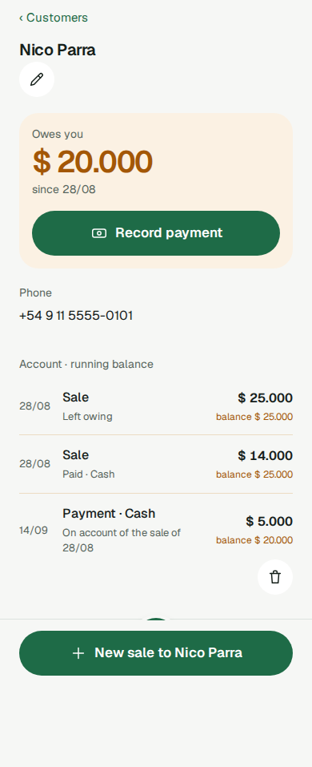
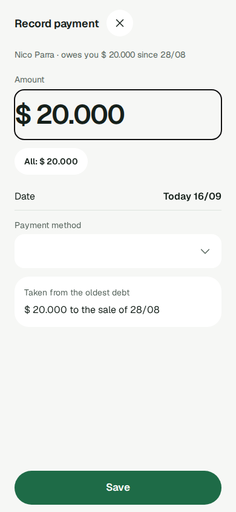

## Jobs

**Cuando** un cliente me paga parte o todo lo que debe, con cualquiera de los medios que acepta mi negocio, el mismo día o semanas después, **quiero** registrarlo desde el celular en pocos toques y ver que su Balance y su "owing since" bajan en el acto, **para** saber siempre quién me debe qué y desde cuándo, y que nada de lo que pagó o todavía debe se pierda ni caiga en la persona equivocada.

Es el mismo job de "manejar mi negocio desde el celular" que el de cualquier otra capacidad. Reemplaza la única columna pagado/pendiente de la planilla. Saldar una deuda pisaba esa columna, así que no quedaba fecha de pago ni pago parcial.

**Cuando** manejo mi negocio desde el celular entre pedidos o en medio del chat con un cliente, varias veces por día, **quiero** que la app esté armada según lo que hago de verdad y con qué frecuencia, **para poder** volver con el cliente en lugar de buscar entre menús. (El job de **Navigation**, navigation.md: acá lo sirve "Collect" en cada fila de deudor de Customers y de Home, que abre Record payment con el cliente elegido en 2 toques como máximo.)

**Cuando** un cliente me paga mientras charlo con él en el celular, **quiero** abrir Record payment desde su ficha o desde su fila de deudor, registrar el pago y volver enseguida a ese cliente, **para** ver que su Balance baja sin perder mi lugar. (Seguimiento de GH-46: en el celular Record payment es una **Sheet** sobre la pantalla desde la que se abrió, nunca una página propia, y esa pantalla conserva su posición de scroll.)

**Cuando** estoy atendiendo a un cliente con el celular en la mano, **quiero** que la app se comporte como una app de celular (un formulario que llena la pantalla con su acción principal bajo el pulgar, y nada de lo que necesito escondido detrás del teclado), **para poder** registrar un pago sin pelearme con la pantalla ni perder lo que escribí. (El job de "Disposición en el celular", navigation.md, GH-319: acá lo sirve Record payment dibujado con el único `Sheet` compartido.)

**Cuando** un cliente me paga, con una venta o a cuenta de una deuda, **quiero** decir cómo me pagó con el mismo control que uso para cualquier elección que puede crecer, **para** registrar el medio a propósito y nunca por un valor que quedó de antes; y cuando los Payment methods pasen a ser mi propia lista, registrar un pago se tiene que sentir igual. (Parte 5 de GH-581: acá lo sirve el campo "Payment method" de Record payment, un **Selector** obligatorio y sin valor por defecto; en New sale lo sirve el mismo campo bajo Paid, sales.md.)

**Cuando** un cliente me paga, en la venta o más tarde, **quiero** registrar cómo me pagó con los medios que mi negocio de verdad acepta, nombrados a mi manera, **para** que cada pago me diga después cómo me llegó la plata, sin que la app decida por mí que la plata es efectivo o transferencia. (Parte 24 de GH-318: la lista vive en payment-methods.md; acá la sirven el campo "Payment method" de Record payment y el medio en la cuenta del Customer.)

**Cuando** me siento a cobrar lo que me deben, **quiero** ver la deuda de cada cliente con su antigüedad, cómo se reparte toda la deuda entre reciente y vieja, y, al abrir un cliente, qué Sales siguen formando lo que me debe, **para** decidir a quién le pido primero y decirle exactamente qué tiene impago. (Parte 2 de GH-828: acá lo sirven los datos nuevos de `GET /api/payments/debtors`, que leen las pantallas de partes posteriores. Antes, el vendedor veía solo nombre, Balance y Owing since, y abría cada Customer para encontrar sus Sales impagas; no había reparto por antigüedad en ningún lado.)

**Cuando** estoy por cobrarle a un Customer que me debe, o por recordárselo, **quiero** ver qué Sales todavía me debe y cuánto de cada una, la más vieja primero, **para** decirle exactamente qué cubre la plata y desde cuándo. (#899: acá lo sirven las líneas por Sale `still_owing` de `GET /api/payments/debtors` con `with_lines`, que leerán las pantallas de partes posteriores. Antes, ningún llamador tenía ese detalle en la lista de deudores: hacía falta una lectura por deudor y rehacer el Settlement en el navegador.)

**Cuando** un cliente me pregunta cuánto me debe o me dice que ya me pagó, y tengo el celular en la mano y poco tiempo, **quiero** ver su cuenta como una sola lista de Sales y Payments con el saldo después de cada una, **para poder** contestarle, y mostrarle, cómo se llegó a esa cifra sin hacer la cuenta yo. (Parte 1 de GH-829, dentro de la parte 2 de GH-498: acá lo sirve la cuenta de la ficha del Customer como libro corrido, con una fila por Payment. Antes, un mismo Payment aparecía partido en varias líneas "On account of the sale of dd/mm" y una fila Credit aparecía de la nada al eliminar una Sale, así que el vendedor no podía conciliar las filas con el Balance de la cabecera.)

**Cuando** abro Customers en el celular con poco tiempo, **quiero** ver de entrada si alguien me debe, y cuántos, y pasar a todos a los que les vendo cuando necesito a otra persona, **para poder** perseguir o cobrar lo que me deben sin scrollear entre gente que no debe nada. (Parte 1 de GH-831, entregada en GH-934: acá lo sirven la vista "Owed to you" de Customers, con que se abre la pantalla, la cantidad de deudores del control "Owed to you · N" y el estado "Nobody owes you"; las vistas están en customers.md.)

**Cuando** cambio la cuenta del Customer, el Settlement o el censo de colores, **quiero** que ADR-0012, este documento y el censo describan el orden de la cuenta y el saldo corrido exactamente como los entregó la parte 1 de GH-829, **para** no reabrir una decisión tomada ni volver a traer el reparto de un Payment ni las sublíneas "On account of the sale of dd/mm" y "Credit". (Parte 2 de GH-829: lo leen el sistema agéntico y quienes lo mantienen; el PM y el dueño, solo cuando una tarea posterior de la cuenta lo cita. Acá lo sirven la adenda "Account order and running balance (GH-829)" de ADR-0012, "La cuenta" de abajo y la entrada `.cuenta-cliente__saldo.monto-deuda` de `colorCensus.ts`.)

**Cuando** un Customer me debe y estoy por recordárselo, o por decidir si le vuelvo a vender sin que me pague, **quiero** ver en su cuenta hace cuánto está abierta su deuda más vieja, qué Sales todavía me debe y cuánto queda de cada una, y cuánto me compra normalmente, **para** mandarle un recordatorio preciso sin hacer ninguna cuenta y juzgar cuánto confiar en él. (Parte 3 de GH-498: acá lo sirven `age_days`, `still_owing`, `sales_by_month` y `average_sale` de `GET /api/customers/{id}/account`, que leerán las pantallas de partes posteriores. Antes, la cuenta mostraba el Balance y el "Since", pero no cuán vieja era esa deuda, lo que queda de cada Sale ni lo que el Customer suele comprar; en la planilla el vendedor recorría filas por nombre y sumaba a mano.)

# Pagos

El dinero que un **Customer** entrega, y lo que cada Customer debe por eso: su **Balance**, su **Owing since** y la cuenta de sus **Sales** y **Payments**. Lo ve solo su **Business** (ADR-0004). Lee las Sales y sus **On-the-spot payments** de sales (ADR-0007), los Customers de customers y los **Payment methods** de payment-methods (ADR-20261111-payment-methods-by-id). **Cash** (#7) cuenta los Payments en sus propias fechas, sea cual sea su medio. Qué Sale salda un Payment se calcula en el momento y nunca se guarda, igual que el **Cost of goods sold** (ADR-0009, ADR-0010), mientras que los precios de una Sale quedan congelados (ADR-0003). Quién debe se muestra como la vista "Owed to you" de Customers, con la que se abre la pantalla, y como el bloque "Owed to you" de Home; no hay una pantalla Owed to you aparte.

Criterios de éxito:

1. **Rápido desde el celular**: un Payment se registra en menos de un minuto, con la fecha ya puesta en hoy. Record payment, con el Customer elegido, se abre en 2 toques como máximo desde cualquier **Tab root** ("Collect" en Customers o en Home). Pagar todo lo que se debe lleva un toque ("All"). Elegir el medio cuesta un paso: abrir el campo y tocar la opción.
2. **Los Payments parciales andan solos, primero la deuda más vieja**: el vendedor nunca elige una Sale. Cada Payment posterior salda primero la Sale impaga más vieja del Customer, después la siguiente. Antes de guardar, el vendedor ve qué Sales salda y cuánto queda debiendo. Después de guardar, ve cuánto queda debiendo.
3. **El Balance siempre es correcto**:
   - El Balance es igual a lo que se compró y no se pagó, menos los Payments, al peso.
   - El Owing since es la fecha de la Sale más vieja que no está pagada por completo.
   - Los dos son correctos inmediatamente después de registrar o eliminar cualquier Sale o Payment, y nunca dependen del orden en que se cargaron las cosas.
4. **Quién debe, de un vistazo**: todo Customer que debe, con la deuda más vieja primero, cada uno con su Balance y su Owing since, en la vista "Owed to you" con que se abre Customers, junto con el **Total owed** y la cantidad de Customers que deben ("Owed to you · N"). La cantidad de **Sales still owing** se muestra en el bloque "Owed to you" de Home, no en Customers. Nada de eso se calcula a partir de las Sales en el navegador. En Sales, una Sale que todavía se debe aparece marcada como tal.
5. **Una cuenta que se lee de una pasada** (parte 1 de GH-829; documentada en la adenda "Account order and running balance (GH-829)" de ADR-0012):
   - La cuenta de cada Customer es un libro corrido: sus Sales y Payments ordenados por fecha, después por `recorded_at`, después Sale antes que Payment, después id; cada Sale suma, cada Payment resta y cada fila lleva el saldo después de ella. Con fecha y `recorded_at` iguales, la Sale va primero.
   - Ese orden es el del libro, no el del Settlement (ADR-20261120-the-customer-account-is-a-ledger-walk-not-a-settlement-view): el orden del Settlement, que decide qué Sale salda un Payment, no cambia.
   - `recorded_at` se fija una sola vez: asignarle un Customer a una Sale sin Customer no lo cambia, y un Payment eliminado y vuelto a registrar es un Payment nuevo.
   - El saldo de la fila más nueva es siempre igual al Balance de la cabecera de la ficha (`settle().balance`), sin excepción: también con un Payment de fecha anterior a su Sale, una Sale y un Payment del mismo día, un Credit que quedó al eliminar una Sale y una Sale sin Customer a la que después se le asigna uno.
   - Cada Sale dice su **Sale number**, si se pagó y con qué medio, o si quedó debiendo.
   - Cada Payment posterior es una sola fila, "Payment · <medio>", con su monto completo y su fecha, sin sublínea, cubra una Sale, varias o parte de una. La cuenta no dice a qué Sales fue: eso se ve solo en Record payment y su vista previa. Las sublíneas "On account of the sale of dd/mm" y la fila "Credit" ya no existen en la cuenta.
   - Un saldo corrido por debajo de cero se lee "In your favor $ X", nunca como una deuda negativa.
   - Un Payment equivocado se puede eliminar, una sola vez y desde su única fila, y la cuenta y el Balance lo siguen al instante.
   - Prueba en el celular: el vendedor contesta "cuánto me debés y por qué" leyendo la ficha una vez, sin sumar nada de cabeza.
6. **Las fechas de los Payments se conservan**: un Payment conserva su propia fecha y su medio, así que Cash (#7) cuenta el dinero el día en que entró, nunca en la fecha de la Sale.
7. **Los Businesses nunca se mezclan, nada se filtra**: un Payment pertenece a un Customer de su propio Business y usa un Payment method de su propio Business (ADR-0004). El Customer, el Payment o el medio de otro Business no existe (404). Ningún monto ni nombre va a un error, un log, la consola ni el almacenamiento del navegador (ADR-0005).
8. **Sin curl, y el navegador no calcula nada**: todo se hace desde el celular. Todo Balance, Owing since, **Settlement**, saldo corrido y marca de Payment parcial que se muestra o se lee sale de la API.
9. **Nunca perder el lugar**: en el celular, Record payment se abre como una Sheet sobre la pantalla desde la que se abrió (la ficha del Customer, Customers o Home) y se cierra con "Close". Guardar o cerrar deja al vendedor de vuelta en esa pantalla, en la posición de scroll que tenía, con el Balance ya más bajo después de guardar. En la computadora es un modal. Los docs de producto, el dibujo y la app construida coinciden en esto.
10. **El medio, siempre a propósito** (parte 5 de GH-581, que sigue valiendo con la lista propia de GH-318): un Payment nunca se guarda sin medio, y el medio nunca viene puesto: Record payment abre siempre con el campo vacío, sin recordar nada de un Payment anterior.
11. **Volver, Close y Escape predecibles** (parte 5 de GH-581): con la lista de medios abierta, volver o "Close" cierran solo la lista; con el formulario sin tocar, volver lleva a la pantalla de la que vino; con algo escrito o elegido, volver pregunta primero (LeaveConfirm). En la computadora, Escape cierra solo el desplegable. Nada de lo que Record payment hacía se pierde, y el **Mobile check** no gana ningún infractor.
12. **La deuda por antigüedad suma el Total owed** (GH-828): los tres tramos (this week, 0 a 7 días; 8 a 30 días; over 30, 31 días o más) suman el Total owed, y un **Credit** nunca entra en ellos.
13. **Las líneas por Sale que se deben** (#899, con `with_lines`):
    - Para cada deudor, los `remaining` de sus líneas suman su Balance. Un Credit nunca aparece como línea ni baja una línea más allá de lo que ya hace el Settlement.
    - Las líneas van primero la más vieja, en el orden del Settlement: las Sales por fecha y después por orden de registro.
    - La fecha de la primera línea es igual al Owing since ("Since") del deudor; nunca se contradicen.
    - Sin el flag, la respuesta conserva su contenido de antes y `still_owing` está presente con valor null, así que ningún llamador existente se ve afectado.
14. **Un orden estable de deudores** (GH-828): el Owing since más viejo primero, después el Balance mayor, después el nombre sin distinguir mayúsculas ni acentos, después el orden de registro. Los mismos datos dan siempre el mismo orden.
15. **La antigüedad en días del Business** (GH-828): se cuenta en días de hora argentina y cambia solo a la medianoche local. Una deuda de 30 días sigue en 8-30; pasada la próxima medianoche argentina tiene 31 y está en over 30. Una Sale con fecha posterior a hoy tiene 0 días y está en this week.
16. **"N de M clientes me deben"** (GH-828): la cantidad de Customers incluye a los que no tienen Sales y a los que tienen un Credit; la cantidad de deudores no incluye a ninguno de los dos. Desde GH-934 Customers muestra las dos, "All · N" y "Owed to you · N" (customers.md).
17. **Nada de otro Business** (GH-828, #899): ninguna cifra, cantidad, Sale ni **Sale number** de otro Business aparece en la lista de deudores ni en sus líneas, y nada revela que exista.
18. **La marca de Payment parcial, solo en la API** (parte 1 de GH-829): cada fila de Payment de la cuenta lleva `is_partial`, verdadero solo cuando el saldo corrido después de ese Payment es mayor que 0, y falso en exactamente 0 y por debajo. La calcula solo `account_of()` y nunca se guarda. La ficha todavía no la muestra; una parte posterior la muestra como una palabra en la fila, nunca solo por color, con su propio chequeo contra el dibujo.
19. **Los docs dicen lo que la cuenta hace** (parte 2 de GH-829): la adenda de ADR-0012 es el único lugar con el orden completo de la cuenta y sus reglas de saldo corrido; la línea 31 de ADR-0012 ya no da una clave propia y apunta a la adenda y a ADR-20261120-the-customer-account-is-a-ledger-walk-not-a-settlement-view; este documento y la entrada del censo de colores coinciden con la cuenta entregada y con el glosario (Settlement, Credit, Balance).
20. **La deuda de un Customer, sin hacer cuentas** (parte 3 de GH-498): desde la cuenta de un Customer, el vendedor obtiene la antigüedad en días de su deuda más vieja y cada Sale que todavía se debe (Sale number, fecha, lo que queda), la más vieja primero, sin calcular nada.
21. **Lo que se debe por Sale suma el Balance** (parte 3 de GH-498): los `remaining` de `still_owing` suman exactamente el Balance del Customer cuando es mayor que $0, porque salen del mismo Settlement. Un Customer que no debe nada, o que tiene un Credit, no tiene Sales que se deban ni antigüedad de deuda.
22. **Lo que compra, igual que a mano** (parte 3 de GH-498): los totales por mes y el **Average sale** del Customer coinciden con una suma a mano de sus Sales en los seis meses: envío incluido, pagadas o no, cada Sale en el mes de su propia fecha, con el redondeo compartido de la mitad hacia arriba que usa Analysis.
23. **Nunca un promedio inventado** (parte 3 de GH-498): un Customer sin Sales en la ventana muestra 0 en cada mes y ningún `average_sale`, nunca un promedio de $0.

## Comportamiento

### Payment

- **Campos**: un Customer del mismo Business, una fecha, un monto en pesos enteros mayor que $0 y un Payment method ofrecido del mismo Business (`payment_method_id`, payment-methods.md). No hay **Note**.
- **Medio**: un Payment apunta a su medio por id, nunca por su texto, así que muestra siempre el nombre actual del medio, archivado o no. La columna vieja `payment.method` queda congelada con su valor y ya no se lee ni se escribe (ADR-20261111-payment-methods-by-id). Un medio archivado, eliminado, inexistente o de otro Business se rechaza para un Payment nuevo con el mismo 404 `payment_method.unavailable`.
- **Fecha**: por defecto es hoy, el día del Business en hora argentina. Se permiten días anteriores; una fecha futura se rechaza.
- **Customer**: obligatorio. El Customer de otro Business no existe (404).
- **Por encima del Balance**: un Payment mayor que el Balance actual del Customer se rechaza, así que registrar nunca crea un **Credit**.
  - El Balance actual cuenta todas las Sales del Customer, sea cual sea la fecha del Payment.
  - A un Customer cuyo Balance es $0 o un Credit no se le puede cargar un Payment.
- **Sin edición**: un Payment no se puede editar, su medio incluido. Uno equivocado se elimina y se vuelve a registrar; el que se vuelve a registrar es un Payment nuevo, con su propio `recorded_at`.
- **Eliminación**: una eliminación definitiva, con confirmación previa. Solo se puede eliminar así un Payment posterior.

### Settlement

- **On-the-spot payment**: el Payment registrado junto con una Sale pagada por completo con uno de los Payment methods del Business (sales.md, ADR-0007).
  - Salda esa Sale y solo esa Sale, por completo. Nunca participa del recorrido de la deuda más vieja primero.
  - Se elimina junto con su Sale y no se puede eliminar por separado.
- **Payment posterior**: se registra con Record payment. Los Payments posteriores saldan lo que las Sales del Customer dejaron debiendo, primero la deuda más vieja.
  - Las Sales se toman por fecha, después por orden de registro.
  - Los Payments posteriores se aplican por fecha, después por orden de registro.
  - Un Payment que alcanza más de una Sale sigue con la siguiente.
  - **La fecha propia de un Payment nunca limita lo que salda.** Un Payment con fecha anterior a la Sale debida más vieja del Customer igual salda esa Sale. Su fecha dice cuándo entró el dinero (criterio 6), no qué deuda puede pagar.
- **Nada de un Settlement se guarda.** Qué Sale cubre un Payment, el Balance y el Owing since se calculan en el momento a partir de las Sales y los Payments del Customer tal como están ahora.
  - Una Sale o un Payment registrado tarde ocupa su lugar según su propia fecha.
  - Eliminar cualquiera de los dos hace que todo lo posterior se vuelva a calcular.
- **Dónde se ve**: qué Sales salda un Payment se muestra solo en Record payment y su vista previa ("On account of the sale of dd/mm"), donde el vendedor decide qué cubre la plata. La cuenta del Customer no lo muestra (ver "La cuenta", más abajo).
- **Eliminar una Sale**: los Payments posteriores que la habían saldado se aplican a la siguiente deuda más vieja del Customer, o pasan a ser un Credit.
- **Eliminar un Payment**: lo que saldaba vuelve a deberse.
- **Lo que nunca se mueve**: los precios, las reglas y los totales de línea guardados de una Sale (ADR-0003, ADR-0007), y la fecha, el monto y el medio de un Payment. Solo puede cambiar qué Sale salda un Payment, y el nombre con que se muestra su medio si la vendedora lo renombra.

### Credit

- Solo eliminar una Sale que unos Payments posteriores habían saldado puede dejar dinero de más. Sigue visible y nunca se lleva a $0:
  - el Balance pasa a ser menor que cero y la cabecera de la ficha lo muestra como "Credit $ X";
  - el Credit se aplica automáticamente a las próximas Sales del Customer que queden debiendo;
  - no cuenta en ninguna cifra de deuda;
  - un Credit que no debería existir se corrige eliminando el Payment equivocado;
  - la app no registra reintegros.
- En la cuenta, un Credit no es una fila propia ni una sublínea: se ve como el saldo corrido que queda por debajo de cero, con "In your favor $ X" (ver "La cuenta").

### Quién debe y los totales

- **Sales still owing**: toda Sale del Business que no está pagada por completo una vez aplicado el Settlement, las pagadas en parte incluidas, cada una contada una sola vez. Una Sale cubierta por un Credit está pagada.
- **Total owed**: la suma de los Balances mayores que $0. Los Credits nunca la restan.
- **Antigüedad de la deuda**: se mide por Sale que todavía se debe, nunca por Customer, en tramos de 0-7, 8-30 y 31+ días. Ver el ADR [20261119-debt-age-is-per-sale-still-owing-over-settlement](../adr/20261119-debt-age-is-per-sale-still-owing-over-settlement.md).
  - Los días se cuentan entre la fecha de la Sale y hoy del Business, en hora argentina, así que cambian solo a la medianoche local. Una Sale con fecha posterior a hoy tiene 0 días.
  - **Supuesto conocido de Assume nothing**: los límites de 7 y 30 días están fijos en el código y no son configurables por Business. Queda anotado para #330, que barre los supuestos existentes; esta parte no lo resuelve.

### La lista de deudores (`GET /api/payments/debtors`)

La lectura de la que salen la vista "Owed to you" de Customers, las cantidades de su control "All | Owed to you" y el bloque de Home. Todo se calcula en el momento a partir del Settlement (`settle()`) y de la antigüedad de la deuda (`debt_age`); nada se guarda. Los campos que ya existían conservan su nombre y su significado.

- **Totales de la respuesta**:
  - `total_owed` y la cantidad de Sales still owing, como antes.
  - `customer_count`: todos los Customers del Business, los que no tienen Sales y los que tienen un Credit incluidos. Sale de un conteo directo de los Customers del Business, nunca del Settlement. Customers lo muestra como "All · N".
  - `debtor_count`: los Customers cuyo Balance es mayor que $0. Nunca cuenta un Customer sin Sales ni uno con Credit. Customers lo muestra como "Owed to you · N" y, cuando vale 0, muestra "Nobody owes you".
  - `buckets`: un objeto `{this_week, days_8_30, over_30}` con lo que todavía se debe de cada Sale still owing, sumado según la antigüedad de esa Sale. Solo lo alimentan los Customers que deben, así que un Credit nunca entra y los tres suman el Total owed. Sin deudores, los tres están presentes y valen 0.
- **Por deudor**, además del nombre, el Balance y el Owing since:
  - `age_days` y `bucket`: la antigüedad de su Owing since, es decir de su deuda más vieja, y su tramo. Como `buckets` suma por Sale, las Sales de un deudor pueden caer en más de un tramo mientras el deudor lleva un solo `bucket`.
  - `customer_type_id`: el **Customer type** guardado del Customer, o null. Es null siempre que el interruptor Customer types de las **Pricing settings** está desactivado; el valor guardado nunca cambia. Solo el caso de uso lo oculta.
  - `still_owing` (#899): siempre presente. Vale `null` salvo que el pedido lleve `with_lines=true`; entonces es la lista de las Sales still owing de ese Customer, una línea por Sale.
- **El parámetro `with_lines`** (#899): opcional, booleano y desactivado por defecto. Un valor que no es booleano recibe la misma respuesta 422 de validación que cualquier otro parámetro inválido, sin código de rechazo propio. La vista "Owed to you" de Customers y el bloque de Home no lo mandan en esta parte, así que su respuesta no cambia.
- **Cada línea de `still_owing`**: `{sale_number, date, remaining}`.
  - `sale_number` es el **Sale number** propio de la Sale en su Business (Sale #N en pantalla), nunca un id.
  - `date` es la fecha de la Sale.
  - `remaining` es lo que todavía se debe de esa Sale después del Settlement, nunca su total. Siempre es mayor que 0 y viaja en unidades de moneda como decimal (ADR-0058).
  - Entran todas las Sales con algo todavía debido, las pagadas en parte incluidas, cada una una sola vez. Una Sale cubierta por un Credit está pagada y no entra.
  - Van en el orden del Settlement: por fecha, después por orden de registro. La fecha de la primera es el Owing since del deudor, y los `remaining` suman su Balance.
  - Un deudor siempre tiene al menos una línea, porque su Balance es mayor que $0. Un Customer con Credit o con Balance de $0 no es deudor y no tiene líneas.
  - No hay tope de líneas por deudor ni campos extra (total de la Sale, Note). No hay un endpoint aparte por Customer.
- **Orden de los deudores**: el Owing since más viejo primero, después el Balance mayor, después el nombre sin distinguir mayúsculas ni acentos, después el orden de registro (el id del Customer). Reemplaza al desempate solo por nombre. Lo define únicamente el caso de uso `debtors()`; ningún router, esquema ni adaptador lo vuelve a ordenar. `with_lines` no lo cambia.
- **Dinero**: los montos viajan en unidades de moneda como decimal (ADR-0058).
- **El resumen de deuda de Home** (results.md) usa la misma lectura con el mismo orden, sin Customer type y sin líneas. Su lista corta no cambia.

### La cuenta (`GET /api/customers/{id}/account`)

La lectura de la que sale la cuenta de la ficha del Customer, armada solo por `account_of()` en `app/payments/domain/account.py` (parte 1 de GH-829). El único lugar que reúne su orden y sus reglas de saldo corrido es la adenda "Account order and running balance (GH-829)" de [ADR-0012](../adr/0012-settlement-is-worked-out-on-read-and-the-balance-guard-is-one-statement.md); esta sección la resume.

- **Un libro corrido**: un recorrido simple de las Sales y los Payments posteriores del Customer, con la clave (fecha, `recorded_at`, Sale antes que Payment, id). Con fecha y `recorded_at` iguales, la Sale va primero. No es el orden del Settlement: un Payment de fecha anterior a su Sale va antes que ella. Ver el ADR [20261120-the-customer-account-is-a-ledger-walk-not-a-settlement-view](../adr/20261120-the-customer-account-is-a-ledger-walk-not-a-settlement-view.md). El orden del Settlement (las Sales y después los Payments, cada uno por fecha y después por orden de registro) no cambia y sigue decidiendo qué Sale salda un Payment.
- **`recorded_at` se fija una sola vez**: asignarle un Customer a una Sale sin Customer no lo cambia, y un Payment eliminado y vuelto a registrar es un Payment nuevo, con su propio `recorded_at`.
- **Fila de Sale**: suma su total al saldo corrido, o 0 cuando la Sale se pagó en el momento. Lleva su `number` (el Sale number), `how_paid` (`paid`, `owing` o `none`) y, para una Sale pagada en el momento, su `payment_method` (`{id, name, icon}`).
- **Fila de Payment**: una por cada Payment posterior, que resta su monto completo, sin repartirlo entre Sales. Lleva su `payment_method` e `is_partial`: verdadero solo cuando el saldo corrido después de él es mayor que 0; falso en exactamente 0 y por debajo. `is_partial` se calcula y nunca se guarda.
- **Cada fila** lleva el saldo corrido después de ella. El de la fila más nueva es siempre igual a `settle().balance`.
- **Por debajo de cero**: un saldo corrido puede quedar menor que cero en un punto del libro (por ejemplo, un Payment de fecha anterior a su Sale, hasta que llega la fila de la Sale) o al final (un Credit después de eliminar una Sale). Es solo una cifra corrida, no crea un Credit.
- **Sin `applied_to` y sin fila de crédito**: la cuenta no dice qué Sales salda cada Payment, y no hay un tipo de fila aparte para un Credit. Las antiguas sublíneas "On account of the sale of dd/mm" y la fila "Credit" de la cuenta se quitaron en la parte 1 de GH-829 y no vuelven. `AppliedToOut`, `Split` y las respuestas de registrar y de vista previa de Record payment no cambian.
- `settle()` se usa en la cuenta para el Balance, el Owing since, el estado, `age_days` y `still_owing`; nunca para armar filas.
- **Una Sale sin Customer** a la que después se le asigna uno (`PUT /api/sales/{id}/customer`) ocupa su lugar en la cuenta por su propia fecha y su `recorded_at`, que la asignación no cambia.
- **Aislamiento**: la cuenta de un Customer de otro Business responde 404.

#### Deuda y compras del Customer (parte 3 de GH-498)

Cuatro campos que se suman a la respuesta de la cuenta para recordarle la deuda al Customer o juzgar si venderle sin cobrar. Las pantallas que los muestran son partes posteriores de GH-498; en esta parte ninguna pantalla cambia. Solo suman campos: las filas, el Balance y el Owing since no cambian, y no es un quiebre de la API (ADR-0066).

- **`age_days`**: los días enteros entre el Owing since del Customer (la fecha de su Sale más vieja que no está pagada por completo después del Settlement) y hoy del Business, en hora argentina hasta la parte time-zone de GH-318.
  - Una Sale con fecha de hoy da 0, y una con fecha posterior a hoy también da 0, igual que en `debt_age`.
  - Una Sale pagada en parte conserva su fecha, así que pagar una parte nunca reinicia la antigüedad.
  - Vale `null` cuando el Customer no debe nada o tiene un Credit. Siempre coincide con el "Since" que el vendedor ya ve.
  - Sale solo de `debt_age` y del Settlement.
- **`still_owing`**: la lista `{sale_number, date, remaining}` de las Sales del Customer que no están pagadas por completo después del Settlement, las pagadas en parte incluidas, con la misma forma y las mismas reglas que una línea de la lista de deudores (#899):
  - `sale_number` es el Sale number, nunca un id;
  - `remaining` es lo que queda de esa Sale, nunca su total, siempre mayor que 0 y en unidades de moneda como decimal (ADR-0058).
  - Van en el orden del Settlement (por fecha, después por orden de registro), sin tope. Los `remaining` suman exactamente el Balance cuando es mayor que $0.
  - Un Customer que no debe nada o que tiene un Credit recibe una lista vacía. Un Credit nunca se descuenta de una línea ni aparece como una.
- **`sales_by_month`**: la lista `{month, total}` de seis meses calendario, el más viejo primero, que termina en el mes en curso del día del Business. `month` va como `YYYY-MM` y `total` en unidades de moneda como decimal (ADR-0058).
  - Seis es la cantidad de meses que dibuja `ClientesCompu.dc.html` ("de mayo a octubre"), fijada en una sola constante.
  - El mes en curso cuenta las Sales que lleva hasta ahora.
  - Cada Sale cuenta en el mes de su propia fecha, con el Shipping charged incluido, pagada o no; los Gifts suman su $0.
  - Todo mes sin Sales vale 0, también los anteriores a la primera Sale del Customer, así que la lista siempre tiene exactamente seis entradas.
  - Una Sale con fecha posterior al mes en curso queda fuera de la ventana; una con fecha más adelante dentro del mes en curso cuenta en ese mes.
- **`average_sale`**: el **Average sale** del Customer en la misma ventana de seis meses: el total de sus Sales en ella, envío incluido, dividido por su cantidad de Sales (no de líneas), en unidades de moneda como decimal (ADR-0058).
  - Se redondea con la misma regla de la mitad hacia arriba que el Average sale de Analysis, movida sin cambios a `app/shared/`, así que las dos cifras nunca se contradicen.
  - Vale `null` cuando la ventana no tiene Sales, también cuando todas las Sales del Customer son más viejas que la ventana.
  - Cubre solo la ventana, nunca toda la historia, así que el vendedor puede compararlo con los seis meses que tiene al lado.
- **Supuesto conocido de Assume nothing**: la ventana de seis meses está fija en el código y es la misma para todo Business. Queda anotada para #330, junto con los límites de antigüedad; esta parte no la vuelve configurable.

### En pantalla: la vista "Owed to you" de Customers

- **Dónde**: la vista "Owed to you" de Customers (customers.md), una de las dos del control "All | Owed to you"; es la vista con que Customers se abre, también cuando nadie debe. Reemplaza a la antigua pantalla Owed to you, que ya no existe; su ruta vieja responde como una dirección desconocida (navigation.md, Direcciones retiradas). El título Owed to you de Home abre Customers en esta vista (results.md).
- **Su cabecera**: el Total owed, sin título de sección y sin la línea "N sales owing"; esa cantidad sigue en el bloque "Owed to you" de Home (results.md). La cantidad de Customers que deben está en el control, "Owed to you · N".
- **Sus filas**: solo los Customers cuyo Balance es mayor que $0, en el orden de la lista de deudores: por Owing since (el más viejo primero), después el Balance mayor, después el nombre sin distinguir mayúsculas ni acentos, después el orden de registro.
  - Cada fila muestra el Balance en ámbar y "since dd/mm", nunca como chip.
  - Cada fila lleva **"Collect"** (nombre accesible "Collect from <name>"), que abre Record payment con ese Customer ya elegido. Tocar el resto de la fila abre la ficha del Customer. En el celular, "Collect" y las opciones del control son blancos táctiles de al menos 44×44 (navigation.md, "Disposición en el celular").
  - El contenedor de las filas lleva `tabIndex=-1` y `data-place={OWED_PLACE}`: es el lugar de la vista para el foco.
- **Nadie debe** (`debtor_count` 0): la vista dice solo un "Nobody owes you" fijo, sin nada para tocar, sin Total owed y sin lista vacía; esa línea es entonces el lugar para el foco (`tabIndex=-1`, `data-place={OWED_PLACE}`).
- **Mientras la lectura está pendiente** no se muestra el Total owed, ninguna fila ni "Nobody owes you"; si falla, Customers muestra la lista plana de todos, con "Collect" en cada fila de quien debe (customers.md).
- **La cabecera de Customers** no lleva ninguna cifra de deuda tocable: la vista misma está en pantalla.
- **Búsqueda**: mientras se escribe una consulta, Customers deja el control de vistas y muestra una sola lista plana por nombre (customers.md); un Customer que debe conserva ahí su Balance, "owes you since dd/mm" y "Collect".
- **Los Customers con Credit** nunca aparecen en la vista "Owed to you" y no cuentan en ninguna cifra. En la vista "All" muestran "Credit $ X" con el tratamiento neutro/azul, nunca verde ni ámbar.
- Los tramos de antigüedad, el Customer type y las líneas por Sale todavía no se muestran: los mostrarán partes posteriores de GH-831. Las cantidades de Customers y de deudores sí se muestran, en el control de vistas.

### En pantalla: la ficha del cliente (`ClienteFicha`)

- Muestra "Owes you $ X since dd/mm" como una etiqueta chica sobre una cifra grande. Para un Credit muestra "Credit $ X", de la misma manera, sin "since". Con un Balance de $0 no muestra ninguno de los dos.
- "Record payment" se muestra solo cuando el Balance es mayor que $0. Si no, está oculto.
- **La cuenta** abre con la etiqueta "Account · running balance" y lista las filas de la API ("La cuenta", arriba) en su orden, sin reordenarlas. El front no calcula ningún saldo ni ninguna marca: lee el saldo corrido de cada fila.
  - Cada fila muestra su fecha, un título (con una sublínea debajo solo en las filas de Sale), y a la derecha su monto sobre "balance $ X", en Tabular figures. Un monto nunca se parte entre "$" y su cifra.
  - **Una Sale**: el título "Sale #N", con su Sale number. Su sublínea es una de estas:
    - "Paid · <medio>" para una Sale pagada en el momento, que no tiene fila de Payment propia; solo una fila pagada que no trae medio dice "Paid" a secas;
    - "Left owing" para una Sale que quedó debiendo;
    - "Nothing to pay" para una Sale cuyo total es $0, saldada sin medio y sin nada debido (sales.md).

    Una Sale pagada en el momento deja el saldo donde estaba. La fila no nombra ningún **Product** ni gramos: el detalle de la Sale los tiene (sales.md).
  - **Un Payment posterior**: una sola fila, titulada "Payment · <medio>", con su monto completo y sin sublínea, cubra una Sale, varias o parte de una. No dice a qué Sales fue: no hay sublíneas "On account of the sale of dd/mm" ni "Credit".
  - **La marca de Payment parcial** (`is_partial`) no se muestra en esta parte.
  - El nombre del medio es siempre el actual, también para un medio archivado, en las filas de Sales y de Payments. Ninguna fila lee un valor cash o transfer.
  - Lo que se debe se lee en ámbar; la cifra del saldo lleva antes la palabra "balance" (entrada `.cuenta-cliente__saldo.monto-deuda` del censo de colores, `web/src/architecture/colorCensus.ts`).
- **Saldo corrido por debajo de cero**: la fila dice "In your favor $ X" (`creditAmount`) con el tratamiento neutro/azul del crédito (`.monto-credito`), nunca ámbar ni verde, y nunca como una deuda negativa.
  - Pasa, por ejemplo, entre un Payment y una Sale de fecha posterior que ese Payment salda, o después de eliminar una Sale ya saldada.
  - Marca solo un punto del libro, no un Credit guardado, y no cuenta en ninguna cifra.
  - El Balance propio de la ficha dice "Credit" solo cuando el Balance de hoy es menor que cero.
- **"Delete payment"** existe solo en los Payments posteriores, una sola vez por Payment, en su única fila.
  - Se confirma con "Delete the payment of $ 15.000 (<medio>) from 20/09?", "No, keep it / Yes, delete it". La confirmación nombra el Payment y su medio, nunca las Sales que cubría.
  - Después, el toast "Payment deleted", sin datos, y la cuenta y el Balance se refrescan desde la API.
  - Un Payment que ya no existe sigue la regla "That is gone." de accounts.md.
- `age_days`, `still_owing`, `sales_by_month` y `average_sale` (parte 3 de GH-498) todavía no se muestran: los mostrarán partes posteriores de GH-498, con su propio chequeo contra el dibujo.

### En pantalla: Record payment (`Payment`)

- **Se abre desde**: "Collect" en una fila de deudor de Customers (cualquiera de las dos vistas, los resultados de búsqueda o la lista plana) o del bloque "Owed to you" de Home, y "Record payment" en la ficha del Customer. Cada uno lo abre con ese Customer ya elegido.
- **Una Sheet en el celular, un modal en la computadora** (navigation.md):
  - En el celular es una Sheet de pantalla completa dibujada con el único `Sheet` compartido (ADR-0062), sobre la pantalla desde la que se abrió (la ficha del Customer, Customers o Home), nunca una página propia. Esa pantalla queda debajo. No tiene manija ni deja asomar la pantalla de atrás.
  - En el celular la Sheet no tiene afuera: "Close" arriba y el gesto de volver del celular, que son la misma acción, son sus únicas salidas. Un toque en la franja de área segura junto a la barra de estado no hace nada.
  - En el celular la acción principal queda fija abajo del formulario, encima del teclado, con los rechazos en línea arriba de ella. El alto de la Sheet sigue al viewport visible.
  - En la computadora es un modal sobre la misma pantalla, exactamente como antes: tocar su fondo lo cierra solo cuando no se escribió ni se eligió nada.
  - Sin barra y sin el +. "Close", con una confirmación al salir con algo escrito o elegido.
  - Guardar o "Close" deja al vendedor de vuelta en la pantalla desde la que se abrió.
  - Cambiar el tamaño cruzando 900 px o rotar el celular conserva lo escrito.
- **Foco al abrir**: en el celular el foco va al primer campo de la Sheet; el modal de la computadora enfoca su título.
- **Volver donde estabas**: al cerrar, con "Close" o al guardar, la pantalla de abajo queda en la posición de scroll que tenía cuando se tocó "Collect" o "Record payment", en el celular y en la computadora.
  - El refresco posterior al guardado actualiza las filas en su lugar y nunca reinicia el scroll.
  - El foco vuelve al "Collect" (o "Record payment") que se tocó.
  - Cuando el Payment salda todo el Balance y la fila del Customer sale de "Owed to you", la lista queda en el mismo desplazamiento y las filas se cierran; nada salta arriba de todo. En Customers el foco va a la lista de la vista "Owed to you", o a "Nobody owes you" cuando ya nadie debe; en Home, a su título "Owed to you". Desde la vista "All", el foco cae en el campo de búsqueda hasta que #942 lo lleve a la opción elegida del control.
  - Esto vale solo para este flujo; la restauración del scroll en el resto de la app no es parte de los pagos.
- **La Sheet**:
  - "All: $ X" completa el monto con todo el Balance en un toque;
  - la fecha viene completa con hoy;
  - el medio, en el campo "Payment method" (abajo), obligatorio.
- **El medio** (`Cobro`; el control está en selector.md, la lista en payment-methods.md):
  - Es un Selector obligatorio con la etiqueta "Payment method", la misma entrada del Copy module que usa New sale (sales.md). Va después de la fila de la fecha y antes del resumen de lo que queda después del Payment. Sus opciones son los Payment methods ofrecidos del Business, leídos del servidor (`GET /api/payment-methods`), en el orden que fijó la vendedora y cada uno por su nombre; los archivados nunca se ofrecen. New sale y Record payment comparten la misma fuente. Esa lista nunca se declara en `fixedSets.ts`: los Payment methods son un **Growable set** (ADR-0074).
  - Sin valor por defecto, sin opción "Select…", sin `placeholder` y sin fila para borrar: vacío, el campo muestra solo su etiqueta. Con más de 8 opciones la lista tiene búsqueda. El mensaje de conjunto vacío no debería verse nunca: siempre hay al menos un medio ofrecido.
  - **Carga**: mientras la lista no se cargó con éxito, el campo queda en `loading`, deshabilitado y con su esqueleto, y nunca parece vacío.
  - **La lista no carga** (decisión 21 del humano): sin conexión se muestra el aviso "Sin conexión"; con un error del servidor la lista dice "Could not load the payment methods. Tap to try again." y tocar el campo de nuevo vuelve a leerla. Nada de lo escrito se pierde.
  - Record payment abre siempre con el medio vacío. Nada se recuerda entre Payments, ni para el mismo Customer ni entre Customers.
  - Elegir un medio cuenta como algo elegido: después, "Close" o volver piden confirmación igual que con un monto o una fecha que escribió el vendedor. Un valor que la pantalla completa sola al abrir (la fecha de hoy) no cuenta.
  - Lo que se guarda es el Payment con su `payment_method_id`.
  - **Un medio que dejó de ofrecerse** antes de guardar (una socia lo archivó o lo eliminó): la API responde 404 `payment_method.unavailable`, el guardado se rechaza, el campo lo muestra con la marca "no longer available" y "That payment method is no longer available. Choose another one.", la lista se vuelve a leer y todo lo escrito se conserva.
  - **En el celular**: tocar el campo abre la lista en una Sheet, su propia entrada del historial en el nivel de arriba de Record payment. Hay un `SheetStackProvider` en la raíz de `CobroRoute`. Volver o "Close" con la lista abierta cierran solo la lista, nunca Record payment, desde cualquiera de sus tres accesos, y nunca abren la confirmación de cambios sin guardar.
  - **En la computadora**: el desplegable del Selector con teclado. El primer Escape cierra solo el desplegable y no cierra el modal. El segundo sale si el formulario está sin tocar, o pide confirmación si tiene algo escrito o elegido.
  - **Sin medio al guardar**: la acción principal sigue habilitada. Este control corre después del control del monto. Tocar la acción sin medio no guarda nada y no entra en el estado de guardado en curso. Muestra "Choose how they paid." junto al campo, con el **Attention icon** al lado (`FieldRefusal`, que el campo nombra con su `aria-describedby`), y lleva el foco del vendedor al campo. La frase sale del Copy module y desaparece apenas se elige un medio. Si el monto también es inválido, primero se muestra solo el rechazo del monto.
- **Antes de guardar**, la vista previa de la API muestra qué Sales salda el Payment ("Taken from the oldest debt", con "On account of the sale of dd/mm") y "They still owe $ X" cuando queda algo. Es el único lugar de la app que muestra a qué Sales va un Payment.
- **Después de guardar**:
  - "Payment saved · still owing $ X" cuando queda algo;
  - "Payment saved" cuando no queda nada.

  Esta es la segunda excepción deliberada a la regla de toast sin datos de accounts.md. La pantalla desde la que se abrió se refresca desde la API, así que el Balance más bajo ya está ahí cuando la Sheet se cierra. En el celular el toast queda arriba de la barra de esa pantalla (navigation.md, "Disposición en el celular").
- **Los rechazos** se muestran en línea y conservan todo lo escrito:
  - por encima del Balance;
  - fecha futura;
  - monto menor o igual que $0;
  - medio que ya no se ofrece.

  El rechazo por falta de medio se muestra junto al campo "Payment method" (arriba). El rechazo de la API por falta de medio (`payment.method_required`) queda como respaldo y muestra la misma frase en el mismo lugar.

### Chequeo en el teléfono

- Las 21 entradas `radio:Cash`, `radio:Transfer` y `radio:Owing` de `touch-action.json` eran todas de estados recorridos de New sale. Record payment no tenía ninguna, así que su cambio al Selector no borró ni agregó ningún infractor.
- Record payment no tiene un estado de WalkState con la lista de medios abierta (`record-payment/method-selector-open` no se agregó). La lista abierta la cubren los tests del front (`CobroHistory.test.tsx`). El estado `CobroDesdeClientes` elige el medio abriendo el campo y tocando la opción. Los estados de carga, error del servidor, sin conexión y "no longer available" del campo están registrados en WalkState.
- La cuenta como libro corrido (parte 1 de GH-829) no cambia WalkState ni `screens.json`.
- Los campos nuevos de la cuenta (parte 3 de GH-498) no cambian WalkState ni `screens.json`: ninguna pantalla los muestra todavía.

### Restricciones

- `payment` es la tabla de ADR-0007 y lleva `business_id`. El Business sale de la **Session**.
- `payment.payment_method_id` apunta a `payment_method` con una FK compuesta `(business_id, payment_method_id)` ON DELETE RESTRICT; `payment.method` queda congelada, ahora admite nulo y las filas nuevas la dejan vacía (ADR-20261111-payment-methods-by-id). Solo el adaptador de tablas y las migraciones la nombran, y un test de arquitectura lo controla. La migración solo agregó y llenó la columna nueva, y el comparador M3 lo prueba.
- El medio de un Payment nuevo se controla dentro del mismo `INSERT … SELECT` que lo escribe: si no es un medio ofrecido del Business, no se escribe nada y se responde 404 `payment_method.unavailable`.
- La API de Payments lleva `payment_method_id` en lugar de `method`; es un quiebre declarado con una línea `Breaking-API:` en el PR (ADR-0066). Agregar `still_owing` y `with_lines` (#899) solo suma un campo y un parámetro opcional, así que no es un quiebre. Agregar `age_days`, `still_owing`, `sales_by_month` y `average_sale` a la cuenta (parte 3 de GH-498) solo suma campos, así que tampoco lo es; el snapshot de OpenAPI se regenera.
- La cuenta como libro corrido (parte 1 de GH-829) es un quiebre declarado: "Breaking-API: GET /api/customers/{id}/account drops applied_to from payment rows and the credit row kind" (ADR-0066). Su único consumidor, la ficha del Customer, cambia en la misma parte, y el snapshot de OpenAPI se regenera.
- Los saldos corridos y `is_partial` salen solo de `account_of()`; ningún adaptador, router, esquema ni código del navegador los calcula, y nada los guarda. `applied_to` se quitó solo de las filas de la cuenta; las respuestas de registrar y de vista previa de Record payment lo conservan.
- El orden de la cuenta y sus reglas de saldo corrido se documentan en un solo lugar, la adenda "Account order and running balance (GH-829)" de ADR-0012; la línea 31 de ADR-0012 apunta a ella y a ADR-20261120-the-customer-account-is-a-ledger-walk-not-a-settlement-view y no da una clave propia.
- Las rutas de Payment se suman al barrido de aislamiento, al test de rutas con acceso restringido y al test de migración de pertenencia.
- Los códigos de rechazo van en `contract.json` (ADR-0008):
  - por encima del Balance;
  - fecha futura;
  - monto menor o igual que $0;
  - falta el medio;
  - medio que no se puede usar (archivado, eliminado, inexistente o de otro Business: 404 `payment_method.unavailable`);
  - eliminar un On-the-spot payment;
  - Customer inexistente;
  - Payment inexistente.
- Ningún monto ni nombre en los rechazos, los logs, la consola ni el almacenamiento del navegador (ADR-0005).
- Todo Balance, Owing since, reparto del Settlement, saldo corrido, marca de Payment parcial, antigüedad, total por mes, Average sale, total y cantidad en pantalla se lee de la API.
- La antigüedad de cada deuda y lo que queda de cada Sale salen solo de `settle()` y de `app/payments/domain/debt_age.py`. Los tres tramos, la antigüedad de cada deudor y sus líneas `still_owing` (`StillOwingLine(sale_number, sale_date, remaining)`, armadas desde `SettleResult.sales` con `still_owed > 0` en `app/payments/application/view_accounts.py`) se arman con los mismos valores del Settlement, nunca con una segunda consulta ni un segundo recorrido; ningún adaptador, router ni esquema recorre Sales contra Payments, asigna un tramo a una fecha ni reordena las líneas. El esquema (`DebtorsOut.of(debtors, with_lines)`) solo decide si `still_owing` sale como lista o como null. El `age_days` y el `still_owing` de la cuenta (parte 3 de GH-498) siguen la misma regla.
- Los totales por mes y el Average sale de un Customer salen solo de `app/payments/domain/customer_sales.py`; ningún adaptador, router, esquema ni código del navegador los calcula. La cantidad de meses es una sola constante, `SALES_BY_MONTH_WINDOW` (6), en ese mismo módulo.
- El redondeo de la mitad hacia arriba del Average sale vive solo en `app/shared/`: results lo importa de ahí sin cambios y payments usa el mismo, así que el Average sale de Analysis y el de un Customer nunca se contradicen.
- La cuenta extendida usa un repositorio armado para el Business de la Session y sus registros se siembran en `tests/test_business_isolation.py`, incluido un Customer con meses vacíos.
- Payments lee el interruptor Customer types por su propio puerto (`PricingSettingsReader`) y nunca importa `app.pricing_settings`.
- El registro de pantallas no tiene clave para "modal en la computadora"; ningún chequeo del registro distingue una Sheet de una página. La **Design capture** y la corrida e2e son la evidencia.
- La rama de computadora de `CobroFrame` no la edita el layout de celular; solo su rama de celular la dibuja `Sheet`.
- Los Payment methods nunca se declaran en `fixedSets.ts`, ni siquiera de forma temporal (ADR-0074).
- Cuando un cambio saca o mueve un elemento que la suite e2e usa como referencia, la misma tarea migra cada uso e2e; el elemento nunca se vuelve a poner, visible u oculto, para un locator (D-69509906).

## Métricas

- **Tiempo de registro (criterio 1)**: un Payment se registra a través del front desde un viewport de celular en menos de 60 s. Desde Customers y desde Home, Record payment se abre con el Customer elegido en 2 toques como máximo. "All" completa todo el Balance en un toque. El medio suma como máximo un paso (abrir el campo, tocar la opción).
- **Matriz de Settlement (criterios 2, 3)**: 100% aprobada. Cubre:
  - la deuda más vieja primero;
  - un Payment parcial;
  - un Payment que abarca varias Sales;
  - un Payment con fecha anterior a la Sale que salda;
  - un On-the-spot payment que se queda con su Sale;
  - independencia del orden de registro;
  - recalcular después de un registro tardío o de la eliminación de una Sale o de un Payment.
- **Identidad del Balance (criterio 3)**: Balance = comprado e impago − Payments, al peso, después de cada alta y eliminación de Sales y Payments.
- **Credit**: después de eliminar una Sale saldada, la cabecera muestra el Credit como "Credit", queda fuera de la vista "Owed to you", del Total owed y de las cantidades, se aplica a la próxima Sale que quede debiendo, y en la cuenta se ve como un saldo corrido "In your favor $ X", nunca como una fila ni una sublínea propia.
- **Totales de quién debe (criterio 4)**: el Total owed, la cantidad de Sales still owing, la vista "Owed to you" de Customers, el bloque de Home y la marca de Sales son iguales a un cálculo directo sobre las Sales y los Payments. 0 diferencias. La línea de cantidad de Home dice "1 sale owing" para una Sale y "N sales owing" para dos o más, las dos cubiertas por los tests del front; Customers no la muestra, y sus tests lo comprueban.
- **Matriz de la cuenta (criterios 5, 18)**: 100% aprobada en `tests/payments/test_account.py`; en cada caso el saldo de la última fila es igual a `settle().balance`, 0 diferencias. Cubre:
  - un Payment del mismo día registrado antes de una Sale y otro registrado después (la clave fecha, `recorded_at`, Sale antes que Payment, id);
  - un Payment con fecha anterior a su Sale (una fila negativa, no parcial);
  - un empate de fecha y `recorded_at` (la Sale va primero, sin fila negativa);
  - un Credit después de una Sale eliminada (sin fila de crédito);
  - una sola fila de monto completo por Payment, sin reparto;
  - marcas parciales, exactamente 0 incluido.

  Un test de propiedad con semilla fija (`random.Random`) sobre libros mezclados afirma la misma igualdad e `is_partial == (running_balance > 0)` en cada fila de Payment.
- **La cuenta por la API (criterio 5)**: tests por TestClient con el reloj movible: un Payment de una deuda vieja registrado antes de una Sale del mismo día va primero; el orden inverso pone la Sale primero; una Sale sin Customer a la que después se le asigna uno conserva su lugar, porque la asignación no cambia su `recorded_at`. En cada uno la fila más nueva es igual al Balance.
- **La cuenta en pantalla (criterio 5)**: los tests del front (`accountRows.test.ts`, `ClienteFicha.test.tsx`) muestran la etiqueta "Account · running balance"; "Sale #N" sobre "Paid · <medio>", "Left owing" o, para una Sale de $0, "Nothing to pay"; una sola fila "Payment · <medio>" por Payment, con su monto completo y sin sublínea (ninguna "On account of the sale of dd/mm" ni "Credit"), eliminable una sola vez; "In your favor $ X" sin sublínea cuando el saldo corrido es menor que cero; el nombre actual del medio después de renombrarlo (por ejemplo "Paid · Cash" y después "Paid · Mercado Pago"); "Paid" a secas solo para una fila sin medio y nunca una palabra cash o transfer; el monto sobre "balance $ X" sin corte dentro de un monto; ningún Product ni gramos en la fila de una Sale; y las aserciones de "Credit" de la cabecera sin cambios. `ledgerRowView` es exhaustivo (`assertNever`, sin `default`).
- **La cuenta de punta a punta (criterio 5)**: `web/e2e/payments.spec.ts` afirma "Payment · Cash", el monto completo y el saldo sin sublínea; "In your favor" con conteo 0 donde no hay saldo negativo, y con `toHaveCount(1)` donde hay uno.
- **Los docs coinciden con la cuenta (criterio 19)**: la adenda de ADR-0012 tiene la clave, el empate de `recorded_at`, la igualdad con `settle().balance`, la fila de monto completo sin reparto ni fila de crédito, `is_partial` calculado y nunca guardado, y `recorded_at` fijado una sola vez; la línea 31 no tiene clave propia; la entrada `.cuenta-cliente__saldo.monto-deuda` de `colorCensus.ts` dice `the word "balance" before the figure (below zero the row reads "In your favor")` y su test sigue siendo `ClienteFicha.test.tsx`, que pasa sin tocarse. 0 contradicciones con el glosario (Settlement, Credit, Balance); nada de `docs/api/**` ni `docs/architecture/**` editado.
- **Fechas conservadas (criterio 6)**: después de cualquier recálculo, la fecha, el monto y el medio de cada Payment quedan sin cambios.
- **Vista previa = guardado (criterios 2, 8)**: la vista previa de Record payment coincide con el Settlement después de guardar. 0 diferencias. Sus tests (`Cobro*.test.tsx`) y su `applied_to` no cambian con la cuenta como libro corrido.
- **Aislamiento (criterio 7)**: toda ruta de Payment está en el barrido y responde 404 o vacío desde otro Business; la cuenta de un Customer de otro Business responde 404 (`tests/test_business_isolation.py`); un Payment con el medio de otro Business responde 404 y no escribe nada.
- **Sin eco (criterio 7)**: ningún rechazo ni línea de log contiene un monto ni un nombre. Después de una corrida completa del front, la consola y el almacenamiento del navegador no tienen ninguno.
- **Sin curl (criterio 8)**: una corrida end-to-end solo a través del front:
  - registra un Payment desde "Collect" en Customers y desde "Collect" en Home, eligiendo el medio con el campo "Payment method";
  - salda todo con "All";
  - registra un Payment parcial;
  - elimina un Payment;
  - lee la vista "Owed to you" de Customers y su Total owed, y elige la vista "All" para encontrar a un Customer que no debe.

  Los controles del estado de guardado en curso siguen como estaban.
- **Sheet en el celular (criterio 9)**: una corrida end-to-end en un viewport de celular abre Record payment desde "Collect" en Customers, "Collect" en Home y el "Record payment" de la ficha. Verifica cuatro cosas:
  - es una Sheet con la pantalla de abajo todavía montada, no un cambio de pantalla;
  - "Close" vuelve a esa misma pantalla;
  - un guardado vuelve ahí con el Balance leído más bajo;
  - en un viewport de computadora, los mismos accesos abren un modal.
- **Foco y texto escrito (GH-319)**: un test del front muestra el foco en el primer campo cuando se abre la Sheet del celular; un test de cambio de viewport (de celular a computadora y de vuelta) conserva el monto escrito; los tests de cambios sin guardar de Record payment pasan sin editarse sus aserciones; la lista de infractores del **Mobile check** no nombra ningún estado de Sheet recorrido de Record payment.
- **Lugar conservado (criterio 9)**: una corrida end-to-end desplaza Customers y Home de modo que la fila de deudor tocada quede debajo de la primera pantalla, después abre Record payment y lo cierra, una vez con "Close" y una vez con un guardado parcial. Cada vez el desplazamiento queda sin cambios y el foco está en el "Collect" tocado. Después de un guardado que salda todo el Balance, el desplazamiento queda sin cambios y el foco está en la lista de "Owed to you" (o en "Nobody owes you") en Customers, y en el título "Owed to you" en Home.
- **Acuerdo con el diseño (criterio 9)**: la Design capture de Record payment en el celular muestra que el dibujo y la app construida son los dos una Sheet, con el campo "Payment method" cerrado como el Selector dibujado en Registrar cobro (`Cobro`, `CobroOscuro` y `CobroCompu` en `docs/product/design-system/pantallas/`). La nota de evidencia no deja ninguna diferencia abierta; la manija y el asomo del dibujo son una diferencia conocida, descartada a propósito (ADR-0062).
- **Acuerdo con el diseño de la cuenta (criterio 5)**: la Design capture de `ClienteFicha` compara con el dibujo la fila de Payment, la fila "In your favor" y el título "Sale #N". Toda diferencia con el dibujo aprobado va al dueño como desvío.
- **El medio es un Selector con la lista propia (criterio 10)**: un test del front muestra en Record payment el campo "Payment method" con exactamente los medios ofrecidos del Business en su orden (con los valores por defecto, Cash y Transfer), ningún medio archivado, ningún grupo de radio ni botón `aria-pressed` con los medios, ninguna fila para borrar, y el estado `loading` mientras carga. Otros tests cubren el error del servidor con reintento, el aviso sin conexión y un 404 `payment_method.unavailable` que conserva lo escrito y marca el campo.
- **Siempre vacío (criterio 10)**: un test del front abre Record payment dos veces seguidas (mismo Customer y otro Customer) después de guardar un Payment con el primer medio, y las dos veces el medio está vacío.
- **Sin medio no se guarda (criterio 10)**: tocar guardar sin medio no hace ningún pedido a la API, no entra en el estado de guardado en curso y muestra "Choose how they paid." con el Attention icon junto al campo, que recibe el foco; elegir un medio saca la frase.
- **Historial (criterio 11)**: `CobroHistory.test.tsx` lo cubre desde la fila de deudor de Customers, la de Home y la ficha del Customer:
  - con el formulario sin tocar, volver lleva a la pantalla madre;
  - con algo escrito, o con solo un medio elegido, volver muestra LeaveConfirm;
  - con la lista abierta, volver cierra solo la lista;
  - en la computadora, el primer Escape cierra solo el desplegable y el segundo sale o pregunta.
- **Mobile check (criterio 11)**: no queda ninguna entrada `radio:Cash`, `radio:Transfer` ni `radio:Owing` en `touch-action.json`, y el chequeo pasa sin ningún infractor nuevo.
- **Tramos = Total owed (criterio 12)**: un test por la API HTTP, con un Customer con Credit presente, muestra que `this_week + days_8_30 + over_30` es igual a `total_owed`. 0 diferencias.
- **Líneas por Sale (criterio 13, #899)**: tests por la API HTTP (TestClient, `app.state.clock`):
  - sin `with_lines`, y con `with_lines=false`, cada deudor trae `still_owing` presente y null, y el resto de la respuesta es igual a la de antes;
  - con `with_lines=true`, para cada deudor la suma de los `remaining` es igual a su Balance (0 diferencias), la fecha de la primera línea es igual a su Owing since, y una Sale pagada en parte aparece una sola vez con lo que le queda, nunca con su total;
  - con Sales registradas fuera de orden de fecha y dos Sales de la misma fecha, las líneas siguen el orden del Settlement;
  - un Customer con Credit no aparece y no aporta ninguna línea, y una Sale cubierta por un Credit no es una línea;
  - un valor no booleano de `with_lines` recibe 422;
  - el orden de los deudores, los totales, las cantidades y los tramos son iguales con el flag activado y desactivado.
- **Orden (criterio 14)**: tres tests de empate pasan: mismo Owing since con distinto Balance; mismo Balance con distinto nombre plegado; mismo nombre plegado, que cae al orden de registro. Ninguna spec e2e ni vitest afirma ya un empate ordenado por nombre (D-69509906).
- **Días del Business (criterio 15)**: una Sale con fecha posterior a hoy tiene `age_days` 0 y está en `this_week`; mover el reloj de 30 días a pasada la próxima medianoche argentina pasa de `days_8_30` / 30 a `over_30` / 31.
- **Cantidades (criterio 16)**: `customer_count` incluye un Customer sin Sales y uno con Credit, y `debtor_count` no incluye a ninguno de los dos. Los tests del front de Customers muestran las dos tal como llegan, en el control de vistas.
- **Customer type (GH-828)**: `customer_type_id` es null con el interruptor Customer types desactivado y es el id guardado con el interruptor activado.
- **Aislamiento de deudores (criterio 17)**: con un deudor, un Credit y un Customer sin Sales sembrados en otro Business, ninguna de sus cifras ni cantidades aparece; con `with_lines=true` (`client` y `other_client`), las líneas de cada Business tienen solo sus propias Sales y Sale numbers, y nada de las del otro.
- **Marca parcial (criterio 18)**: en la matriz de la cuenta y en el test de propiedad, `is_partial` es verdadero exactamente cuando el saldo corrido después del Payment es mayor que 0, y falso en 0 y por debajo; ningún archivo del front calcula un saldo ni una marca, y el Copy module no tiene clave de "Partial payment".
- **Deuda de la cuenta (criterios 20, 21)**: tests por la API HTTP (TestClient, `app.state.clock`) sobre `GET /api/customers/{id}/account`:
  - un Customer que debe trae `age_days` igual a los días entre su Owing since y hoy, y `still_owing` en el orden del Settlement con la fecha de la primera línea igual a su Owing since;
  - la suma de los `remaining` es igual al Balance, 0 diferencias;
  - una Sale pagada en parte aparece una sola vez con lo que le queda y no reinicia `age_days`;
  - una Sale con fecha de hoy da `age_days` 0;
  - un Customer que no debe nada y uno con Credit traen `still_owing` vacío y `age_days` null;
  - las filas, el Balance y el Owing since de la cuenta son iguales a los de antes.
- **Compras por mes y Average sale (criterios 22, 23)**: tests de dominio de `customer_sales.py` contra un cálculo directo, 0 diferencias:
  - seis entradas siempre, la más vieja primero, terminando en el mes en curso, con meses vacíos en 0;
  - envío incluido, pagadas o no, Gifts en $0, cada Sale en el mes de su fecha;
  - una Sale con fecha más adelante en el mes en curso cuenta en él, y una posterior al mes en curso queda afuera;
  - el Average sale redondea la mitad hacia arriba con el helper de `app/shared/`, con un caso exactamente en la mitad;
  - un Customer sin Sales y uno con todas sus Sales más viejas que la ventana dan 0 en cada mes y `average_sale` null.
- **Redondeo compartido (criterio 22)**: los tests existentes de results pasan sin cambiar sus aserciones con el redondeo importado de `app/shared/`, y ningún otro módulo define un redondeo propio del Average sale.
- **Aislamiento de la cuenta extendida (criterio 7)**: `tests/test_business_isolation.py` siembra un Customer con meses vacíos y la cuenta de un Customer de otro Business sigue respondiendo 404, sin ninguna cifra de él.

## Fuera de alcance

- Reintegros.
- Una Note en un Payment.
- Asignar un Payment a una Sale a mano.
- Eliminar un On-the-spot payment por separado; editar un Payment, su medio incluido.
- Una pantalla Owed to you aparte.
- Record payment como página propia en el celular (la Sheet de pantalla completa queda sobre la pantalla desde la que se abrió).
- Cerrar tocando afuera en la Sheet de pantalla completa del celular.
- Una clave o un chequeo del registro de pantallas que distinga una Sheet de una página.
- Restaurar el scroll en cualquier lugar que no sea el cierre de Record payment.
- Cash y **Profit**: la capacidad results (#7). Cash separado por medio o totales por medio: otro job.
- Actualizaciones en vivo entre socios.
- Los Products o los gramos de una Sale en la cuenta del Customer: el detalle de la Sale los muestra.
- Administrar la lista de Payment methods: payment-methods.md.
- Recordar el último medio usado, o proponer uno por defecto.
- Límites de antigüedad configurables por Business (supuesto conocido, #330).
- Mostrar en pantalla los tramos, el Customer type o las líneas por Sale: partes posteriores de GH-831.
- Un tope de líneas por deudor, campos extra en una línea (el total de la Sale, su Note) o un endpoint aparte por Customer para las líneas.
- Mostrar en la ficha a qué Sales fue un Payment: eso queda solo en Record payment y su vista previa.
- Mostrar en pantalla la marca de Payment parcial: una parte posterior de GH-498 la muestra como palabra, con su propio chequeo contra el dibujo.
- Volver a decidir el orden de la cuenta, la fila de Payment o la redacción "In your favor", o reabrir ADR-20261120-the-customer-account-is-a-ledger-walk-not-a-settlement-view o el orden del Settlement (parte 2 de GH-829 solo documenta lo entregado).
- Mostrar en pantalla la antigüedad, las Sales que se deben, las compras por mes o el Average sale del Customer, y el texto o el envío de un recordatorio: partes posteriores de GH-498.
- El Average sale sobre toda la historia del Customer, o una ventana de meses configurable por Business (supuesto conocido, #330).
- Estas cifras en el Catalog, el Sale bill o cualquier otra lectura.
