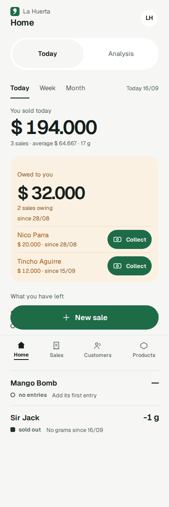

## Jobs

**Cuando** abro la app, o paro entre pedidos o al final del día para ver cómo va hoy, esta semana o este mes, **quiero** ver en una sola pantalla qué vendí, cuánto me costó, cuánto gasté, cuánto gané (Profit), la plata que realmente se movió (Cash), quién me debe y cuánto me queda de cada Product, **para** saber si estoy ganando plata y cuánta tengo de verdad, y saber si tengo que reponer o cobrar una deuda, sin abrir Sales, Customers y Products una por una ni hacer ninguna cuenta.

El Profit y el Cash no existen en ningún otro lugar del producto, y son la razón de ser del Panel. El Panel de la planilla calculaba mal el Profit: bajaba la semana en que se compraba flor. Mostrar la deuda y el stock en la misma pantalla es una comodidad que se suma a eso.

**Cuando** abro la app entre pedidos o al final del día, **quiero** ver qué vendí hoy, quién me debe y qué se está terminando, y actuar enseguida (cobrarle a un deudor, abrir un Product que está bajo, arreglar lo que me dice un aviso), **para** volver al Customer sin pasar por Customers y Products una por una ni hacer cuentas.

Este job afina el job del Panel de arriba y el job de navegación para Today (GH-45); no es un job nuevo. Su protagonista es el vendedor, en el teléfono y con poco tiempo. Week y Month son para la mirada semanal o mensual, y Analysis para todo lo más profundo. Antes, el vendedor entraba a Customers para cobrar y a Products Product por Product.

**Cuando** abro Home en el celular para ver cómo viene el día, **quiero** ver solo lo que vendí, lo que me deben y mi Stock por Product, **para** llevar el negocio de un vistazo sin avisos de configuración en el medio.

Afina el job del Panel: Home muestra el día, no configura el Business. Antes, Home mostraba arriba un elemento de primer uso (el aviso "Go on to the setup" del Onboarding, la lista de pasos de primer uso o "Start with your products") y el aviso posterior a la Spreadsheet import, hasta que la configuración se terminaba. El dueño los sacó (`docs/design/redesign/registro-unificado.md`, "Se sacan los avisos de primer uso"), y la parte 3 de GH-495 borra lo que quedaba de ellos en el código de Home. La configuración sigue en el Onboarding (al aceptar la Invitation o abriendo `/onboarding`), en Settings y en la página del Product. Criterios de éxito propios:

1. Home no muestra ningún aviso de primer uso para un Business en Onboarding, uno anterior al Onboarding, uno importado ni uno sin precio hoy; en todos los casos se ve como el de un Business con la configuración terminada.
2. Un Business nuevo sigue entrando al Onboarding al aceptar su Invitation, y cada acción de configuración sigue alcanzable desde Settings o la página del Product.
3. Nada en la app ni en sus tests nombra ni muestra los avisos sacados.
4. El glosario y los docs describen el producto como es ahora.

**Cuando** saco gramos de mi propio stock sin venderlos (para convidar en una fiesta y que la gente conozca el negocio, o para consumo propio), **quiero** registrarlo desde el teléfono en pocos toques (fecha, Products y gramos, Withdrawal reason), **para** mantener bien el stock y ver en el Profit lo que me costó promocionar el negocio y lo que consumí, sin registrar una venta que nadie hizo ni un Adjustment que se lee como flor perdida. (Acá lo sirven las líneas de costo por Withdrawal reason de Week y Month; el Stock withdrawal se define en stock.md.)

**Cuando** saco stock sin venderlo, **quiero** registrarlo bajo un Withdrawal reason con mis propias palabras, **para que** Home y Analysis muestren cuánto me cuesta cada tipo de Stock withdrawal y cuánto baja mi Profit. (GH-318, parte de Withdrawal reasons: acá lo sirve una línea de costo por Withdrawal reason en Week y Month, en el orden de la lista del Business; la lista se define en stock.md.)

**Cuando** llevo el negocio desde el teléfono entre pedidos o en medio de un chat con un Customer, varias veces por día, **quiero** que la app esté ordenada según lo que hago de verdad y con qué frecuencia, **para** volver al Customer en vez de buscar entre menús. (Es el job de navegación, navigation.md. Acá lo sirve Today, que muestra lo que se puede resolver hoy, con "Collect" en cada deudor.)

**Cuando** necesito registrar una Expense, sacar flor del stock, ver cómo va el negocio o cambiar una configuración desde el celular, **quiero** encontrarlo donde ya vive ese contexto (Analysis en Home, "Take from stock" en la vista de stock de Products, Settings en el encabezado), **para** terminar en pocos toques sin pasar por un menú que lo junta todo. (GH-651, el retiro de More, navigation.md: acá lo sirven el avatar "Settings" del encabezado de Home y el segmento Home | Analysis.)

**Cuando** estoy en la pestaña Home del celular y quiero pasar entre la vista en vivo y la vista de historia de mi negocio, **quiero** que las dos opciones se llamen como las vistas que abren, Home y Analysis, **para** saber dónde estoy y adónde me lleva la otra opción sin un "Today" encima de otro. (#733, navigation.md: afina el job de navegación para el celular. Acá lo sirve la opción "Home" del segmento, elegida en Home encima de las pestañas Today · Week · Month del Panel, que no cambian.)

**Cuando** abro Home en el celular entre pedidos, **quiero** que arriba de la pantalla se vea qué día estoy mirando y poder pasar entre Home y Analysis con un toque, **para poder** ver cómo va el día o el mes. No necesito que la app me diga en qué Business estoy, porque ya lo sé. (Parte 2 de GH-723, navigation.md: afina el job del Panel y el de navegación para el celular. Acá lo sirve el encabezado compartido de Home y Analysis, con la línea de fecha, el avatar y el segmento. Antes, el nombre del Business y la Yerba mark ocupaban arriba de la pantalla y la fecha de las cifras no se veía.)

**Cuando** estoy en Home o en Analysis en el celular y necesito cambiar algo de mi Business, **quiero** abrir Settings directo desde el encabezado, **para poder** cambiarlo y volver a mis números sin buscarlo. (Parte 3 de GH-495, navigation.md: afina el job de Settings y el de navegación para el celular. Acá lo sirve el avatar "Settings" de la fila de fecha de Home, un link con las iniciales del Business, con su caja de 44×44 y el círculo de 36 px del dibujo.)

**Cuando** un Product que cargué por error, o uno con el que ya no trabajo, sigue apareciendo en mis listas y selectores, **quiero** sacarlo desde el teléfono en pocos toques, eliminándolo si nunca se movió y archivándolo si tiene historial, **para que** mis listas muestren solo lo que todavía vendo, ninguna cifra pasada de ventas, stock, costo o Profit cambie, y pueda volver a tenerla exactamente como estaba si empiezo a venderla de nuevo. (Acá lo sirve What you have left, que deja afuera los Archived products mientras todas las cifras del período siguen iguales; se define en varieties.md.)

Criterios de éxito:

1. **Un vistazo, desde el teléfono**: el Panel abre, y cambiar entre Today, Week (de lunes a domingo) y Month responde, en menos de 300 ms con unos cientos de ventas. Cada período muestra su rango de fechas.
2. **Nunca contradice a las pantallas propias**:
   - el total y la cantidad de ventas del período son iguales a los de Sales para el mismo período;
   - el total, la cantidad y la fecha más antigua de Owed to you son iguales a los de la sección "Owed to you" de Customers;
   - los gramos, el estado y los Days left de cada Product son iguales a los de Products;
   - el Profit, el Cost of goods sold, el Stock shortfall, el costo de cada Withdrawal reason, las Expenses y el Cash de Week y Month son iguales a la fila de Analysis para la misma semana y el mismo mes.

   Cualquier cifra que no coincida es un defecto.
3. **Profit y Cash son honestos**:
   - Profit = ventas − Cost of goods sold − Stock shortfall − el costo de cada Withdrawal reason − Expenses (CONTEXT.md: Profit).
   - Cash = Payments recibidos − Expenses − Purchases, cada uno contado en su propia fecha.
   - Aparecen uno al lado del otro con esos nombres, en Week y Month.
   - Una cifra negativa se muestra tal cual, nunca se oculta ni se lleva a cero.
   - El Pending cost se marca, nunca se toma como $0 (ADR-0009). El Profit se calcula entonces sobre la parte con costo.
   - La flor perdida por un Adjustment negativo baja el Profit en la fecha del Adjustment.
   - Los gramos retirados bajan el Profit en la fecha del Stock withdrawal, cada Withdrawal reason en su propia línea, nunca dentro del Cost of goods sold ni del Stock shortfall.
   - Las Stock entries y los Stock withdrawals corregidos se ven la próxima vez que se abre el Panel: un período no tiene fecha de cierre.
   - Archivar o restaurar un Product no mueve ninguna cifra.
4. **Quién debe y qué queda, de un vistazo**: la plata adeudada, cada deudor a un toque de cobrarle, y el stock de cada Product sin archivar con su estado. El estado se dice por forma y palabra, nunca solo por color.
5. **Los Businesses nunca se mezclan** (ADR-0004): cada cifra sale solo del Business de quien consulta, y la ruta del Panel entra en el barrido de aislamiento. Ninguna cifra va a la consola ni al almacenamiento del navegador.
6. **Nada inventado, nada calculado en el navegador**:
   - cada cifra viene del servidor;
   - un período sin actividad muestra ceros reales;
   - el Average sale no muestra nada cuando el período no tiene ventas.
7. **Un Stock withdrawal no es una venta**: registrar uno deja exactamente como estaban las ventas, la cantidad de ventas, el Average sale, los gramos vendidos, You gave away, el Cost of goods sold, el Stock shortfall y el Cash.
8. **Cobrar en un toque desde Today**: "Collect" en cada fila de deudor del bloque "Owed to you" abre Record payment con ese Customer elegido, con nombre accesible "Collect from <name>"; volver o "Close" sale con un solo movimiento.
9. **Today es solo lo que se puede resolver**: lo vendido hoy, después Owed to you, después What you have left; un Product bajo lleva a su página; ninguna cifra de resultado (Profit, Cash, costos, Expenses, You gave away, Purchases) se muestra en Today.
10. **Sin primer uso en Home**: Home no muestra ningún elemento de primer uso (ni el aviso del Onboarding, ni la checklist, ni "Start with your products", ni el aviso posterior a la Spreadsheet import) para ningún Business, cualquiera sea el estado de su configuración. Un Business en configuración ve el Panel normal con sus estados vacíos de siempre, sin texto de configuración.
11. **Cada aviso lleva a su arreglo**: "Your Telegram catalog is out of date" abre la pantalla del Catalog; en el teléfono, el avatar "Settings" del encabezado abre Settings, y en una computadora la fila del Business de la barra lateral.
12. **Como en el diseño**: Home, `InicioOscuro` (Home, tema oscuro) e `InicioCompu` (Home, disposición de computadora) coinciden con `docs/product/design-system/pantallas/`, en teléfono y computadora, en los dos temas.
13. **Nada cambia para un Business existente** (GH-318, parte de Withdrawal reasons): ve los mismos costos, Profit y Cash; la única diferencia visible es que la línea "Promotion" ahora dice "Marketing".
14. **Analysis a un toque** (GH-651): en el teléfono, el segmento Home | Analysis de Home abre Analysis en 1 toque, y Home siempre abre en su vista Home; las pestañas Today · Week · Month del Panel no cambian.
15. **El segmento nombra sus vistas** (#733): en el teléfono, las opciones del segmento dicen "Home" y "Analysis", en pantalla y en su nombre accesible; ninguna dice "Today". La única "Today" de Home es la pestaña del Panel.
16. **El encabezado del día** (parte 2 de GH-723): en el teléfono, Home muestra arriba la fecha de hoy como dd/mm, el avatar "Settings" y el segmento, en el mismo lugar que Analysis, sin el nombre del Business, sin la Yerba mark y con un solo h1, oculto a la vista. Nada más del encabezado se toca, y está en todos los estados de Home. En la computadora, el nombre del Business sigue arriba del h1 visible y la pantalla se ve igual que antes.
17. **Settings a un toque, como el dibujo** (parte 3 de GH-495): en el teléfono, el avatar de Home abre Settings en 1 toque, muestra las iniciales del Business, un lector de pantalla dice "Settings" y se alcanza con el teclado; su caja táctil mide 44×44 y pasa `touch-target`; no aparece a 900 px y más. Los criterios propios están en navigation.md (38–41).

# Resultados

Si un Business gana plata y cuánta tiene de verdad, hoy, esta semana y este mes: el Panel de Home. Es de solo lectura y lo ve solo su Business (ADR-0004). Lee:

- las ventas y sus totales, de sales;
- el Cost of goods sold, el Stock shortfall y el costo de los Stock withdrawals por Withdrawal reason, de los Lots de stock (ADR-0009, ADR-0010);
- las Expenses, de expenses;
- las Purchases, de stock;
- los Payments, los Balances y el Settlement, de payments (ADR-0012);
- el Stock status y los Days left, de stock;
- el estado del Pinned catalog, de pinned-catalog.

No calcula nada que esas capacidades ya calculen, más allá de sumarlo. Sus cifras por período salen del único cálculo que también lee Analysis (ADR-0020): el Profit de acá y el de Analysis son la misma cifra. Home no lee `/first-run` ni `/onboarding-progress` y no muestra ningún elemento de primer uso. Un Archived product (varieties.md) sale de What you have left, mientras que todas las cifras del período la siguen contando.

## Comportamiento

### Períodos

- Today, Week y Month, en hora argentina, con las mismas definiciones que Sales. No hay Dates.
  - Week es la semana de lunes a domingo que contiene hoy.
  - Month es el mes calendario en curso.
- El Panel abre en Today.
- **Rangos**: "Today 03/10", "28/09 – 04/10" y "01/10 – 31/10".
  - Siempre `dd/mm`, sin nombres de mes, aunque una semana cruce a otro mes o año.
  - Un rango cubre el período entero, incluidos los días que faltan. Las cifras cubren solo lo registrado.

### Cifras por período

Cada cifra se cuenta en su propia fecha. Las ventas, el Cost of goods sold, el Stock shortfall, el costo de cada Withdrawal reason, las Expenses, el Profit y el Cash salen del mismo cálculo por período que Analysis (ADR-0020), nunca de una segunda suma. Cuentan todos los Products, los archivados incluidos.

- **Ventas**: la suma de los totales de las ventas del período, envío incluido, pagadas o no. Es la misma cifra que el total de Sales. Su título sigue a la pestaña: "You sold today", "You sold this week" o "You sold this month". Los Stock withdrawals nunca son ventas.
- **Cantidad de ventas**: cuenta ventas, no líneas.
- **Average sale**: ventas ÷ cantidad de ventas, redondeado al peso entero con mitad hacia arriba. No se muestra nada cuando no hay ventas.
- **Gramos vendidos**: los gramos de las líneas del período que no son Gifts.
- **Gramos regalados** ("You gave away"): los gramos de las líneas de Gift del período. Los gramos retirados nunca son gramos regalados.
- **Cost of goods sold** ("Cost of goods sold"): lo que cuestan los gramos de las Sale lines del período (Gifts incluidos), de sus Lots tal como están hoy (ADR-0009, ADR-0010). No incluye el costo de un Adjustment negativo ni el de un Stock withdrawal.
- **Stock shortfall** ("Stock shortfall"): lo que cuestan los gramos sacados por los Adjustments negativos del período, en la fecha del Adjustment, de sus Lots tal como están hoy, primero el más antiguo (CONTEXT.md: Stock shortfall). Se muestra como "Stock shortfall $ X" solo cuando el período tiene algún Adjustment negativo; si no, la línea se deja afuera. Nunca incluye un Stock withdrawal.
- **Costo de cada Withdrawal reason** (una línea con el nombre del Withdrawal reason, por ejemplo "Marketing $ X" u "Own use $ X"): lo que cuestan los gramos de los Stock withdrawals del período con ese Withdrawal reason, en la fecha del Stock withdrawal, de sus Lots tal como están hoy, primero el más antiguo. Se muestra solo cuando el período tiene un Stock withdrawal de ese Withdrawal reason; si no, su línea se deja afuera. Las líneas siguen el orden de la lista de Withdrawal reasons del Business, y el nombre es el actual del Withdrawal reason, también para los períodos pasados.
- **Expenses** ("Expenses"): la suma de las Expenses del período.
- **Purchases** ("Flower purchases"): el costo total de las Stock entries de origen Purchase del período.
- **Profit**: ventas − Cost of goods sold − Stock shortfall − el costo de cada Withdrawal reason − Expenses.
  - Cuando parte de su costo está pendiente, se calcula sobre la parte con costo: las ventas de los gramos pendientes se dejan afuera (ventas − (ventas sin envío − ventas de gramos con costo) − Cost of goods sold con costo − Stock shortfall con costo − el costo con costo de cada Withdrawal reason − Expenses), con las ventas de gramos con costo por línea como las define el Margin de CONTEXT.md (total de la línea × gramos con costo ÷ gramos de la línea, con mitad hacia arriba). La cifra de ventas que se muestra sigue siendo la venta completa.
  - Es la misma cifra que Analysis muestra como Profit para la misma semana o el mismo mes.
  - Lleva el tratamiento de acento del diseño cualquiera sea su signo: el acento marca la cifra principal, no si es buena o mala.
- **Cash**: Payments recibidos − Expenses − Purchases. Los Payments recibidos son todos los Payments con fecha en el período, tanto los On-the-spot payments como los posteriores, cada uno en su propia fecha. El Cash se muestra al lado del Profit. Un Stock withdrawal nunca lo toca.

### Qué muestra cada pestaña

- **Today** muestra lo que se puede resolver hoy, de arriba abajo: lo vendido hoy (ventas, cantidad de ventas, Average sale y gramos vendidos), después el bloque "Owed to you", después What you have left.
- **Week y Month** muestran ventas, cantidad de ventas, Average sale, gramos vendidos, You gave away, Cost of goods sold, Stock shortfall (cuando el período lo tiene), una línea por cada Withdrawal reason con Stock withdrawals en el período, Expenses, Flower purchases, Profit y Cash, y después el bloque "Owed to you" y What you have left. Las líneas de los Withdrawal reasons van justo después de Stock shortfall y antes de Expenses, en el orden de la lista del Business.
- El Profit, el Cash, el Cost of goods sold, el Stock shortfall, las líneas de los Withdrawal reasons, las Expenses, You gave away y las Purchases nunca se muestran en Today.

### Pending cost

- Una nota fija, "includes pending cost", sin gramos ni montos:
  - debajo de Cost of goods sold, cuando alguna de las Sale lines del período tiene gramos pendientes tal como están hoy los Lots;
  - debajo de Stock shortfall, cuando alguno de los Adjustments negativos del período tiene gramos pendientes;
  - debajo de la línea de cada Withdrawal reason, cuando alguno de los Stock withdrawals del período con ese Withdrawal reason tiene gramos pendientes;
  - debajo de Profit, cuando corresponde cualquiera de las anteriores.
- **Una línea de Withdrawal reason toda pendiente**: cuando todos los gramos detrás de la línea de un Withdrawal reason están pendientes, la línea muestra sus gramos sin costo (por ejemplo "1 g without cost") en lugar de una cifra, nunca "$ 0", y lleva la nota. La línea nunca se oculta porque su costo esté pendiente.
- El Cash nunca la lleva: el Pending cost no es plata que se movió.
- Sin nada pendiente, ninguna cifra muestra la nota.

### Cifras negativas

- El Profit y el Cash pueden quedar por debajo de cero.
- Una cifra negativa se lee con un signo menos antes del formato de dinero de la app: "−$ 4.500".
- Se muestra con el tratamiento neutro, nunca en rojo ni ámbar, y nunca se oculta ni se lleva a cero. El signo dice el estado.
- "Credit" queda reservado para el Credit de un Customer.

### Bloque Owed to you

- **Cifras**: el Total owed, la cantidad de Sales still owing ("1 sale owing" o "N sales owing") y la fecha de Owing since más antigua, como las define payments.md.
- **Avance**: hasta 3 Customers con el Balance más alto por encima de $0. Los empates se ordenan por Owing since (el más antiguo primero) y después por nombre. El diseño puede ajustar el número.
  - Cada fila muestra el Balance en ámbar y "since dd/mm", y lleva "Collect" (nombre accesible "Collect from <name>"), que abre Record payment con ese Customer ya elegido (payments.md), como un paso más en el historial de la app.
  - Tocar el resto de la fila abre la ficha de ese Customer.
- Tocar el título del bloque abre Customers, en su sección Owed to you.
- Los Customers con Credit nunca aparecen y no cuentan en ninguna cifra.
- **Nadie debe**: el bloque se queda y dice un fijo "Nobody owes you", sin nada para tocar.
- **Después de "Collect"**: Record payment sigue payments.md sin cambios (se permite un Payment parcial, un Payment mayor que el Balance se rechaza en línea conservando todo lo tipeado, "All" completa el Balance entero). Guardar o "Close" vuelve a Home en un solo movimiento. El toast es el de payments.md, "Payment saved · still owing $ X", o "Payment saved" cuando no queda nada adeudado; nunca nombra al Customer. El bloque se actualiza desde la API:
  - el total, la cantidad y la fecha más antigua se actualizan;
  - un deudor que todavía debe se queda, con el Balance nuevo;
  - un deudor que pagó todo sale, y el avance se vuelve a completar hasta 3 según su propio orden;
  - si ya no debe nadie, dice "Nobody owes you".

  Home no agrega ninguna animación ni regla propia.

### What you have left

- Cada Product sin archivar, ordenado por nombre, incluidos los Products sin movimientos. Los Archived products se dejan afuera (varieties.md).
- Cada uno muestra lo mismo que Products:
  - gramos;
  - su marca de estado, dicha por forma y palabra;
  - Days left;
  - su línea de detalle: "No grams since 30/09", "You are warned below 20 g" o "Add its first entry".
- Un Product bajo lleva a su página (varieties.md).
- Un Product sin umbral no muestra línea de aviso.
- Los Products bajos no se ponen primero; el orden es por nombre.
- No hay gramos totales.

### En pantalla (Home; `InicioOscuro`, Home en el tema oscuro; `InicioCompu`, Home en la disposición de computadora)

- Home es el Panel y una Tab root (navigation.md), y sigue siendo la pantalla de llegada después del login y después de aceptar una Invitation para sumarse. Aceptar una Invitation de Business nuevo lleva, en cambio, al Onboarding (onboarding.md).
- **Encabezado del teléfono** (GH-651; compartido con Analysis desde la parte 2 de GH-723, navigation.md): lo dibuja el layout de ruta `HomeLayout`, arriba del Panel y fuera de su área de contenido. Es un `div`, no es fijo y se va con el scroll. En este orden:
  1. Una fila con la línea de fecha, un lugar vacío y el avatar "Settings".
     - La línea de fecha es el hoy del Business como dd/mm (por ejemplo `03/10`), tomado del `me.today` de la Session. Es una cifra, no palabras, y no lleva Tabular figures. Nunca se parte en dos líneas: se corta con puntos suspensivos antes de que el avatar se achique, y nada se desplaza de costado a 320 px.
     - El lugar vacío ocupa el lugar que el dibujo le da a "Editar". No tiene link, botón, rol, texto ni elemento enfocable.
     - El avatar "Settings" es un link con las iniciales del Business (calculadas solo por `initialsOf`), con nombre accesible "Settings" (nunca el nombre del Business), que se alcanza con el teclado y abre Settings en 1 toque. Su caja táctil es de 44×44 con márgenes negativos, y el círculo verde dibujado de 36 px, con el color de los tokens, es un hijo dentro de ella (parte 3 de GH-495). Mientras el nombre del Business todavía no se conoce, sigue visible y tocable y el círculo no muestra letras. Reemplaza al avatar del Business que tenía Home, así que la pantalla tiene una sola entrada a Settings.
  2. El segmento Home | Analysis.
  3. El único h1 de la pantalla, "Home", oculto a la vista: solo lo leen los lectores de pantalla.

  El teléfono no muestra el nombre del Business, la Yerba mark ni un título visible (decisión del dueño). Fuera de las dos opciones del segmento y el avatar, nada del encabezado se toca. No espera las cifras: está en todos los estados de Home (cargando, vacío, error, con datos), y el `aria-busy` sigue en el área de contenido.
- **El segmento Home | Analysis** (solo en el teléfono, GH-651; nombre de la opción desde #733): dentro del encabezado, debajo de la fila de la fecha y encima del Panel, un control de navegación, un grupo con nombre accesible "Home view" de dos links de al menos 44 px, "Home" y "Analysis", con "Home" elegido (`aria-current="page"` y peso, nunca solo color). "Analysis" abre `/analysis` (analysis.md), que muestra el mismo encabezado con "Analysis" elegido. Está en todos los estados de Home (cargando, vacío, error, con datos) y nunca se desactiva. Home siempre abre en su vista Home y no recuerda nada. Es otro nivel que las pestañas Today · Week · Month del Panel, que no cambian: ninguna opción del segmento dice "Today".
- **En una computadora** no hay línea de fecha, avatar ni segmento: arriba van el nombre del Business y, debajo, el h1 visible "Home", como antes. Settings se abre desde la fila del Business de la barra lateral, y Analysis desde la barra lateral (navigation.md).
- **De arriba abajo, encima de las cifras**:
  1. "Your Telegram catalog is out of date", mientras el Pinned catalog está Out of date (pinned-catalog.md). Abre la pantalla del Catalog (catalog.md);
  2. las cifras de la pestaña, como se listan arriba.
- **Ningún elemento de primer uso**: ni "Go on to the setup", ni la lista de pasos de primer uso, ni "Start with your products", ni "Connect the bot so the pinned catalog updates by itself". Nada los reemplaza: ningún aviso, insignia ni recordatorio de configuración, en Home ni en otro lado. Un Business en configuración (a mitad del Onboarding, anterior al Onboarding sin sus dos pasos, importado o sin precio hoy) ve el Panel con sus estados vacíos de siempre ("Nobody owes you", ceros reales, "Add its first entry"), sin texto de configuración. Desde la parte 3 de GH-495 tampoco queda código de ellos en Home: ni la checklist, ni el aviso posterior a la Spreadsheet import, ni "Go on to the setup", ni la lectura de primer uso propia de Home, ni sus ramas en `inicioNotices.ts`.
- **Cargando**: Home espera solo la lectura del estado del Pinned catalog junto con sus cifras, así que un aviso que llega tarde nunca empuja las cifras hacia abajo, y no se reserva lugar para ningún otro aviso.
- Week y Month conservan el mismo aviso encima de sus propias cifras.
- En una computadora usa la disposición de dos columnas de `InicioCompu` (Home, disposición de computadora), con el mismo aviso arriba.
- Sigue los temas claro y oscuro, y coincide con `docs/product/design-system/pantallas/` en los dos. Las líneas de los Withdrawal reasons usan la fila de resultado existente (la etiqueta a la izquierda y la cifra a la derecha); no tienen dibujo propio.
- No es un menú de acciones:
  - no registra nada por sí mismo y no tiene toasts propios;
  - su única acción principal es el "+ New sale" del marco; "Collect" en las filas de deudor es la única otra acción directa, además del aviso, que solo abre donde está su arreglo. El avatar "Settings" y el segmento solo llevan a otras pantallas.
- Las cifras se leen al abrir el Panel, sin actualizaciones en vivo.
- Una red caída muestra "No connection"; un error del servidor muestra el reintento genérico (accounts.md).

### Restricciones

- El Business sale de la Session.
- La ruta del Panel entra en el barrido de aislamiento y en la prueba de rutas protegidas.
- Cada cifra se calcula en el servidor, y también si se muestra el aviso de desactualizado, qué líneas de Withdrawal reason se muestran y en qué orden, y si una línea de Withdrawal reason está toda pendiente. El navegador nunca ordena ni suma nada.
- Home no lee `/first-run` ni `/onboarding-progress`. Esas rutas siguen en el backend: `/onboarding-progress` lo lee el Onboarding, y `/first-run` el marco y Products para las reglas laterales de navigation.md.
- Ninguna cifra ni nombre va a los logs, la consola ni el almacenamiento del navegador.
- Las palabras del avatar y del segmento ("Settings", "Home", "Analysis", "Home view") salen del Copy module; la opción "Home" es `common:homeSegmentHome`. La línea de fecha usa el formateador de fechas que ya existe y no suma nada al Copy module. Las iniciales del avatar salen solo de `initialsOf`, y el avatar no agrega ninguna ruta de API.

## Métricas

- **Velocidad (criterio 1)**: el Panel, y cada cambio de período, responden en menos de 300 ms con unos cientos de ventas y unas decenas de Products y Customers. Se cuida con el plan de consulta y la cantidad de sentencias, nunca con el tiempo transcurrido (ADR-0038): la misma cantidad de sentencias en un Business sembrado chico que en un año sembrado, sin importar cuántos Withdrawal reasons tenga.
- **Acuerdo (criterio 2)**: 0 diferencias, por período:
  - el total y la cantidad de ventas contra Sales;
  - las cifras de Owed to you contra la sección "Owed to you" de Customers;
  - los gramos, el estado, los Days left y el detalle de cada Product contra Products;
  - el Profit, el Cost of goods sold, el Stock shortfall, el costo de cada Withdrawal reason, las Expenses y el Cash de Week y Month contra la fila de `GET /analysis` para la misma semana y el mismo mes, sobre una historia sembrada que incluye un Adjustment negativo con gramos con costo, uno con gramos pendientes, una Sale line con gramos pendientes, tres o más Withdrawal reasons (uno renombrado y uno reordenado), un Stock withdrawal con costo de cada Withdrawal reason y un Stock withdrawal con gramos pendientes.
- **Fórmulas (criterio 3)**: una matriz, 100% de aprobación, que cubre:
  - el Profit y el Cash;
  - los Payments contados en su propia fecha, no en la de la venta;
  - una Purchase con fecha atrasada o una Stock entry editada que mueven el Cost of goods sold y el Profit;
  - un Adjustment negativo que baja el Profit en su costo con costo en su propia fecha, muestra "Stock shortfall $ X" y deja sin cambios el Cost of goods sold y el Cash;
  - un Stock withdrawal de cada Withdrawal reason que baja el Profit en su propia fecha, muestra su propia línea con el nombre del Withdrawal reason y deja sin cambios el Cost of goods sold, el Stock shortfall y el Cash;
  - un período sin Adjustment negativo que no muestra línea de Stock shortfall, y uno sin Stock withdrawal de un Withdrawal reason que no muestra línea para ese Withdrawal reason;
  - las líneas de los Withdrawal reasons en el orden de la lista del Business, también después de reordenarla, y con el nombre actual después de renombrar uno;
  - gramos pendientes en una Sale line que dejan sus ventas afuera del Profit mientras "You sold today" conserva la venta completa;
  - el Pending cost que muestra la nota debajo de Cost of goods sold, de Stock shortfall, de la línea de cada Withdrawal reason y del Profit como está definido, y nunca debajo del Cash;
  - una línea de Withdrawal reason toda pendiente que muestra sus gramos sin costo, nunca "$ 0";
  - Profit y Cash negativos que se muestran como "−$ X".
- **Nada cambia para un Business existente (criterio 13)**: sobre una historia sembrada, antes y después de la migración de los Withdrawal reasons, cada cifra de Week y Month es idéntica, y la única etiqueta que difiere es "Promotion" → "Marketing".
- **Archivar no mueve nada (criterio 3)**: cada cifra del período es idéntica antes de archivar un Product con historial, después de archivarlo y después de restaurarlo; el Archived product no aparece en What you have left.
- **No es una venta (criterio 7)**: después de registrar un Stock withdrawal, 0 diferencias en ventas, cantidad de ventas, Average sale, gramos vendidos, You gave away, Cost of goods sold, Stock shortfall y Cash.
- **Pestañas (criterio 9)**: las pruebas del front, en teléfono y computadora, muestran Today solo con lo vendido hoy, Owed to you y What you have left, en ese orden, y el Profit, el Cash, el Cost of goods sold, el Stock shortfall, las líneas de los Withdrawal reasons, las Expenses, You gave away y las Purchases solo en Week y Month, con las líneas de los Withdrawal reasons justo después de Stock shortfall.
- **Cobrar en un toque (criterio 8)**: la corrida de punta a punta del front, en ventanas de teléfono y de computadora, toca "Collect from <name>" en Today, Record payment abre con ese Customer elegido, se guarda un Payment y un solo movimiento de vuelta regresa a Home.
- **Actualización después de Collect**: las pruebas del front muestran un Payment parcial que deja al deudor con el Balance nuevo, un Payment total que saca la fila y el avance que se completa hasta 3 según su orden, "Nobody owes you" cuando no queda nadie que deba, y los dos toasts como están especificados, sin nombre de Customer.
- **Sin primer uso en Home (criterio 10 y job de Home)**: las pruebas del front, en teléfono y computadora y en los dos temas, muestran Home sin "Go on to the setup", sin checklist, sin "Start with your products" y sin "Connect the bot…" para un Business a mitad del Onboarding, uno anterior al Onboarding sin sus dos pasos, uno importado y uno sin precio hoy, cubriendo las clases de cuenta `pre_onboarding`, `imported` y `onboarding`; Home no pide `/first-run` ni `/onboarding-progress`. Nada bajo `web/src`, `web/e2e` ni `tests` nombra `OnboardingNotice`, `FirstRunChecklist` ni `ImportNotice`, y `inicioNotices` no tiene ninguna rama de primer uso: si el archivo sigue, solo le queda la del aviso de Out of date. 0 excepciones.
- **El aviso de Home (criterio 11)**: las pruebas del front, en teléfono y computadora, muestran el aviso de desactualizado arriba de las cifras mientras rige, que abre la pantalla del Catalog. En ancho de teléfono hay exactamente un link llamado "Settings", el avatar, que muestra las iniciales que da `initialsOf` para el nombre del Business de la Session, y tocarlo lleva a `/settings`; con la Session todavía sin nombre del Business, el link sigue ahí, sin letras. En ancho de computadora el avatar no está y Settings se abre desde la fila del Business de la barra lateral.
- **Analysis a un toque (criterio 14)**: pruebas de Testing Library a través del router real, en ancho de teléfono: tocar "Analysis" en el segmento de Home lleva a `/analysis`, "Home" lleva elegido `aria-current="page"` en Home, y en ancho de computadora el segmento no está. 100% de aprobación.
- **El segmento nombra sus vistas (criterio 15, #733)**: en ancho de teléfono, el grupo "Home view" de Home tiene exactamente dos links, de nombre accesible "Home" y "Analysis", y ninguno "Today"; las pestañas del Panel siguen siendo exactamente Today · Week · Month. El proyecto e2e `mobile` pasa en `InicioHoy` e `InicioOscuro` sin ningún infractor agregado. 100% de aprobación.
- **El encabezado del día (criterio 16, parte 2 de GH-723)**: pruebas de Testing Library a través del router real (`HomeLayout.test.tsx`):
  - en `/` hay exactamente un h1, con `visualmente-oculto` en el teléfono y visible en la computadora, también cargando y con error;
  - con hoy 2026-10-03, la línea de fecha dice `03/10`;
  - la fila del encabezado no tiene otro elemento interactivo que las dos opciones del segmento y el avatar;
  - con la API retenida, el encabezado, el segmento y el avatar están y funcionan, y el `aria-busy` está en el área de contenido;
  - en el teléfono no hay nombre del Business ni imagen "apostrophe"; en la computadora el nombre va arriba del h1.

  El proyecto e2e `mobile` pasa en `InicioHoy` e `InicioOscuro` a 320, 360 y 390 px y al 130 %, con la línea de fecha en una sola línea y sin ningún infractor agregado, y la captura de `InicioHoyCompu` no cambia. 100% de aprobación.
- **Settings a un toque, como el dibujo (criterio 17, parte 3 de GH-495)**: las métricas de los criterios 38–41 de navigation.md: el link "Settings" con sus iniciales y su estado sin letras, 0 infractores `touch-target` en `InicioHoy` e `InicioOscuro` a 320, 360 y 390 px y al 130 %, y el avatar juzgado a ojo, lado a lado, contra `Inicio`, `InicioOscuro`, `Analisis` y `AnalisisOscuro` (decisión 1 del humano), con las capturas de antes y después que prueban que nada fuera del avatar cambia; ninguna tolerancia agrandada ni infractor listado. La métrica de primer uso se mide por rama: ni `pre_onboarding`, `imported` ni `onboarding` muestran un aviso de primer uso en Home, y Home no pide `/first-run` ni `/onboarding-progress`.
- **Bordes de período**: una semana que cruza un mes y un año, el lunes como primer día y un cambio de día en hora argentina. 100% de aprobación.
- **Avance de deudores (criterio 4)**: ordenado por Balance, después por Owing since y después por nombre; los Credits excluidos; "Nobody owes you" cuando nadie debe; "Collect" con su nombre accesible en cada fila. Ningún estado se dice solo por color, en los dos temas.
- **Aislamiento (criterio 5)**: desde otro Business, la ruta del Panel no muestra ninguna cifra ni nombre de Withdrawal reason del primer Business. Después de una corrida completa del front, la consola y el almacenamiento del navegador no tienen cifras ni nombres.
- **Nada inventado (criterio 6)**:
  - un Business vacío muestra $ 0 y 0 g, sin Average sale y sin ninguna línea de Stock shortfall ni de Withdrawal reason;
  - cada cifra en pantalla es igual a la respuesta de la API.
- **Como en el diseño (criterio 12)**: `scripts/design/compare.sh` corre antes y después para Home, `InicioOscuro` e `InicioCompu`, en teléfono y computadora, con las capturas adjuntas al PR y cada diferencia con el diseño listada. El registro de pantallas no captura Week ni Month: las líneas de los Withdrawal reasons y su nota se cubren con las pruebas del front y la corrida de teléfono. Las filas `InicioPrimeraVez*`, `InicioOnboardingEnCurso*` e `InicioOnboardingCompleto*` ya no existen, así que el aviso de desactualizado y el Panel vacío de un Business en configuración no tienen captura y se juzgan contra el texto y la regla de icon-and-text-rule.md. La etiqueta "Home" del segmento contra "Hoy" en el dibujo no es una diferencia que listar: es una decisión del dueño (#733). Tampoco lo son la línea de fecha dd/mm contra el día de la semana del dibujo ni el lugar vacío donde el dibujo tiene "Editar" (parte 2 de GH-723).
- **Sin curl**: la corrida de punta a punta del front abre Home, pasa por los tres períodos, lee las líneas de los Withdrawal reasons después de registrar un Stock withdrawal de cada uno (un Withdrawal reason agregado por el dueño incluido), abre Customers desde el título del bloque, un Customer desde el avance y Record payment desde el "Collect" de una fila del avance.

## Fuera de alcance

- Dates o cualquier rango a medida; comparar con períodos anteriores; gráficos.
- Registrar cualquier cosa desde el Panel salvo con "+ New sale" y "Collect".
- Actualizaciones en vivo entre socios.
- Margin por Product (#8), Stock shortfall por Product, y el costo de cada Withdrawal reason por Product.
- Gramos pendientes contados en el Panel ("and N g without cost") para una cifra con parte pendiente: la nota del Panel es fija y no lleva gramos; Analysis muestra las cuentas.
- Los gramos totales del stock en el Panel.
- Cualquier aviso, insignia, recordatorio o elemento de primer uso en Home, o un reemplazo de los avisos sacados en otra pantalla; un mensaje a los Users existentes de que se fueron.
- Un link al Onboarding desde Home.
- Quitar `/first-run` o `/onboarding-progress` del backend, o cambiar las reglas laterales de "+ New sale" y "Send catalog" (navigation.md).
- Archived products en el Panel.
- Poner primero los Products bajos en What you have left.
- Rediseñar Record payment según `Cobro.dc.html`: es trabajo propio de la pantalla de payments.
- Mostrar una línea en $0 para un Withdrawal reason sin Stock withdrawals en el período.
- Recordar la última vista de Home (Home o Analysis), cambiar las pestañas Today · Week · Month del Panel, y el segundo link dibujado a Analysis ("Ver análisis del mes →"); el Home rediseñado completo lo construye su propio issue de rediseño.
- Un avatar en el encabezado o el segmento Home | Analysis en una computadora.
- Una nota de versión o un anuncio del cambio de nombre de la opción "Today" a "Home" (#733).
- Una función detrás del lugar vacío del encabezado ("Editar" en el dibujo), el día de la semana en la línea de fecha, y un temporizador o una regla nueva para la medianoche (parte 2 de GH-723).
- Letras, un marcador o "?" en el avatar mientras carga el nombre del Business; una ruta de API nueva para las iniciales (parte 3 de GH-495).

## Planificado en GH-318

Todavía no está construido. Hasta que salga la parte indicada, las secciones de arriba son lo que hace la app.

Cada pasaje nombra el ADR que lo decide, la parte que lo va a entregar y la oración actual que va a reemplazar. La parte que entrega un pasaje lo saca de acá y edita Comportamiento y Fuera de alcance en el mismo diff.

### Unidades: cantidades por unidad

Decidido en docs/adr/0056-a-stored-quantity-is-a-whole-number-of-hundredths-whatever-the-unit-and-decimals-only-validate-and-display.md; lo entrega la parte de unidades.

- Una cifra que suma cantidades de varios Products va a mostrar un monto por unidad, cada uno con su etiqueta (un `QuantityByUnit`, que crea la parte de unidades), porque nunca se van a sumar cantidades de unidades distintas. Esto abarca la cantidad vendida, la cantidad regalada ("You gave away") y los totales de Stock withdrawals.
- Va a reemplazar: "**Gramos vendidos**: los gramos de las líneas del período que no son Gifts." y "**Gramos regalados** ("You gave away"): los gramos de las líneas de Gift del período. Los gramos retirados nunca son gramos regalados."
- La etiqueta "Flower purchases" y las cantidades de "What you have left" van a seguir la unidad de cada Product.

### Plata

Decidido en docs/adr/0058-money-crosses-the-wire-in-currency-units-as-decimal-and-is-stored-per-business-at-scale-0-or-2-behind-one-adapter-helper.md; lo entrega la parte de plata.

- Las ventas, los costos, el Profit y el Cash van a conservar sus definiciones y se van a calcular a partir de montos guardados en la escala del Business; el redondeo con mitad hacia arriba va a pasar por `round_half_up`, que la parte de plata crea en `app/shared/money.py`. Subir los decimales de plata de un Business va a dejar cada cifra con el mismo valor.
- Va a reemplazar: "**Average sale**: ventas ÷ cantidad de ventas, redondeado al peso entero con mitad hacia arriba. No se muestra nada cuando no hay ventas."

### El día del negocio

Decidido en docs/adr/0057-the-business-time-zone-replaces-argentina-days-today-is-worked-out-per-business-and-upkeep-is-due-when-its-last-check-was-not-on-the-business-s-own-today.md; lo entrega la parte de zona horaria.

- Today, Week y Month van a seguir la zona horaria propia del Business.
- Va a reemplazar: "Today, Week y Month, en hora argentina, con las mismas definiciones que Sales. No hay Dates."
