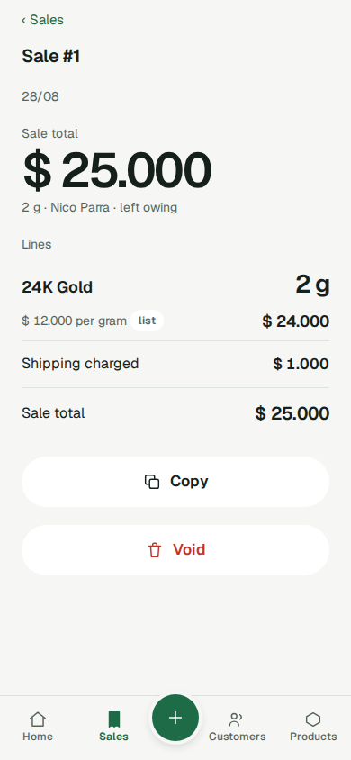

# Detalle de una Sale

## Jobs

- Cuando abro una Sale que registré, quiero ver de un vistazo quién la compró, cuándo, si está paga y qué se debe todavía, y exactamente qué Products, cantidades, precios y total tuvo, para poder contestarle al Customer, compartirle la Sale o asignarle el Customer que le faltaba, sin abrir nada más.
- Cuando acabo de registrar una Sale, o un Customer me pregunta por una, quiero ver de un vistazo para quién fue, qué se llevó, cuánto dio y si está paga, y mandarle el Sale bill en un toque, para cerrar la conversación sin volver a tipear montos ni sacar de memoria lo que todavía debe. (GH-1116: es el paso de confirmación y entrega del trabajo del Brief "When I hand over an order…". El Payment state y el Balance del Sale bill lo atan al trabajo de la deuda, pero esta pantalla se juzga por la entrega.)

## Qué muestra

(La imagen se vuelve a tomar después del merge de GH-1201; hasta entonces puede mostrar el detalle anterior, y gana el texto.)

`/sales/:id` (`web/src/screens/ventas/VentaDetalle.tsx`) es una sola disposición para teléfono y computadora, armada con `SaleCustomerCard` y `SaleDetailCard`, según los dibujos `VentaDetalle.dc.html` y `VentaDetalleOscuro.dc.html`. De arriba hacia abajo:

1. **La fila del título**: un grupo (`role=group`) rotulado por el h1 "Sale #N" (el **Sale number**). Lleva un botón redondo solo de ícono cuyo nombre accesible es "Share" (`sales:detail.share`; regla del dueño D-8ecb8c1d). Se muestra solo mientras el teléfono puede compartir y hay un Sale bill; se deshabilita con `aria-busy` mientras se arma el Sale bill. Es el único Share de la pantalla. La pantalla no tiene un Volver propio: la vuelta es la flecha del marco (ADR-0049).
2. **El aviso de Undo**, sin cambios.
3. **`SaleCustomerCard`**: avatar con iniciales (o ícono de persona sin Customer, ambos decorativos), el nombre como texto plano o "No customer", la fecha tal como la da `formatWeekdayDay(date, language)` (sin hora ni canal), el chip de pago `SalePaymentChip` y, solo en una **Sale without a customer**, "Assign customer". Assign customer se deshabilita mientras el Sale bill se está actualizando (una asignación en curso, o esperando que llegue el Customer asignado), para que el Sale bill que se comparte nunca quede viejo.
4. **`SaleDetailCard`**: la sección "Detail", una fila por Sale line con "N ×" y la cantidad, el nombre del Product, "· precio" en el Money format del Business, la insignia de la Pricing rule (toda regla salvo list) y el total de la línea; "Shipping charged" solo cuando es mayor que 0; "Total" en cifra grande; la Note solo cuando no está en blanco. Muestra el precio y el total registrados, nunca recalculados.
5. Los avisos y errores.
6. **El bloque del Sale bill** (`SaleBillButton`): un grupo con nombre propio "Sharing the bill" (`sales:bill.actionsName`), nunca "Sale bill". Ofrece siempre **Copy**, nunca Share. Es el único que muestra el aviso de falla y la región para copiar a mano, que conserva el nombre "Sale bill". Sin Sale bill no dibuja nada.
7. **La fila de Void**, sin cambios.

Un elemento que el dibujo muestra se queda cuando su dato existe y se oculta cuando no existe (regla del dueño). Por eso el precio no lleva unidad: un Business todavía no tiene una Unit (planificada en GH-318, ADR-0056), y una unidad fija rompería **Assume nothing**. La cantidad y la línea de resumen siguen la misma regla frente al dibujo.

El detalle no ofrece cobrar. Record payment se abre con "Collect" desde una fila de deudor de Customers o de Home, o desde la ficha del Customer, nunca desde una Sale.

### Compartir

- En un teléfono que puede compartir, el Share de la fila del título manda el Sale bill en un toque, sin scroll, desde 320 px de ancho.
- Cuando el Share no se ofrece ahí (no hay Sale bill, el dispositivo no comparte, o un intento falló), el camino es Copy en el bloque del Sale bill. Después de un Share fallido, el Share del título se oculta y el bloque muestra Copy, el aviso de falla y la región para copiar a mano.
- La pantalla llama a `useSaleBillShare` una sola vez, arriba de todo, antes de los estados de error y de carga.

### Cargando y sin la Sale

- **Cargando**: tiene la misma forma que la pantalla cargada, con `aria-busy` y el nombre "Loading sale" (`sales:detail.loading`): la fila del título con el h1 vacío y el Share redondo deshabilitado, las barras de la tarjeta del Customer, el título "Detail" con tres barras de fila y una de Total, y el bloque. Ningún dígito ni símbolo de moneda, y a no más de `CONTENT_SHIFT_PX` de la pantalla cargada.
- **Sin la Sale** (borrada o inexistente): igual que antes.

### Diferencias con el dibujo aceptadas por el dueño

Las cinco que el dueño aceptó (traídas de #1116, publicadas el 2026-11-27):

1. No hay chip de Delivered, porque no existe un estado de entrega.
2. No hay filas de promoción hasta que GH-318 agregue las Applied promotions.
3. No hay Edit sale (#561), ni tarjetas por canal, ni recibo como imagen (#1056); se conserva el Share/Copy en texto plano.
4. Una sola disposición de teléfono también en la computadora, por ahora.
5. Solo la flecha de vuelta del marco, y la línea de fecha sin hora ni canal.

Aparte, el dueño aceptó que Assign customer se deshabilite mientras el Sale bill se actualiza, un estado que el dibujo no muestra. Share aparece una sola vez, en la fila del título: el dueño rechazó un segundo Share en el bloque.

### e2e

`web/e2e/sales.spec.ts` lee cada línea con `getByRole('region',{name:'Detail'}).getByRole('listitem').filter({hasText:'<Product>'})`. Ninguna e2e usa las clases `.venta-detalle__*` borradas, y ninguna vuelve, ni visible ni oculta (D-69509906). `SaleCustomerCard` y `SaleDetailCard` ya no figuran en `web/scripts/docs/front-exclude.json` (D-62e6dc23).

## Métricas

- **Un toque**: desde que se abre una Sale en el teléfono, el Sale bill sale hacia el Customer con un toque en el Share de la fila del título, sin scroll, desde 320 px de ancho.
- **Orden de lectura**: la pantalla se lee Sale #N, Customer, chip de pago, líneas, Total, en ese orden.
- **Nunca trabado**: después de un Share fallido siempre quedan Copy y la región para copiar a mano; la carga nunca muestra un dígito ni un símbolo de moneda.
- Desde el teléfono, el detalle de una Sale se lee completo (Customer, fecha, Payment state, líneas, envío y total) sin scroll horizontal, con nombres de Product de 60 caracteres y montos de nueve dígitos. Solo el nombre se acorta y ninguna cifra se corta.
- El Payment state que muestra el detalle coincide siempre con el del Settlement y con el chip de la tarjeta en la lista de Sales. Cuando no se puede calcular dice "Payment can't be shown" y nunca adivina.
- Toda Sale without a customer muestra "No customer" y la acción "Assign customer". Ninguna Sale con Customer muestra un link en el nombre ni la acción de asignar.
- Ningún precio del detalle muestra una unidad, "per gram" ni un símbolo de moneda que no sea el del Money format del Business.
- Share aparece una sola vez en la pantalla.
