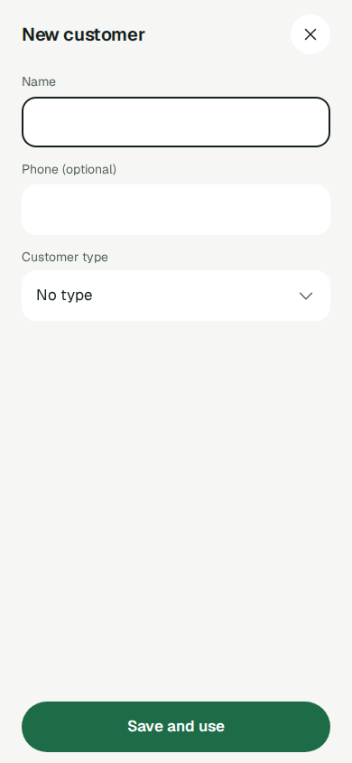
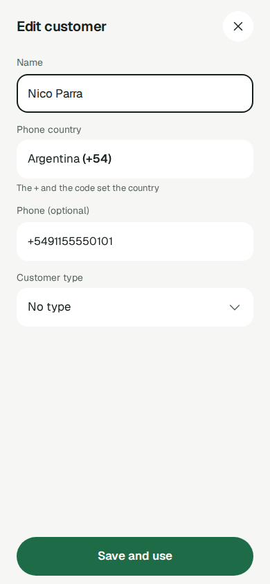

## Jobs

- Cuando estoy cargando un registro en el teléfono y un campo necesita una opción de mi propia lista, que sigue creciendo, quiero encontrar la opción y elegirla en dos toques sin perder lo que ya cargué, para terminar el registro en menos de un minuto y nunca elegir algo equivocado.
- Cuando agrego una línea a una venta en el teléfono, quiero encontrar y elegir el producto correcto de una lista en la que puedo buscar, sin perder la venta que estoy cargando, para registrar el pedido en pocos toques y que la línea siga cotizada con el Current price de ese día, nunca de memoria. (La historia de New sale; definida en sales.md).
- Cuando un cliente me paga, con una venta o a cuenta de una deuda, quiero decir cómo me pagó con el mismo control que uso para cualquier elección que puede crecer, para registrar el medio a propósito y nunca por un valor que quedó de antes; y cuando los Payment methods pasen a ser mi propia lista, registrar un pago se tiene que sentir igual. (Parte 5 de GH-581; definida en sales.md y payments.md).
- Cuando registro una Expense o guardo un Customer desde el teléfono, quiero elegir su Expense category o su Customer type igual que elijo un Product o un Withdrawal reason (un campo con etiqueta que abre su propia lista, con búsqueda cuando la lista es larga), para terminar el formulario en pocos toques y que volver nunca tire lo que ya tipeé. (Parte 6 de GH-581; definida en expenses.md y customers.md).
- Cuando registro o edito un Customer desde el celular con su número adelante, quiero que el número se lea con el país correcto para ese número, por defecto el del lugar donde estoy, para poder guardarlo en pocos toques sin ir a Settings y confiar en que la misma persona nunca se convierte en dos Customers. (Parte 2 de GH-682; definida en customers.md: acá la sirven el campo "Phone country" y el estado bloqueado, que muestra el país que decide el `+` sin dejar elegir otro.)

La computadora también es una situación: el mismo campo se usa con teclado, conserva la capacidad y no recibe pulido dedicado (Phone first).

# Selector

## Qué es

El Selector es el único control para elegir una opción de un Growable set: un conjunto que puede tener una opción con la que la app no vino, hoy o por una decisión ya tomada (Products, Expense categories, Withdrawal reasons, Customer types, Payment methods, los Phone countries; y con GH-318, units, time zone y Money format). Lo opuesto es un Fixed set, declarado en `web/src/components/fixedSets.ts` con un motivo, que puede mostrarse como chips. El componente vive en `web/src/components/Selector.tsx`, y su búsqueda en `web/src/components/selectorSearch.ts`.

Las partes de GH-581 pasan las pantallas al Selector. Desde la parte 3 lo usan el formulario de Stock entry (`EntradaStock`, para el Product) y el de Take from stock (para el Withdrawal reason y el Product de cada línea), como describe stock.md. Desde la parte 4 lo usa cada línea de New sale (`NuevaVentaLinea`, para el Product), como describe sales.md. Desde la parte 5 lo usan el medio de pago de New sale bajo Paid (`SelectorPago`) y el de Record payment (`Cobro`), con la etiqueta "Payment method" y las opciones incorporadas Cash y Transfer, como describen sales.md y payments.md. Desde la parte 6 lo usan el formulario de la Expense (`ExpenseForm`, para la Expense category, obligatorio), como describe expenses.md, y el formulario del Customer (`CustomerTypeField` dentro de `ClienteForm`, para el Customer type, opcional), como describe customers.md. Con la parte 6 no queda ningún select nativo para un Growable set. Desde la parte 2 de GH-682 lo usan también los campos del Customer (`CustomerFields`: New customer, Edit customer y el creador de "Pick a customer" de New sale) para el "Phone country", obligatorio, con búsqueda y alimentado por `GET /phone-countries`, como describe customers.md; es el primer uso del estado bloqueado.

## El campo

- Tiene una etiqueta visible (`label`) y muestra la opción elegida.
- Cada opción (`options`: `value`, `label`, `glyph` opcional) puede llevar un glifo antes del nombre, decorativo (`aria-hidden`) y que nunca se busca.
- Campo obligatorio (`required`): no tiene fila para borrar la elección. Puede llevar un `placeholder` opcional: el texto que muestra el área del valor mientras no hay elección y no está cargando. Nunca es una fila de la lista, nunca se puede elegir y nunca se busca. Un campo opcional no acepta `placeholder` (no compila).
- Campo opcional (`emptyWording`): sin elección muestra su propio texto vacío. La fila para borrar, con el mismo texto, aparece primera en la lista solo mientras el campo tiene una elección, y la borra (`onChange(null)`). Sin elección, la lista no tiene fila para borrar ni una fila repetida con el texto vacío (desde la parte 6 de GH-581).
- Lista incorporada (`builtIn`, desde la parte 5 de GH-581): una lista que viene con la app y que no carga ninguna consulta, como los Payment methods hasta GH-318. Siempre es obligatoria y tiene al menos una opción. Nunca está en `loading` y no lleva `emptySetMessage` ni `emptyWording`: pasarlos no compila. Nunca muestra un texto de conjunto vacío ni una fila para borrar. El "Phone country" no es una lista incorporada: sus opciones llegan de `GET /phone-countries`.
- Cargando (`loading`): el campo queda deshabilitado, con `aria-busy="true"` y la barra de esqueleto de la app en lugar del valor, sin texto ni dígitos (tampoco el `placeholder` ni el texto vacío); la lista no se puede abrir. Si `loading` pasa a verdadero con la lista abierta, la lista se cierra y el foco va al grupo que envuelve el campo.
- Bloqueado (`locked`, desde la parte 2 de GH-682): el campo muestra un valor que decidió otra cosa del formulario y que el vendedor no puede cambiar desde el campo, como el país que decide el `+` de un número.
  - `locked: true` exige `lockedReason: string`; sin el motivo no compila.
  - Muestra el valor con el token de texto normal, nunca atenuado como deshabilitado, y conserva su alto de 44 px. El chevron no se muestra, así que el campo no parece tocable.
  - Lleva `aria-disabled="true"` y `aria-describedby` apuntando a una línea de motivo visible debajo del campo (texto de 13 px en `--tinta2`), sumada a la descripción que ya pasaba la pantalla. El motivo es obligatorio, va en palabras, nunca solo con un ícono o un color, y su contraste se mide.
  - La lista nunca se abre, ni con un toque ni con el teclado (Enter, Space, flechas), y no agrega ninguna entrada al historial.
  - Es distinto de `loading`: no hay esqueleto, y el valor se ve.
  - Al desbloquearse, el campo conserva el valor que mostraba, y la lista vuelve a abrirse.
- Los nombres largos se cortan con puntos suspensivos; la marca "no longer available" nunca se corta.
- Props opcionales para la pantalla que lo usa, todas compatibles con los usos anteriores:
  - `accessibleName`: nombra el grupo, el campo (seguido del valor, como siempre) y la lista donde nombraría `label`; la etiqueta visible y el título visible de la Sheet siguen siendo `label`. Sirve cuando el nombre accesible tiene que ser más preciso que la etiqueta, como "Line 1 product" con la etiqueta "Product".
  - `fieldRef`: recibe el `<button>` del campo, para que la pantalla le dé el foco o lo traiga a la vista; es el mismo botón que usa el Selector.
  - `listHost`: el elemento donde se dibuja la lista del teléfono en lugar de al lado del campo. Lo usa una pantalla que deja `inert` lo que la lista tapa y necesita la lista fuera de esa parte.
  - `describedBy` (desde la parte 5): el id del texto que describe el campo, como la frase de su rechazo. El campo lo lleva como `aria-describedby`.
  - `locked` y `lockedReason` (desde la parte 2 de GH-682), arriba.

## Una elección que no está entre las opciones

- Si quien usa el Selector pasa la elección actual con su nombre (`selected`), el campo muestra ese nombre con la marca "no longer available": la palabra más el Attention icon, nunca solo color. La lista nunca la ofrece. Pasar el nombre es tarea de quien usa el Selector.
- `selected` se usa solo cuando `selected.value` es igual a `value`; si no coincide, se ignora (un `selected` viejo no se muestra) y el campo sigue las reglas de arriba y de abajo según `options`.
- Si la elección no está ni en `options` ni en `selected`, el campo muestra la marca sin nombre. Nunca muestra el texto vacío ni un blanco, porque diría que no hay elección cuando el registro tiene una. Es una red de seguridad, no el caso normal.
- Elegir una opción vigente la reemplaza.
- Una pantalla que, ante un rechazo por una elección que ya no existe, borra la elección (como la Expense category o el Customer type que desaparecieron al guardar) no usa la marca: el campo queda sin elección y la pantalla muestra su frase de rechazo.

## Teléfono (menos de 900 px)

- El campo abre la lista en el marco compartido de la Sheet: el botón de cerrar arriba (el ícono × de toda Sheet, con nombre accesible "Close"), el `label` del campo como título y sin barra de acciones. El nombre accesible de la lista es "{name} options", con el `accessibleName` del campo o, si no tiene, su `label`.
- Filas de 44 px; la opción actual lleva un check y la palabra accesible "Selected". Los nombres largos se cortan con puntos suspensivos. No hay scroll horizontal.
- Tocar una opción la elige y cierra la lista: elegir lleva exactamente 2 toques.
- Con más de 8 opciones, arriba hay un campo de búsqueda fijo que recibe el foco al abrir la lista: `type="search"`, `inputmode="search"`, `autocomplete="off"`, `enterkeyhint="search"`, texto de 16 px y 44 px de alto. Enter nunca envía el formulario de abajo: lleva el foco a las filas, dentro de la lista. Sin búsqueda, el foco va a la opción actual o, si no hay, a la primera fila.
- Solo las filas hacen scroll (`overflow-y:auto`, `overscroll-behavior:contain`), con el alto tomado del viewport visible (`useVisualViewport`), así que toda fila queda alcanzable por encima del teclado.
- Cada lista abierta es su propia entrada del historial, en el nivel de arriba del formulario desde el que se abrió. Volver y "Close" son la misma acción y cierran exactamente una entrada, nunca el formulario de abajo, también cuando ese formulario está abierto sobre otro. El "Close" de la lista nunca abre la confirmación de cambios sin guardar del formulario de abajo.

## Historial

- El contexto `SheetLevel` de `useSheetStack.ts` (0 por defecto) da el nivel: el Selector llama a `useSheet(level + 1)` y envuelve su lista en `SheetLevel` en `level + 1`; nunca recibe un nivel por prop. Sin envoltorio la lista es el nivel 1; dentro de un formulario en el nivel 1 es el nivel 2. `NuevaVentaCliente` provee los niveles 1 y 2 alrededor de su selector de cliente y de su creador, sin ningún cambio visible.
- En New sale, la lista de productos de una línea y la lista de medios son el nivel 1 sobre el formulario, dentro del `SheetStackProvider` de `NuevaVenta`. Comparten el número de nivel con Pick a customer (`NuevaVentaCliente`), pero nunca están abiertas a la vez: New sale monta Pick a customer solo cuando la vendedora lo pidió, y un Selector cierra su lista al elegir.
- En Record payment, la lista de medios es el nivel de arriba de la Sheet de Record payment, dentro de un `SheetStackProvider` montado en la raíz de `CobroRoute`, abra desde la fila de deudor de Customers, la de Home o la ficha del Customer.
- En el formulario de la Expense, la lista de Expense categories es el nivel de arriba del formulario, dentro de un `SheetStackProvider` montado en `ExpenseNewRoute` (se abra desde Expenses o desde More) y en la edición en el lugar de `Gastos`.
- En el formulario del Customer, la lista de Customer types y la de Phone countries son el nivel de arriba del formulario, dentro de un `SheetStackProvider` montado en la raíz de `ClienteForm`, al dar de alta y al editar. Nunca están abiertas a la vez.
- En el creador de "Pick a customer", la lista de Phone countries es el nivel de arriba del creador y se dibuja en su `listHost`, por encima de la Sale y del creador; mientras está abierta, los dos de abajo quedan `inert`, así que ningún botón tapado (como "No customer") se puede tocar ni cuenta en el chequeo `mobile`.
- Un campo bloqueado nunca abre su lista, así que nunca agrega una entrada al historial.
- Volver y "Close" cierran exactamente una entrada, nunca el formulario de abajo. Un doble toque, o elegir y tocar "Close" enseguida, tampoco saca el formulario: un solo abrir emite a lo sumo un cierre.
- Pasar de teléfono a computadora con la lista abierta la cierra una vez; pasar de computadora a teléfono cierra el desplegable. En los dos casos el foco vuelve al campo. Un campo bloqueado sigue bloqueado al cambiar de tamaño.
- Límite conocido: una Sheet hermana que use el mismo número de nivel también se lee como abierta junto con la lista. Una prueba lo fija; quien revisa cada cambio de pantalla comprueba el nivel de cada Sheet hermana.
- Quien usa el Selector no lo re-keya ni lo desmonta mientras su lista está abierta: lo pasa a `loading`. El costo de hacerlo mal es una entrada muerta en el historial: el primer volver no muestra nada. Si un campo pasa a `locked` con la lista abierta (por ejemplo, un `+` pegado), la lista se cierra una vez y queda solo el formulario en la pila.

## Computadora (900 px o más)

- El campo es un botón con `aria-haspopup="listbox"` y `aria-expanded`. Se abre con un clic o, con el foco en el campo, con flecha arriba o flecha abajo; bloqueado, ni el clic, ni Enter, ni Space, ni las flechas lo abren.
- El desplegable va debajo del campo y se abre hacia arriba cuando abajo no hay lugar. La fila activa empieza en la opción actual o, si no hay, en la primera; las flechas la mueven, Enter elige y Tab sale. Un clic fuera también lo cierra.
- Escape cierra solo el desplegable y frena el evento; el Escape del formulario no se dispara.
- La búsqueda funciona igual que en el teléfono. El desplegable nunca toca el historial.

## Orden, búsqueda y fila para borrar

- El Selector nunca reordena: muestra el orden que recibe, así que el orden propio de un Business (por ejemplo el de sus Withdrawal reasons) es el que ve el vendedor. No fija ninguna regla de orden (Assume nothing).
- La búsqueda compara solo el nombre (`label`), sin importar mayúsculas ni acentos (`ñ` coincide con `n`: en la búsqueda la ñ no es una letra aparte, es una `n` con tilde), solo filtra y conserva el orden. El texto buscado es texto plano, nunca un patrón. Cuando nada coincide dice "No results".
- La fila para borrar, cuando la hay (campo opcional con una elección), va siempre primera y no se filtra con la búsqueda.

## Reapertura y foco

- La búsqueda empieza vacía cada vez que se abre la lista.
- El foco vuelve al campo después de elegir, de "Close", de volver o de Escape.

## Conjunto vacío

- Sin opciones, la lista muestra el mensaje de conjunto vacío (`emptySetMessage`): una sola línea de texto plano, no un link, que nombra el lugar real donde se crean esas opciones.
- Campo opcional con una elección puesta (por `selected` o por un valor que no está en ninguna lista): primero la fila para borrar y debajo el mensaje.
- Campo opcional sin elección: el mensaje solo.
- Campo obligatorio: el mensaje solo, nunca una fila para borrar.
- Una pantalla puede reemplazar el campo entero cuando el conjunto está vacío, si eso ya era su comportamiento: el formulario del Customer muestra el Tappable notice "Add a customer type" en lugar del Selector cuando el Business no tiene ningún tipo (customers.md).
- El medio de pago, hasta GH-318, es una lista incorporada (`builtIn`): siempre tiene sus dos opciones, nunca llega a un conjunto vacío y no tiene mensaje de conjunto vacío ni entrada en `emptyStates`. Ese mensaje lo va a escribir la parte payment methods de GH-318, nombrando el lugar de Settings donde se van a crear los medios.
- El "Phone country" nunca llega a un conjunto vacío: siempre tiene la opción Other.

## Carga y cargas fallidas

- El Selector no tiene estado de error. Mientras las opciones de un campo no se cargaron con éxito (pendiente, fallida o reintentando), quien lo usa mantiene `loading`: el campo sigue deshabilitado con su esqueleto, y el manejo de errores de la propia pantalla dice qué falló y cómo se recupera.
- El mensaje de conjunto vacío aparece solo después de una carga exitosa que no trajo opciones. Una carga fallida nunca parece un conjunto vacío.
- El medio de pago, hasta GH-318, no lo alimenta ninguna consulta, así que nunca está en `loading`.
- Mientras carga, `loading` gana sobre `locked`: el campo muestra el esqueleto, no el valor bloqueado, y la lista no se abre.

## Textos

Todo texto sale del Copy module (`web/src/copy/`), en inglés, con el en-XA generado; se reusan las claves existentes (`close`, `loading`, `owing`). El `placeholder`, el `accessibleName` y el `lockedReason` que pasa una pantalla también salen del Copy module.

- `common`: `search` (Search), `noResults` (No results), `noLongerAvailable` (no longer available), `selected` (Selected), `optionsOf` ("{{name}} options", que recibe el `accessibleName` del campo o, si no tiene, su `label`), `paid` (Paid), `owing` (Owing), `paymentMethod` (Payment method), `noType` (No type). El control no muestra las últimas cuatro por sí mismo: desde la parte 5, `paid` y `owing` rotulan el Fixed set Paid · Owing y `paymentMethod` es la etiqueta del campo del medio en New sale y en Record payment; desde la parte 6, `noType` es el texto vacío (`emptyWording`) del campo Customer type.
- Las opciones del medio, "Cash" (`common:cashMethod`) y "Transfer" (`common:transfer`), las arma una sola vez `usePaymentMethodOptions()` en `web/src/sales/paymentMethods.ts` en cada render, nunca a nivel de módulo.
- La frase de rechazo "Choose how they paid." (`common:chooseHowTheyPaid`), que New sale y Record payment muestran junto al campo del medio con el Attention icon, sale también del Copy module. No la muestra el Selector sino la pantalla, con el componente `FieldRefusal`.
- El motivo del bloqueo del "Phone country", "The + and the code set the country" (`phoneCountryLockedReason`), la etiqueta "Phone country" y la opción "Other (type + and the code)" salen del Copy module (`web/src/copy/customers.ts`, customers.md).
- `emptyStates`:
  - `selectorNoVarieties`: "No products yet. Add them in the Products tab." Lo usan Stock entry, Take from stock y cada línea de New sale.
  - `selectorNoCategories`: "No categories yet. Add them in Settings → Expense categories." Lo usa el formulario de la Expense desde la parte 6.
  - `selectorNoReasons`: "No reasons yet. Add them in Settings → Business → Withdrawal reasons."

Una prueba comprueba que cada mensaje nombra el lugar con las mismas palabras de pantalla de ese lugar. Lo que vende un Business se llama siempre "Product" / "Products" en pantalla, sin ninguna palabra configurable (varieties.md); la clave `selectorNoVarieties` es un identificador y conserva su nombre.

## Reglas

- Un conjunto que puede tener una opción con la que la app no vino, hoy o por una decisión ya tomada, se elige con el Selector, nunca con chips. Solo los Fixed sets pueden ser chips. Ejemplos: Expense categories → Selector; Today · Week · Month → chips; Payment methods → Selector; Phone countries → Selector; Paid · Owing (el estado de pago, que no es un medio) → chips.
- Chips, pills, Pestanas y controles `role="radio"` toman sus opciones solo de un Fixed set declarado en `fixedSets.ts`, con un motivo no vacío. `fixedSets.ts` importa solo de `web/src/copy/` y del tipo `IconName`. Una `FixedOption` tiene solo `value`, un getter de copy `label` y un `IconName` opcional; el estado en tiempo de ejecución vive en una capa aparte por `value`. `SegmentedChoice` recibe sus `options` como `FixedSet<T>` y el estado de cada opción (`disabled`, `describedBy`) en la capa aparte `optionState`.
- Ningún conjunto leído de los datos o la configuración de un Business, Payment methods incluidos, se declara nunca en `fixedSets.ts`, ni siquiera temporalmente. Las Expense categories, los Customer types y los Phone countries nunca están ahí.
- Cualquier selector posterior sobre datos o configuración del Business (GH-318: units, time zone, Money format, Payment methods) se construye sobre el Selector.
- Payment methods hasta GH-318: los medios Cash y Transfer están incorporados y no son configurables. Sus opciones del Selector las arma una sola vez `usePaymentMethodOptions()` a partir del Copy module, fuera de `fixedSets.ts`, con los valores que ya recibe la API (`cash`, `transfer`), y las comparten New sale y Record payment. GH-318 reemplaza solo esa fuente. Las pruebas y los dibujos del Selector pueden seguir usando un conjunto de Payment method armado dentro de la prueba o del dibujo, que nunca se declara en `fixedSets.ts`.
- Una parte que pasa una pantalla al Selector, y solo ella, agrega la entrada de WalkState de esa pantalla, borra las entradas de las listas de infractores que el cambio deja obsoletas y actualiza el dibujo de la pantalla en `pantallas/`. Nunca le quita una capacidad que la pantalla tenía (creación en el lugar, líneas de ayuda, el rechazo ante una línea que ya no existe), los Fixed sets conservan su aspecto y su comportamiento, y le pasa al campo el estado de carga de la consulta que lo alimenta. Cuando un campo obligatorio queda con el conjunto vacío, esa parte se asegura de que el formulario a medio cargar se conserve o se pueda recuperar.
- Un cambio genérico del componente no es un cambio de pantalla: no agrega WalkState ni toca infractores ni dibujos. Son ejemplos las props opcionales `accessibleName`, `fieldRef`, `placeholder` y `listHost` de la parte 4, la rama `builtIn` y la prop `describedBy` de la parte 5, que la fila para borrar aparezca solo con una elección, de la parte 6, y el estado `locked` de la parte 2 de GH-682.

## WalkState y chequeo en el teléfono

- El componente no tiene una ruta a la que el recorrido llegue, así que el componente por sí solo no agrega ninguna entrada de WalkState ni toca las listas de infractores ni los dibujos de `pantallas/` de ninguna pantalla. Cada pantalla recibe su entrada, su limpieza de infractores y su dibujo en la parte que la pasa al Selector.
- Desde la parte 3, el chequeo `mobile` recorre listas del Selector abiertas en el teléfono: `stock-entry/variety-selector-open` (12 Products, con búsqueda) y `withdrawal/reason-selector-open`. Desde la parte 4 recorre también `new-sale/line-variety-selector-open` (12 Products o más, con búsqueda), desde la parte 5 `new-sale/method-selector-open` (Cash y Transfer, sin búsqueda), y desde la parte 6 `expense/category-selector-empty` (la lista de Expense categories abierta con el conjunto vacío y su mensaje) y `customer/type-selector-open` (la lista de Customer types abierta, con doce tipos y búsqueda). Desde la parte 2 de GH-682 recorre `customer/country-selector-open` (la lista de Phone countries abierta, con búsqueda), `customer/country-selector-loading` (con la API retenida), `customer/country-selector-locked` (con "+598 99 123 456" en el teléfono) y `sale/customer-country-selector-open` (la lista de Phone countries abierta dentro del creador de "Pick a customer"), sin infractores nuevos ni entradas nuevas en las listas de infractores. Ahí se controlan las filas y el campo de búsqueda de 44 px, el texto de 16 px, la ausencia de scroll horizontal y que toda fila quede alcanzable por encima del teclado.
- Record payment no tiene un estado de WalkState con su lista de medios abierta. La lista abierta la cubren los tests del front (`CobroHistory.test.tsx`), y el estado `CobroDesdeClientes` elige el medio abriendo el campo y tocando la opción.
- La parte 5 borró de `touch-action.json` las 21 entradas `radio:Cash`, `radio:Transfer` y `radio:Owing`, todas de estados recorridos de New sale, y cualquier otra entrada que dejó obsoleta, sin agregar ningún infractor. Las celdas `radio:Paid` y `radio:Owing` pasan gracias a `touch-action: manipulation` y `user-select: none` en `.selector-pago__opcion`.
- La parte 6 borró de `autocomplete.json` las entradas `combobox:Category` de GastoDesdeGastos, GastoDesdeMas, GastoEditar y GastoNuevo, que la falla por entrada obsoleta señalaba, sin agregar ningún infractor.

## Dueños de `fixedSets.ts`

`fixedSets.ts` y su guarda son de las partes 3 y 5 de GH-581. La parte 3 declaró ahí `STOCK_ENTRY_ORIGINS` ("fixed set: Stock entry origins"). La parte 5 declaró el estado de pago Paid · Owing ("fixed set: payment state, which is not a method"), que usa `SegmentedChoice` en New sale. Ningún medio de pago está declarado ahí. Nada de lo que entrega el Selector (componente, auxiliar, pruebas, dibujo) importa de ese archivo, y las partes 4 y 6 no lo tocan.

## Diseño

El Selector está dibujado en el bloque "Selector" de `docs/product/design-system/pantallas/Componentes.dc.html`: el campo cerrado, el campo con "no longer available" con nombre y sin nombre, el campo cargando, la lista de teléfono con búsqueda y sin ella, No results, el conjunto vacío en sus tres variantes y el desplegable de computadora. El campo bloqueado no tiene dibujo: se juzga contra esta definición (Drawing as guide). La regla y sus dos ejemplos están en `docs/product/design-system/README.md`, en "Chips o Selector".

Cada pantalla pasada al Selector lo muestra cerrado en su propio dibujo de `pantallas/`:

- New sale: el campo de producto de la línea en `NuevaVenta` y `NuevaVentaOscuro`, y el campo "Payment method" bajo Paid en `NuevaVentaCompu`, `NuevaVentaClienteCompu` y sus versiones oscuras.
- Registrar cobro: el campo "Payment method" en `Cobro`, `CobroOscuro` y `CobroCompu`.
- Formulario de la Expense: el campo "Category" en `GastoNuevo`, `GastoNuevoOscuro` y `GastoNuevoCompu`.
- Formulario del Customer: el campo "Customer type" en `ClienteNuevo`. El campo "Phone country" no está dibujado; las filas del formulario y `NuevaVentaCliente*` se juzgan a ojo contra customers.md. Las Screen images `ClienteNuevo` y `ClienteEditar` lo muestran: abierto sin bloquear al dar de alta, y bloqueado, con su línea de motivo, al editar un Customer con número.

Las listas abiertas las juzga el chequeo `mobile`. El dibujo del paso de cobro del teléfono (`NuevaVentaCobrar`, `NuevaVentaCobrarOscuro`) no se actualizó y todavía muestra el viejo select "Cómo paga". Ante esa diferencia ganan esta definición y sales.md (Drawing as guide).

## Métricas

Cada criterio de éxito se mide con una prueba de vitest y Testing Library, a través de lo que ve el usuario; están todos en verde en el Gate:

1. Con 20 opciones, elegir lleva 2 toques: abrir el campo y elegir la opción.
2. La búsqueda aparece con más de 8 opciones y no con 8, no distingue mayúsculas ni acentos y muestra "No results".
3. Una elección que no está entre las opciones muestra la marca, con su nombre y sin él, y nunca se ofrece.
4. Volver cierra solo la lista sobre un formulario en el nivel 0 y en el nivel 1.
5. Cargando: `aria-busy`, sin texto, y la lista no se abre; nunca hay texto de conjunto vacío.
6. Conjunto vacío: el mensaje, y la fila para borrar arriba cuando hay una elección en un campo opcional; ninguna fila para borrar en un campo obligatorio.
7. Teclado de computadora: flechas, Enter y un Escape que no llega al formulario.
8. Se conserva el orden recibido, la búsqueda empieza vacía al reabrir y el foco vuelve al campo.
9. El mensaje de conjunto vacío de Products, como todo valor del Copy module, no dice "variety"/"varieties": lo controla el barrido permanente de varieties.md (`web/src/copy/productWord.test.ts`).
10. Props opcionales (`Selector.phone.test.tsx`, `Selector.computer.test.tsx`): el `fieldRef` de quien lo usa recibe el `<button>` del campo y le da el foco; con `accessibleName`, el nombre del campo empieza con él y contiene el valor, la etiqueta visible sigue siendo `label` y la lista se llama "{accessibleName} options"; con `placeholder` y sin elección, el campo lo muestra y ninguna fila de la lista lo tiene; mientras carga, el `placeholder` no se muestra.
11. Guarda de `fixedSets.ts` (parte 5): el Fixed set Paid · Owing tiene su motivo no vacío, `SegmentedChoice` solo acepta un `FixedSet<T>`, y ningún valor de medio (cash, transfer) aparece en `fixedSets.ts`.
12. Lista incorporada (parte 5, `paymentMethods.test.tsx`): `usePaymentMethodOptions()` da exactamente `cash` y `transfer`, en ese orden. Su prueba dibuja el Selector con ese resultado, así que si el tipo se amplía, `tsc` falla. El campo no tiene ninguna fila para borrar y nunca muestra un texto de conjunto vacío.
13. Fila para borrar (parte 6, `Selector.phone.test.tsx`, `Selector.computer.test.tsx`): un campo opcional sin elección no tiene fila para borrar ni una fila con su texto vacío, y el foco o la fila activa empiezan en la primera opción, en el teléfono y en la computadora; con una elección, la fila para borrar va primera y la borra.
14. Bloqueado (parte 2 de GH-682, `Selector.locked.test.tsx`): `locked` sin `lockedReason` no compila (lo hace cumplir `tsc`); el campo muestra el valor con el token de texto normal, lleva `aria-disabled="true"` y no tiene esqueleto; una línea de motivo visible lo describe, sumada a la descripción que ya pasaba la pantalla; un campo sin bloquear no tiene `aria-disabled` ni línea de motivo; en el teléfono, un toque, Enter, Space y las flechas no abren nada ni agregan una entrada al historial; en la computadora, un clic, Enter, Space y las flechas no abren el desplegable; bloquear con la lista del teléfono abierta la cierra y deja la pila en el formulario; desbloquear conserva el valor y la lista vuelve a abrirse; volver a bloquear después de un cambio conserva lo elegido; y un cambio de tamaño de la computadora deja bloqueado al campo bloqueado.

El resultado del trabajo (una Sale registrada desde el teléfono en menos de un minuto) se mide en las partes que pasan cada pantalla al Selector, no en esta. Para la línea de New sale lo miden los criterios 28 a 32 de sales.md y su presupuesto de toques (`web/e2e/tapBudget.spec.ts`); para el medio de pago, los criterios 33 a 36 de sales.md y los criterios 10 y 11 de payments.md; para la Expense category, M14 a M17 de expenses.md; para el Customer type, las métricas "El tipo con el Selector" de customers.md; para el Phone country, las métricas "El país mostrado y el bloqueo" y "El país no agrega toques" de customers.md.
