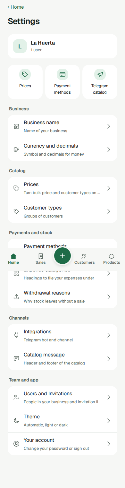
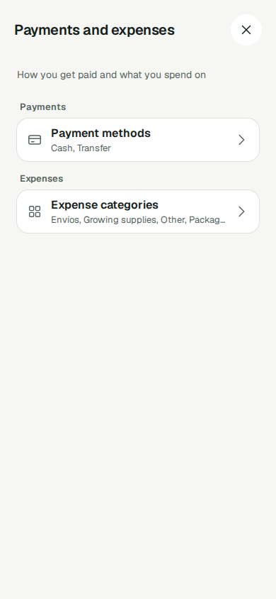
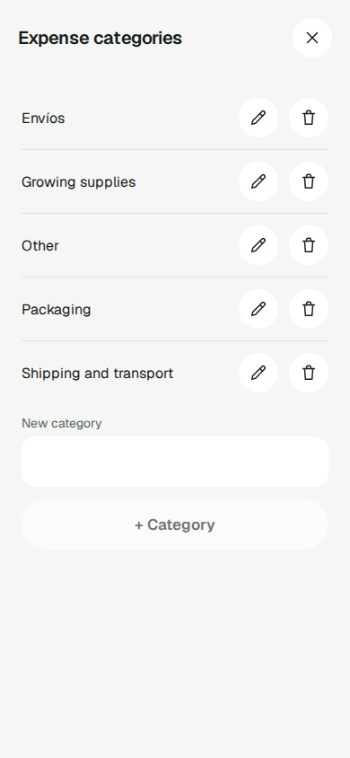

## Jobs

**Cuando** necesito cambiar cómo está configurado mi negocio (renombrarlo, sumar un socio, conectar o cambiar el bot de Telegram, editar el **Catalog header and footer**, manejar mis **Expense category**s y mis **Payment method**s, pasar a oscuro, cambiar mi contraseña o cerrar sesión), **quiero** cada configuración de todo el negocio en un solo lugar, cada una en su propia pantalla corta, **para poder** cambiarla en pocos toques desde el celular y volver con el cliente, sin preguntarme qué pantalla la tiene.

- Es el job de Settings de navigation.md. **Settings** es poco frecuente y deliberado, y los jobs diarios nunca lo necesitan. Las configuraciones de un solo Product viven en su página y quedan fuera de este job.

**Cuando** cambia algo de cómo manejo mi negocio (un precio, una forma en que me pagan, el bot de Telegram, quién trabaja conmigo) y solo tengo el celular, **quiero** abrir Settings, ver que estoy en el negocio correcto y llegar a esa configuración en un toque, **para poder** cambiarla y volver a vender.

- Afina el job de arriba para la pantalla de inicio de Settings en el celular (parte 3 de GH-843). No es un job nuevo de producto. Su protagonista es quien vende, con el celular en la mano y poco tiempo (BRIEF).
- Casi siempre se entra por una de unas pocas configuraciones frecuentes. Las demás se visitan poco, y se buscan por tema en vez de recordarlas de memoria.
- Antes: el celular mostraba una sola lista plana. No se veía qué Business se estaba editando, no había atajos a las configuraciones que más cambian, y los Payment methods quedaban a 3 toques de una pantalla principal (avatar → Payments and expenses → Payment methods). Quien vendía recorría la lista buscando la fila.

**Cuando** necesito cambiar cómo funciona mi negocio (una regla de precio, un **Payment method**, el bot de Telegram) y estoy en el celular con poco tiempo, **quiero** ver cada configuración que aplica a mi negocio, agrupada por lo que hace, con las más usadas a un toque arriba de todo, **para poder** llegar a la pantalla correcta sin buscar.

- Afina el job de Settings de navigation.md ("cada configuración de todo el negocio en un solo lugar"); no es un job nuevo de producto. Su protagonista es quien vende, en el celular, en un momento poco frecuente y deliberado.
- Lo sirve la lista de inicio de Settings del celular (GH-843), construida como componente en #999 y conectada por #927 (parte 3 de GH-843) dentro de la pantalla de inicio de Settings del celular.

**Cuando** abro Settings en el celular para ver cómo está configurado mi negocio, **quiero** que cada fila me diga cuántos **Payment method**s y cuántas **Expense category**s tengo, y que la lista de Expense categories muestre solo lo que ya configuré hasta que elija agregar una, **para poder** revisar mi configuración de un vistazo y agregar una Expense category en un toque cuando la necesito.

- Pasada de detalle de Settings contra los dibujos aprobados (GH-1069, parte 2 de 2). Lo sirven el grupo Expense categories con un solo botón "+ Category" y los conteos de las filas de Payments and expenses.
- Antes: quien vendía pasaba por un campo "New category" vacío y siempre abierto, con un "+ Category" desactivado debajo, y para saber cuántos medios o categorías tenía abría cada grupo. No se pierde plata: el costo es desorden y toques de más.

**Cuando** entro a Settings para cambiar cómo funciona mi negocio, **quiero** encontrar cada configuración en un solo lugar, la lista de Settings, y que cada camino que me nombran la app o los docs coincida con lo que toco, **para** llegar rápido y no preguntarme si dos links llevan a dos cosas distintas.

- Afina el job de Settings de navigation.md; no es un job nuevo de producto (GH-1068, pasada de detalle 1/2). Antes, Currency and decimals y Withdrawal reasons también se abrían desde la página Business, y Customer types desde Prices; el texto nombraba caminos que pasaban por esas páginas.

# Settings

**Settings** es el único lugar que reúne cada configuración de todo el **Business**. Cada configuración vive en su propia pantalla, y sus filas, sus atajos y sus direcciones salen de un solo registro tipado, `web/src/screens/settings/settingsRows.ts`. Ninguna pantalla declara una etiqueta, una segunda línea, un ícono ni una dirección propia (ADR [20261119-settings-rows-live-in-one-registry-read-by-the-list-the-shortcuts-and-the-search](../adr/20261119-settings-rows-live-in-one-registry-read-by-the-list-the-shortcuts-and-the-search.md)). Desde dónde se llega a Settings y el marco de cada pantalla se definen en navigation.md. Lo que hace cada grupo se define en el archivo de su capacidad: pricing-settings.md, payment-methods.md, catalog.md, accounts.md, theme-choice.md, money.md y stored-language.md.

`Settings.tsx` elige la vista según `useViewport()`: en una computadora (900 px o más) muestra `SettingsComputer`, la lista de siempre movida tal cual, con los mismos `GROUPS`, `data-menu`, `ajustes__*` y texto, sin ningún cambio (**Phone first**). En el celular muestra `SettingsHome`, la pantalla de inicio que define esta capacidad.

## Criterios de éxito

1. **Cada configuración a un toque.** En el celular, cada fila que muestra el registro se abre en 1 toque desde la pantalla de inicio de Settings, y su pantalla vuelve a esa pantalla de inicio. Lo prueba un recorrido de vitest con la tabla de rutas real.
2. **Lo frecuente, en la primera pantalla.** Los tres atajos quedan enteros en la primera pantalla, sin scroll, a 320, 375 y 430 px, en claro y en oscuro. Desde la pantalla de inicio de Settings, los Payment methods quedan a 1 toque; desde un Tab root, a 2 (el avatar y el atajo). Antes eran 3.
3. **Nada cortado, todo tocable.** A 320 px no hay nada recortado ni superpuesto. El nombre del Business y las segundas líneas terminan en puntos suspensivos sin partirse. La etiqueta de un atajo ocupa como máximo dos líneas y nunca se corta. Cada fila y cada atajo mide al menos 44 px y tiene un estado presionado.
4. **Se sabe en qué negocio se está.** El nombre del Business se ve sin tocar nada. Mientras la lectura no llegó, o si falló, no se muestra ninguna cantidad de Users, ni equivocada ni rota: el lugar queda vacío.
5. **La computadora no cambia.** El marcado, los localizadores (`data-menu`, `ajustes__*`) y el texto de Settings en la computadora quedan byte por byte iguales, en `SettingsComputer`. Los tests de Settings de siempre corren contra la vista de computadora; la captura de ConfiguracionCompu antes y después llega con #994.

### Criterios de éxito de un solo camino (GH-1068)

1. **Las páginas de grupo, como el dibujo.** La página Business muestra solo el campo del nombre del Business y su guardado. La página Prices muestra solo los dos interruptores, sus líneas de ayuda, la línea de las Sales pasadas y Save, en el celular y en la computadora (ConfiguracionNegocio, ConfiguracionNegocioCompu, ConfiguracionPrecios, ConfiguracionPreciosCompu).
2. **Cada pantalla, desde su propia fila.** Currency and decimals, Withdrawal reasons y Customer types se siguen abriendo desde su propia fila de Settings. "‹ Settings" y Close devuelven a Settings, nunca a una página que no se abrió.
3. **El camino nombrado es el que se toca.** Ningún texto de la app ni ningún doc de producto nombra "Settings → Business → Currency and decimals", "Settings → Business → Withdrawal reasons" ni "Settings → Prices → Customer types".

## Un solo registro

Las filas de Settings, sus tres shortcuts y la búsqueda futura salen de un único registro tipado, `web/src/screens/settings/settingsRows.ts` (ADR [20261119-settings-rows-live-in-one-registry-read-by-the-list-the-shortcuts-and-the-search](../adr/20261119-settings-rows-live-in-one-registry-read-by-the-list-the-shortcuts-and-the-search.md)):

- Las etiquetas, las segundas líneas, los íconos, las direcciones y las etiquetas de los shortcuts viven solo ahí; el texto, en el Copy module bajo `settings:*`, en inglés.
- Cada fila tiene su `key`, su `to` y su `isShown(ctx)`. La fila Customer types se muestra solo mientras el interruptor de Customer types está activado (nunca con el interruptor desactivado o sin conocer). La fila de idioma se muestra solo cuando hay dos o más idiomas, y abre la misma pantalla que la fila del nombre del Business (`SETTINGS_BUSINESS`).
- Los shortcuts son exactamente tres (`prices`, `paymentMethods`, `integrations`), cada uno referencia una fila por su clave y toma el destino con `shortcutTarget`, sin dirección propia. Su etiqueta es `settings:shortcuts.<fila>` y su nombre accesible es esa misma etiqueta visible: hoy "Prices", "Payment methods" y "Telegram catalog" (este último abre Integrations). Los tres destinos también son filas, así que nada se alcanza solo desde la tira.
- Los grupos son cinco, en el orden de `SETTINGS_GROUPS`; el título de cada uno sale de `SETTINGS_GROUP_LABEL_KEYS` (`settings:groups.<grupo>`, cada clave escrita literal).
- `shownRowsByGroup(ctx, rows)` es la función pura que da los grupos en el orden de `SETTINGS_GROUPS`, cada uno con sus filas que `isShown(ctx)` deja pasar, en el orden del registro; un grupo sin ninguna fila a la vista queda afuera.
- No se agrega, mueve ni redirige ninguna dirección del front.
- La búsqueda por etiqueta de fila tiene su función pura, `searchSettingsRows`, y su estado en una marca del historial, no en un Sheet (ADR [20261123-settings-search-is-a-history-entry-flag-not-a-sheet](../adr/20261123-settings-search-is-a-history-entry-flag-not-a-sheet.md)); ninguna pantalla las usa todavía.
- **Un solo camino a cada pantalla (GH-1068).** La pantalla de una fila se abre solo desde esa fila (o desde su atajo). La página de un grupo no repite como link otra fila del registro: la página Business no lleva links a Currency and decimals ni a Withdrawal reasons, y la página Prices no lleva link a Customer types. Así no queda ninguna pantalla inalcanzable, porque cada una tiene su fila: `currency` (grupo Business), `withdrawalReasons` (grupo Payments and stock) y `customerTypes` (con la misma condición de antes, Customer types guardado como activado).

## La lista de inicio (celular)

El componente `SettingsNav` (`web/src/screens/settings/SettingsNav.tsx`) dibuja la lista a partir del registro, y de nada más, con el contexto (`ctx`) que recibe como prop obligatoria, sin valor por defecto. No hace ninguna lectura propia: lo usa `SettingsHome`, que le pasa el contexto como valores simples. Ya no figura en `web/scripts/docs/front-exclude.json` (D-62e6dc23).

**Shortcuts**
- Primero, antes de cualquier grupo: una tira de tres celdas iguales, sin título propio. La tira siempre lee el registro completo, sean cuales sean las filas que reciban los grupos.
- Cada celda es un solo `InAppLink` al destino de su fila, con el estado `{enteredFrom: 'settings'}`, así la pantalla que abre sabe volver a Settings.
- Cada celda muestra el ícono del registro en `--acento`, dentro de un recuadro de 36×36 en `--acento-suave`, arriba de su etiqueta centrada de 13 px en `--tinta`. Las tres usan el mismo tinte: ningún color por categoría.
- Las celdas van sobre `--superficie`, con las esquinas de panel y sin borde: el espacio contra `--papel` las separa.
- Cuando una etiqueta se parte en dos líneas a 320 px, las tres celdas conservan la misma altura (tres columnas iguales que se estiran). La etiqueta nunca se corta.
- Sin chevron.

**Grupos y filas**
- Después, los cinco grupos en el orden de `SETTINGS_GROUPS`, cada uno bajo su título: un `h2` real, un nivel debajo del título de la página, de 14 px en `--tinta2` (estilo de título de sección, no de título de página).
- Un grupo sin ninguna fila a la vista no dibuja ni su título ni su tarjeta.
- Las filas de un grupo van en una sola tarjeta `--superficie` con esquinas de panel, con separadores finos `--linea` entre filas y ninguno después de la última.
- Cada fila es un solo `InAppLink` a su `to`, con el estado `{enteredFrom: 'settings'}`: el ícono del registro en `--tinta2`, sin recuadro; su etiqueta en `--tinta`, sin el peso 600 del dibujo; y una segunda línea de 13 px en `--tinta2`. La segunda línea nunca se parte: termina en puntos suspensivos y nunca agranda la fila (su bloque de texto tiene `min-width: 0; flex: 1`).
- Cada fila termina con un chevron decorativo (`aria-hidden`), fuera del nombre accesible, que queda en su lugar aunque la segunda línea sea larga. El nombre accesible de una fila es su etiqueta más su segunda línea.
- Las filas se identifican por su `key`, nunca por su dirección, porque la fila del nombre del Business y la de idioma comparten la misma.

**Toque y tema**
- Cada fila y cada shortcut mide al menos `--alto-tocable` (44 px) de alto. Al tocarlo responde a la vista (`:active`, con fondo `--papel`), y un toque nunca selecciona texto ni hace zoom (`user-select: none`, `touch-action: manipulation`). No hay nada que dependa solo del hover, y el foco visible es el de las filas de Settings existentes.
- Estilos bajo la raíz de clases `ajustes-inicio__*` en `styles/app.css`, solo con tokens de diseño, sin ningún valor hex ni `rgb()`, en claro y en oscuro.

**Precedencia.** Ningún dibujo aprobado cubre los shortcuts, los títulos de grupo ni las filas: las elecciones visuales de arriba aplican el diseño escrito de GH-843, y la estructura de un solo nivel del ADR del registro gana sobre los dos niveles de `Configuracion.dc.html`. Las cuatro decisiones de dibujo de GH-843 ganan sobre cualquiera de esas elecciones que contradigan. Al conectar la lista, #927 dejó lo que el dibujo resolvía de otra forma como quedó construido: el ícono de la fila sin recuadro ni tono propio (solo tokens), las celdas de los atajos sin borde, la etiqueta de la fila sin peso 600 y la fila con 44 px como mínimo, sin la altura dibujada de 60 px. Son diferencias de forma que no cambian lo que quien vende lee o hace (**Drawing as guide**).

**Assume nothing.** La lista no fija nada de la forma de trabajar de un Business: cada etiqueta, ícono y dirección sale del registro, y lo que se muestra depende solo de `isShown(ctx)`.

## Criterios de éxito de la lista

1. **Los shortcuts primero, a un toque.** Los tres shortcuts del registro van antes que cualquier grupo; cada uno abre su pantalla con un toque y lleva `enteredFrom: 'settings'`. Sus nombres y destinos son los del registro.
2. **Cinco grupos, en orden.** Los cinco títulos aparecen en el orden de `SETTINGS_GROUPS`, y un grupo sin filas a la vista no muestra el suyo.
3. **Solo lo que aplica.** Con Customer types activado: 12 filas con un idioma y 13 con dos (aparece la fila de idioma). Con Customer types desactivado o sin conocer, su fila no está.
4. **Cada fila se lee en una línea y se toca con el pulgar.** Una segunda línea larga termina en puntos suspensivos, nunca se parte ni agranda la fila; filas y shortcuts miden al menos 44 px, responden al toque y se leen bien en claro y en oscuro.
5. **Una sola fuente.** Ningún texto, ícono ni dirección de la lista se declara fuera de `settingsRows.ts`; ningún valor hex en el componente ni en su CSS; ninguna dirección del front nueva o cambiada.
6. **Conectada solo en el celular.** `SettingsHome` la conecta; la Settings de computadora no cambia.

Métrica: la cumplen los tests de Testing Library de los criterios 1 a 3: orden de títulos y tira, conteos de filas por contexto, nombres y destinos de los shortcuts, `enteredFrom: 'settings'` en cada link y grupo vacío sin título. Los cubren `SettingsHomeList.test.tsx` y `settingsRows.test.ts`. La medida del job para quien vende (llegar a la pantalla correcta sin buscar) la toman `SettingsHome.test.tsx` y `tapBudget.spec.ts`.

## Criterios de éxito de los grupos Expense categories y Payments and expenses (GH-1069)

1. **Un solo "+ Category".** En Settings, el grupo Expense categories muestra la lista y un solo botón "+ Category", y ningún campo "New category" hasta tocarlo. Tocarlo abre el campo con el foco; un agregado guardado lo cierra y devuelve el foco al botón; un campo abierto con texto pregunta "Discard the category?" antes de salir.
2. **Conteos que nunca mienten.** La fila "Payment methods" muestra la cantidad de medios ofrecidos y la fila "Expense categories" la cantidad de Expense categories del Business, cada una antes del chevron y solo después de que respondió con éxito su propia lectura. Sin categorías, "0". Nunca se muestra una cifra equivocada ni durante una lectura pendiente o fallida.
3. **Como el dibujo.** ConfiguracionCategorias, ConfiguracionCategoriasCompu y ConfiguracionCobros no le dejan al dueño nada para leer o hacer distinto del dibujo, en claro y en oscuro (**Drawing as guide**), con las Design captures de evidencia; no es una comparación de píxeles.
4. **Nada más cambia.** Renombrar y eliminar funcionan como antes, el paso de categorías del Onboarding se comporta igual y no se agrega ningún pedido a la API.

## Comportamiento

### Pantalla de inicio de Settings (celular)

Solo por debajo de 900 px. `SettingsHome` (`web/src/screens/settings/SettingsHome.tsx`) va dentro de `ContentArea`, con el marco de Tab root que define navigation.md. De arriba abajo:

1. el título "Settings" (`settings:home.title`), un `h1` de 26 px y peso 600;
2. la tarjeta del Business;
3. los tres atajos;
4. los cinco grupos en el orden de `SETTINGS_GROUPS`, cada uno con su encabezado y sus filas visibles.

La pantalla hace las dos lecturas de las que dependen las filas condicionales, `/business` y `/pricing-settings`, y se las pasa a `SettingsNav` como contexto: `selectableLanguages` sale de `/business` e `isCustomerTypesOn` del interruptor de Customer types. Cada valor queda sin definir mientras su lectura está pendiente o si falló, así que una fila condicional nunca aparece antes de tiempo. El contenido queda marcado ocupado (`aria-busy`) mientras cualquiera de las dos lecturas está pendiente.

No hay campo de búsqueda: puede ser una parte posterior. Los estilos de la pantalla usan sus propias raíces de clases, `ajustes-inicio__*` para el marco y el título y `ajustes-inicio-tarjeta__*` para la tarjeta, y solo tokens de diseño.

### Tarjeta del Business

- Muestra:
  - la inicial, en un recuadro de 44 px con el tinte suave del acento: el primer carácter del nombre sin espacios al inicio ni al final, así que un emoji cuenta como uno solo (`Array.from(name.trim())[0]`);
  - el nombre del Business, en una sola línea que termina en puntos suspensivos cuando no entra;
  - la cantidad de Users, "1 user" o "N users" (`settings:card.users`).
- La cantidad sale de la misma lectura de `/business` que usa el grupo Users y que alimenta los idiomas seleccionables, compartida por `businessQueryOptions()` en `web/src/api/business.ts`, así que la tarjeta y el grupo Users nunca muestran cantidades distintas. No agrega ninguna ruta de API.
- El lugar de la cantidad tiene una altura fija (20 px), así que nada se corre cuando se llena.
- Mientras la lectura está pendiente, la cantidad queda vacía y el contenido se marca ocupado (`aria-busy`). Si la lectura falla, la cantidad queda vacía y no se muestra ningún error.
- Es de solo lectura: no tiene link, botón ni chevron. Para entrar a esas pantallas están las filas Business y Users.
- No muestra ningún rol, porque los roles dentro de un Business quedan fuera de alcance (BRIEF).

### Atajos

- Son los tres que declara `SHORTCUTS` en el registro, en este orden: Prices, Payment methods e Integrations, que se lee "Telegram catalog". Cada uno abre la pantalla de su fila.
- Se eligieron por el job (un precio, una forma de cobrar, el bot de Telegram). Customer types es opcional y viene desactivado en un Business nuevo, y Users y Appearance cambian poco, así que ninguno de ellos es atajo.
- La etiqueta puede ocupar hasta dos líneas y nunca se corta con puntos suspensivos. Cada tile mide al menos 44 px de alto y los tres tienen la misma altura.

### Grupos y filas

- Hay cinco encabezados, en el orden del registro: Business, Catalog, Payments and stock, Channels, Team and app.
- Cada fila visible es un solo link con un ícono, una etiqueta, una segunda línea y un chevron decorativo. La segunda línea no se parte: termina en puntos suspensivos, y su bloque de texto tiene `min-width: 0`.
- Language se muestra solo cuando el Business tiene 2 o más idiomas seleccionables. Customer types se muestra solo con ese interruptor activado. Ninguna de las dos aparece antes de que se conozcan sus datos, ni si su lectura falló. Hay 11 filas con las dos ocultas, 12 con una sola visible y 13 con las dos.
- Cada fila y cada atajo es un `InAppLink` a la dirección de su fila, con el estado `{enteredFrom: 'settings'}`.
- Cada fila y cada atajo mide al menos 44 px y tiene un estado `:active`.

### Grupo Payments and expenses: conteos (GH-1069)

El grupo Payments and expenses (`PaymentsGroup.tsx`, dibujo `ConfiguracionCobros.dc.html`) tiene dos filas, "Payment methods" y "Expense categories". Cada una muestra un conteo a su derecha, antes del chevron, como en el dibujo ("3", "5"):

- "Payment methods" cuenta los Payment methods que el Business ofrece ahora (sin archivar): la misma lista que une su segunda línea.
- "Expense categories" cuenta las Expense categories del Business. Sin ninguna, muestra "0" y ninguna segunda línea.
- Cada fila toma su lista solo cuando su propia lectura respondió con éxito (`isSuccess`), y la segunda línea y el conteo salen de esa misma lista, así que nunca se contradicen. Mientras una lectura está pendiente, o después de que falló (también cuando falla una relectura después de una primera respuesta buena), esa fila no tiene ni conteo ni segunda línea; la otra fila sigue mostrando los suyos. El contenido queda `aria-busy` mientras alguna lectura está pendiente, como antes (`useLoading`). No hay reintento: se cierra el grupo y se vuelve a abrir.
- El conteo es un número solo, sin palabra de unidad: la etiqueta de la fila ya nombra lo que se cuenta. Es un `span.ajustes__item-cuenta` dentro de `ajustes__item-flecha`, antes del chevron, en **Tabular figures** (`cifra-n`), de 13 px en `--tinta2` (el mismo token y tamaño que la segunda línea construida), solo con tokens de diseño, en claro y en oscuro. El dibujo lo pone en 14 px; la diferencia no cambia lo que quien vende lee o hace (**Drawing as guide**).
- El conteo no está oculto a la tecnología de asistencia: es parte del texto del link, así que el nombre accesible de la fila empieza por su etiqueta y termina con el conteo.
- Los dos conteos salen de las lecturas que `PaymentsGroup.tsx` ya hace (`GET /api/payment-methods` y `GET /api/expense-categories`): no se agrega ningún pedido a la API. Después de agregar una Expense category, el editor invalida la misma lectura, así que el conteo está al día al volver al grupo.
- En el celular el grupo sigue siendo un grupo con "Close" (decisión 21), no la página con "‹ Ajustes" del dibujo: diferencia aceptada por el dueño (abajo).

### Grupo Expense categories (GH-1069)

En Settings, el grupo Expense categories (`ExpenseCategoriesGroup.tsx`, dibujos `ConfiguracionCategorias.dc.html` y `ConfiguracionCategoriasCompu.dc.html`) dibuja `ExpenseCategoriesEditor`, que desde GH-1069 tiene un solo modo, el mismo en Settings y en el paso de categorías del Onboarding (`web/src/screens/onboarding/CategoriesStep.tsx`):

- Muestra la lista de Expense categories y un solo botón "+ Category" (el ícono de agregar con `COMMON_TEXT.category`), habilitado. El campo "New category" no se ve hasta tocarlo, y no hay ningún botón desactivado.
- Tocar "+ Category" abre el campo con el foco en él. Un agregado guardado limpia el nombre, cierra el campo, devuelve el foco al botón y muestra el aviso de guardado. Un agregado rechazado deja el campo abierto con su texto y el error en línea, o el aviso sin conexión.
- No hay ningún control para plegar el campo sin guardar: un campo vacío nunca bloquea "Close", y uno con texto (o un renombre sin guardar) pregunta "Discard the category?" antes de salir, como en el dibujo.
- La prop `addCollapsed` ya no existe. La línea "Adding, renaming or removing a category saves right away." (`CATEGORIES_SAVE_AT_ONCE`) es ahora la prop opcional `footnote` del llamador, que se dibuja debajo del control de agregar una vez cargada la lista: el Onboarding la pasa, porque su dibujo la tiene, y Settings no pasa ninguna, porque sus dibujos no la tienen. Cada agregado, renombre o eliminación ya muestra su resultado al hacerse.
- Renombrar y eliminar quedan como estaban, solo con ícono, como lo permite la **Icon and text rule**, igual que el aviso de una categoría con Expenses que no se puede eliminar.
- El contenido del grupo va dentro de su propio envoltorio, `.categorias-grupo`, que solo sirve para aplicar `touch-action: manipulation` a sus botones y al "Close" del encabezado del grupo, sin cambiar la disposición y nunca sobre el editor mismo, así que el paso del Onboarding no cambia. Las entradas de `touch-action` de ConfiguracionCategorias, ConfiguracionCategoriaRenombrar y ConfiguracionCategoriaConfirmarBorrado salieron de la lista de infractores: la lista solo se achicó.
- El Mobile check recorre también el estado `ConfiguracionCategoriaNueva`, con el campo de agregar abierto después de tocar "+ Category", sin que crezca ninguna lista de infractores, tolerancia ni control.
- Los localizadores de vitest y e2e que encontraban el campo siempre visible tocan primero "+ Category"; el campo nunca se vuelve a poner, ni visible ni oculto, para satisfacer un localizador (D-69509906).

### Las páginas Business y Prices (GH-1068)

Las dos páginas siguen sus dibujos aprobados, en el celular y en la computadora (la lista lateral de la computadora lee el mismo registro):

- **Business** (ConfiguracionNegocio, ConfiguracionNegocioCompu): solo el campo del nombre del Business y su guardado. Ya no lleva las filas link "Currency and decimals" ni "Withdrawal reasons"; las dos pantallas se abren desde sus filas `currency` (grupo Business) y `withdrawalReasons` (grupo Payments and stock), cuyas rutas ya tienen a Settings como padre. El control de idioma, que se muestra solo con 2 o más Selectable languages (ninguno antes de #317), no cambia.
- **Prices** (ConfiguracionPrecios, ConfiguracionPreciosCompu): solo los dos interruptores, sus líneas de ayuda, la línea de las Sales pasadas y Save. Ya no lleva la fila link "Customer types ›"; la lista se abre desde la fila `customerTypes`, que se muestra con la misma condición que tenía el link (Customer types guardado como activado). Con Customer types desactivado, Prices no muestra ningún link y la fila sigue oculta, igual que antes. El detalle de Prices está en pricing-settings.md.
- El texto que le indica un camino a quien vende nombra la fila de Settings: el estado vacío del Selector de motivos (`emptyStates:selectorNoReasons`) dice "No reasons yet. Add them in Settings → Withdrawal reasons.".
- Ningún localizador e2e ni de vitest usa los links quitados, y ninguno vuelve, ni visible ni oculto (D-69509906).

### Volver a Settings

- Cada pantalla que se abre desde una fila o un atajo vuelve a la pantalla de inicio de Settings. El control depende del tipo de pantalla en el celular:
  - una pantalla de tipo tarjeta (Payment methods, por ejemplo) muestra "‹ Settings";
  - una pantalla de tipo formulario (Prices, Integrations, el nombre del Business, Users, Account y otras) muestra "Close", que vuelve por el historial y cae en el mismo lugar.
- `ENTRY_PARENTS` en `web/src/routes.ts` hace que Payment methods y Expense categories nombren a Settings como su origen cuando se abren con `enteredFrom: 'settings'`. Solo un link con ese estado lo activa, así que las etiquetas de vuelta de la computadora no cambian.
- Customer types (`settings-customer-types`) tiene a Settings como padre en `web/src/routes.ts` y en `scripts/design/screens.json` desde GH-1068 (antes era Prices), y ya no tiene entrada en `ENTRY_PARENTS`. "‹ Settings" y Close sin historial caen en Settings, se llegue desde la fila o tipeando la dirección. La dirección `/settings/prices/customer-types` se conserva tal cual y no redirige, así que un marcador guardado la sigue abriendo.

### Texto e idioma

Todo el texto está en inglés, en el **Copy module**, bajo `settings:*`. No sale ningún texto en español de un dibujo.

### Diferencias con el dibujo aceptadas por el dueño

El dibujo es `Configuracion.dc.html` y su gemelo oscuro. Las cuatro diferencias se aceptaron en GH-843, decisión 1 del humano:

1. Hay tres atajos entre la tarjeta y los grupos, y el dibujo no tiene ninguno.
2. La tarjeta es de solo lectura y no muestra rol. En el dibujo es un link con chevron y dice "Vos sos dueño · 2 personas".
3. No hay campo de búsqueda, aunque el dibujo trae uno.
4. Las nueve filas sin encabezados del dibujo se reemplazan por los cinco grupos con encabezado del registro. Varias de esas filas del dibujo no tienen ninguna capacidad detrás.

Además, por **Drawing as guide** y sin cambiar lo que quien vende lee o hace: el título mide 26 px en vez de 28, y la inicial va en el tinte suave del acento con texto en el color del acento, en vez del acento sólido con texto blanco.

En GH-1069 (decisión 1 del humano, 2026-11-26) el dueño aceptó otras cuatro diferencias, que quedan como están construidas:

1. Integrations (`ConfiguracionIntegraciones.dc.html`) conserva "Find my chat" (**Own chat lookup**) y su **More info** "i" junto a "Your chat".
2. Integrations conserva "Enter the token first" debajo del "Find my chat" desactivado, el motivo visible de que esté desactivado.
3. Integrations conserva el link "Go to the catalog" al pie, la única entrada a la pantalla del Catalog además de la línea "Out of date" de Home (#848).
4. En el celular, Payments and expenses (`ConfiguracionCobros.dc.html`) se abre como un grupo con "Close" (decisión 21), no como la página con "‹ Ajustes" del dibujo.

## Métricas

- Toques desde la pantalla de inicio de Settings hasta la pantalla de cualquier fila: 1, para cada fila del registro, según el recorrido de vitest con la tabla de rutas real (`SettingsHome.test.tsx`, con las dos filas condicionales visibles).
- Toques desde un Tab root del celular hasta la pantalla de cada atajo: 2 (antes eran 3 para los Payment methods), según `tapBudget.spec.ts` y `paymentMethods.spec.ts`.
- Atajos enteros en la primera pantalla, sin scroll, a 320, 375 y 430 px: 3 de 3, según el e2e del proyecto de celular y la Design capture (#994).
- Objetivos táctiles de la pantalla de inicio de Settings por debajo de 44 px: 0, según el Mobile check, sin que crezca ninguna lista de infractores.
- Cantidades de Users equivocadas o rotas mostradas durante una lectura pendiente o fallida: 0, según los tests de Testing Library.
- Cambios en la Settings de computadora: 0, según los tests de Settings existentes contra la vista de computadora y la captura de ConfiguracionCompu antes y después (#994).
- Grupo Expense categories de Settings con el campo "New category" visible antes de tocar "+ Category": 0, según los tests de `ExpenseCategoriesGroup` y `ExpenseCategoriesEditor` y el e2e de Settings (GH-1069).
- Toques desde el grupo Expense categories hasta el campo de agregar abierto y con foco: 1 (GH-1069).
- Conteos mostrados en las filas de Payments and expenses durante una lectura pendiente o fallida (una relectura fallida incluida), o distintos del largo de su lista: 0, según `PaymentsGroup.test.tsx` (GH-1069).
- Pedidos a la API agregados por `PaymentsGroup`: 0 (GH-1069).
- Infracciones del Mobile check en el estado `ConfiguracionCategoriaNueva`: 0, sin ampliar ninguna lista de infractores, tolerancia ni control; la lista de `touch-action` solo se achicó (GH-1069).
- Design captures adjuntas de ConfiguracionCategorias, ConfiguracionCategoriasCompu y ConfiguracionCobros, en celular de 375 px y computadora, claro y oscuro: todas (GH-1069).

- Filas link que repiten otra fila del registro en las páginas Business y Prices: 0 (antes 3), según los tests de BusinessGroup y PricingGroup (GH-1068).
- Toques desde un Tab root hasta la lista de Customer types con el interruptor ya activado: 2 (antes 3, pasando por Prices); en un Business nuevo, 4 hasta la lista y 7 para crear un tipo, sin contar encender el interruptor ni guardarlo (decisión 1 del humano en GH-1068). "‹ Settings" o Close desde la lista cae en Settings en el 100 % de los casos, se llegue desde la fila o por la dirección, según el test de rutas (padre `settings`), `SettingsNavigation.test.tsx` y `customerTypes.spec.ts` (GH-1068).
- Caminos nombrados en el Copy module o en `docs/product/` que pasan por "Settings → Business →" hacia Currency and decimals o Withdrawal reasons, o por "Settings → Prices → Customer types": 0 (GH-1068).
